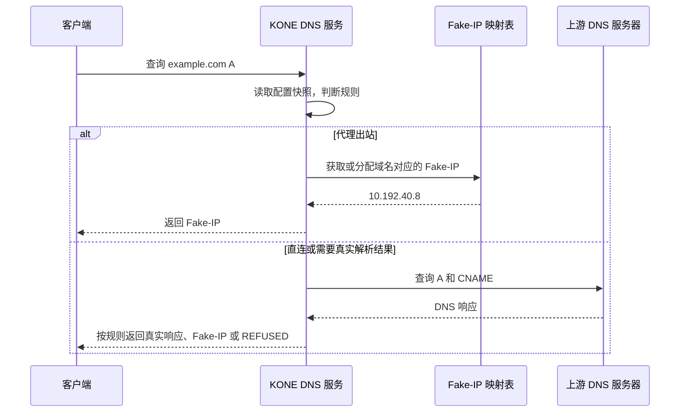
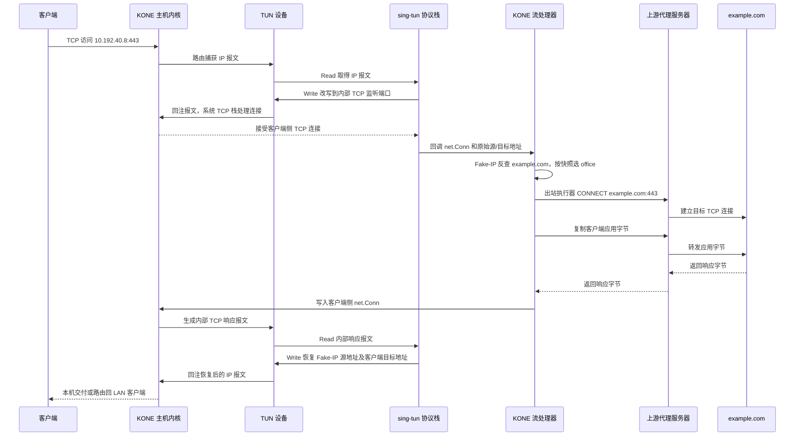
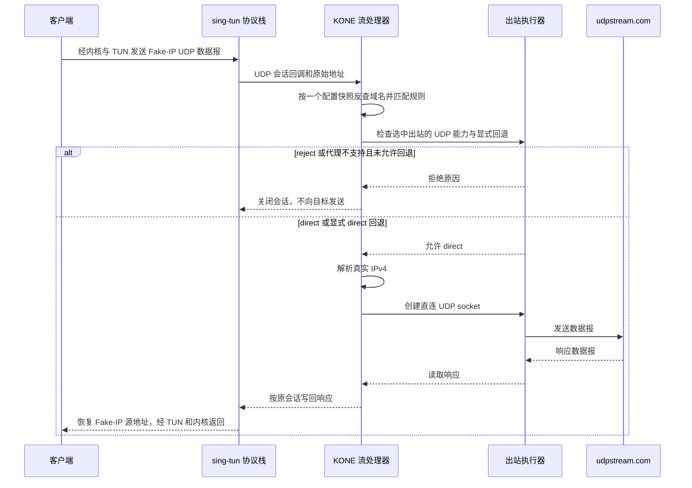

# KONE 技术原理与核心流量链路

KONE 把进入 TUN 的 IP 报文交给 sing-tun，将得到的 TCP 连接或 UDP 会话按规则转发。先由**内核路由选择入口**，再由 **KONE 规则选择出站**；只有进入 TUN 的流量才受 KONE 管理。客户端既可以是本机应用，也可以是 LAN 设备。

## 1. 各层负责什么

| 层次 / 组件 | 职责 |
| --- | --- |
| KONE 主机内核 | 按路由把报文送往 TUN；处理 system/mixed 的客户端侧 TCP 状态；把回注报文送回本机应用或 LAN |
| TUN 设备 | 用户态读取发往虚拟接口的 IP 报文；写入的 IP 报文作为接收流量回注内核。Linux TUN、macOS utun、Windows Wintun 是平台实现 |
| sing-tun 协议栈 | 处理报文、透明 TCP 会话映射和 UDP 会话，调用 KONE 流处理器，恢复响应地址 |
| KONE DNS 服务 / Fake-IP 映射表 | 保存域名与虚拟 IPv4 的关联；按规则返回 Fake-IP、真实 DNS 响应或 REFUSED |
| KONE 流处理器 | 从 Fake-IP 恢复域名，读取配置快照，选择出站及 UDP 策略，管理连接生命周期 |
| 出站执行器 | 按出站能力创建连接；内置 direct/reject，具名代理使用 HTTP/HTTPS CONNECT 或 SOCKS5 TCP |
| 上游代理服务器 / 目标服务 | 代理服务器执行代理协议并连接目标；目标服务处理客户端应用请求 |

这些组件中，DNS 服务、sing-tun 协议栈、流处理器、出站执行器都在同一 KONE 进程中；时序图生命线表示职责，不一定表示独立进程。

`core.stack = "system"` 使用系统 TCP 和 sing-tun UDP；`mixed` 使用系统 TCP 和 gVisor netstack UDP，需要 `-tags with_gvisor`。这里只使用 gVisor 的 Go 网络栈，不运行容器或沙箱。更换协议栈不会增加代理协议能力或自动启用 IPv6。

旧的自建报文分发器、NAT、TCP/UDP relay 和 `pkg/tcpip` 已删除。生产入口只沿 [stack.go](../pkg/kone/stack.go) → [flow.go](../pkg/kone/flow.go) → [outbounds.go](../pkg/kone/outbounds.go) 阅读；Fake-IP 地址池和 CIDR 匹配使用 `net/netip`。

## 2. example.com 如何经 Fake-IP 往返

### DNS：建立域名关联

假设规则选择代理 `office`。客户端查询 `example.com` 的 A 记录，KONE 返回示意 Fake-IP `10.192.40.8`。普通 IP 报文没有可靠的域名信息，后续依靠该映射恢复域名。



`[dns]` 可省略：启动前读取一次系统上游 DNS，热更新不重新发现已被 KONE 改写的 DNS。显式 `dns.servers` 可覆盖自动发现。DNS 服务使用自有 UDP socket，未启用 sing-tun 自动 DNS 劫持；LAN 客户端需按部署指南使用 KONE DNS。

Fake-IP 映射与配置快照独立：热更新保留虚拟地址，新流量按最新规则选择出站。TUN 地址及其后继地址留给设备/协议栈，不参与分配；未知或已过期的 Fake-IP 会失败，不能凭地址猜测域名。

### TCP：恢复域名、连接出站、恢复响应地址

以 LAN 客户端 `192.168.10.20:53000` 访问 `10.192.40.8:443` 为例。system/mixed 都由系统 TCP 栈处理握手、确认、重传和流重组；sing-tun 保存原始地址/端口，改写报文到内部监听端口，再把客户端侧 `net.Conn` 和原始元数据交给 KONE。**这个 net.Conn 还没有连接目标服务。**



正确返回依靠两种不同的映射：**Fake-IP 映射表**关联域名和虚拟 IP；**透明 TCP 会话表**由 sing-tun 维护，关联原始与内部改写的地址/端口。系统 TCP 栈负责客户端侧 TCP 状态；KONE 只在客户端侧连接与出站连接之间双向复制应用字节，并保留 TCP 半关闭。

代理路径通常有三段 TCP：客户端到 KONE、KONE 到代理、代理到目标，各自维护 TCP 状态。HTTPS CONNECT 额外加密代理传输；KONE 无需解密应用自己的 TLS。选择 `direct` 时直接连接真实目标，省去代理段，响应恢复过程相同；选择 `reject` 时不建立出站连接。

代码：[DNS](../pkg/kone/dns.go)、[映射表](../pkg/kone/dns_table.go)、[地址池](../pkg/kone/dns_ip_pool.go)、[流处理器](../pkg/kone/flow.go)、[TCP 双向复制](../pkg/kone/copy.go)。

## 3. UDP：先判断规则，再检查出站能力

**代理不支持 UDP 时默认拒绝，不再静默直连。** sing-tun/gVisor 能接收 UDP，只说明入口具备 UDP 会话能力，不代表 HTTP CONNECT 或 SOCKS5 出站实现了 UDP 代理。

| 规则选择 | 当前行为 |
| --- | --- |
| 内置 `direct` | 必要时解析真实 IPv4，再创建直连 UDP socket |
| 内置 `reject` | 拒绝，不解析目标、不创建出站 socket，也不执行回退 |
| 代理，无 `udp-fallback` 或为空 | 当前 HTTP/HTTPS/SOCKS5 实现均仅支持 TCP，拒绝 UDP，结构化日志记录出站名称与原因 |
| 代理，`udp-fallback = "direct"` | 用户明确允许直连，解析真实 IPv4 后通过真实出口发送 UDP；TCP 仍走代理 |
| 代理，`udp-fallback = "reject"` | 明确拒绝 UDP |

可选回退配置属于对应代理，而不是全局隐式行为：

```toml
[[outbounds]]
name = "office"
url = "socks5://127.0.0.1:1080"
# 默认拒绝 UDP；明确需要直连回退时才设置下面一行。
udp-fallback = "direct"
```

回退目标目前只允许内置 `direct` 或 `reject`，不能引用代理、自己或回退链。以后增加支持 UDP 的代理时，应在出站执行器中实现该出站自己的 UDP 关联/协议；具备原生能力时优先使用它，不能继续借直连 socket 代替代理。

例如客户端把发往 `udpstream.com` 的数据报发送到 Fake-IP：



拒绝 UDP 不会把它转换成 TCP，应用是否改用 TCP 由自身协议决定。一次 UDP 会话保留创建时的快照；热更新只改变新会话。会话在取消、I/O 错误或空闲超时后关闭，退出等待读写任务结束。IPv6 接管和 SOCKS5 UDP ASSOCIATE 尚未实现。

## 4. 网关、生命周期与统计边界

Linux/Raspberry Pi 网关保留两种捕获方式：Fake-IP 子网/显式 CIDR 路由，或 `core.auto-route = true` 的两条 IPv4 `/1` 路由。后者保留原默认路由，更具体的系统路由仍优先；进入 TUN 后再按规则选择代理、直连或拒绝。管理员负责 LAN forwarding、DHCP、NAT/防火墙和回程路由，见[网关指南](guides/how-to-use-with-raspberry-pi.md)。

`core.outbound-interface` 把代理传输、直连 TCP/UDP 和上游 DNS 绑定到真实出口，避免再次被全局路由捕获。回环代理和本地 DNS stub 保留回环路径。AAAA 查询可以转发，但设备原有 IPv6 路由可能绕过 KONE，不能当作完整双栈接管。

`Run(ctx)` 统一拥有设备、协议栈、DNS/管理监听和路由：失败逆序回滚，取消或信号退出关闭活动流量、恢复自有网络设置、关闭设备并等待任务结束。不会删除他人设备/路由；强杀和断电无法执行清理。配置快照原子发布，域名规则、代理 URL 与 UDP 回退可以热更新；core、DNS、管理/日志或 CIDR 捕获变化要求重启。详见[运行可靠性](runtime.md)。

管理流量统计目前只由 TCP 流处理器写入，UDP 尚未纳入同一统计。**DNS 记录数量、TCP 连接/字节和 UDP 会话数量是不同指标，不能混用。** 后续若扩展 UDP 观测，应单独记录会话数、收发数据报/字节及原出站/回退出站，避免把 UDP 误标成 TCP 或已代理流量。

CI 在 system/mixed 下使用独立 LAN、网关、上游命名空间，验证全局捕获、Fake-IP/literal TCP、直连 UDP、默认拒绝、显式回退、热更新和路由恢复；另有真实 Windows Wintun 验收和三平台 race。Raspberry Pi 长期吞吐、macOS 特权场景、网络切换与多 VPN 共存仍需部署验收。

## 5. 名词定义

| 名词 | 本文含义 |
| --- | --- |
| 客户端 / LAN 客户端 | 发起应用请求的一端；LAN 客户端位于 KONE 网关后面 |
| KONE 主机 / 网关 | 运行 KONE 的机器；网关负责接收 LAN 转发流量 |
| 内核路由 / 捕获路由 | 内核选择下一跳的规则；捕获路由使指定 IPv4 报文进入 TUN |
| TUN 设备 / 回注 | 内核与用户态交换 IP 报文的虚拟接口；向设备写入表示把报文交回内核接收路径 |
| sing-tun 协议栈 | 把 IP 报文转换为透明 TCP 连接或 UDP 会话回调的组件 |
| 系统 TCP 栈 | 操作系统维护握手、序列号、确认、重传等 TCP 状态的实现 |
| gVisor netstack | mixed 模式用于 UDP 的 Go 网络栈，独立于代理协议 |
| Fake-IP / Fake-IP 映射表 | 关联域名的虚拟 IPv4 / 保存域名与该地址的映射，不等于目标真实地址 |
| 透明 TCP 会话表 | sing-tun 保存的原始与内部地址/端口关系，与域名映射分离 |
| 客户端侧连接 / 出站连接 | 客户端到 KONE 的连接 / KONE 创建的到目标或代理的连接 |
| 配置快照 | 同一版本的配置、规则和出站执行器；一个请求或会话保留其读取的版本 |
| 出站 / 代理出站 | 具名转发策略 / 以 name、url 及可选 udp-fallback 配置的代理 |
| direct / reject | 内置直连 / 内置拒绝目标，无需声明且名称保留 |
| UDP 会话 / UDP 回退出站 | 协议栈跟踪的 UDP 数据报关联 / 代理不支持 UDP 时由用户明确指定的替代策略 |
| KONE DNS 服务 / 上游 DNS 服务器 | 面向客户端提供 Fake-IP 策略的服务 / 真实解析使用的系统或显式 DNS 服务器 |
| 真实出口接口 / 上游代理服务器 / 目标服务 | 承载 KONE 出站的物理接口 / 执行代理协议的远端 / 实际应用服务 |