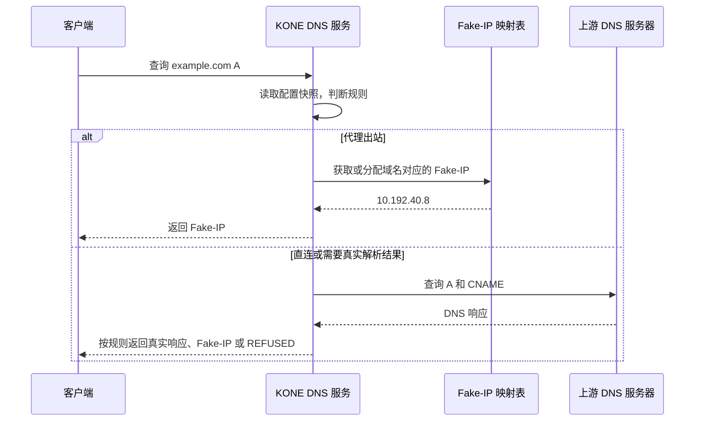
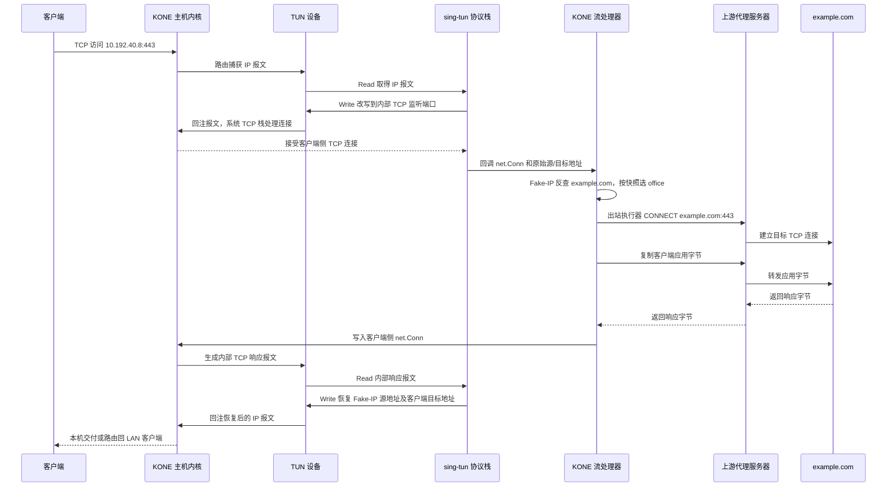
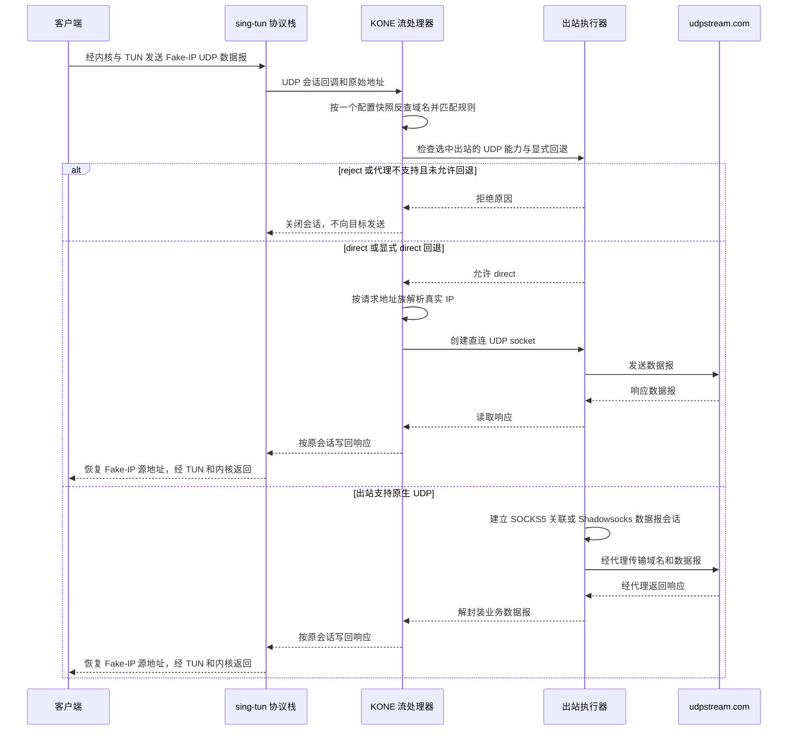

# KONE 技术原理与核心流量链路

KONE 的核心链路是：**客户端 → 内核路由 → TUN → sing-tun → KONE 流处理器 → 出站 → 目标服务**。响应沿对应会话反向返回。先由内核路由决定哪些报文进入 KONE，再由 KONE 规则决定这些流量如何转发；进入 TUN 不等于使用代理。客户端既可以是本机应用，也可以是 LAN 设备。

管理服务与数据面引擎有独立生命周期：无参数启动先打开管理页面，用户明确启用后才创建 TUN 和捕获路由。Windows/macOS 普通权限管理服务通过独立授权的网络助手运行数据面，配置和凭据通过受保护的本机 IPC 传输。

## 1. 各层负责什么

| 层次 / 组件 | 职责 |
| --- | --- |
| 管理服务与前端 | 持久配置、授权、生命周期、诊断与观察 API；前端是根目录 `web/` 构建的离线静态资源，不参与报文转发 |
| KONE 主机内核 | 按路由把报文送往 TUN；处理 system/mixed 的客户端侧 TCP 状态；把回注报文送回本机应用或 LAN |
| TUN 设备 | 用户态读取发往虚拟接口的 IP 报文；写入的 IP 报文作为接收流量回注内核。Linux TUN、macOS utun、Windows Wintun 是平台实现 |
| sing-tun 协议栈 | 处理报文、透明 TCP 会话映射和 UDP 会话，调用 KONE 流处理器，恢复响应地址 |
| KONE DNS 服务 / Fake-IP 映射表 | UDP/TCP 查询、私有域名分流、真实响应缓存与有界历史；按规则返回 Fake-IP、真实响应或 REFUSED，Linux/Windows 可选 IPv6 地址族 |
| KONE 流处理器 | 从 Fake-IP 恢复域名，读取配置快照，选择出站及 UDP 策略，管理连接生命周期 |
| 出站执行器 | 内置 direct/reject；HTTP/HTTPS CONNECT 支持 TCP，SOCKS5 和受支持的 Shadowsocks AEAD 方法支持 TCP/UDP |
| 上游代理服务器 / 目标服务 | 代理服务器执行代理协议并连接目标；目标服务处理客户端应用请求 |

DNS 服务、sing-tun 协议栈、流处理器和出站执行器属于同一数据面引擎；使用网络助手时，它们在助手进程中。时序图生命线表示职责，不一定表示独立进程。管理页面读取引擎的真实快照；助手失联会显示数据不可用，不用空数据冒充正常运行。

`core.stack = "system"` 使用系统 TCP 和 sing-tun UDP；`mixed` 使用系统 TCP 和 gVisor netstack UDP，需要 `-tags with_gvisor`。这里只使用 gVisor 的 Go 网络栈，不运行容器或沙箱。更换协议栈不会增加代理协议能力或自动启用 IPv6。

旧的自建报文分发器、NAT、TCP/UDP relay 和 `pkg/tcpip` 已删除。生产入口只沿 [stack.go](../pkg/kone/stack.go) → [flow.go](../pkg/kone/flow.go) → [outbounds.go](../pkg/kone/outbounds.go) 阅读；Fake-IP 地址池和 CIDR 匹配使用 `net/netip`。

## 2. example.com 如何经 Fake-IP 往返

### DNS：建立域名关联

假设规则选择代理 `office`。客户端查询 `example.com` 的 A 记录，KONE 返回示意 Fake-IP `10.192.40.8`。普通 IP 报文没有可靠的域名信息，后续依靠该映射恢复域名。



`[dns]` 可省略：启动前读取系统解析环境，热更新不重新发现已被 KONE 改写的 DNS。显式 `dns.servers` 可覆盖自动发现，`[[dns.rules]]` 可将私有后缀限定到指定解析器及接口；命中后不会因失败向公共解析器回退。DNS 客户端和服务端支持 UDP/TCP，上游 UDP 响应截断时重试 TCP。

DNS 服务监听与引导系统使用该服务是两件事。受支持的系统 DNS 引导须显式通过预检，并在服务准备好后设置、停机前恢复；不解密应用自己的 DoH/DoT。LAN 客户端仍需按部署指南配置网关和 DNS。平台能力、系统上下文发现限制及配置见 [DNS 配置](configuration.md) 与 [验收记录](acceptance.md)。

Fake-IP 映射与配置快照独立：热更新保留虚拟地址，新流量按最新规则选择出站；活动会话固定其映射，避免地址过早改指其他域名。TUN 地址及其后继地址留给设备/协议栈，不参与分配；未知或已过期的 Fake-IP 会失败，不能凭地址猜测域名。协议/端口规则在 DNS 阶段只建立捕获入口，到业务流到达时再作最终决定。

### TCP：恢复域名、连接出站、恢复响应地址

以 LAN 客户端 `192.168.10.20:53000` 访问 `10.192.40.8:443` 为例。system/mixed 都由系统 TCP 栈处理握手、确认、重传和流重组；sing-tun 保存原始地址/端口，改写报文到内部监听端口，再把客户端侧 `net.Conn` 和原始元数据交给 KONE。**这个 net.Conn 还没有连接目标服务。**



正确返回依靠两种不同的映射：**Fake-IP 映射表**关联域名和虚拟 IP；**透明 TCP 会话表**由 sing-tun 维护，关联原始与内部改写的地址/端口。系统 TCP 栈负责客户端侧 TCP 状态；KONE 只在客户端侧连接与出站连接之间双向复制应用字节，并保留 TCP 半关闭。

代理路径通常有三段 TCP：客户端到 KONE、KONE 到代理、代理到目标，各自维护 TCP 状态。HTTPS CONNECT 额外加密代理传输；KONE 无需解密应用自己的 TLS。选择 `direct` 时直接连接真实目标，省去代理段，响应恢复过程相同；选择 `reject` 时不建立出站连接。

代码：[DNS](../pkg/kone/dns.go)、[映射表](../pkg/kone/dns_table.go)、[地址池](../pkg/kone/dns_ip_pool.go)、[流处理器](../pkg/kone/flow.go)、[TCP 双向复制](../pkg/kone/copy.go)。

## 3. UDP：先判断规则，再检查出站能力

**先匹配规则，再检查选中出站的 UDP 能力；不支持时默认拒绝。** sing-tun/gVisor 接收 UDP，出站执行器负责实际传输，二者不能互相代替。

| 规则选择 | 当前行为 |
| --- | --- |
| 内置 `direct` | 必要时按请求地址族解析真实地址，创建直连 UDP socket |
| 内置 `reject` | 拒绝，不解析目标、不创建出站 socket，也不执行回退 |
| SOCKS5 / Shadowsocks | 使用原生 UDP 关联或加密数据报；保留远端域名解析，不借直连替代 |
| HTTP/HTTPS，无 `udp-fallback` 或为空 | 拒绝 UDP，记录出站名称与不支持的原因 |
| 不支持 UDP 的代理，`udp-fallback = "direct"` | 用户明确允许直连，解析真实地址后通过真实出口发送 UDP |
| 不支持 UDP 的代理，`udp-fallback = "reject"` | 明确拒绝 UDP |

可选回退配置属于对应代理，而不是全局隐式行为：

```toml
[[outbounds]]
name = "office"
url = "http://127.0.0.1:8080"
# 默认拒绝 UDP；明确需要直连回退时才设置下面一行。
udp-fallback = "direct"
```

回退目标只允许内置 `direct` 或 `reject`。原生 UDP 能力优先；关联、认证、网络或传输失败不会再降级直连。SOCKS5 使用 TCP 控制连接和 UDP 中继，Shadowsocks 使用其加密数据报格式；外层传输仍走明确的真实出口。

例如客户端把发往 `udpstream.com` 的数据报发送到 Fake-IP：



拒绝 UDP 不会把它转换成 TCP，应用是否改用 TCP 由自身协议决定。一次 UDP 会话保留创建时的快照；热更新只改变新会话。会话在取消、I/O 错误或空闲超时后关闭，退出等待读写任务结束。

## 4. 网关、生命周期与统计边界

Linux/Raspberry Pi 网关保留两种捕获方式：Fake-IP 子网/显式 CIDR 路由，或 `core.auto-route = true` 的两条 IPv4 `/1` 路由。后者保留原默认路由，更具体的系统路由仍优先；进入 TUN 后再按规则选择代理、直连或拒绝。管理员负责 LAN forwarding、DHCP、NAT/防火墙和回程路由，见[网关指南](guides/how-to-use-with-raspberry-pi.md)。

`core.outbound-interface` 把代理传输、直连 TCP/UDP 和默认上游 DNS 绑定到真实出口，避免再次被全局路由捕获；专用 DNS 可绑定所属接口。回环代理和本地 DNS stub 保留回环路径。Linux/Windows 显式设置 `core.ipv6-network` 后支持 Fake-AAAA、CIDR6、TCP/UDP 和独立的 IPv6 捕获路由；默认不启用，macOS 当前拒绝启用，见 [IPv6 边界](ipv6.md)。未启用时，IPv6 业务可能绕过 KONE。

`Run(ctx)` 统一拥有设备、协议栈、DNS/管理监听和路由：失败逆序回滚，取消或信号退出关闭活动流量、恢复自有网络设置、关闭设备并等待任务结束。不会删除他人设备/路由；强杀和断电无法执行清理。配置快照原子发布，域名规则、代理 URL 与 UDP 回退可以热更新；core、DNS、管理/日志或 CIDR 捕获变化要求重启。详见[运行可靠性](runtime.md)。

TCP 和 UDP 都在流处理器中增量记账，长连接无需结束即可观察，零字节失败也有事件。上下行按客户端视角统计业务载荷，不把 IP/TCP 头、代理封装和主动诊断混进业务总量。明细有数量/时间上限，独立累计计数不随明细淘汰而丢失；进程归属异步查询，无法验证的 PID、远端来源或已退出进程显示未知。

桑基图与连接列表来自同一观察快照。图的宽度是注明采样窗口的载荷速率或累计载荷；Top N 的「其他」保留贡献流标识，以相同筛选、时间与会话锚点钻取。清理明细不等于重置累计或停止网络。DNS 查询数、连接数、UDP 会话数和字节数是不同指标。

CI 在 system/mixed 下使用独立 LAN、网关、上游命名空间，验证全局捕获、Fake-IP/literal TCP、直连 UDP、默认拒绝、显式回退、热更新和路由恢复；另有真实 Windows Wintun、macOS UTUN 验收和三平台 race。Raspberry Pi 长期吞吐、真实桌面授权窗口、网络切换与多 VPN 共存仍需部署验收。

## 5. 管理、版本与恢复

管理服务负责保存配置，数据面引擎负责应用配置。保存成功不代表已应用；应用成功也不代表某个目标已经可达。界面同时显示保存版本、运行版本和最近确认版本，写入携带基线版本并核对磁盘内容，避免覆盖另一页面或外部编辑。

域名、出站和协议选择器可原子热更新；既有连接继续使用旧决定。在已观察的域名、CNAME 和地址中按最早显式规则选择策略，后面的默认规则不能覆盖更早的直连规则。临时域名规则带明确失效时间，失效后新连接按后续规则匹配；不会强拆旧连接或复用其 Fake-IP。涉及捕获路由、DNS 或核心设置的变化仍要求重启。GeoIP 数据先验证来源说明、格式和 SHA256，再显式切换并保留上一版；规则快照固定数据版本，见 [GeoIP 更新](geoip.md)。

网络助手和普通权限管理服务核验本机通道访问控制、双方进程和可执行文件身份：Windows 使用随机命名管道，macOS 使用私有目录内的 Unix 套接字。实际 TUN 名称/索引在网络配置前持久记录，记录失败就回滚；助手失联也走引擎清理路径。系统授权等待不会无限占住管理生命周期锁，超时后迟来的助手不能绕过已关闭的通道启动接管。

恢复记录只保存运行标识和最小资源身份，不保存代理凭据。正常退出先恢复系统 DNS，再关闭服务和恢复路由。异常结束后先检查遗留，不能仅凭熟悉的接口名称删除资源；无法证明所有权或恢复成功时明确阻断。检测到接口、路由或解析环境变化时暂停接管，重新预检后再启用。

## 6. 诊断证明什么

诊断是独立、按需、有界的控制流量，不重放应用请求。运行中的诊断固定引擎的 DNS 和出站快照；待应用配置不能冒充运行版本。记录的阶段区分目标解析、代理连接/认证/协商、上游代理 TLS 与目标 TLS。

TCP 成功不等于应用成功。Shadowsocks AEAD 本身没有目标连接确认，连上代理传输只能显示待确认；目标 TLS 校验成功才构成该目标 TLS 可达的证据。代理连接的对端 IP 是代理服务器，不能当作真实目标 IP。只有直连失败且代理有目标可达证据时才建议调整规则，仍需用户确认。

## 7. 名词定义

| 名词 | 本文含义 |
| --- | --- |
| 客户端 / LAN 客户端 | 发起应用请求的一端；LAN 客户端位于 KONE 网关后面 |
| KONE 主机 / 网关 | 运行 KONE 的机器；网关负责接收 LAN 转发流量 |
| 内核路由 / 捕获路由 | 内核选择下一跳的规则；捕获路由使指定地址族的报文进入 TUN |
| TUN 设备 / 回注 | 内核与用户态交换 IP 报文的虚拟接口；向设备写入表示把报文交回内核接收路径 |
| sing-tun 协议栈 | 把 IP 报文转换为透明 TCP 连接或 UDP 会话回调的组件 |
| 系统 TCP 栈 | 操作系统维护握手、序列号、确认、重传等 TCP 状态的实现 |
| gVisor netstack | mixed 模式用于 UDP 的 Go 网络栈，独立于代理协议 |
| Fake-IP / Fake-AAAA / 映射表 | 关联域名的虚拟 IPv4 / IPv6 地址及其映射，不等于真实目标地址 |
| 透明 TCP 会话表 | sing-tun 保存的原始与内部地址/端口关系，与域名映射分离 |
| 客户端侧连接 / 出站连接 | 客户端到 KONE 的连接 / KONE 创建的到目标或代理的连接 |
| 配置快照 | 同一版本的配置、规则和出站执行器；一个请求或会话保留其读取的版本 |
| 管理服务 / 数据面引擎 / 网络助手 | 持续在线的配置与操作入口 / 拥有 TUN 和业务转发的引擎 / Windows、macOS 中以独立授权运行引擎的进程 |
| 保存版本 / 运行版本 / 策略代次 | 持久用户配置修订 / 当前引擎应用的修订 / 规则或数据发布用于内部缓存失效的代次，三者不可混用 |
| 观察会话 / 采样窗口 / 冻结快照 | 一次引擎运行的统计范围 / 速率的明确时间区间 / 停止后保留的最终证据，不冒充实时流量 |
| 出站 / 代理出站 | 具名转发策略 / 以 name、url 及可选 udp-fallback 配置的代理 |
| direct / reject | 内置直连 / 内置拒绝目标，无需声明且名称保留 |
| UDP 会话 / UDP 回退出站 | 协议栈跟踪的 UDP 数据报关联 / 代理不支持 UDP 时由用户明确指定的替代策略 |
| KONE DNS 服务 / 上游 DNS 服务器 | 面向客户端提供 Fake-IP 策略的服务 / 真实解析使用的系统或显式 DNS 服务器 |
| 真实出口接口 / 上游代理服务器 / 目标服务 | 承载 KONE 出站的物理接口 / 执行代理协议的远端 / 实际应用服务 |
