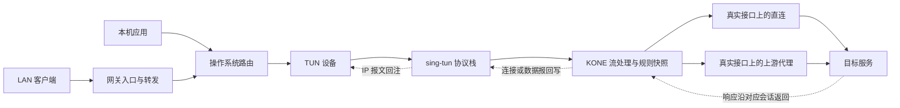
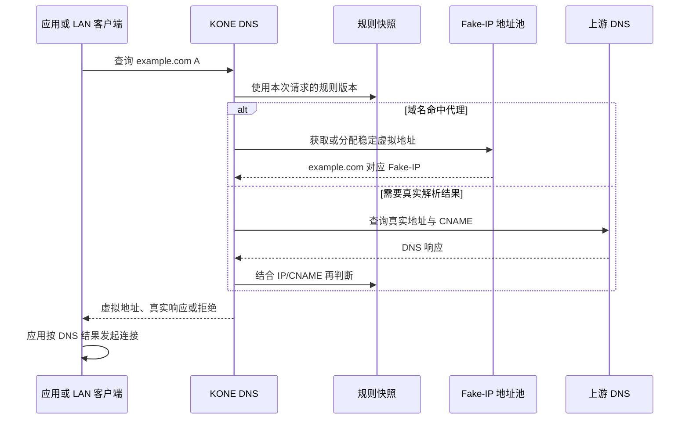
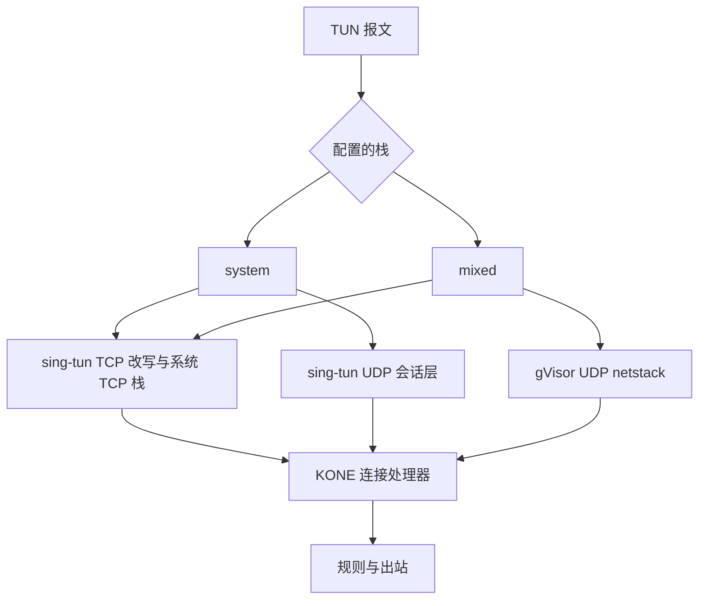

# KONE 技术原理：从使用场景到流量核心链路

本文描述 sing-tun 迁移后的实际实现。先理解一条连接如何经过 KONE，再阅读协议栈和生命周期代码。配置示例见 [配置说明](configuration.md)，网关系统设置见 [Raspberry Pi 指南](guides/how-to-use-with-raspberry-pi.md)。

## 1. KONE 在网络中承担什么角色

KONE 将进入 TUN 的 IP 流量转换为 TCP 连接和 UDP 会话，按规则选择出站，再把响应交还给原来的应用或 LAN 客户端。
应用继续使用自己的 socket API；客户端通常只需配置 DNS、网关或到虚拟网段的路由。网关部署时，客户端可以完全不安装 KONE。

有两种入口：

- **本机入口**：本机应用产生流量，操作系统路由表将目标流量送入 TUN。
- **网关入口**：LAN 客户端先把流量交给 Linux 网关，再由网关路由表送入 TUN。需要 forwarding、正确的回程路径和防火墙策略。

是否进入 TUN 由系统路由决定；进入之后走哪个代理由 KONE 规则决定。两者是不同的决策阶段。`auto-route` 只扩大捕获范围，DIRECT/REJECT 规则仍然生效；更具体的系统路由也仍有优先级。



TUN 从内核读取发往虚拟接口的 IP 报文；向 TUN 写入报文，则把它作为接收报文重新交给内核。因此，图中的回注之后仍会发生系统路由，网关才能将响应继续送回 LAN 客户端。

## 2. 先看 DNS：Fake-IP 如何保留域名信息

普通 IP 报文只有源/目标地址与端口，没有可靠的域名信息。KONE 的 DNS 服务通过虚拟地址保存域名与后续连接之间的关联。

例如客户端查询 `example.com`，命中代理规则，KONE 从虚拟地址池分配 `10.192.40.8`，记录域名和虚拟地址的双向映射，再返回该地址。客户端随后建立到 `10.192.40.8:443` 的连接；KONE 收到流后反查得到 `example.com:443`，交给上游代理。



需要注意这些实际行为：

- 命中域名代理规则时，TCP 可以把域名直接交给代理，无需提前得到真实 IPv4 地址。
- 直连查询会访问上游 DNS；真实 A/CNAME 结果也可以参与规则判断。命中拒绝的域名查询返回 REFUSED。
- UDP 直连、以及热更新后从代理改为 DIRECT 的 Fake-IP 连接，需要真实 IPv4 地址；按需解析并缓存。
- 地址表和配置快照分开管理。热更新保留已分配的虚拟地址，新请求按新快照重新判断策略；地址生命周期仍受 DNS 表维护逻辑约束。
- TUN 自身地址及其后继地址是系统协议栈保留地址，不发给 DNS 客户端。
- 当前 Fake-IP 入口处理 IPv4 A 查询；AAAA 查询可转发给上游，但 KONE 尚未接管 IPv6 流量。

DNS 服务监听的是 KONE 自己的 socket。当前没有启用 sing-tun 的自动 DNS 劫持；Linux/macOS 和 LAN 客户端需要按部署指南使用 KONE DNS。

代码入口：[DNS](../pkg/kone/dns.go)、[地址表](../pkg/kone/dns_table.go)、[地址池](../pkg/kone/dns_ip_pool.go)、[规则](../pkg/kone/rule.go)。

## 3. TCP 核心链路：报文如何成为可代理的连接

当前 `system` 与 `mixed` 都使用操作系统的 TCP 栈，透明连接的改写和会话表由 sing-tun 负责。

以网关收到的连接为例：

```text
原始连接：LAN 客户端 192.168.10.20:53000 → Fake-IP 10.192.40.8:443
          ↓ sing-tun 保存原始地址/端口，改写后回注内核
内部连接：保留的虚拟对端:会话端口 → TUN 地址:内部 TCP 监听端口
          ↓ 操作系统完成 TCP 握手、重传、拥塞控制和流重组
连接回调：原始客户端地址 + 原始目标地址 + net.Conn
          ↓ KONE 反查 Fake-IP，读取一次规则/代理快照
出站连接：KONE → 真实接口 → DIRECT 或 HTTP/HTTPS/SOCKS5 代理
```

sing-tun 的内部监听使用动态分配端口。KONE 从回调得到原始源和目标信息，因此管理统计仍能显示 LAN 客户端身份，不会把它们统一当成回环流量。

`flowHandler.NewConnectionEx` 执行以下工作：

1. 将连接登记到生命周期，拒绝在关闭过程中接收新流。
2. 读取不可变快照，按原目标 IP 判断规则；目标是 Fake-IP 时反查域名，重新计算该快照下的域名/IP 策略。
3. REJECT 结束连接；DIRECT 拨号到真实地址；代理策略使用快照中的对应代理定义。
4. 在客户端连接与出站连接之间双向复制字节，保留 TCP 半关闭语义，结束后记录流量并释放资源。

客户端这一侧和出站这一侧有各自的 TCP 连接状态。HTTP CONNECT/SOCKS5 建立的是出站通道，应用数据经该通道传递；HTTPS CONNECT 还会加密 KONE 到代理服务器的传输。应用自己的 HTTPS 会话可继续在通道内运行。

响应字节写回客户端侧连接后，内核生成 TCP 报文，经 TUN 再交给 sing-tun；sing-tun 反向恢复原始地址和端口，再回注内核。网关路由表将其送回 LAN 客户端，本机部署则交给原应用 socket。

配置中的 `[[outbounds]]` 用类型区分 proxy/direct/reject，规则的 outbound 只引用名称。名称没有特殊含义；运行时按同一快照中的类型判断直连、拒绝及 Fake-IP 是否需要真实解析。

代码入口：[流适配器](../pkg/kone/flow.go)、[出站选择](../pkg/kone/outbounds.go)、[代理协议](../pkg/proxy/proxy.go)、[双向复制](../pkg/kone/tcp_relay.go)。

## 4. sing-tun、Wintun 与 gVisor 分别负责什么

| 组件 | 在 KONE 中的职责 |
| --- | --- |
| 系统路由与 forwarding | 决定哪些本机/LAN 报文进入 TUN，以及回注报文如何返回客户端 |
| Linux TUN、macOS utun、Windows Wintun | 提供内核与用户态之间的 IP 报文收发设备 |
| SagerNet/sing-tun | 封装设备和透明协议栈，将原始 IP 流量交付为 TCP/UDP 回调，维护协议栈所需的透明会话 |
| 操作系统 TCP 栈 | 在当前 system/mixed 模式中处理客户端侧 TCP 状态机、重传和流重组 |
| gVisor netstack | 在 mixed 模式中处理 UDP 网络报文、会话及响应报文生成 |
| KONE | DNS/Fake-IP、路由策略、代理协议选择、快照、出站接口绑定、管理统计与资源所有权 |

TUN 交付的是 IP 报文，而 HTTP CONNECT/SOCKS5 出站需要已经建立的字节流；中间必须有人处理 TCP 握手、序列号、确认、重传和关闭。sing-tun 将这些工作连接起来，KONE 才能在连接层选择代理。gVisor 是更大的系统项目，这里只使用其 Go 网络栈 netstack，不会因此启动容器或运行沙箱。它能在用户态处理协议状态，但当前 mixed 模式仅把 UDP 交给它，TCP 仍由操作系统处理。

sing-tun 本身也提供地址、路由和 DNS 管理能力。本次接入使用 **external configuration** 模式：网络变更由 KONE 的 `Network` 边界统一执行和回滚，避免两个管理者改动同一项系统配置。
当前通过远程模块替换固定引用 xjdrew/sing-tun 的修补提交，KONE 仓库内不再复制源码。Windows PE 加载器边界/session 清理、HRESULT 错误规范化及独占设备创建在 [fork PR #1](https://github.com/xjdrew/sing-tun/pull/1) 单独 review，详见 [来源与升级说明](sing-tun.md)。独占创建使网卡名称预检查之后的进程竞争也不会接管既有设备。

Windows 的 Wintun DLL 通过依赖内嵌，运行时调用其 API 创建网卡并部署驱动，所以用户省去手动预装 TAP 的步骤；权限和驱动仍然存在。

### system 与 mixed 的差别

- **system**：普通 Go 构建的默认选项。TCP 走系统 TCP 栈；UDP 由 sing-tun 的报文解析和 UDP 会话层交给 KONE。其 IPv4 UDP 路径会丢弃分片。
- **mixed**：构建时启用 `with_gvisor`，配置中显式指定。TCP 仍走同一系统 TCP 路径；UDP 的 IP 报文送入 gVisor 的虚拟链路端点，由 netstack 处理后交付给同一个 KONE UDP 回调。响应再由 netstack 生成 IP 报文写回 TUN。



gVisor 的作用集中在 **IP 报文到 UDP 会话这一层**。代理规则、Fake-IP 和 HTTP/SOCKS5 协议仍由 KONE 处理；选择 mixed 不会自动增加 SOCKS5 UDP ASSOCIATE 或 IPv6 接管。
分片、MTU、大数据报及性能差异应以所选栈的端到端测试和目标设备测量为准。

代码入口：[协议栈接入与监督](../pkg/kone/stack.go)、[mixed 接入](../pkg/kone/stack_mixed.go)、[设备创建](../pkg/kone/device.go)。
依赖实现对应固定提交：[system](https://github.com/xjdrew/sing-tun/blob/1b310d7937079beb5018c1cab0885520d8b326e7/stack_system.go)、[mixed](https://github.com/xjdrew/sing-tun/blob/1b310d7937079beb5018c1cab0885520d8b326e7/stack_mixed.go)。

## 5. UDP 链路与当前能力边界

两种栈最终都调用 `flowHandler.NewPacketConnectionEx`。处理器读取一次快照、检查 REJECT、反查 Fake-IP 并按需解析真实 IPv4 地址，然后创建绑定真实出口的 UDP socket。
它按数据报转发请求和响应，并在取消、错误或空闲超时后关闭会话、等待响应任务退出。
当前管理流量统计由 TCP 处理器写入，UDP 尚未计入同一流量统计；DNS 地址表属于另一类状态，不等同于流量计数。

当前 UDP 的出站固定为直连，保留迁移前行为。命中某个 HTTP/HTTPS/SOCKS5 TCP 代理，并不让这个 UDP socket 进入该代理。因此“全局 IPv4 捕获”与“所有协议都通过上游代理”是两项不同能力；本轮实现了前者。
后续添加 UDP 代理应扩展出站层并明确不支持 UDP 的代理策略，而不是重新编写 TUN 收包或协议栈。

## 6. 网关全局接管与出站防循环

选择性部署可以只把 Fake-IP 网段及指定 CIDR 路由到 KONE。全局部署则使用 `auto-route=true`，添加 `0.0.0.0/1` 和 `128.0.0.0/1`，保留原来的真实默认路由。已有更具体的 LAN/VPN 路由仍按内核规则工作。

全局捕获也会覆盖代理服务器和上游 DNS 的目标地址。如果 KONE 自己的拨号再次走 TUN，就会形成不断建立新流的循环。
`outbound-interface` 为代理传输、DIRECT TCP/UDP 和上游 DNS 指定真实接口；代理域名解析也使用绑定该接口的 resolver。关闭 KONE 时删除本次半网捕获路由，原物理默认路由继续可用。

网关上的 forwarding、DHCP、NAT、回程路由、reverse-path filtering 与防火墙由部署者管理。迁移保留的是可路由 LAN 客户端流量的处理能力，不会自动配置整台路由器。IPv6 必须另行规划。

代码入口：[出站接口绑定](../pkg/kone/outbound.go)、[生命周期及捕获路由](../pkg/kone/one.go)、[网关端到端验收](../test/integration/gateway_linux_test.go)。

## 7. 生命周期与热更新如何贯穿数据面

`FromConfig` 校验并构造对象。`Run` 依次取得设备、网络配置、协议栈和监听资源，安装捕获路由，启动 DNS/管理服务并发布 Ready。任何阶段失败都会执行已登记的逆操作。

退出时先取消运行 context、关闭新流入口与活动连接，再关闭协议栈，逆序恢复网络并关闭设备，最后等待已进入的 I/O 和处理任务。清理使用独立超时 context，清理错误与原始错误一起返回。
包装在接口里的 nil 指针必须在接管资源之前识别，防止失败清理覆盖原始驱动错误；终止性 TUN 读写错误必须传回 Run，防止设备死亡后进程仍显示运行。

规则、代理定义和配置作为同一个不可变版本发布。每个 DNS 请求、新 TCP 流、新 UDP 会话只读取一个版本；旧连接保留原出站，之后的新流使用新定义。修改设备、栈、真实出口、捕获路由或监听配置需要重启。

详见 [运行可靠性](runtime.md)。保留的旧 `TunDriver`、NAT 和报文类型用于嵌入兼容；生产 `Run` 的数据面已经切换到 sing-tun，阅读新链路应从 `stack.go` 和 `flow.go` 开始。

## 8. 后续优化的落点与验证依据

| 优化方向 | 主要边界 | 应保留或增加的证据 |
| --- | --- | --- |
| 新代理协议、UDP 代理 | 出站层与 flowHandler | TCP 半关闭、UDP 往返、取消、明确的能力匹配与策略行为 |
| DNS 能力、IPv6 | DNS/Fake-IP、配置、规则与栈地址 | A/AAAA、一致的策略、DNS 回退、真实双栈流量和泄漏边界 |
| 性能、批处理、零拷贝 | supervisedTun、sing-tun 适配与栈选择 | 实际 Raspberry Pi 吞吐/CPU/内存、MTU/分片、并发与退出测试 |
| 自动网络切换、崩溃恢复 | Network 所有权、真实出口与持久化恢复 | 接口变化、故障回滚、已有路由保护、多实例/其他 VPN 共存 |
| 可观测性和界面 | 原始连接元数据、管理统计 | 以进入 KONE 的流量为观测范围，保留 LAN 来源及规则版本 |

当前验收组合包括普通单元测试、三平台 race、独立 LAN/网关/上游命名空间的真实流量、Windows Wintun 真实启动与流量、以及失败回滚。编译成功不能代替驱动与网关运行验收，CI 通过也不能代替目标 Raspberry Pi 的长期负载测量。
