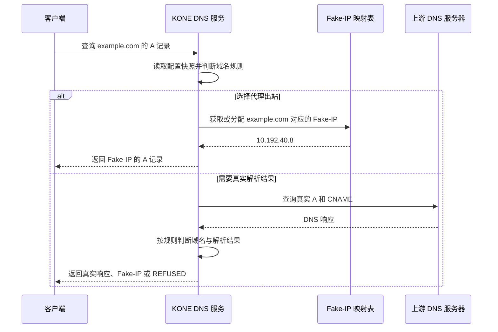
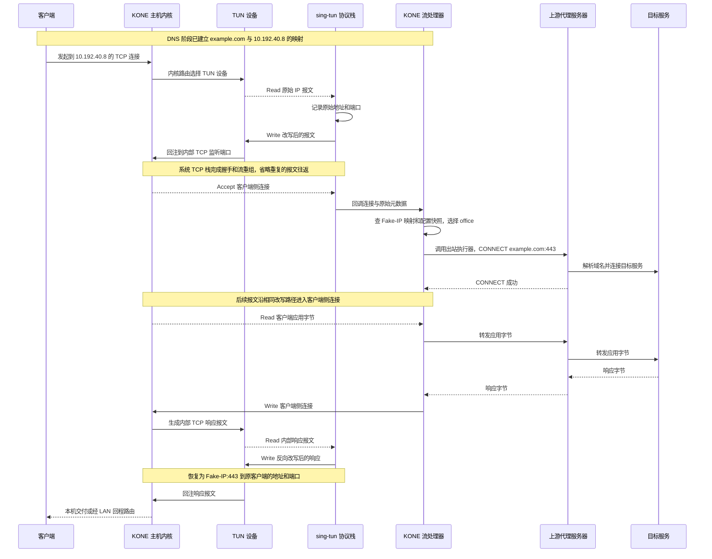
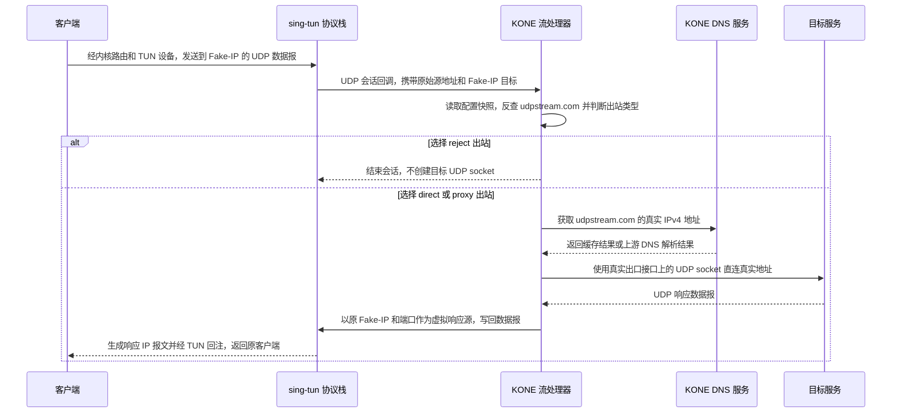

# KONE 技术原理：一条连接如何往返

本文先沿 `example.com` 的一次访问解释实际链路，再说明 UDP、网关、协议栈及生命周期。全文使用统一称呼，定义汇总在[末尾词汇表](#9-名词定义)。配置见[配置说明](configuration.md)，部署见[Raspberry Pi 指南](guides/how-to-use-with-raspberry-pi.md)。

## 1. 先分清层次和两次选择

**KONE 将进入 TUN 设备的 IP 报文交给 sing-tun 协议栈，取得 TCP 字节流或 UDP 会话，再选择出站。TUN 设备自身不解析域名，也不连接上游代理服务器。**

客户端可以是本机应用，也可以是另一台 LAN 设备上的应用。运行 KONE 的机器统一称为“KONE 主机”；网关部署时，它就是 Linux/Raspberry Pi 网关。

| 层次 | 统一称呼 | 输入与输出 |
| --- | --- | --- |
| 应用层 | 客户端 | 使用普通 socket，查询域名并访问 IP 地址 |
| 操作系统层 | KONE 主机内核 | 内核路由决定 IP 报文进入 TUN 设备还是其他接口；系统 TCP 栈处理客户端侧 TCP 状态 |
| 虚拟设备层 | TUN 设备 | KONE 读取发往虚拟接口的 IP 报文；写入设备的 IP 报文被作为接收报文回注内核 |
| 协议处理层 | sing-tun 协议栈 | 将 IP 报文转换为 TCP 连接回调或 UDP 会话回调，维护相应映射 |
| 策略与转发层 | KONE 流处理器、出站执行器 | 使用配置快照、Fake-IP 映射表和出站定义，取得出站连接或 UDP socket 并转发数据 |
| 远端 | 上游代理服务器、目标服务 | 代理服务器处理代理协议；目标服务提供应用访问的实际服务 |

KONE DNS 服务、sing-tun 协议栈、KONE 流处理器和出站执行器都在同一个 KONE 进程中。图中的生命线用于划分职责，不都代表独立进程或另一台机器。

这里发生两次不同的选择：

1. **内核路由选择入口**：决定流量是否进入 TUN 设备。本机访问由本机路由决定；LAN 访问还需要网关转发和回程路由。
2. **KONE 规则选择出站**：进入之后，按域名、IP 等选择出站。`outbound` 引用配置的代理名称，或内置的 `direct`、`reject`。配置中的 `[[outbounds]]` 只用 `name` 和 `url` 声明代理，协议由 URL 决定；两个内置出站无需声明，名称保留且不能覆盖。内部运行时仍区分 proxy/direct/reject 行为。

`direct` 表示 KONE 接收后自行连接目标服务，仍经过 KONE 流处理器。内核路由没有选择 TUN 设备时，流量才完全绕过 KONE。`auto-route` 扩大入口捕获范围，不改变出站类型。

下文所有图使用 [GitHub 支持的 Mermaid](https://docs.github.com/en/get-started/writing-on-github/working-with-advanced-formatting/creating-diagrams#creating-mermaid-diagrams) `sequenceDiagram` 基础语法。箭头表示数据或消息传递，标注的 Read/Write 表示相应读写动作；图中合并了重复的 TCP 握手和确认报文，不能把每根箭头理解为一个 IP 报文。

## 2. DNS 阶段：域名如何对应 Fake-IP

普通 IP 报文包含 IP 地址和传输层端口，不能据此可靠还原域名。KONE DNS 服务提前保存域名和 Fake-IP 的对应关系。

假设规则让 `example.com` 使用代理出站 `office`。客户端先向 KONE DNS 服务查询 A 记录，得到示意地址 `10.192.40.8`；随后访问的是 `10.192.40.8:443`。这个地址在 KONE 主机的 TUN 网段中，因此内核路由把相关报文送入 TUN 设备。

需要分清三个对象：

- **Fake-IP 映射表**保存 `example.com ↔ 10.192.40.8`，必要时缓存真实解析结果。
- **配置快照**保存规则和出站定义。新连接会重新选择出站，Fake-IP 并不把客户端永久绑定在分配时的代理出站上。
- **透明 TCP 会话表**由 sing-tun 协议栈维护，负责下一节的地址/端口改写。它不是 Fake-IP 映射表。

代理出站的 TCP 连接通常可以把域名交给上游代理服务器，KONE 不必先解析目标的真实 IPv4 地址。直连出站、以及当前实现的 UDP 转发则需要真实 IPv4 地址。

`[dns]` 可整段省略。创建运行实例时，KONE 在修改网络前读取系统上游 DNS；规则热更新沿用本次运行已取得的上游，避免重新读到自己写入的虚拟 DNS 地址。显式 `dns.servers` 可以覆盖自动发现结果。

当前 KONE DNS 服务使用自己的 UDP socket，未启用 sing-tun 的自动 DNS 劫持。Linux/macOS 和 LAN 客户端应按部署指南使用 KONE DNS 服务。AAAA 查询可以转发，但 KONE 尚不接管 IPv6 流量。TUN 地址及其后继地址为协议栈保留，不分配为 Fake-IP；映射不存在或已过期时，不会凭一个未知 Fake-IP 猜测域名。

代码入口：[DNS 服务](../pkg/kone/dns.go)、[Fake-IP 映射表](../pkg/kone/dns_table.go)、[地址池](../pkg/kone/dns_ip_pool.go)、[规则](../pkg/kone/rule.go)。

## 3. TCP 阶段：从 example.com 到出站，再正确返回

下面以代理出站 `office`、HTTP CONNECT 和 LAN 客户端为例。客户端地址为 `192.168.10.20:53000`，目标为 Fake-IP `10.192.40.8:443`；TUN 地址为 `10.192.0.1`。这些地址只用于说明关系。

### 3.1 sing-tun 如何取得客户端侧连接

当前 `system` 和 `mixed` 模式都使用系统 TCP 栈处理客户端侧 TCP。sing-tun 协议栈先保存原始源/目标地址与端口，再把报文改写成发往内部 TCP 监听端口的报文，通过 TUN 设备回注 KONE 主机内核。

系统 TCP 栈完成握手、确认、重传和流重组；sing-tun 协议栈接受内部监听端口上的连接，并把 `net.Conn` 与原始源/目标元数据一起交给 KONE 流处理器。**这个 net.Conn 是客户端侧连接，不是已经连到 example.com 的出站连接。**

| 对象 | 示例 | 由谁保存或处理 |
| --- | --- | --- |
| 原始连接地址 | `192.168.10.20:53000 → 10.192.40.8:443` | 客户端看到的连接，原始地址由 sing-tun 协议栈保存 |
| 内部改写地址 | 保留的虚拟对端地址和会话端口 → TUN 地址和动态 TCP 监听端口 | sing-tun 协议栈与系统 TCP 栈使用，客户端不需要知道 |
| 域名关联 | `10.192.40.8 ↔ example.com` | Fake-IP 映射表保存 |
| 代理传输连接 | KONE 主机的真实出口接口 → 上游代理服务器 | 出站执行器创建 |

### 3.2 完整往返时序

图中出站执行器的调用合并在 KONE 流处理器的生命线上；出站连接从真实出口接口发起。链路能够正确返回，依赖两种映射和两侧连接各自负责的状态：

1. **Fake-IP 映射表恢复域名**：KONE 流处理器把原目标 `10.192.40.8:443` 转为 `example.com:443`，从同一配置快照选出 `office`，调用出站执行器。
2. **客户端侧 TCP 连接承载字节**：系统 TCP 栈维护这侧的序列号、确认、重传和关闭。KONE 只在它与出站连接之间双向复制字节。
3. **透明 TCP 会话表恢复地址与端口**：响应沿客户端侧连接产生报文后，sing-tun 协议栈恢复客户端认识的 Fake-IP 源地址和原始客户端目标地址，更新校验和并回注。客户端因此把响应交给原来连接 Fake-IP 的 socket。

KONE 不把同一个 TCP 连接原封不动地延伸到远端。代理出站通常包含三段 TCP：客户端到 KONE、KONE 到上游代理服务器、上游代理服务器到目标服务；它们各有 TCP 状态。HTTPS CONNECT 额外加密 KONE 到上游代理服务器的传输，应用自身的 TLS 字节仍可在其中传递，KONE 不需要解密应用 HTTPS。

如果选择 `direct` 出站，出站执行器直接连接目标服务的真实地址，省去上游代理服务器这一段；客户端侧处理和响应地址恢复不变。如果选择 `reject`，KONE 不创建出站连接。未知 Fake-IP、解析失败或拨号失败也会结束相应连接。

TCP 出站的入口是 `Outbounds.DialContext`；HTTP/HTTPS CONNECT 和 SOCKS5 的差异位于代理协议实现。原始客户端元数据用于管理统计，因此 LAN 来源不会因内部改写而全部变为虚拟对端地址。TCP 半关闭也被保留：客户端关闭发送方向后，目标仍可继续返回响应。

代码入口：[TCP 流处理器](../pkg/kone/flow.go)、[出站执行器](../pkg/kone/outbounds.go)、[代理协议](../pkg/proxy/proxy.go)、[双向复制](../pkg/kone/tcp_relay.go)。

## 4. UDP 阶段：udpstream.com 被 Fake-IP 截获后怎么办

**当前实现会在非 reject 的情况下直连发送 UDP，即使规则选中了 proxy 出站。它没有通过 HTTP/HTTPS/SOCKS5 代理传送这些 UDP 数据报。**

假设 KONE DNS 服务已把 `udpstream.com` 映射为 Fake-IP，客户端向该 Fake-IP 的某个 UDP 端口发送数据报：

实际代码中，`flowHandler.destination(..., udp=true)` 会反查域名并取得真实 IPv4 地址。`NewPacketConnectionEx` 随后直接调用 `net.Dialer.DialContext(..., "udp4", ...)`，没有调用出站执行器的代理拨号路径。响应通过 sing-tun 协议栈的 UDP 会话写回，仍使用客户端原来访问的 Fake-IP 和端口；会话在取消、错误或空闲超时后清理。

| 规则选中的出站类型 | 当前 UDP 行为 | 对策略的影响 |
| --- | --- | --- |
| direct | 解析真实 IPv4 地址并直连 UDP | 符合直连策略 |
| reject | 结束 UDP 会话，不向目标发送 | 符合拒绝策略 |
| proxy | 解析真实 IPv4 地址并回退为直连 UDP | 没有执行指定代理，会向目标暴露直连出口 |

目前所有 proxy 类型只实现 TCP 通道，包括 SOCKS5；尚未实现 SOCKS5 UDP ASSOCIATE。sing-tun 或 gVisor 能接收 UDP，并不意味着出站执行器具备 UDP 代理能力。Fake-IP 只是域名关联机制，也不会补上代理协议能力。

### 更合理的后续策略

应先判断规则，再检查出站的协议能力：

1. direct 使用直连 UDP；reject 始终拒绝，不执行回退。
2. proxy 支持 UDP 时，使用该出站的 UDP 关联或对应协议。
3. proxy 不支持 UDP 时，**默认拒绝，并记录出站名称及不支持 UDP 的原因**。如果确有直连需要，应由用户显式配置 UDP 回退出站，而不是静默改变策略。

这样不会把“要求代理”自动降级为“允许直连”。拒绝 UDP 不等于把 UDP 转换成 TCP；是否改用 TCP 由应用自己的协议与实现决定。这是后续优化建议，本次文档更新没有改变现有 UDP 兼容行为，也没有新增尚未实现的配置项。

当前管理流量统计由 TCP 流处理器写入，UDP 尚未计入同一统计。DNS 记录数量、TCP 连接流量和 UDP 会话数量是不同指标，不能混用。

代码入口：[UDP 流处理器与真实地址解析](../pkg/kone/flow.go)、[真实出口接口绑定](../pkg/kone/outbound.go)。

## 5. sing-tun、系统 TCP 栈与 gVisor 各负责什么

TUN 设备交付 IP 报文，而 TCP 代理协议接收已经建立的字节流。sing-tun 协议栈连接这两个层次；它不是代理服务器，也不替 KONE 决定域名规则和出站策略。

| 组件 | 职责 | 不承担的工作 |
| --- | --- | --- |
| TUN 设备 | 提供内核与用户态间的 IP 报文读写接口；Linux TUN、macOS utun、Windows Wintun 是平台实现 | Fake-IP 域名反查、代理协议和出站选择 |
| sing-tun 协议栈 | 设备封装、透明 TCP 改写与会话表、UDP 会话交付 | KONE 的规则、配置快照和代理能力策略 |
| 系统 TCP 栈 | 当前两种模式中客户端侧 TCP 的握手、确认、重传、流重组与关闭 | KONE 的域名规则和 Fake-IP 映射 |
| gVisor netstack | mixed 模式中 UDP 的用户态协议处理与响应 IP 报文生成 | HTTP CONNECT、SOCKS5 及 UDP 出站能力 |
| KONE 流处理器和出站执行器 | Fake-IP 反查、规则选择、真实解析、拨号、数据转发和连接所有权 | 客户端侧 TCP 报文状态机的自行实现 |

| 配置模式 | 客户端侧 TCP | UDP 接收与响应生成 | 构建要求 |
| --- | --- | --- | --- |
| system | sing-tun 透明改写 + 系统 TCP 栈 | sing-tun 的 UDP 报文和会话层；当前 IPv4 路径丢弃分片 | 普通 Go 构建，默认模式 |
| mixed | 同 system | gVisor netstack 处理 UDP，再交给同一 KONE 流处理器 | 需要 `-tags with_gvisor` 并显式配置 |

这里仅使用 gVisor 的 Go 网络栈 netstack，不启动容器或运行沙箱。选择 mixed 不会自动获得 UDP 代理、IPv6 接管或新的代理协议；分片、MTU、大数据报与性能仍需按所选模式验收。

sing-tun 还提供地址、路由和 DNS 管理功能，但 KONE 使用 external configuration 模式：系统网络变更由 KONE 的 `Network` 边界统一取得所有权并回滚。Windows 的 Wintun DLL 随依赖内嵌，由 API 创建网卡并部署驱动；用户不必手工预装 TAP，但仍需管理员权限。

KONE 固定引用 fork 中的修补提交，源码和测试在 sing-tun 的[独立 PR #1](https://github.com/xjdrew/sing-tun/pull/1) 审查，KONE 内不再复制源码。来源与升级方法见[依赖说明](sing-tun.md)。

代码入口：[协议栈适配层](../pkg/kone/stack.go)、[mixed 适配](../pkg/kone/stack_mixed.go)、[TUN 设备创建](../pkg/kone/device.go)。

## 6. 网关接管与真实出口接口

LAN 客户端先把流量交给 KONE 主机，再由其内核路由选择 TUN 设备。响应回注后，还需要内核路由把它送回 LAN 客户端；TUN 设备本身不会替网关配置 forwarding、DHCP、回程路由或防火墙。

选择性接管可以只为 Fake-IP 网段和指定 CIDR 配置路由。全局 IPv4 接管使用 `auto-route=true`，添加 `0.0.0.0/1` 和 `128.0.0.0/1`，同时保留原默认路由。更具体的 LAN/VPN 路由仍可能使流量不进入 TUN 设备。

全局捕获也可能覆盖上游代理服务器和上游 DNS 服务器。如果 KONE 自己的出站连接再次进入 TUN 设备，就会形成循环。因此 `core.outbound-interface` 把代理传输连接、直连 TCP/UDP 和上游 DNS 访问绑定到真实出口接口；代理服务器域名解析也使用这条路径。回环地址上的本地代理和 DNS stub 沿原回环路径访问。

正常退出时删除本次拥有的捕获路由，保留原默认路由。部署者自行配置的 forwarding、DHCP、NAT、回程路由、reverse-path filtering 和防火墙仍由部署者管理。这里保留的是 Linux/Raspberry Pi 网关转发能力，不是自动配置整台路由器；IPv6 需要另行规划。

代码入口：[真实出口接口绑定](../pkg/kone/outbound.go)、[捕获路由与回滚](../pkg/kone/one.go)、[独立 LAN 客户端验收](../test/integration/gateway_linux_test.go)。

## 7. 生命周期与配置快照

`FromConfig` 校验配置、取得本次运行使用的上游 DNS 并构造对象；`Run` 依次取得 TUN 设备、网络设置、协议栈和监听资源，安装捕获路由，最后发布 Ready。任何阶段失败，都执行已登记的逆操作。

退出先取消 context、停止接纳新连接并关闭活动连接，再关闭协议栈、逆序恢复系统网络并关闭 TUN 设备，最后等待 I/O 和处理任务退出。清理有独立超时，清理错误与原始启动/运行错误一起返回；typed-nil 设备不会进入所有权集合，终止性 TUN I/O 错误会传回 `Run`。

规则、出站定义与配置作为一个不可变的配置快照发布。每个 DNS 请求、新 TCP 连接和新 UDP 会话只读取一个版本；已建立连接保留原出站，热更新后的新连接重新选择。Fake-IP 映射表独立维护，因此更新规则时可保留客户端缓存的地址。

改变设备、协议栈模式、真实出口接口、DNS、监听或 CIDR 捕获配置需要重启；系统网络切换和崩溃后的持久化恢复尚未实现。详见[运行可靠性](runtime.md)。旧 `TunDriver`、NAT 和报文类型暂留作嵌入兼容，生产路径从 `stack.go` 和 `flow.go` 阅读。

## 8. 后续优化应落在哪一层

| 优化方向 | 主要修改位置 | 应保留或增加的证据 |
| --- | --- | --- |
| UDP 出站与能力校验 | 出站执行器、KONE 流处理器、配置校验 | 不支持 UDP 时的拒绝、显式回退、真实 UDP 代理往返、取消与会话清理 |
| DNS 与 IPv6 | KONE DNS 服务、Fake-IP 映射表、规则和协议栈适配层 | A/AAAA、一致的策略、双栈流量、DNS 回退及泄漏边界 |
| 性能、批处理和零拷贝 | 协议栈适配层、sing-tun 设备接口 | Raspberry Pi 实机吞吐、CPU/内存、MTU/分片、并发和退出 |
| 网络切换与崩溃恢复 | Network 所有权、真实出口接口及持久化状态 | 接口变化、已有路由保护、多实例及其他 VPN 共存 |
| 管理与可观测性 | 原始连接元数据、配置快照和管理统计 | 只观测进入 KONE 的流量，区分 TCP/UDP/DNS 指标，保留 LAN 来源与规则版本 |

目前有三平台 race、Linux 独立 LAN/网关/上游网络命名空间、Windows Wintun 真实流量和故障回滚验收。它们不能代替 Raspberry Pi 的长期负载测量或 macOS 特权运行验收。

## 9. 名词定义

| 名词 | 本文中的统一含义 |
| --- | --- |
| 客户端 | 发起访问的应用一侧，包含应用 socket 和所在主机的网络栈；可以位于本机，也可以位于另一台 LAN 设备 |
| KONE 主机 | 运行 KONE 的机器；网关部署时指 Linux/Raspberry Pi 网关 |
| KONE 主机内核 | 该机器的操作系统网络子系统；包含内核路由与系统 TCP 栈 |
| 内核路由 | 根据目的地址、接口和路由优先级选择 IP 报文路径；不同于 KONE 的域名/IP 规则 |
| TUN 设备 | 内核与用户态交换 IP 报文的虚拟网络设备；平台实现为 TUN、utun 或 Wintun |
| TUN 地址 | 配置在 TUN 设备上的主机地址，例如 10.192.0.1；它不是分配给域名的 Fake-IP |
| IP 报文 | 包含源/目标 IP、协议及传输层数据的网络层单位；TCP 报文和 UDP 数据报可以装在其中 |
| socket | 操作系统提供的网络通信端点；TCP socket 传递字节流，UDP socket 收发数据报 |
| net.Conn | Go 的连接读写接口；本文客户端侧 net.Conn 指已交付给流处理器的 TCP 字节流，而 UDP 转发另用 UDP socket |
| 回注 | 用户态向 TUN 设备写入 IP 报文，内核将其当作接收报文处理 |
| Fake-IP | 分配给域名的虚拟 IPv4 地址；客户端访问此地址，KONE 通过映射恢复域名 |
| Fake-IP 映射表 | KONE 保存的域名/Fake-IP 双向关系及相关 DNS 解析记录；对应 DnsTable |
| KONE DNS 服务 | 接收客户端 DNS 查询、判断规则、生成 Fake-IP 响应或向上游查询的服务 |
| 上游 DNS 服务器 | 为真实域名解析提供 DNS 响应的系统配置服务器或显式 dns.servers；不同于 KONE DNS 服务 |
| DNS A/AAAA/CNAME 记录 | 分别表示 IPv4 地址、IPv6 地址和域名别名；Fake-IP 当前用于 A 记录 |
| DNS stub | 本机提供真实解析转发的 DNS 服务，例如系统解析守护进程；不同于 KONE DNS 服务 |
| sing-tun 协议栈 | 库提供的透明 TCP/UDP 处理；负责连接/会话交付及相关报文转换 |
| 系统 TCP 栈 | 操作系统提供的 TCP 状态机；当前 system/mixed 均用它处理客户端侧 TCP |
| gVisor netstack | 用户态网络栈库；当前仅在 mixed 模式的 UDP 路径使用 |
| 协议栈适配层 | KONE 对 sing-tun 的接入和 TUN I/O 监督代码；不等同于 sing-tun 协议栈本身 |
| 透明 TCP 会话表 | sing-tun 保存的原始地址/端口与内部改写地址/端口的对应关系，用于恢复响应；不同于 Fake-IP 映射表 |
| 客户端侧 TCP 连接 | 经透明改写交给 KONE 流处理器的 net.Conn；客户端仍认为对端是原目标/Fake-IP |
| KONE 流处理器 | TCP/UDP 回调适配、Fake-IP 反查、规则选择、数据转发和资源登记代码；对应 flowHandler |
| 配置快照 | 同一版本的规则、出站定义与配置；请求/连接读取后保持该版本 |
| 出站 | 一个具名转发策略；代理由配置声明，direct/reject 由运行时内置；不是一个远端服务器 |
| 出站执行器 | 根据出站定义创建连接的 KONE 代码；当前代理拨号接口只实现 TCP |
| 代理出站 | 由 name 和 url 配置，内部类型为 proxy，使用 HTTP/HTTPS CONNECT 或 SOCKS5 TCP 通道；名称自定义，但不能使用内置保留名 |
| 直连出站 | 内置名称 direct，KONE 自行连接真实目标；无需配置声明，仍经过 KONE，不表示绕过 TUN |
| 拒绝出站 | 内置名称 reject，不创建到目标的连接或 UDP socket；无需配置声明 |
| 出站连接 | KONE 创建的客户端侧连接之外的 TCP 连接；直连时通向目标，代理时通向上游代理服务器 |
| 上游代理服务器 | 接收 CONNECT/SOCKS5 等代理协议并连接目标服务的远端进程 |
| 目标服务 | 客户端实际要访问的服务，例如 example.com 的 HTTPS 服务 |
| 真实出口接口 | KONE 配置的出口接口，例如 eth0；用于使自身出站流量绕过 TUN 捕获 |
| CIDR | 用地址和前缀长度表示网段，例如 192.168.0.0/16；内核路由和 IP-CIDR 规则都使用它 |
| forwarding | 内核在网络接口之间转发报文的能力；LAN 网关需要启用 |
| reverse-path filtering | Linux 对报文源地址回程路径的校验；非对称 TUN 路径可能需要按部署调整 |
| MTU | 一个接口可承载的网络层报文大小上限；影响大报文、分片和所选协议栈的处理 |
| UDP 会话 | sing-tun 交付的一组关联 UDP 数据报及其处理状态；UDP 本身没有 TCP 式握手连接 |
| UDP 回退出站 | 当选定出站不支持 UDP 时，由用户显式指定的替代出站；目前属于建议，尚无对应配置实现 |
