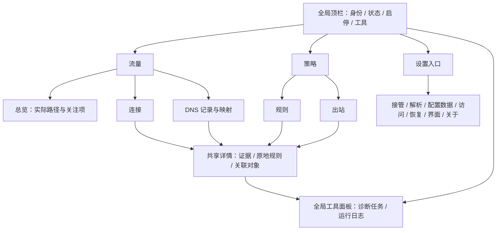
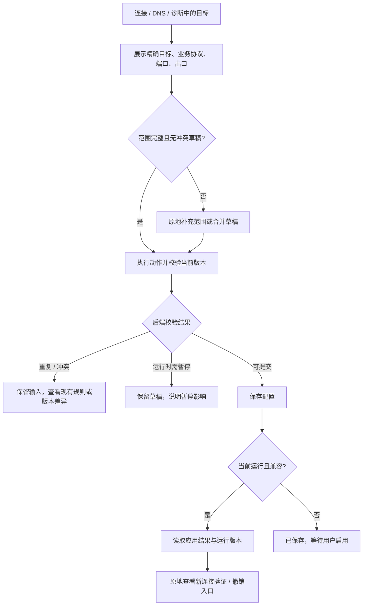

# KONE Web UI/UX 设计规则

| 项目 | 约定 |
| --- | --- |
| 定位 | **Developer-first Power User Console**：面向技术专家的网络管理工作台 |
| 用途 | 指导 `web/` 重写、组件实现和交互验收；本文件是设计目标，不是已交付功能清单 |
| 业务依据 | [产品 PRD](../../requirements/prd.md)、[Web 交互规格](../../requirements/web-ui.md)；核对代码 `1ba6c0d`（已合入 PR #51），2026-11-07 |
| 适用实现 | 面向整个 `web/` 重构；不绑定现有页面、路由、组件、文件结构或框架，依赖选型单独评估 |
| 阅读顺序 | 任务与路径 → 工作台 → 视觉变量 → 组件 → 操作与反馈 → 页面 → 实现边界 → 验收 |

PRD 定义能力与范围，Web 规格定义业务交互契约，本文件定义目标信息架构和操作体验。现有界面的模块划分不构成重构约束；权限、版本、网络能力与真实数据语义必须保留，接口可为目标体验重新组织并验证。新增界面沿用本文件；确需例外时，在同目录 `pages/<page>.md` 记录理由、适用范围及验收，不复制整套规则。

## 1. 设计原则与任务预算

| 原则 | 必须落实 | 验收方式 |
| --- | --- | --- |
| 信息密集、层级清楚 | 状态条、紧凑表格、固定操作列；关键数据优先于说明和装饰 | 1440×900、100% 缩放的连接视图，详情和工具面板关闭时首屏至少 20 条单行记录 |
| 高频操作就近 | 行内操作、搜索、批量工具条和命令面板共享动作；低频项进入“更多” | 同一动作在所有入口拥有一致权限、范围和反馈 |
| 所见即所控 | 流、DNS、诊断证据旁直接创建精确规则；详情内修改引用对象 | 从证据到提交不强制离开流量工作区 |
| 反馈真实 | 区分草稿、保存、运行应用、业务验证；失联和未知单独显示 | 保存失败不丢输入；HTTP 成功不等于业务成功 |
| 复杂度逐层展开 | 默认展示对象、状态、主要条件和操作；高级参数按组展开 | 折叠不丢字段，不改变合法配置，不隐藏高风险默认值 |
| 性能与隐私优先 | 只展示必要元数据；刷新、列表、图形和客户端缓存均有界 | 不引入正文、TLS 解密、自动探测或无限历史来改善“可视化” |

点击预算从对象已在当前视口开始，计入打开菜单、选择选项、提交；输入字符与勾选 N 个对象另计。键盘必须有等价路径。预算是设计验收目标，权限、范围不明、冲突和网络重启属于显式异常路径。

| 任务 | 正常路径 | 预算 / 上下文 |
| --- | --- | --- |
| 看连接或 DNS 详情 | 点击目标 → 原地详情 | 1 次；列表位置、筛选和刷新模式保留 |
| 将已知精确流目标直连 / 阻断 | 点击带明确作用范围的行操作 → 提交 | 1 次；仅限范围完整、无待合并草稿、后端允许的情形 |
| 指定代理 | “代理到…” → 选择命名出站并提交 | 2 次；菜单同时显示目标、协议、端口和出口能力 |
| 从 DNS 名称创建规则 | “建规则…” → 核对业务范围并提交 | 2 次起；DNS 传输不能推导业务协议和端口 |
| 改现有规则出站 | 点击出站单元格 → 选择 → 保存 | 3 次；停留本行，支持取消 |
| 批量改已选规则出站 | 选择 N 行 → “更改出站” → 选择 → 保存 | N 次选择 + 3 次；一次版本校验、一次配置事务 |
| 诊断失败流 | “诊断” → 核对目标和测试方式 → 开始 | 2 次；结果在详情中展开，不重放原请求 |
| 从桑基图定位连接 | 点击路径 → “查看连接” | 2 次；固定原快照，返回恢复图形选择 |
| 启用 / 暂停代理 | 顶栏动作 → 展示主机任务结果 | 就绪时 1 次；预检、系统授权、直连确认按业务契约展开 |
| 默认直连改为全局代理 | 基础模式 → 全局代理 → 指定出口 → 查看差异并应用 | 已有兼容出口时 4 次；暂停时仅保存，不替用户启动引擎 |
| 切换语言 | 设置 → 界面 → 语言，或登录页/命令面板入口 | 选择后立即生效，不需保存网络配置或重启 |

## 2. 信息架构与工作台

### 2.1 决策：两个主工作区，顶部导航

日常任务围绕“观察事实”和“维护策略”展开。采用 **流量、策略** 两个主工作区，顶部常驻文字入口；设置作为全局工具入口，诊断与日志作为按需展开的工具面板。总览是流量工作区的默认视图，不再独占一级页面。

| 方案 | 适用性与取舍 |
| --- | --- |
| 八项左侧导航 | 技术模块易找，但一次排障跨连接、DNS、诊断、规则、出站跳转，持续占用宽表格空间；不采用 |
| 四项顶部导航：总览、流量、策略、设置 | 减少横向占用，但总览与明细仍跨工作区，低频设置与高频任务并列；继续合并 |
| **两工作区 + 工具入口** | 总览/明细共享筛选，规则/出站共享编辑上下文；宽度留给证据和操作；作为默认布局 |
| 仅命令面板 / 隐藏导航 | 路径短但发现成本高，触控和不记快捷键的用户受限；命令仅作可见入口的加速方式 |

不设置固定全局左侧栏，也不提供任意停靠、无限标签或可拖拽仪表板定制。初次进入展示流量总览；同一会话返回恢复上次视图。本机数字回环自动建立管理会话，远端认证/配对完成后进入工作台；主机身份指当前服务，不暗示多主机平台。

启动 KONE 只打开管理服务，接管引擎保持暂停，必须手工启用。默认直连/全局代理是分流策略，与启停状态分离；顶栏采用“已暂停 · 默认直连”或“运行 · 全局代理 → office”这样的双层摘要。切换或保存策略、语言切换、打开页面与重连都不启动已暂停的引擎。



| 原功能域 | 重构归属 | 就近入口 |
| --- | --- | --- |
| 首页 | 流量 → 总览 | 点击路径切换连接视图，固定证据快照 |
| 连接 | 流量 → 连接 | 行内策略动作与详情；无需跳策略工作区 |
| DNS 观察 | 流量 → DNS | 域名关联查询、真实响应缓存和 Fake-IP 映射 |
| DNS 配置 | 设置 → 解析 | DNS 视图中的“解析设置”可直接定位 |
| 规则 | 策略 → 规则 | 所有目标详情复用同一精确规则编辑器 |
| 出站 | 策略 → 出站 | 规则出口单元格和连接详情直接打开出站检查器 |
| 入站 | 设置 → 接管 | 顶栏状态摘要提供配置/预检入口 |
| 诊断与日志 | 全局工具面板 | 当前目标发起诊断；状态错误定位日志；顶栏也可独立打开 |
| 设置与恢复 | 设置工具页 | 保存来源工作区与返回上下文 |

### 2.2 布局与响应式

```text
┌ KONE / 主机 ── [流量] 策略 ── 状态 ↑↓ ── 命令… 工具 设置 ── 启用/暂停 ┐
│ 总览  [连接]  DNS      搜索…   筛选…   时间窗   实时/冻结             │
│ 当前范围 / 筛选项 / 数据时间                                      │
├─────────────────────────────────────────┬────────────────────────┤
│ 表格或图形：使用完整可用宽度             │ 详情检查器（按需）     │
│ 稳定表头 / 行序 / 就近操作               │ 目标 / 状态 / 动作     │
│                                         │ 路径 / 证据 / 原位编辑 │
├─────────────────────────────────────────┴────────────────────────┤
│ 诊断任务 | 运行日志     当前目标 / 筛选     展开 / 收起（默认关闭） │
│ 工具面板内容：任务阶段或日志；可展开占满主区                       │
├──────────────────────────────────────────────────────────────────┤
│ 分页 / 选择 / 数据边界                  保存版本 / 运行版本       │
└──────────────────────────────────────────────────────────────────┘
```

| 区域 | 桌面规则 | 小屏适配 |
| --- | --- | --- |
| 全局顶栏 | 最小高 44 px；主机、主导航、管理/代理状态、启停开关常驻；开关左侧显示运行时业务上/下行速率，过期显示不可用、停止隐藏 | 768–1199 px 将次要元信息收为摘要；小于 768 px 分两行，第一行身份/状态/启停，第二行主导航与工具入口 |
| 主导航 | “流量 / 策略”使用文字链接，活动项有下划线与 `aria-current`；设置入口位置固定 | 主导航仍直接可见，不收进汉堡菜单，也不另建不同顺序的底部导航 |
| 视图工具条 | 最小高 40 px；视图切换、搜索、筛选和刷新同一行；长条件另起一行 | 视图切换独占一行；搜索与筛选按需换行，批量动作进入显式菜单 |
| 主区 | 全宽使用，不设置营销页面式最大宽度；外边距 12 px，区间距 8–12 px | 外边距 8 px；只允许必要的数据区域局部横向滚动 |
| 详情 | 1200 px 起可并排，宽 360–440 px；关闭后归还空间 | 小于 1200 px 在主区内切换到全宽详情，保留返回锚点，不叠多层侧栏 |
| 工具面板 | 默认关闭；打开高 240–320 px，主内容至少保留 320 px；提供收起/标准/展开三种尺寸 | 高度不足或小于 768 px 时工具使用全宽主区，关闭恢复原视图；不把表格、详情、日志压成三个小窗口 |
| 设置 | 从工具入口进入完整设置页，保留主导航与来源；可用 160 px 局部分类栏 | 分类改为有名称的选择器；不用窄弹窗承载整套主机设置 |
| 版本与分页 | 同一底部区域；有草稿时出现保存条，内容预留高度 | 软键盘、安全区和 200% 缩放不得盖住输入、错误或保存按钮 |

详情默认非模态，可继续操作列表；打开后焦点进入标题或首个动作，关闭返回来源按钮。关联对象替换详情内容并保留“返回连接”路径，禁止侧栏套侧栏。工具面板显式打开时接收焦点，后台完成任务只更新提示，不自动展开或抢焦点；关闭面板只隐藏结果。模态对话框仅用于不可逆动作、权限确认或离开未保存编辑。

### 2.3 上下文连续性

流量三个视图共享可兼容的目标、时间与快照上下文；连接专有的规则/出站筛选不能伪装成 DNS 查询条件。切换 DNS 时以可见标签注明“连接专用条件未用于 DNS”，返回后恢复；DNS 与业务流仍分别计量。策略两个视图共享配置草稿和基础版本，但各有列表筛选。不存在让所有数据共用一个含义模糊的全局搜索。

跨工作区切换才改变主导航；看详情、建规则、诊断、看关联日志均保持来源工作区。总览钻取连接只切同区视图并保存原 anchor，返回总览恢复选中路径。用户手动切换目标时，进行中的诊断仍绑定原目标，不能自动改测新行。

URL 可保存页面、非敏感过滤和选中 ID；完整草稿、凭据、配对秘密、诊断内容不得进入 URL。筛选、排序、列宽、滚动位置在页内往返时恢复；默认只将主题、密度、列设置等非敏感偏好持久化到浏览器。跨会话不保留流量记录和敏感草稿，登出清除私密内存及迟到响应。

工作区、视图、设置分组和工具状态可以有独立 URL；浏览器返回应恢复用户导航，轮询与每次输入不增加历史项。顶部主导航采用原生链接；同区视图若采用 tabs，按 [W3C Tabs](https://www.w3.org/WAI/ARIA/apg/patterns/tabs/) 提供方向键和选中语义，网络加载视图使用 Enter/Space 确认切换，避免方向键每移动一次便发请求。

## 3. 视觉变量

### 3.1 配色

默认深色；提供浅色和跟随系统选项时只替换语义变量，不改变布局与状态含义。沿用 KONE 当前深蓝底、薄荷强调色。主色用于当前选择和主要动作，不把每张面板染成彩色。

| CSS 变量 | 深色 | 浅色 | 用途 |
| --- | --- | --- | --- |
| `--color-bg` | `#0D1220` | `#F6F8FA` | 工作台底色 |
| `--color-surface` | `#151D2D` | `#FFFFFF` | 表格、导航、面板 |
| `--color-raised` | `#1B2537` | `#EDF2F7` | 菜单、悬停行、次级区域 |
| `--color-selected` | `#183D39` | `#DFF5EE` | 选中行；另有勾选或边标记 |
| `--color-text` | `#E9EFF8` | `#172033` | 主要文字 |
| `--color-muted` | `#93A1B9` | `#4B5A70` | 时间、辅助文字；禁止再降低不透明度 |
| `--color-line` | `#293449` | `#D6DDE8` | 装饰分隔，不作为控件唯一边界 |
| `--color-control-border` | `#7A8BA5` | `#718096` | 输入、复选框等必要轮廓 |
| `--color-accent` | `#73E0C1` | `#006B55` | 主动作、活动项 |
| `--color-on-accent` | `#102721` | `#FFFFFF` | 实心主按钮文字 |
| `--color-info` | `#80B8FF` | `#075EB5` | 链接、进行中、焦点环 |
| `--color-success` | `#73E0C1` | `#006B55` | 已完成且有成功证据 |
| `--color-warning` | `#F6BD76` | `#8A4B00` | 待处理、过期、回退 |
| `--color-danger` | `#F299A8` | `#B4233B` | 失败、拒绝、危险动作 |

文字色在上述四种背景上的最低对比度：深色 4.55:1，浅色 5.62:1；主按钮文字分别为 9.86:1、6.49:1。输入边框在四种背景上最低分别为 3.43:1、3.52:1。混色、透明度、禁用样式或图表新配色须重新验证；这些数值不替代实际页面验收。普通文字目标至少 4.5:1，参照 [WCAG 文字对比度](https://www.w3.org/WAI/WCAG22/Understanding/contrast-minimum.html)。

### 3.2 字体、空间与层级

| 项目 | 规则 |
| --- | --- |
| 正文字体 | `system-ui, "Segoe UI", "PingFang SC", "Microsoft YaHei", sans-serif`；中文说明使用无衬线 |
| 技术字体 | `ui-monospace, "SFMono-Regular", Consolas, "Liberation Mono", monospace`；用于域名、IP、端口、规则条件、版本和日志字段 |
| 字级 / 行高 | 页面标题 18/24、面板标题 14/20、正文与控件 13/20、技术表格与辅助数据 12/18、主要数值 20/24，单位 CSS px |
| 字重 | 正文 400、标签/按钮 500、标题/关键状态 600；不用超细字重或全大写长标题 |
| 数字 | 计量列右对齐，`font-variant-numeric: tabular-nums`；单位列统一，小数位稳定 |
| 间距变量 | `--space-1: 4px`、`--space-2: 8px`、`--space-3: 12px`、`--space-4: 16px`、`--space-6: 24px`；24 px 仅用于大区分隔 |
| 密度 | 桌面默认行高 32 px、控件高 28 px；舒适模式行高 40 px、控件高 36 px；高度均是最小值，放大字体后可增长 |
| 触控 | 粗指针或触控主模式下主要点击目标至少 44×44 CSS px；不能用桌面密度压缩命中区 |
| 圆角 | 输入/按钮 4 px，面板/菜单 6 px；状态标签 3 px；不使用满屏胶囊与大圆角卡片 |
| 图标 | 统一线性 SVG，16 px，约 1.5 px 描边；同一概念只用一个图标；复用现有本地图标，不混 emoji |
| 层级 | 内容 0、粘性表头 10、导航/状态条 20、浮动详情 30、菜单 40、模态 50、提示 60；浮层不得被祖先裁剪 |
| 动效 | 颜色/透明度 100–150 ms；不以位移动画重排实时行，不做闪烁流粒子；减弱动效时取消非必要过渡 |

深色面板用边界和层级区分；阴影只用于浮层。不使用渐变标题、玻璃背景、巨型 KPI 卡、装饰插画和入场动画。字体、图标、样式均随包离线交付，不加载公网字体或 CDN。

### 3.3 数据显示与措辞

- 域名、IP、规则名可选择和复制；IPv6 与端口组合使用方括号。目标列优先占宽，必要时中间省略；完整值可通过详情、键盘或点击获得，不能只靠悬停。
- 累计用 `B / KB / MB / GB`，速率用 `B/s / KB/s / MB/s`，1024 进位；同一图和列共享单位，提示给出原始字节数。延迟用 ms，零、未知和未测不同值。
- 表格时间使用本地时区，跨日显示日期；详情给出含时区完整时间。相对时间只作补充，不能替代日志筛选边界。
- 未知显示“未知”，未测试显示“未测”，失效证据显示“已过期”；`—` 仅代表不适用。零必须来自有效观测。
- 按钮写动作与对象：“保存规则”“代理到…”“暂停代理”；避免“确定”“操作成功”。纯直连启用确认使用“启用 TUN（仅直连）”，明确不经过上游代理；UI 使用“阻断”时注明对应出站 `reject`，“代理到…”必须选择实际命名代理。

### 3.4 国际化与语言资源

首发 `en`、`zh`；默认自动匹配，中文首发简体。手动选择优先于自动值；桌面由可信本机入口读取 OS 语言，纯浏览器采用语言优先列表，远端会话不能使用服务器的 OS 语言代替用户语言。逐个候选尝试精确标签与父语言，全部不支持才回退 en；检测规则见 [PRD 国际化](../../requirements/prd.md#56-国际化)。

| 设计面 | 规则 |
| --- | --- |
| 入口 | 登录/首次设置直接可见 `English / 中文`；设置 → 界面提供“跟随系统 / English / 中文（简体）”，命令面板可直达；不用国旗表示语言 |
| 偏好范围 | 按浏览器/客户端保存，不作为主机路由配置；只读用户和未登录用户也可调整语言；桌面自有菜单按本机偏好工作，远端切换不改它 |
| 切换 | 选择即更新标签、标题、消息、ARIA 名称和 `html.lang/dir`；保留焦点、草稿、筛选、任务 ID、配置版本和引擎状态，不整页重载 |
| 自动模式 | 本机 OS 提示可用时优先使用；否则采用 `navigator.languages`；自动值在后续启动/语言变化时更新，显式选择不被覆盖 |
| 展示文案 | 组件只引用稳定消息键，完整句子带命名参数；数量使用 locale 复数规则，不拼接翻译片段；API 错误使用 code/params 映射 |
| 技术数据 | 用户命名、域名/IP、协议、错误码、规则类型/ID、配置键、原始日志不翻译；操作解释和状态摘要翻译，原始详情脱敏后展开 |
| 格式化 | 日期、数值、国家名称按 locale 展示；时区保持用户本地设置，计量单位和 1024 换算不变；技术复制值采用稳定原始格式 |
| 长文本 | 控件使用最小尺寸，可随译文增长/换行；不能通过缩字号挤英文；技术串可省略，但核心动作、错误和选项必须可完整阅读 |
| 方向与字体 | 语言元数据带 `dir`，CSS 优先逻辑方向属性；技术地址与代码保持 LTR 隔离；中英用系统字体回退，不为翻译加载公网字体 |
| 加载与错误 | en/zh 首屏资源离线可用；先确定语言再展示内容，避免整屏中文闪切；单键缺失回退 en，整个包损坏回退 en 并可恢复选择 |

翻译文件作为独立资源自动发现，例如 `locales/en.json`；下例为未来资源结构示意，不是现有配置格式：

```json
{
  "meta": { "locale": "en", "nativeName": "English", "htmlLang": "en", "dir": "ltr" },
  "messages": {
    "policy.base.direct": "Direct by default",
    "policy.base.global": "Global proxy",
    "policy.exceptions.count": "{count} custom rules"
  }
}
```

实际资源格式还须支持复数分支及参数校验；消息格式与依赖选型由实现设计决定。新增语言通过一个同结构文件注册，自称和方向随文件提供，不修改导航、组件或硬编码语言列表；构建校验资源结构、en/zh 全键与参数一致性，并生成语言清单。运行时未知键使用可读通用错误及稳定错误码，不把裸消息键当用户文案。翻译及插值按文本转义，资源文件不是可执行脚本。

| 消息语义 | en | zh |
| --- | --- | --- |
| 默认直连 | Direct by default | 默认直连 |
| 全局代理 | Global proxy | 全局代理 |
| 保护范围 | Protected bypass | 保护直连范围 |
| 手工启用 | Enable proxy | 启用代理 |
| 部分覆盖 | Partial coverage | 部分覆盖 |

文档语言声明与方向遵循 [W3C HTML 语言声明](https://www.w3.org/International/questions/qa-html-language-declarations)；浏览器语言能力依据 [HTML Language preferences](https://html.spec.whatwg.org/multipage/system-state.html#language-preferences)。两种语言及文字长度扩展约 50% 的伪本地化都必须通过紧凑布局、触控和读屏检查。

## 4. 通用组件

| 组件 | 内容与行为 | 必备状态 |
| --- | --- | --- |
| 动作按钮 | 每个任务区最多一个实心主按钮；次级描边或文字按钮；图标按钮有可访问名称 | 默认、悬停、焦点、执行中、不可用及原因；执行中防重入且宽度稳定 |
| 状态标记 | 图标 + 短文本，颜色辅助；连接状态、管理状态、数据时效分开 | 运行 / 暂停 / 处理中 / 失败 / 未知 / 过期，不能由一个绿点概括 |
| 数据表格 | 固定表头、身份列和操作列；单行概览，详情展开；列选择/排序保留 | 首次加载、有效空表、无匹配、更新中、部分数据、失联、无权限 |
| 搜索与筛选 | 搜索当前页对象；协议、出站、规则、状态、时间为显式筛选；已选项可移除 | 输入保留、加载、结果计数、错误；空结果可清除筛选，不清全配置 |
| 内联编辑器 | 单字段就地编辑，关联字段用行展开或详情；保留“保存 / 取消” | 脏、校验中、字段错误、冲突、保存未应用；失焦不静默提交 |
| 详情检查器 | 身份/状态 → 当前路径 → 关键字段 → 证据/高级字段；顶部就近动作 | 存在、加载、已淘汰、无权限；已淘汰不得用同名新对象替代 |
| 上下文菜单 | 检查/复制 → 规则/诊断 → 其他；破坏性动作置底并分隔；最多一层子菜单 | 权限/能力/版本原因；选择前能读到完整作用范围 |
| 批量工具条 | 替换列表次级工具区，显示已选数量和操作范围，不覆盖搜索与列表 | 无选择、多选、提交、失败、冲突；范围变化不得悄悄扩大选择 |
| 反馈 | 字段错误就近；操作结果留在对象/任务区；全局问题用横幅 | 短提示用于已复制等轻反馈；失败和待处理不得自动消失 |
| 表单高级组 | 标题 + 当前摘要 + 展开；密码保留/替换/清除独立控件 | 组内出错自动展开；高级合法字段往返不丢失；隐藏不等于禁用 |

不可用原因通过可见说明或可聚焦的说明入口提供，不依赖禁用按钮的悬停。主动作、快捷键与批量操作采用相同的可执行条件，不能因入口不同绕过限制。

表格默认使用原生 `<table>`、表头关联、行内按钮和复选框；不把整行伪装成一个按钮，点击文字仍可选择。排序使用表头按钮并设置 `aria-sort`。只有实现完整焦点与编辑键盘模型时才使用 ARIA grid；两者行为不能混用，见 [W3C 表格模式](https://www.w3.org/WAI/ARIA/apg/patterns/table/)。

实时行通过稳定 ID 更新，排序同值以 ID 稳定落位。用户选择、编辑、打开菜单或浏览历史时冻结成员与行序，可更新不影响操作的数值；新记录以“有 N 条新记录”提示，显式恢复后再插入。没有可靠增量计数时只显示“有新数据”。

筛选条件默认为条件间 AND，同一多选字段内 OR；文本按可见目标/名称匹配，不引入未说明的查询语言。服务端支持的过滤发往服务端；仅对当前批次筛选或排序时必须标注“当前已加载 N 条”，不能暗示覆盖全部历史。搜索建议 200 ms 去抖，旧请求取消或按请求代次丢弃；选项点击立即生效。

## 5. 上下文操作与配置事务

### 5.1 从观察证据创建规则



| 来源 | 默认匹配 | 不得推断 |
| --- | --- | --- |
| 带明确业务域名的流 | 精确 `DOMAIN`，继承已知业务协议、端口 | 不扩为后缀或通配，不从代理服务器地址猜业务目标 |
| 只有真实目标 IP 的流 | IPv4 `/32` 或 IPv6 `/128`，继承已知协议、端口 | 不扩大网段，不把 Fake-IP 当真实目标地址 |
| DNS 查询名称 | 精确名称；原地选择业务 TCP / UDP / 两者及端口范围 | 查询使用 UDP/53 不代表业务也使用 UDP/53；IP 规则需显式选择真实响应地址 |
| 独立诊断 | 只继承明确输入的目标、测试业务协议/端口，并标出来源 | UDP DNS 探测不证明任意 UDP 应用可达；测试解析器不变成原业务目标 |

操作前的行、选中行操作条或菜单必须完整呈现如 `example.com · TCP · 443 → proxy-office` 的范围。“直连 / 阻断”仅在范围已明确时直接提交；“代理到…”选择出口即提交。未知协议/端口必须先明确选择，不默认扩成全部。DNS 名称可选择“TCP+UDP、全部端口”，但必须让用户看到并主动提交这个范围。

精确规则默认置于用户普通规则首位，不能覆盖系统保护规则；同类型、规范化目标、协议与端口集合的重复规则就地打开现有项，禁止重复堆叠。扩大为后缀、网段、全部端口或更广协议时展示范围差异并显式提交。临时规则仅在支持的域名类型提供，显示到期时间；到期不改写旧流或存量映射。

有其他未保存草稿时，不把快捷操作顺带变成全配置保存：加入现有草稿并显示待提交项，或在用户明确处理草稿后提交。所有入口复用同一配置编辑状态，禁止不同页面各自保存陈旧副本。合法 CIDR 规则已支持在线应用；TUN/core、DNS 等需暂停的修改按后端校验走暂停路径；不能为了满足“一键”预算偷偷停网。

### 5.2 编辑、批量与撤销

| 场景 | 规则 |
| --- | --- |
| 普通编辑 | 编辑中明确基础版本；Enter 保存单行有效输入，Escape 取消当前编辑；多行文本保留换行。无改动不提交 |
| 批量选择 | 默认仅当前页/当前已加载范围；复选框、Shift 连选和“清除选择”均可用。换筛选、页码前清空或明确保留选择；禁止无提示跨页操作 |
| 批量写配置 | 可批量改规则出站、删除普通规则或调整支持的出站启用状态；预览影响数量与引用，一次校验后一次原子保存，不逐行并发写 |
| 批量失败 | 校验/版本失败整批保留；保存成功但应用失败整批显示“已保存，未应用”，不将保存误报成部分成功 |
| 批量独立测试 | 仅当任务接口支持有界调度时提供；逐项展示结果与取消状态。不把配置事务与诊断任务混为一类 |
| 撤销当前动作 | 记录对象 ID、原值、动作后版本及改动字段；在当前版本仍匹配时提交逆向变更，仍经过校验与保存/应用 |
| 撤销遇到后续修改 | 停止直接撤销，展示差异；用户选择重做逆向修改，不能覆盖其他会话或后来修改 |
| 全配置恢复 | `/config/undo` 恢复已确认配置快照，入口明确写“恢复上一已确认配置”并展示范围；不能充当任意一行的撤销 |

“撤销”入口位于当前对象结果区，并保留至版本不再匹配或会话结束；短暂 toast 只能作为重复入口。没有可靠逆向数据、存在不可恢复凭据或后端不支持时，不显示可用的一键撤销。删除仅有可验证安全恢复时免确认；无法恢复的删除、恢复默认、清除观察数据和会断网的切换，展示一次带对象与影响的明确确认。普通保存、复制、筛选和查看不弹确认。

### 5.3 结果与恢复

| 阶段 | 用户看到 | 可继续动作 |
| --- | --- | --- |
| 校验 / 提交中 | “正在校验 / 保存”，仅锁本事务；页面仍可阅读 | 等待或取消尚未提交的编辑，不把关浮层当作撤销主机任务 |
| 已保存、运行未应用 | 保存版本、运行版本、具体原因 | 修正问题或重试应用；暂停状态明确等待启用 |
| 已应用 | “已应用到新连接”，显示运行版本 | 按当前目标筛选新连接，或由用户主动发起独立诊断 |
| 业务验证 | 新业务流的规则 ID、版本、实际出口与结果 | 保留或撤销；旧连接不作为新版失败证据 |
| 请求超时 / 断连 | “结果未知”，保留目标和操作标识 | 先查询任务/配置版本再决定重试；不盲目重复写入 |
| 409 冲突 | “配置已由其他会话更新”，保留本地输入 | 比较最新值与草稿后重做；不得自动覆盖 |
| 权限失效 | 停止写入；会话失效则清除私密界面 | 重新认证；只读降权保留允许查看的上下文 |

错误文案采用“对象 + 失败阶段 + 下一步”，如“规则已保存，应用失败：出口不可用。修正出口后重试应用”。技术错误码、任务 ID 和脱敏详情按需展开；不输出凭据。

### 5.4 基础策略切换

默认直连与全局代理都执行“系统保护 → 用户规则 → 基础兜底”。默认直连引导添加代理规则；全局代理引导添加直连/阻断例外，允许指定其他代理。不因更换基础模式清空或重排用户规则；已自定义是一种修改状态，不是第三个互斥开关。

切换编辑器原地呈现模式、默认出口、保护范围、用户规则保留情况、UDP 行为、IPv4/IPv6 接管计划和版本差异。已有出口可直接选择；没有合适出口时展开同一检查器的出站编辑，保存后返回策略草稿。不得在 UI 内复制一份固定局域网 CIDR 列表充当保护实现，完整计划由后端提供。

| 条件 | 提交与反馈 |
| --- | --- |
| 当前暂停 | 按新基础保存，显示“已保存，等待手工启用”；不自动启动 |
| 当前运行且支持完整热切换 | 一次版本化提交后核对网络和运行版本，明确对新连接生效 |
| 需要暂停重配 | 差异区说明影响，用户明确“暂停并应用”后执行；是否恢复运行须在同一动作中说明，不能对原已暂停引擎自动恢复 |
| 全局缺默认代理 | 原地添加/选择出站；不借用第一个代理、不退回直连、不显示成功 |
| HTTP 无 UDP / 既有直连回退 | 显示“UDP 拒绝”或用户明确接受的“UDP 直连例外”；可选择支持 UDP 的出口，变更共享出口策略必须列引用影响 |
| IPv6 接管缺失 | 明确未覆盖地址族；修复或显式接受 IPv4 限定模式，不用“全局已覆盖”掩盖 |
| 无法识别的导入配置 | 保留条件 FINAL 和规则事实，显示自定义；用户选择基础模板时先看转换差异 |
| 失败 / 冲突 / 撤销 | 保留草稿和旧运行事实；版本检查覆盖策略与路由计划，不能只撤回一个前端模式标签 |

## 6. 键盘、上下文菜单与命令

所有入口复用动作定义：`id、名称、适用对象、可见条件、可执行条件及原因、作用范围、执行、结果、撤销条件`。工具条、行操作、右键、命令面板不能各自实现一份业务逻辑；权限变化后立即重算，最终仍由服务端检查。

| 输入 | 规则 |
| --- | --- |
| Tab / Shift+Tab | 按视觉顺序经过导航、工具条、表格内控件、详情与保存区；提供“跳到主内容”入口；不用正数 `tabindex` 修补顺序 |
| Enter / Space | 激活按钮或菜单，Space 勾选复选框；不把焦点所在整行直接解释为危险动作 |
| Ctrl/Cmd+K | 打开命令面板；默认在非编辑区域响应，输入框、输入法组合和系统组合键优先；浏览器拦截时用常驻“命令…”按钮 |
| Ctrl/Cmd+Enter | 当前编辑器内保存有效草稿，作用范围写在保存按钮旁；不作为全局全配置提交键 |
| Escape | 关闭最上层菜单/提示层，或取消当前内联编辑；脏详情先处理草稿；不暂停代理、不终止未明确取消的主机任务 |
| Shift+F10 / 右键 | 对对象动作入口打开与“更多”完全相同的菜单；选中文字、链接、输入框保留浏览器原生菜单 |
| 菜单方向键 | 上下选择、Home/End 首尾、Enter 执行、Escape 返回触发点；Tab 关闭菜单并继续页面焦点顺序 |
| 排序规则 | 拖拽之外提供“上移 / 下移 / 移至序号”；移动后焦点保留在同一规则 ID；FINAL 不参与普通规则排序 |

命令面板提供页面跳转、当前页筛选入口和当前选择的可用动作；搜索动作名称及技术别名，如“阻断 / reject”。无选中对象时不猜操作目标；执行配置写入仍走同一范围核对和反馈流程。快捷键在菜单和帮助中可发现，可关闭；默认不注册全局单字母快捷键，不覆盖复制、粘贴、文本撤销和浏览器返回/刷新。`Ctrl/Cmd+Z` 保留文本编辑语义，配置撤销使用显式入口。

右键是效率补充，不能是唯一入口：每行始终有“更多”，选中行显露高频动作；键盘聚焦也显露同样动作。触控通过按钮和点击详情完成全部任务，不依赖长按和悬停。菜单按 [W3C Menu Button](https://www.w3.org/WAI/ARIA/apg/patterns/menu-button/) 设置展开状态、焦点和角色。

## 7. 实时观察与图形

### 7.1 刷新、冻结与缺失值

| 情况 | 显示与调度 |
| --- | --- |
| 首次进入 | 保持表头/布局，以骨架或加载文字表示；没有有效采样前不画零流量 |
| 正常实时 | 展示“实时 · 最近更新 …”，更新可见区域；一次请求未完成不叠加同类请求 |
| 冻结观察 | 按钮写“冻结视图 / 恢复实时”，保留快照时间；全局主机状态仍更新，与“暂停代理”分离 |
| 查看历史 / 编辑 | 固定当前页、选择和焦点；新数据提示，不自动滚回顶部；记录淘汰时保留缺失标记 |
| 超过新鲜度窗口 | 保留最后有效数据并显示“已过期”；客户端接收时间计算新鲜度，服务端采样时间说明证据来源 |
| 管理失联 | 常驻重连横幅，主机接管状态显示未知；禁止依据缓存再次启停，恢复后先读状态和版本 |
| 页面隐藏 / 离开 | 停止不可见图表、列表和动画工作；回到前台重新取一致快照，不补播积压动画，不取消主机任务 |
| 达到容量 | 显示保留范围、淘汰/截断；明细统计与全局计数分开，不能用当前可见行相加代替全局总量 |

初始刷新策略：可见数据默认 2 s，可选 1 s、5 s、手动；达到 `max(3 × 刷新间隔, 5 s)` 未收到有效响应则标记过期。此为前端设计参数，须用实际接口负载校准；不能改变后端采样能力或伪造更细数据。隐藏页不轮询；全局状态与页面数据共享调度、去重，1 s 模式也必须满足性能预算。

任务执行中按已知操作 ID 查询。只读 GET 可有界退避重试；配置保存、启停和诊断创建不套用通用自动重试。未确认是否执行时先查结果；有幂等支持的操作在同一意图内复用标识，不为每次重试重新创建任务。

### 7.2 桑基图与速率图

桑基图解释**实际入站 → 命中规则/策略 → 实际出站 → 最终业务目标**。路径属于同一批流、同一 anchor、同一时间窗、同一指标；相邻层守恒，禁止把每层总量相加。主图占流量总览的主要工作区，上传/下载/合计和速率/累计切换位于图标题同行。

- 节点按稳定 ID 排序和着色，刷新不随机换位；截断使用“其他”保留量，未知、拒绝、控制流量分别标明。零字节失败使用事件标记和计数，不增造线宽。
- 悬停、键盘聚焦或点击显示相同摘要：对象、窗口、量纲、计数、实际路径和数据缺失；点击锁定选择，再由“查看连接”进入原快照的流集合。
- 细线提供扩大命中区与等价路径表；不能只靠色相辨识。类别颜色按对象稳定分配，状态另用图标/文字表达，避免把某代理的类别色当健康判断。
- 手机保留桑基图，可局部水平查看；默认允许页面垂直滚动，缩放用明确控件。等价路径表与图使用同一数据源、筛选和操作。
- 吞吐趋势采用两条清晰标注的上/下行折线，配当前数值；避免大面积发光、运动粒子、3D 和仪表盘装饰。断采样留缺口，不能连线制造连续证据。

每幅图旁标明“仅进入 KONE 的业务流量”；上传/下载是业务载荷字节，不能标成主机网卡或代理外层吞吐。图表冻结后钻取坚持原成员，已淘汰明细显示缺失数量，不用新流补齐。

## 8. 工作区与工具规格

以下按重构后的任务归属组织，八个原功能域只作为能力追踪，不对应八个页面。字段按首屏优先级排列；小屏保留身份、状态和主要操作，其余进入详情。

### 8.1 流量工作区

工作区内切换“总览 / 连接 / DNS”，默认总览。三种视图共享兼容的观察上下文，业务流与 DNS 数据保持各自口径。用户从任何视图都能检查目标、调整精确策略并返回原证据。

#### 总览视图

```text
状态摘要：业务 ↑↓ / 活动流 / 失败与拒绝 / 窗口 / 数据时间
┌ 实际路径桑基图（主要面积） ──────────────────┬ 选中路径详情 ┐
│ 指标切换 · 冻结 · 等价路径表                 │ 数值 / 证据  │
└─────────────────────────────────────────────┴──────────────┘
紧凑速率趋势 / 需要关注的失败记录 → 原地详情 → 诊断 / 规则
```

全局启停只保留一个权威开关，使用 `role=switch` 与 `aria-checked` 表达后端状态，忙碌/切换/无权限时不可操作；总览展示预检问题及修复动作，不再放一个语义不同的开关。启动时显示暂停及“启用代理”；默认直连无代理是合法策略，手工启用按预检与必要授权执行。无流量、未启用和失联使用不同空态。“需要关注”沿用 B07 的目标聚合：规范化域名优先，无域名回退 IP，显示次数、最近原因和时间；多事件钻取固定原流 ID 集合，单事件可直接查看详情或建规则。

#### 连接视图

默认列：目标、协议/端口、状态、实际出站、命中规则、上传/下载、开始时间、操作；源/进程放可选列。筛选包括活动/结束/失败、目标、协议、出站、规则和时间。数据有界且可能淘汰，列表明确页内数量与可用历史范围。

详情顺序：目标与来源 → 当前状态/失败阶段 → 期望与实际路径 → 原规则与运行版本 → 源、时间和计数。未采集的进程显示未知，远端来源不伪装成本机应用。提供直连、代理到、阻断、诊断、相关 DNS 和复制；相关 DNS 仅作为解析证据，不声称与业务一一对应。规则修改后就地查看**新连接**，不承诺迁移旧连接。不提供无 API 的“断开连接”按钮；目标折叠沿用 B08：先过滤再分组分页，不同端口/协议保留原始行，同 IP 的不同域名分开；展开状态跨刷新保留，汇总仅覆盖已加载记录。

#### DNS 视图

默认展示查询记录，关联响应缓存和 Fake-IP 映射在详情中检查；需要独立浏览时通过“数据对象”选择器切换，不再嵌套一排标签。解析配置通过“解析设置”进入设置工具页并保留返回位置。记录列：名称、类型、查询传输、解析器/接口、结果、延迟、缓存命中、时间、操作。

详情区分真实响应、Fake 地址、TTL、来源与错误。对名称建规则先核对业务范围；对真实 IP 建规则明确选中地址；不会从 DNS 查询默认生成 UDP/53 业务规则。清理入口写明具体对象与影响，只在对应接口支持时显示；不能把“清观察记录”说成“清所有 DNS 缓存”。私有解析失败展示原因与归属，不提供隐式公共 DNS 回退。

### 8.2 策略工作区

“规则 / 出站”是同一份路由配置的两种视图，默认规则。规则中的出站名称可打开出站检查器，出站中的引用数量可定位相关规则；原列表保持不动，不要求用户记住名称再跨页面搜索。

```text
基础策略 [默认直连 ▾]    默认出口：direct    已自定义 · 3 条规则   已保存 / 运行版本
规则 | 出站             搜索…             添加规则
保护直连范围 ▸ 本地 / 局域网 / 出口链路（由系统维护）
用户规则：按顺序执行，可内联修改 / 批量操作
其余流量 → direct       ← 基础兜底，固定在用户规则之后
```

全局模式将默认出口换为指定代理，显示“添加直连例外”的就近动作；同一编辑器提供国家条件，选择国家后生成普通 GEOIP 规则，不创建隐藏的另一套规则。保护摘要可展开目标范围、来源接口与原因；规则模拟/连接详情明确是保护、用户规则还是兜底命中。全局代理显示地址族和 UDP 覆盖，顶栏只展示当前实际运行版本的模式；未应用草稿另有标识。

#### 规则视图

默认列：顺序、类型、条件、协议/端口、出站、来源、到期、生效状态、操作；稳定 ID 在详情可复制。普通规则按真实优先级排序，FINAL 固定在底部分组，系统保护例外在解释中呈现。筛选时注明规则的原始序号；重排仅在可确定完整顺序时启用，不能将筛选后序号当实际优先级。

出站/简单字段原位编辑，类型改变展开相应字段，复杂修改进入详情。模拟工具在同页展开，输入目标、协议、端口，显示配置版本、命中条件和实际出口；说明使用已保存配置且不测试连通性，不把当前未保存草稿当作模拟依据。快速添加、批量改出口、删除和重排均遵守统一事务。临时规则显示到期时间和已过期状态，不能只显示倒计时。

#### 出站视图

默认列：名称、协议、脱敏地址、配置启用、最近测试结果/时间、UDP 策略、操作。内置 `direct/reject` 独立紧凑分组，不伪装可填写凭据的代理。测试只在用户请求时发起，结果不等同于持续健康检查。

行内编辑名称和已支持的启用状态；新增/编辑地址、协议、认证进入同页详情。切换协议保留合法字段，凭据明确保留/替换/清除。HTTP 无原生 UDP，回退策略与协议能力同时可见；新建 Web 默认和既有文件缺省的区别按 Web 规格保留，不以隐藏字段改写策略。引用检查显示受影响规则，改名/删除不能留下悬空引用。FINAL 只显示摘要链接，完整编辑归规则视图，点击摘要在同区切换并定位 FINAL。

### 8.3 设置工具页

从顶栏“设置”进入，返回恢复原工作区、筛选和选中对象；不是模态弹窗。主机配置与本浏览器的外观偏好明确分组，使用次数低不等于功能缺失。

#### 接管

单 TUN 摘要展示配置启用、实际运行、地址族、栈、选择性/全局范围和真实出口。编辑采用分组表单：常用项直接显示，网段、栈与高级网络项按需展开；配置启用和全局接管运行分别表达。

页面内显示预检问题列表，条目直接定位字段或操作系统授权步骤。全捕获出口不可选自身 TUN；IPv6 能力、配置和实际可用性分开；需暂停的修改保存前说明影响并保留草稿。新建/恢复默认管理配置按活动非回环接口的全局单播地址检测无冲突 ULA 网段；保留既有选择，不能把地址检测视为已运行或目标可达。无多入口的添加按钮或占位卡。

#### 解析

系统引导、监听、自动发现/手工上游、私有后缀与接口分组呈现；显示当前配置和实际解析状态的区别。修改前预检并解释暂停影响，不能隐式改用公共 DNS。查询、响应缓存、Fake-IP 映射留在流量工作区；提供带返回上下文的“查看 DNS 记录”入口。

#### 配置、访问、恢复与偏好

设置分组为接管、解析、配置与数据、访问与会话、主机恢复、界面、关于；每组有独立任务边界，不设一个含义不明的“保存所有”。界面包含主题、密度、语言，偏好即时更新且不影响主机网络。跨组未保存草稿用统一保存摘要列明范围；切组不丢输入，返回工作区需处理未提交改动。配置导入先校验并展示影响，再按版本提交；保留高级字段，默认脱敏导出。GeoIP 显示来源、摘要和当前版本，上传实际文件内容并遵守暂停边界。

数字回环本机不要求登录或设置密码，自动会话仍校验来源、Host/Origin、CSRF；会话过期期间隐藏私密内容，自动恢复但不重放写请求。本机不显示“退出登录”，管理密码用于设置远程认证。远端认证页只显示主机身份、模式、必要字段和错误；登录、首次密码设置、配对分别命名，支持密码管理器和粘贴，重新认证后不恢复秘密。LAN 访问展示 HTTPS 地址、CA 指纹、短期配对、角色和会话撤销；扫码不代替本机授权，不自动开公网入口。

恢复默认、系统遗留恢复为本机限定动作，显示范围、所有权、失败与下一步；远端用户看到限制和本机处理指引，不能得到可执行入口。外观/密度等浏览器偏好不保存成主机路由配置。关于页展示真实版本与隐私边界；没有自动更新或诊断包接口时不展示虚构进度。

### 8.4 全局工具面板

工具面板有“诊断任务”和“运行日志”两个视图。从连接发起时直接打开绑定该目标的诊断任务，详情保留任务摘要；全局工具入口可查看会话内任务或输入新目标。任务与日志筛选有独立状态，切换不重建任务。开始前显示目标、协议、出口和实际探测动作；创建、排队、运行、取消中、取消、失败、完成、过期和不支持明确区分。只读用户可看允许的记录，不能创建探测。

任务结果按 DNS → 连接 → 代理认证 → 目标 TLS 或 UDP DNS 响应展示实际执行阶段；跳过阶段注明未执行。建议只指向有证据支持的精确规则。日志采用时间、级别、来源、消息的紧凑表格，字段按行展开；保持 50/100/200 分页、时间范围、较旧/较新/回到最新，历史页不被轮询抢走。游标保留字符串，不转换为 JavaScript 数字。

面板顶部始终写明当前诊断目标或日志筛选范围。从对象打开时，只带入真实存在的关联字段；日志缺少 flow ID 或任务关联字段时仅提供可核对的时间/来源过滤，不声称已精确关联。切换主工作区不丢正在查看的任务；用户明确关闭后不因结果到达重新弹出。展开查看完整日志只是改变展示面积，收起后回到同一列表位置。

## 9. 可访问性与响应式验收

| 维度 | 规则 |
| --- | --- |
| 键盘与焦点 | 所有任务可无鼠标完成；2 px 可见焦点环、2 px 外偏移及必要滚动空间；弹层关闭恢复焦点，粘性条不遮住被聚焦控件 |
| 点击目标 | 桌面控件至少 24×24 CSS px，默认 28 px；触控主要目标至少 44×44 CSS px；16 px 图标不能只有 16 px 命中区 |
| 语义 | 使用 button、label、input、table 等原生元素；图标按钮有名称，装饰图标隐藏给辅助技术；错误通过 `aria-describedby` 关联字段 |
| 状态播报 | 保存、失败和选中数量使用适当 live region；不逐秒朗读吞吐、每行更新或重复错误；紧急失败才用 assertive |
| 非颜色线索 | 状态文字、图标、线型/标记和选中控件与颜色并存；暗/亮主题分别检查文字与必要图形的对比度 |
| 放大与重排 | 在 200% 缩放及 320 CSS px 宽度下完成流量、策略、设置和工具面板的全部核心任务；工具条和表单重排，桌面列转为主字段+详情，主体不横向溢出 |
| 动效与指针 | 支持 `prefers-reduced-motion`、粗指针和触控；浮层不只绑定 hover，拖拽有按钮/键盘替代 |
| 覆盖环境 | Safari/iOS 16.4、Chrome/Android 110、Firefox 115 起；验证 VoiceOver/Safari 或 NVDA/Firefox 等实际辅助技术组合 |

点击面积依据 [WCAG 2.2 最小目标尺寸](https://www.w3.org/WAI/WCAG22/Understanding/target-size-minimum.html)，44 px 为本产品触控设计目标。WCAG AA 要求焦点不被完全遮挡；KONE 的实现目标是完整可见，避免紧凑底栏遮住操作，见 [焦点不被遮挡](https://www.w3.org/WAI/WCAG22/Understanding/focus-not-obscured-minimum.html)。浏览器自动化不能替代真机软键盘、系统授权与证书信任验收。

## 10. 实现边界与性能预算

### 10.1 能力落点

| 设计项 | 现有依据 | 实现要求 |
| --- | --- | --- |
| 两工作区、顶部导航、工具面板、主题、详情、快捷键、右键 | 前端布局与交互能力 | 按目标工作台重建界面和状态模型；复用一致的动作语义，内部组织可重设计 |
| 原地精确规则 | `exactRuleTarget`、`/rules/exact`、配置校验与保存已有；现 UI 会跳规则页 | 补原地范围预览、动作入口与结果；按状态和保存结果核实应用，不只读快捷接口顶层提示 |
| 内联 / 批量配置 | 有版本保护的整份配置保存 | 保留稳定 ID、完整字段和凭据语义；合成一次合法配置事务；通用批量 UI 尚需实现 |
| 动作级撤销 | 已有全配置确认快照恢复 | 动作级逆向记录与冲突 UI 尚需实现；不能直接包装 `/config/undo` 冒充逐项撤销 |
| 默认直连 / 全局代理与例外 | 有序规则、FINAL、GeoIP、全局路由、部分端点保护可复用 | 新增模式元数据、保护/接管计划与一致切换；跨接口直连、Fake-IP 分类、IPv6 和 UDP 预检需底层配合，属于已确认范围 |
| en/zh 及文件扩展语言 | 共用离线 en/zh 资源，旧技术详情保留原文 | 提取稳定消息键、自动注册资源、错误 code/params、本机 OS 语言提示；语言偏好与网络配置分离 |
| 冻结、筛选、历史、图形钻取 | 有界观察与快照/游标契约 | 共享查询适配，缺失和截断照实显示；不能补造服务端无返回的全集 |
| 目标分组 / 域名聚合 | B07/B08 已实现 | 保留分组键、先筛选再分页、原始单流和固定成员钻取；不扩大已加载数据的统计口径 |
| CIDR 在线应用 / IPv6 默认网段 / 本机自动授权 | B02/B06/B01 已实现 | 保留路由事务与旧流、既有 IPv6 选择、本机会话边界；core/DNS 等仍受运行锁限制，IPv6 地址检测不等于全局 IPv6 覆盖 |
| 连接终止、自动测速、内容检查、批量无限探测 | PRD 无此能力或明确排除 | 不设置可操作占位入口，不扩充到本次设计范围 |

现有 API 用于能力核对，路径和前端封装不锁定未来实现；需要调整时同步业务契约和回归。核对入口： [server.go](../../../pkg/control/server.go)、[配置控制器](../../../pkg/control/controller.go)、[前端适配](../../../web/src/api/endpoints.ts) 和 [现有交互](../../../web/src/main.tsx)。角色、运行锁、IPv6、UDP 和恢复能力来自实际接口与校验；UI 不仅凭“按钮可点”推定服务端支持。

### 10.2 前端预算

以下是待测量的初始设计预算，不是当前产品的性能承诺。实施时记录 SHA、机器、浏览器、样本大小与采样次数；达不到时先减少刷新/渲染工作，不能丢弃事实或改变总量口径。

| 项目 | 初始预算 / 验证 |
| --- | --- |
| 操作响应 | 点击后 100 ms 内显示本地执行态；本地处理 500 条记录的过滤反馈 p95 ≤ 200 ms，远端等待单列 |
| 增量渲染 | 单次刷新主线程工作目标 ≤ 50 ms；只更新变化节点，不整页重建，不重置输入焦点 |
| 列表 | 默认分页渲染；常驻行目标 ≤ 200，超出采用有界窗口且保留可访问性；不为虚拟化丢失选中/编辑对象 |
| 图形 | 只保留当前窗口，Top N 与“其他”有守恒计数；避免无限追加 SVG/Canvas 点或原始样本 |
| 请求 | 页面被动刷新平均目标 ≤ 2 请求/s，共享全局状态；只请求可见页所需数据，重复在途请求为 0 |
| 生命周期 | 连续观察 20 分钟，切页/开关详情/重连后监听器、计时器与缓存不持续增长；后台停止展示轮询 |
| 转发影响 | 用相同业务负载比较管理关闭、打开、1 s 刷新及主动诊断的 CPU、内存、吞吐/延迟；沿用 [性能观察指南](../../development/performance.md) 记录回退 |
| 离线与资源 | 断公网仍能加载全部管理 UI；不加载远程字体、图标或遥测脚本；不为本规范引入未经批准的依赖 |

## 11. 开发验收清单

这些场景用于后续界面实现的验收；本次文档交付不代表它们已通过。

| 编号 | 场景与通过条件 | PRD / Web 契约 |
| --- | --- | --- |
| UX-01 | 顶部两个工作区与工具入口可发现；无固定全局左栏；全部能力有明确归属，桌面密度和 320 px 操作达标 | UI-01/05、MG-MOBILE-01 |
| UX-02 | 流详情原地执行精确规则，满足正常点击预算；代理可选择，不扩大目标/协议/端口，原列表位置保留 | RULE-02、MG-RULE-02 |
| UX-03 | DNS 快捷规则要求业务范围选择；Fake-IP、查询传输和真实 IP 不混用 | DNS-03、MG-DNS-02 |
| UX-04 | 兼容修改明确作用于新流；需暂停时保留草稿；保存成功而应用失败同时显示两个版本 | RULE-03、MG-CONFIG-01 |
| UX-05 | 双客户端并改后不能覆盖；撤销不回退他人的配置；批量事务校验失败不提交半批 | CFG-02、MG-CONFIG-02 |
| UX-06 | 多选、编辑、历史页和菜单打开时刷新不改目标、行序或焦点；晚到响应不覆盖新筛选 | UI-01/02、MG-GLOBAL-04 |
| UX-07 | 桑基同窗同量纲守恒；细线键盘/触控可操作，钻取不以新流替换淘汰的旧流 | OBS-03、UI-04、MG-HOME-03/04 |
| UX-08 | 超时、失联、空表、未知、截断和零可区分；恢复后先查询结果，启停不重复执行 | UI-02、MG-GLOBAL-02/03 |
| UX-09 | 主操作、菜单、命令面板、批量操作具有一致权限；登出清私密状态且旧响应不能恢复它 | UI-03/06、MG-QUALITY-01 |
| UX-10 | 全键盘完成筛选→详情→规则→保存→回列表；触控不依赖右键/hover；焦点、错误与状态可感知 | UI-05、MG-QUALITY-02 |
| UX-11 | 诊断需用户发起，显示实际阶段；UDP DNS/TCP 成功不等同应用成功；没有后台自动探测 | DIAG-01/03、MG-DIAG-02 |
| UX-12 | 关闭公网可用；1 s 刷新和长时间观察有有界证据，数据不依赖业务正文 | PERF-01/02、MG-QUALITY-03 |
| UX-13 | 总览→连接→DNS→返回，兼容筛选保留、专属条件可见；详情建规则与工具诊断不切主工作区；设置返回恢复原位置 | UI-01、MG-GLOBAL-04 |
| UX-14 | 主工作区切换不改进行中诊断的目标；关闭工具不取消任务，后台完成不抢焦点；窄屏展开/收起可回原证据 | UI-02/05、MG-DIAG-01 |
| UX-15 | 启动保持暂停，手工启用默认直连；切基础策略/语言、保存、重连均不启动已暂停引擎 | SAFE-01/03、MG-CONFIG-01 |
| UX-16 | 两种基础策略保留用户规则；全局国家直连例外命中，保护先于用户规则；变化在原地预览并可追溯到运行版本 | POL-01/03/04、MG-POLICY-01/06 |
| UX-17 | 全局代理不误绕过 Fake-IP；本地/LAN/出口链路正确直连；UDP 和 IPv6 受限状态可见，失败不自动直连 | POL-02/05、MG-POLICY-04/05 |
| UX-18 | en/zh 自动检测、显式选择、缺失回退、离线切换正确；语言变化不改草稿、任务、配置和时区；API 值保持稳定 | I18N-01/02/04、MG-I18N-01/03 |
| UX-19 | 添加完整第三语言文件无需修改业务代码；元数据/键/参数检查通过，伪本地化不截断操作，ARIA 语言正确 | I18N-03/04、MG-I18N-04 |

交付前记录实际点击次数、异常路径、浏览器/真机结果及性能数据。页面截图只能证明布局；配置事务、冲突、失联、撤销和权限必须用交互或集成用例验证。

## 12. 结构与研究依据

本规范采用 `ui-ux-pro-max` 的 Master/页面例外结构，按任务、基础变量、组件、交互、页面、验收组织。集中维护共同规则，页面只记录业务差异，便于前端直接引用和检查。

| 来源 | 采纳内容 / 适配边界 |
| --- | --- |
| `ui-ux-pro-max`：`data dense dashboard` / style | 命中 Data-Dense Dashboard，采用紧凑表格、稳定标题与可扫描层级；不引入其推荐图表库或无接口的导出功能 |
| `ui-ux-pro-max`：`keyboard navigation shortcuts`、`error recovery undo`、`focus not obscured` / ux | 采用完整键盘路径、可见焦点、明确恢复入口；具体菜单与可访问性要求用 W3C 原文核验 |
| `ui-ux-pro-max`：`real time dashboard` / chart | 采用当前值、时间、冻结与等价数据展示；不采用默认荧光色、强制 Canvas/WebGL 或持续动画建议 |
| 国际化检索 | `language switcher localization` 与重试 `internationalization` 均无可核验匹配；按 W3C 国际化、HTML 语言接口和 KONE 使用场景制定第 3.4 节规则 |
| 栈检查 | 最初调研基于原生 JavaScript/CSS；该次技能检索无对应栈，`html-tailwind` 检索未得到适用的表格实现规则，不采纳框架特定输出 |
| 系统生成核验 | 首次及收窄后的模板仍含营销 Hero/CTA，不作为控制台结构，不持久化未核验模板；本文件为结合业务证据编写的规则 |
| [VS Code UX Guidelines](https://code.visualstudio.com/api/ux-guidelines/overview) | 参考工作台、状态栏、面板、上下文动作与命令入口的分工；不照搬编辑器全部快捷键 |
| [Primer DataTable](https://primer.style/product/components/data-table/) | 参考筛选、排序、分页、选择与操作的组合；不要求使用 React 组件 |
| W3C APG / WCAG | 表格、菜单、对比度、目标尺寸和焦点的具体依据已在对应章节链接；外部标准不改变 KONE 业务范围 |

VS Code、Grafana、Linear 作为信息密度与操作效率的方向参考；具体间距、颜色、快捷键和点击预算是 KONE 的设计决策，不能表述为这些产品的官方规范。

## 13. React 工作台实施设计

实施采用 `frontend-design` 的“设计 → 对照任务自审 → 开发 → 实屏复验”流程。以下为开发前确定的视图方案；共同变量沿用第 3 节。颜色以背景 `#0D1220`、表面 `#151D2D`、正文 `#E9EFF8`、辅助文字 `#93A1B9`、薄荷操作色 `#73E0C1`、错误色 `#F299A8` 为主。正文使用系统无衬线，网络标识和数字使用等宽字体，数字右对齐，操作与目标左对齐。

```text
┌ KONE / 主机    流量  策略        策略摘要  ↑↓ 代理开关  工具 ┐
├ 总览 / 连接 / DNS      目标过滤  协议  出口    冻结 / 刷新   ┤
│ 实际路由图或紧凑对象表                    │ 目标与事实       │
│ 对象 → 规则 → 实际出口 → 目标             │ 精确操作 / 编辑  │
│                                          │ 关联证据         │
├ 诊断任务 / 运行日志（按需展开，保留来源和高度）              ┤
└ 主机连接状态 / 数据时间 / 范围与截断 / 当前操作              ┘
```

| 视图 | 视觉与交互设计 | 核查重点 |
| --- | --- | --- |
| 登录 / 首次访问 | 克制的单列表单；主机身份、授权方式和语言直接可见；本机自动授权时不闪现登录表单 | 未授权不渲染业务；密码错误不清输入；读屏与 Enter 提交 |
| 总览 | 横向实际路由图占据主区域，紧凑指标与目标关注列表配合；边宽对应同一快照的载荷，零字节失败单列 | 无伪造数据；路径钻取回到原快照；移动端有等价路径列表 |
| 连接 | 稳定列宽的目标分组表、紧凑状态标记、右侧证据详情；选中行用边标记和文字共同表示 | 20 行密度；原地代理/直连/阻断；筛选、展开、选中和编辑不被刷新覆盖 |
| DNS | 查询名为主轴，类型、解析来源、真实/Fake 地址和耗时对齐；配置入口指向设置的解析分组 | DNS 协议不冒充业务协议；空态、缓存与记录截断区分 |
| 规则 | 顶部基础策略条，下方为只读保护、有序用户规则、固定兜底；批量操作条只在选择后出现 | 编辑/排序有键盘等价；条件 FINAL 保留范围；切策略先预览 |
| 出站 | 紧凑对象表展示协议能力、脱敏端点、实测状态和规则引用；右侧编辑与测试证据并列 | 不自动测速；保留凭据；HTTP 的 UDP 限制清晰 |
| 设置 | 工具页内按任务切换完整表单，字段分组使用标题与间距；危险操作独立置底 | 保留高级字段；暂停边界可见；离开草稿与返回来源可恢复 |
| 诊断 | 底部面板以目标和协议为首，解析/连接/认证/TLS 或 UDP DNS 按实际阶段展示 | 纯 TCP 不自动执行 TLS；任务目标固定；关闭面板不取消任务 |
| 日志 | 同一工具区内的时间/级别/来源/消息表，字段按需展开；过滤与游标导航固定 | 历史阅读不跳页；原始日志保持原文；迟到响应不能恢复已登出的数据 |

自审调整：总览取消等尺寸 KPI 卡片，使用连续状态条；设置取消弹窗套弹窗，采用完整工具页；诊断不独占一级导航；不增加装饰性渐变、首页 Hero 或入场动画。KONE 的视觉中心是可操作的网络路径与证据，所有颜色和结构均对应状态或任务。

每个视图开发后用 `agent-browser` 的独立会话检查桌面、窄屏、中英文、键盘与错误态；截图只作视觉证据，核心业务另由真实管理服务验证。

### 13.1 启用检查

任务是回答“什么阻止启动，下一步做什么”。沿用上述颜色、系统字体和紧凑布局，正文左对齐；错误色只标记阻断，警告明确标注不阻止启用。布局为“结论 → 阻断原因及对应操作 → 可折叠的建议/已通过检查 → 固定可见的操作区”，不使用等权状态卡片。

```text
检查启用条件                                      关闭
还有 2 项条件未满足
需要网络管理权限      [阻止启用]
在 KONE 主机上授权并重启；浏览器无法授予系统权限。
当前规则未使用代理    [需要确认]
配置代理规则，或在其他条件满足后明确启用仅直连模式。
                                  [配置代理规则]
建议（不阻止启用） / 已通过检查（按需展开）
阻断解除前不能启用         [重新检查] [启用 TUN（仅直连）]
```

自审：移除所有问题共用的“设置”入口；配置问题指向具体分组，权限问题直接解释主机操作。启动按钮始终展示，禁用时说明原因；重新检查只读取状态，不自动启动。错误在弹层内显示，纯直连确认不能绕过权限等其他阻断。状态文案、检查标题和处理提示均提供中英文，原始技术详情按需展开。
