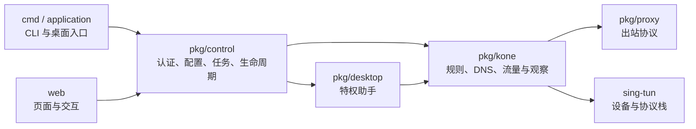

# 开发指南

面向修改 KONE 核心、管理服务和 Web 的开发者。完成本文后应能启动开发环境、定位模块、选择测试并提交可评审的变更。构建产物与发布操作见 [打包指南](packaging.md)。

## 1. 准备环境

| 工具 | 项目版本或要求 |
| --- | --- |
| Go | 1.27.3，与 `go.mod` 一致 |
| Node.js | 26.13.0，附带 npm |
| just | 1.59.0 |
| Git、Bash | Windows 使用 Git Bash |
| C 编译器 / CGO | 执行 race 检查时需要 |

在仓库根目录运行：

```sh
just init
just dev
```

`init` 检查工具并安装项目依赖；`dev` 构建并打开代理暂停的管理界面。仅调试前端时运行 `just dev web`。单独执行 `just` 查看入口，所有日常命令支持 `--help`。

预期结果：管理页可打开，代理保持暂停。配置与权限检查在用户启用时执行；开发启动不会自动修改系统网络。

## 2. 定位模块



| 位置 | 修改内容与验证入口 |
| --- | --- |
| `cmd/`、`pkg/application/` | 参数、GUI/CLI 分流、托盘动作；包内测试及 CLI 集成测试 |
| `pkg/control/`、`pkg/desktop/` | 持久配置、权限、IPC、启停恢复；控制 API 与助手测试 |
| `pkg/kone/`、`pkg/proxy/` | 转发、DNS、规则、观察和代理；包内回归及 `test/integration/` |
| `pkg/geoip/`、`pkg/dnsconfig/`、`pkg/process/` | 数据、平台解析上下文和进程归属；平台边界测试 |
| `web/src/` | 页面、API 适配和图形；`web/test/`、`web/e2e/` |
| `scripts/tasks/`、`scripts/ci/`、`scripts/release/` | 日常入口、CI、发布；任务与发布脚本测试 |

核心原理见 [技术架构](../technical/architecture.md)。Web 重构先读 [产品 PRD](../requirements/prd.md) 和 [Web 规格](../requirements/web-ui.md)，保持状态、权限和数据语义。

## 3. 日常修改流程

1. 读取根 [AGENTS.md](../../AGENTS.md) 及修改目录的约束；新任务从最新 `origin/master` 建立 `codex/<topic>`，相关任务复用分支。
2. 检查实现与测试，确定输入边界、兼容性和失败路径。并行编辑使用独立 worktree。
3. 实现最小变更。Go 使用 `gofmt`、`log/slog` 和严格 TOML；代码放 `cmd/`、`pkg/`，前端资源使用 LF。
4. 补包内单元测试与 `test/integration/` 端到端测试；缺陷修复补回归。行为或配置变化同步更新文档、示例和用户向 CHANGELOG。
5. 执行相关检查，审查 diff，仅提交本任务文件。新增依赖先确认维护状态、平台兼容性与许可要求。

## 4. 选择质量检查

```sh
just quality
just quality vet
# 提交前需要完整便携检查时：
just quality full
```

| 入口 | 覆盖范围 |
| --- | --- |
| `just quality` | 格式、vet、应用 Go 单测及 Web 单测；Go 单测不带 race |
| `just quality fmt` | 格式化 Go 与 just 文件 |
| `just quality vet` | 全模块 Go 静态检查，包含 `with_gvisor` |
| `just quality full` | race、全包覆盖率、Web/脚本测试、浏览器、fuzz 与漏洞检查；可能下载浏览器 |
| `just ci test-web-e2e` | 浏览器交互及真实管理服务的保存、刷新、重启闭环 |
| `just quality benchmark` | 生成可复现性能样本，见 [性能观察](performance.md) |

便携测试使用合成/回环服务；真实管理浏览器测试保持代理暂停。TUN、DNS、路由和权限恢复测试只在隔离 CI runner 中运行，不在个人主机伪造 CI 标记绕过限制。

### CI 与覆盖率

PR 执行九个检查：Web、Linux/macOS/Windows 平台、跨平台构建、质量性能、Windows 三种独立原生栈。所有产物包含 `system/gvisor/mixed`；平台原生验收逐栈执行。工作流定义见 [go.yml](../../.github/workflows/go.yml)。

Linux/macOS 使用 `just ci test` 执行全包 race 检查并记录各用例结果，不做覆盖率插桩；macOS AppKit 与私有 helper 用例包含在这次全包执行中。需要单独排查时仍可运行 `just ci test-macos-desktop`。Windows 保留全包覆盖率报告与下述 PR 基线门禁。

平台、原生 Windows、构建和质量任务分别缓存编译产物，源码变化后通过回退键恢复并保存新增结果；模块下载缓存仅随依赖与工具链变化。Windows 原生三种栈使用同一编译缓存，因为栈在运行时选择。缓存不会跳过测试执行，也不会替代精确源码的发布验证；Web 测试流程保持独立。

Linux 在原平台任务内通过 `just ci docker-build` 构建容器，CI 设置 `KONE_DOCKER_CACHE=1` 后使用 BuildKit 层缓存并加载本次构建的镜像，再执行 `just ci docker-check`。缓存目录位于一次性 runner 的 `RUNNER_TEMP`，仅在成功导出后替换，避免累积无引用层。本地不设置该变量时仍使用普通 Docker 构建；无需新增 runner 或预装网络驱动。

每个 PR 在 Windows 用相同工具链、race、atomic 和包枚举方式重测精确 base SHA。KONE 全包语句覆盖率不得下降，包括未执行代码的包；重复 block 合并后按语句数精确比较，空或缺失报告失败。外部 sing-tun 模块另验补丁，不进入 KONE 分母。

```sh
# 前提：目标 base SHA 已检出到 .coverage-base
just ci test-coverage .coverage-base ../coverage-base.out
just ci test-coverage
just ci coverage-check coverage-base.out coverage.out
```

第一条覆盖文件路径相对于被测模块。历史源码无需自带当前 justfile；不要用当前应用代码代替目标 SHA。

## 5. 验收按风险定位

| 改动 | 关键证据 | 仍需部署验证 |
| --- | --- | --- |
| 启停、DNS、恢复 | `pkg/control/*test.go`、`test/integration/` 的生命周期、系统 DNS、IPv6 用例 | VPN 组合、权限弹窗、休眠换网、物理网络 |
| 规则与配置 | 控制版本冲突、撤销、临时规则、凭据保留；浏览器真实服务闭环 | 已缓存 Fake-IP 的应用行为 |
| 观察与桑基图 | `observation_test.go`、`web/test/graph.test.mjs`、高基数钻取用例 | 长时负载、目标设备性能 |
| 认证与移动管理 | `pkg/control/server_test.go`、`lan_test.go`、三浏览器自动化 | iOS/Android 证书信任、软键盘、锁屏与横竖屏 |
| 桌面与安装 | AppKit/托盘、IPC、原生 TUN、安装包检查 | 干净机器安装、升级、卸载及签名信任 |
| Shadowsocks | 独立 SIP004/SIP007 对端与固定官方服务端的 TCP/UDP 互操作 | 其他服务端、版本及网络环境 |

SS 支持三种 AEAD2017 方法。官方对端由 [互操作脚本](../../scripts/test-shadowsocks-interop.sh) 固定镜像 digest 并校验二进制版本；升级时同时核对源码、digest、版本。保留域名远端解析、错误密码、取消和双向载荷用例。测试通过仅证明对应 SHA 与环境，不能用编译成功替代原生验收。

## 6. 维护资产与提交

图标以 K1 表盘为意象：深色底、浅色圆环、K 形指针和表示流量方向的金色指针；源图由项目绘制。图标源为 [icon.svg](../../web/public/icon.svg) 和 [tray.svg](../../web/native/tray.svg)，派生 ICO、ICNS、托盘及 Web 资源统一生成：

```sh
just ci icons generate
just ci icons check
```

Windows 网关额外放行规则可通过 `just ci windows-firewall-update --help` 查看参数；该维护任务不随构建自动执行。使用 `just ci windows-firewall-check` 核对规则，按实际受信任网络范围配置。

内置 GeoIP 来源与摘要见 [DB-IP 归因](../../licenses/DB-IP.md)。转换入口为 `just ci geoip-convert --help`；更新时一并提交来源清单、归因、数据回归与生成资产。运行时导入见 [配置指南](../user/configuration.md#6-geoip-数据)。

PR 标题用 Conventional Commits。推送后用 `gh` 创建或更新面向 `master` 的 PR，检查并修复 CI；不直接推送 master 或自行合并。提交说明写清行为变化、验证结果和未验证的平台边界。
