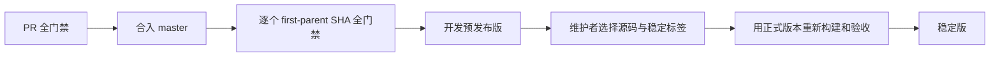

# 打包与发布指南

面向构建、审核及发布 KONE 的维护者。流程为“准备工具 → 生成产物 → 验证 → 发布 → 必要时撤回”。安装用户见 [使用指南](../user/usage.md)。

## 1. 前提与产物

完成 [开发环境](development.md#1-准备环境)，确保工作树与待打包源码一致。所有产物包含 `system/gvisor/mixed`，默认 `system`，无需按栈分别打包。

| 平台 | 本机构建入口 | 默认发行包 |
| --- | --- | --- |
| Linux | `dist/kone` | amd64/arm64 DEB |
| macOS | `dist/Kone.app`、`dist/kone-cli` | amd64/arm64 PKG |
| Windows | `dist/kone.exe`、`dist/kone-cli.exe` | amd64/arm64 ZIP，附 `install.ps1` |

包目前未签名，macOS 未公证。交叉编译仅证明构建成功；原生运行、驱动和干净机器安装需要对应环境的证据。

## 2. 本地构建与打包

```sh
just init
just build
just package
```

程序在 `dist/`，安装包与清单在 `release-assets/`。需要跨平台产物时：

```sh
just build-all
just package-all
# 可选：追加 32 位 Linux 网关
just package-all --include-armv7
```

`build-all` 默认六个 OS/架构目标；`package-all` 生成便携归档及本机可构建的原生安装器。macOS/Windows 原生包分别在对应平台 CI 生成。ARMv7 属显式开发构建，不进入默认公开发行矩阵。

本地打包只生成文件，不运行产物、解包临时安装或发布。清单中 `native_version_checked=false` 表示未取得原生版本验证；不能将本地包当作已通过发布门禁。

## 3. 验证产物

| 检查 | 预期结果 |
| --- | --- |
| 版本与源码 | 产物版本、完整 SHA 和构建元数据一致 |
| 资源 | GUI/CLI 身份、图标、内嵌 Web、许可证完整 |
| 原生安装 | 对应 runner 解包或安装到临时目录，CLI `-version` 正确 |
| 功能与网络恢复 | 三平台测试、三栈原生验收及 Web/协议门禁通过 |
| 用户体验 | 真实双击、权限弹窗、升级/卸载、签名信任由目标设备验收 |

CI 使用 `just ci package` 的验证模式。公开资产为六个应用包、`kone-source.tar.gz`、`release.json`、`SHA256SUMS`；GitHub 自动源码归档另计。源码包含 vendored Go 依赖、前端源码/构建资源、版本信息和组件许可。

`release.json` 绑定 SHA、版本、run/attempt、门禁、资产摘要与构建参数；包内 `build-info.json` 和源码 `BUILD-INFO.json` 用于追溯构建。具体入口见 [打包脚本](../../scripts/release/package.mjs)。

## 4. 计算版本

PR 标题使用 Conventional Commits。自上一个稳定标签以来的 first-parent 变更取最高级别，只累计提升一次：

| 变更 | 版本变化 |
| --- | --- |
| 修复或普通维护 | patch |
| `feat:` | minor |
| `!` / `BREAKING CHANGE:` | 0.x 为 minor；1.x 及以后为 major |

`VERSION` 是最低版本要求。`Release-As: X.Y.Z` 合并提交尾注只能提高计算结果；正常发布无需指定。只接受源码严格祖先上的规范 `vMAJOR.MINOR.PATCH` 稳定标签。

```sh
just ci release-version json
just ci release-version next-tag HEAD
```

开发版为 `<next>-dev.<提交UTC日期>.<first-parent计数>.g<12位SHA>`，例如 `0.5.0-dev.20261101.87.g0123456789ab`。已发布开发版重试复用原版本；稳定版根据当前祖先标签重新计算并重新构建。

## 5. 发布与重试



1. 检查 [Verified releases](../../.github/workflows/release.yml) 对目标 SHA 的结果。批量 master push 按 first-parent 逐个验收，不能借用 push head 的结果。
2. 需要重试时，在该工作流选择 `master`、`development`，输入完整 SHA。已公开资产不可覆盖；符合所有权要求的未发布草稿可修复。
3. 发布稳定版前，确认目标 SHA 已有完整开发版证据，再检查其建议标签。维护者在该 SHA 创建并推送精确规范标签，触发正式版本的完整构建与门禁。
4. 旧源码不支持标签触发时，从 master 手动选择 `stable`，输入相同 SHA 和标签；仍执行同样检查。

开发分支 push 不运行 CI；PR 不发布 Release。资格标记必须匹配源码、版本、run/attempt 和实际成功任务；缺失、跳过或失败不能发布。历史源码的编排工具由工作流固定到 `.ci-tools`，应用源码仍绑定被测 SHA。新证据使用五组 schema 2，旧证据只接受其完整合法分组，不可混拼。

## 6. 撤回与回退

在 master 工作流选择 `withdraw`，填入标签和原因。撤回将 Release 转为草稿并保留源码标签，不能收回已下载文件；普通重试不自动重新公开已撤回版本。

用户回退流程：备份 profile → 停用代理 → 退出旧进程 → 校验并替换程序 → 以暂停状态打开管理。旧版本不兼容新配置时，显式恢复兼容备份，禁止两个版本同时写同一 profile。安装、卸载与系统网络恢复分开执行，先完成网络恢复再移除程序。
