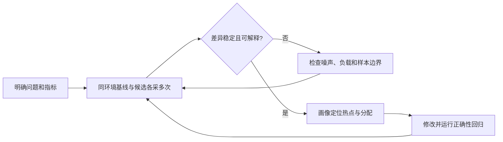

# 性能观察指南

面向定位转发、规则、DNS、观察器和管理查询开销的开发者。目标是得到可复现的证据，区分算法开销、真实转发和用户体验。

## 1. 先定义测量问题

| 问题 | 指标 | 适合的样本 |
| --- | --- | --- |
| 某段逻辑是否变慢 | `ns/op`、`B/op`、`allocs/op` | 固定输入微基准 |
| 观察或查询是否干扰转发 | 吞吐、RTT 分位数、CPU、内存、实际查询次数 | 相同载荷下比较明细开/关与并发查询 |
| 容量是否受控 | 保留记录/路径数、淘汰、队列与内存增长 | 高基数、长时与容量耗尽场景 |
| 某设备是否满足部署需求 | 业务吞吐、p50/p95/p99、CPU、内存、错误率 | 同硬件、同代理与网络条件的独立实验 |

观察范围止于进入 KONE 的流量。业务载荷、DNS、诊断分别计量；业务字节不包含 IP/TUN 和代理协议开销。Go 微基准中基于合成字节得到的 `MB/s` 不能作为网络吞吐。

## 2. 采集本地基线

前提：完成 [开发环境](development.md#1-准备环境)。以下入口不创建 TUN、不修改系统网络：

```sh
just quality benchmark
just ci profile baseline/cpu.out baseline/kone.test
```

`benchmark` 使用固定输入、`-cpu=1,2`、`-benchtime=500ms -count=3`。每次运行前保存上一组 `baseline/`，避免混合不同提交的结果。

| 文件 | 用途 |
| --- | --- |
| `environment.json`、`toolchain.txt` | SHA、时间、硬件、OS、Go、并发与数据来源 |
| `core.txt`、`geoip.txt` | 三次采样的耗时、分配及附加计数 |
| `geoip-startup.txt` | 内置数据初始化内存与一致性 |
| `profile.txt`、`cpu.out`、`memory.out`、`kone.test` | 观察查询负载画像与对应测试二进制 |

## 3. 选择基准

| 基准 | 场景与判断范围 |
| --- | --- |
| `BenchmarkRuleDecision` | 域名、GeoIP、最终规则及并行查找；规则 CPU/分配 |
| `BenchmarkDNSResponseCache` | 命中、ID 更新和响应拷贝；本机缓存成本 |
| `BenchmarkObservationIncrement` / `Session` | TCP/UDP 计数及会话创建关闭；明细开/关对比 |
| `BenchmarkObservationQueries` | 2048 条保留记录、128 活动流，Snapshot/Sankey 与更新并发；画像对象 |
| `BenchmarkObservationBoundedLoad` | 4096 目标周转，记录上限 512、路径上限 128 加“其他”；容量与淘汰 |
| GeoIP 查找、解码、合成 MMDB 基准 | 查询与初始化；合成 MMDB 不代表完整供应商数据库 |

这些算法共用同一实现，只运行一轮；协议栈差异由真实 TUN 样本观察。输入、断言和计量细节见 [核心基准](../../pkg/kone/core_benchmark_test.go)、[观察基准](../../pkg/kone/observation_benchmark_test.go) 和 [GeoIP](../../pkg/geoip)。

## 4. 分析与复验



1. 对齐硬件、电源状态、Go/OS、构建标签、race、数据版本、并发与输入规模。
2. 比较多次样本的分布和分配，保留原始输出；单次最好值不能代表改善。
3. 使用匹配的二进制打开 CPU/内存画像，确定成本来自业务处理、观察还是查询；不要混用其他 SHA 的符号。
4. 改动后同时检查正确性：总计数守恒、容量上限、并发快照与停机清理。
5. 记录结论、误差来源和未覆盖负载；尚无可靠门限时报告数据，不编造百分比收益。

画像的工具选择和解释方法见 [Go Diagnostics](https://go.dev/doc/diagnostics)。

## 5. 阅读原生 CI 样本

[原生性能用例](../../test/integration/performance_linux_test.go) 在 Linux 隔离网络命名空间逐栈运行 `system/gvisor/mixed`：

```text
Fake-IP → TUN → KONE direct → 回环 TCP/UDP 服务 → TUN 回程
```

每栈比较保留明细、仅整体计数、明细加目标 200 次/秒并发查询三种模式；实际查询数单独报告。TCP 每方向 16 KiB，UDP 每方向 1200 字节，4 轮预热、128 轮计量，20 秒上下文上限。

`native-data-plane-baseline` 工件包含环境与逐栈日志。`KONE_NATIVE_PERFORMANCE` JSON 给出校验后的载荷字节、耗时、吞吐、RTT p50/p95/p99、进程 CPU 和查询数。百分位使用最近秩，TCP RTT 是一轮完整载荷回显。

该样本含 race、回环服务、校验和查询负载；CPU 是同进程合计。它用于追踪同类环境变化，不代表物理链路上限、加密代理吞吐或 Raspberry Pi 性能。传输与清理失败使任务失败，性能波动尚无自动回退阈值。

## 6. 交付性能结论

报告至少包含：问题、基线/候选 SHA、环境、数据与负载、原始样本、差异、正确性结果、结论适用范围。独立实验室仍需覆盖 HTTP/SOCKS5/SS、MTU/分片、长时管理负载和 Raspberry Pi；有硬件基线后再确定性能预算。
