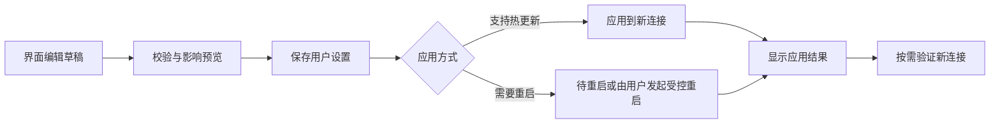

# KONE 管理页面需求文档

版本：v1.1 草案。日期：2026-10-31。适用：Windows/macOS 桌面内的管理界面、同机浏览器，以及经授权访问的手机/平板浏览器。

依据：[产品特性与未来规划](features.md)，尤其是已确认决策、UI-01 至 UI-06、CFG-01 至 CFG-04，以及观察、规则、DNS、诊断和恢复需求。本文细化页面、交互、数据语义与验收，不表示页面或所需后端已经实现，也不锁定前端框架、路由地址和 API URL。

本文是管理界面的实施依据；总体产品范围仍以特性列表为准。新增的页面组织、交互默认值和视觉指标属于设计建议。底层正在演进，字段校验和实际能力应与 [配置说明](configuration.md)、[示例配置](../configs/kone.example.toml)、[运行可靠性](runtime.md) 对齐，不复制历史规划中的旧驱动、旧配置格式或旧许可描述。

现有能力基线为已合并的 `0ee405d`：sing-tun system/mixed、内嵌 Wintun、严格出站配置与显式 UDP 回退，数据链路见 [架构说明](architecture.md)。桌面无文件配置、移动授权及桑基图仍是本文需求，不因这些底层能力已合并而视为已交付；发行遵守当前 GPL-3.0-or-later 及各组件许可。

## 1. 目标与产品边界

用户打开管理界面后，应能完成四件事：**知道当前是否接管网络，看懂流量实际去了哪里，配置所需的入口和出口，出问题时诊断并安全停用。**

| 已确认要求 | 管理页面中的落实 |
| --- | --- |
| Windows/macOS 启动不指定 config | 默认配置即可打开管理界面，配置文件不进入普通用户流程；后续自动读取界面保存的设置 |
| 界面管理入站、出站等配置 | 提供入站、出站、规则、DNS 和设置页面，统一校验、保存、应用与版本反馈 |
| 接受未进入 KONE 的流量不可观察 | 全局提示观察范围，不要求补全全机流量，不将不可观察的数据画成零或成功 |
| 首页使用优美的桑基图 | 以真实路径展示入站→规则/策略→实际出站→最终目的，支持实时更新和逐层钻取 |
| 支持移动设备，在手机访问并查看效果 | 同一套管理 Web 适配手机/平板，移动首页保留桑基图，提供触控钻取及显式授权的局域网访问 |
| 操作简单、反馈清楚 | 默认显示常用项，高级项渐进展开；区分保存、应用、验证与恢复结果 |

首期聚焦一台 KONE 主机及其所有者，可由所有者授权手机/平板访问；移动端是该主机的查看/管理客户端，不要求在手机安装 KONE 内核。多用户远程控制平台、公网暴露、云端统计、节点订阅、业务内容分析、HTTPS 解密和全机旁路抓取不在本页面需求内。进程信息、IPv6、完整 UDP、SS、GeoIP 在线更新仅在对应能力实际交付后开放，不能以一个可点击开关冒充已实现。

应用启动与网络接管分开：无代理、未提权、设备不可用或用户配置损坏时，仍能进入管理界面；只有预检通过且用户发起启用后才接管。内置直连可独立使用，不能把“未配置代理”一律报为不可运行。

## 2. 信息架构与全局框架

### 2.1 导航

| 页面编号 | 主导航 | 用户的问题 | 主要内容 |
| --- | --- | --- | --- |
| P01 | 首页 | 现在是否正常，流量经过哪里、去往哪里 | 运行状态、关键指标、桑基图、待处理问题 |
| P02 | 连接 | 哪条连接在传输，为什么失败或走这个出站 | 活动/已结束/失败列表、连接详情、实际路径 |
| P03 | 入站 | 什么流量会进入 KONE，接管范围多大 | TUN 配置、协议能力、接管模式、冲突与运行状态 |
| P04 | 出站 | 使用哪个出口，它能代理什么、是否可用 | 内置直连/拒绝、代理配置、能力、诊断与引用 |
| P05 | 规则 | 哪些目标走哪里，顺序与影响是什么 | 规则列表、编辑、排序、模拟、应用和撤销 |
| P06 | DNS | 域名如何解析，内部域名是否走对解析器 | DNS 配置、解析器、查询记录、真实/虚拟地址 |
| P07 | 诊断 | 哪些已观察目标有问题，如何修复 | 待诊断目标、诊断任务、对比结果、一键规则入口 |
| P08 | 设置 | 如何设置应用、管理数据与账号、查看版本 | 分组菜单与二级页面，关于置顶，重置与退出置底 |

导航名称使用用户语言。连接详情、DNS 详情、规则变更详情等属于主页面的子视图，不增加同等权重导航。首次配置引导是覆盖正常页面的轻量流程，可退出后继续从各页面配置。

### 2.2 全局区域

- 左侧导航标识当前位置；手机/平板改为可触达的折叠菜单，保留首页、连接及完整导航入口，不依赖鼠标悬停。
- 顶部固定展示接管状态、授权会话可用的启用/暂停动作及观察范围；手机显示所连接的 KONE 主机，避免把主机流量误认为手机流量；只读会话不显示可执行的写动作。
- 页面标题下显示本页指标口径、数据时间和必要筛选。配置版本只在分歧、待应用或详情中展开，避免默认页面堆满实现信息。
- 存在未应用变更、需要重启、恢复失败或数据断连时，使用有明确下一步的状态条。普通瞬时成功使用轻提示；阻断错误不能仅靠稍纵即逝的提示。
- 桌面托盘与页面读取同一真实状态。浏览器刷新、关闭页面不自动停止引擎；“暂停接管”“暂停图形刷新”“退出应用”三个动作名称和位置明确区分。

### 2.3 全局要求

| 需求 ID | 要求 | 完成判定 |
| --- | --- | --- |
| MG-GLOBAL-01 | 默认打开：无需用户准备文件或参数，自动初始化/加载设置，控制层先可用 | 任意工作目录启动；无代理/驱动/提权仍可配置；损坏配置显示修复入口，不静默重置 |
| MG-GLOBAL-02 | 全局状态与控制：状态来自引擎，启用需预检，暂停恢复自有变更 | 上游不可用仍可管理；动作有进度/结果；管理断连后不继续显示正常，不盲目重试启停 |
| MG-GLOBAL-03 | 观察范围与数据质量可见：仅进入 KONE 的数据，区分业务、DNS、探测、控制 | 未观察不当零，过期/截断/丢弃有提示；观察范围随筛选/钻取保留 |
| MG-GLOBAL-04 | 通用列表/表单：稳定分页排序、筛选、详情返回、未保存编辑保护和字段级错误 | 列表不因刷新跳动丢失选择；返回保留上下文；离开有修改的表单可保留草稿/放弃，未修改不打断 |

## 3. 公共状态与配置操作

### 3.1 运行状态

下表动作均受当前会话权限约束；手机只读会话展示状态和可查看的详情，不因同一张状态表而获得启停、恢复或配置权限。

| 状态 | 页面表达 | 可用操作 |
| --- | --- | --- |
| 管理已打开，待配置/待启用 | “尚未接管网络”，显示下一步与默认配置来源 | 配置、诊断、预检、启用；管理可用不等于代理可用 |
| 预检中/启动中 | 展示当前阶段及尚未满足的条件 | 查看详情；允许取消时显示取消，不重复发起启用 |
| 运行中 | “正在接管”，列出已启用入站与能力范围 | 查看流量、编辑配置、诊断、暂停 |
| 降级 | 已接管但部分出站/组件异常，说明受影响范围 | 诊断、切换明确支持的配置、暂停；不夸大为全部断网 |
| 暂停中/停止中 | 停止新连接、关闭会话、恢复网络的阶段与结果 | 查看进度；不重复执行有副作用动作 |
| 已暂停 | 已停止接管，管理保留；历史数据标记为旧会话 | 修改配置、重新预检并恢复 |
| 恢复失败 | 哪项自有网络变更未恢复，已完成/失败项分开 | 重试可安全重试的恢复、查看本机处理建议、导出脱敏信息 |
| 管理连接中断 | “状态未知”，显示最后成功更新时间 | 重连、查看宿主提供的恢复入口；旧数据保留为过期，不推断引擎已停 |
| 配置待修复 | 无法加载用户设置，安全管理仍可用 | 查看脱敏错误、恢复有效备份、重新配置；不擅自覆盖损坏原件 |

只有真实网络/组件结果可更新运行状态，不能用“按钮请求返回成功”替代。网页本身失联时，故障后的紧急操作依赖桌面/本地控制层，而不是一个无法访问的按钮。

### 3.2 统一配置流程



这是目标流程示意，失败分支按下表处理，不代表已有 API。

| 需求 ID | 要求 | 完成判定 |
| --- | --- | --- |
| MG-CONFIG-01 | 草稿、已保存、运行中三个状态分开；保存与应用分别提供明确动作，已通过校验且可应用时可提供“保存并应用” | 每次修改说明立即生效/新连接生效/需重启；未保存不改网络；保存成功但应用失败显示版本分歧和恢复入口 |
| MG-CONFIG-02 | 校验、并发版本与恢复：后端复验，修改按基础版本提交，保留最近有效配置 | 多页/文件并改不静默覆盖；提供重新加载/比较后重做；失败保留旧运行快照，重启不静默启用失败候选 |
| MG-CONFIG-03 | 凭据写入与展示分离，原有凭据不回显也不误删除 | 编辑提供保留/替换/清除语义；掩码不作为真实值回写；密码不进入页面地址/查询串、错误、日志、导出和普通快照；合法代理配置可承载认证信息 |

受控重启会中断活动连接，须在用户发起前展示影响与预计恢复过程。保存需重启的配置不自动触发停机。已建立连接可保留原出站/版本，新连接采用新快照；页面应解释这种差异，不强行中断连接让统计看似统一。

## 4. 首页：以桑基图为中心

### 4.1 布局与重点

首页阅读顺序：**是否接管 → 流量规模 → 完整流向 → 需要处理的问题**。桑基图占据主要内容区，不被大量小卡片挤到首屏之外。

结构草图如下，只表达内容关系，不是最终视觉稿：

```text
顶部：KONE | 正在接管 / 尚未接管 | 仅统计进入 KONE 的流量 | 启用 / 暂停接管
指标：当前上传、下载 | 本会话累计 | 活动连接 | 失败 / 拒绝
图表工具：实时速率 / 会话累计 | 合计 / 上传 / 下载 | 协议与入站筛选 | 暂停图形
主体桑基图：入站  →  命中规则 / 策略  →  实际出站  →  最终业务目的
辅助区域：待处理问题、最近变更、新手下一步、数据时间与完整性提示
```

| 需求 ID | 要求 | 完成判定 |
| --- | --- | --- |
| MG-HOME-01 | 运行状态与指标：上传/下载速率、会话累计、活动数、所选窗口失败/拒绝数 | 单位、窗口、会话明确；全局卡片与筛选后指标明确区分；不能把 DNS 请求算业务连接 |
| MG-HOME-02 | 桑基图按同一连接的路径事实聚合，覆盖入站、决策、实际出站、最终目的 | 任一可见路径能关联到连接证据；不能拼接独立维度总量制造路径，不能用预期路由冒充实际出站 |
| MG-HOME-03 | 指标切换与聚合准确：统一窗口/单位，上传、下载、合计与累计可切换 | 不重复累加各层边权；Top N/其他保持总量；未知、失败、拒绝和控制流量遵守下文契约 |
| MG-HOME-04 | 图形高亮、钻取和返回保留观察上下文 | 点击结点/边进入精确过滤列表，绑定所点快照的窗口与样本；过期数据不可查时说明，不静默换成另一批实时连接 |
| MG-HOME-05 | 图形美观、稳定、可访问，实时流量无需等连接结束 | 长连接增量可见，颜色/顺序稳定；小窗口有等价列表；空态/过期不模拟流动，降低动效可用 |

### 4.2 结点语义与最终目的

默认层次为“入站 → 规则/策略 → 实际出站 → 最终目的”。可识别应用/来源和已实现且可观察的代理链作为展开层，不要求先实现进程归属或代理链才交付首页。

- 入站是实际进入 KONE 的入口，如当前 TUN；不因配置了某入口就画出其流量。
- 决策结点标规则名称/摘要，无规则命中时显示默认直连。安全绕过、显式回退与原策略的不同可在详情解释。
- 实际出站区分直连、具体代理、拒绝及失败/未知。代理端点地址位于出站详情，不放在最终目的层冒充业务目标。
- 最终目的优先展示有证据的域名，详情补真实 IP、端口与归属来源；无域名用 IP。远端解析不可得时保留域名并明确真实 IP 未知，不猜测公网路径。
- 未建立的连接显示“尝试访问的目的”，不能暗示已经抵达；规则是逻辑结点，不是物理路由器。
- 同名规则/出站通过稳定标识区分；快照注明当前配置版本，每条流保留创建时版本，避免更新后重写旧流的历史路径。

### 4.3 计量与边界

| 维度 | 展示契约 |
| --- | --- |
| 默认权重 | 当前采样窗口内业务转发载荷的上下行合计速率；可切换单向速率或本会话累计字节，不混用 B/s 与字节 |
| 逻辑方向 | 从入站到目的表示逻辑路由，下载视角改变权重，不表示所有网络包都按图上箭头单向运动 |
| 聚合守恒 | 一份业务量在各层各投影一次；首页整体总量来自独立计数，不把所有连线相加；过滤后的每层总量按同口径对应 |
| 目的合并 | 默认突出主要目的，其余合并“其他”，可展开/搜索；合并保留路径关联，不能制造入站与出站的交叉组合 |
| 未知与缺失 | 无证据的域名/IP/进程标未知；采样、明细保留或丢弃造成的不完整单独提示，不能承诺可完全钻取 |
| 失败与拒绝 | 有真实字节照实计量；零字节事件用计数/标记/列表入口，不给它虚构正流量宽度；拒绝无目标响应不是应用成功 |
| 控制流量 | DNS、主动诊断、更新等使用独立视图或显式分类；默认业务图不混入这些字节，防止同一业务 DNS 和连接被重复解释 |
| 会话与历史 | 默认仅当前会话；暂停/恢复或重启后的新会话有明确边界，旧数据不自动拼为跨会话累计；历史能力存在才开放选择 |

桌面悬停、移动端点选均能显示全名、方向、权重/单位、占当前过滤总量的比例、连接数和状态，并高亮相关完整路径。多个分支同时关联时保留真实分支；不将效果误画成一个独占路径。手机先点选查看摘要，再通过明确的“查看连接”动作钻取，避免手指一碰即丢失图形上下文。

钻取默认固定所点击快照的时间窗口与过滤条件，详情显示来自哪个图形上下文。提供显式“切换实时”操作；返回后恢复原上下文。历史明细已淘汰时展示仍可提供的聚合证据及缺失原因，不展示无关最新数据顶替。

### 4.4 视觉验收

- 曲线平滑，留白充分，层次和流量规模一眼可辨；主要目的名称在常规窗口可读，长名称可查看全名。
- 颜色克制且语义稳定，同一出站刷新后不换色；失败/未知除颜色外有文字或图标；不让渐变和发光掩盖量值。
- 刷新以平滑数值更新为主，不持续重排结点。动效轻量，支持降低动效；鼠标悬停、键盘聚焦和选择状态不因刷新丢失。
- 小窗口优先折叠辅助层、合并次要目的；手机仍保留可读的桑基图，通过点选展开、局部平移/缩放查看细节，并提供同口径路径表格切换；不能只把桌面图无限缩小或默认完全替换为表格。
- 无流量时给“尚无进入 KONE 的业务流量”及检查入站/规则入口。演示数据若用于设计预览须显著标明，不出现在真实运行默认视图。

## 5. 连接页面

上方汇总活动、已结束、失败、拒绝等数量；列表可按状态切换，并支持目标、协议、入站、出站、规则、时间过滤。进程列仅在能力可用时显示，不作为首期必需字段。

建议默认列：状态、目标域名/IP:端口、协议、入站、实际出站、上传/下载速率、累计、开始/最后活动时间。规则、来源地址、持续时间可展开。未知与无能力不显示成“0”或空白成功。

详情展示：连接 ID、源/目的、域名归属来源、真实/虚拟地址、入站、期望策略与实际出站、规则及版本、阶段/错误、时间、上下行计数、DNS/诊断关联和实际逻辑路径。不能展示业务载荷。

| 需求 ID | 要求 | 完成判定 |
| --- | --- | --- |
| MG-CONN-01 | 活动、已结束、零字节失败/拒绝可查询，长连接持续更新，列表稳定 | 按源页面上下文精确过滤；停留列表不随刷新跳页；导出仅当前授权/保留范围且脱敏 |
| MG-CONN-02 | 详情可解释路径与失败，能跳到规则/出站/DNS、发起独立诊断或建立精确规则 | 原有路径/版本不被新配置改写；直接拨号成功不标应用成功；临时缺失详情给原因及返回入口 |

首期不要求“强制关闭任意连接”功能；若以后提供，需要独立定义影响和后端授权，不能用仅删除页面记录冒充终止连接。

## 6. 入站页面

页面回答“哪些流量会进入 KONE”。首期按实际引擎提供的单个 TUN 展示，不承诺多 TUN、HTTP/SOCKS 入站；不把显示为卡片的对象结构直接写成严格 TOML 中不存在的 `[[inbounds]]`。

| 内容 | 展示/编辑要求 |
| --- | --- |
| 总览 | 已配置入口、实际运行状态、当前接管模式、协议范围和预检问题；配置为启用不等于已经接管 |
| 常用配置 | 入口名称/说明（若管理层支持）、TUN 自动/指定名称、虚拟 IPv4 网段、选择性/全 IPv4 接管、真实出口接口 |
| 高级配置 | 协议栈、平台支持项；按构建能力开放，不支持项说明原因，不能静默换栈 |
| 运行详情 | 实际设备/地址、路由范围、DNS 关联、拥有的变更、最近错误；配置值与运行值分开 |
| 动作 | 编辑、预检、保存/应用或待重启；只有引擎支持多入口时才出现新增/删除入口 |

| 需求 ID | 要求 | 完成判定 |
| --- | --- | --- |
| MG-IN-01 | 按能力配置入口和范围，普通/高级分层；已移除的 relay/NAT 端口字段不再展示或写回配置 | 只支持一个 TUN 时不显示可创建多个的入口；保留表单未展开但引擎认可的高级项，未知配置键拒绝；不可用能力明确说明 |
| MG-IN-02 | 预检网段、设备、接口、端口、路由/VPN/DNS 冲突，说明启用和重启的实际影响 | 全 IPv4 接管要求合法真实出口；不能选择 TUN 自身作为出口；失败保持原状态，改设备/栈/范围按后端契约提示重启 |

名称、启用状态、稳定 ID 等如不属于引擎 TOML，应由明确的管理契约承载，不能向严格配置写入虚构键。当前不支持按协议筛选捕获时，不让用户以为勾选 TCP 就能保证同域名 UDP 不受 Fake-IP 影响。

## 7. 出站页面

内置“直连”“拒绝”与用户代理分区展示。前者始终存在、不可删除、改名、禁用或被代理改名覆盖；机器引用值遵守 `direct` / `reject`，界面可使用中文名称。无用户代理时仍有合法内置出口。

代理列表建议展示：名称、协议、脱敏地址、TCP/UDP/IPv6 能力、最近一次诊断及时间、规则引用、实际使用连接数、速率/累计；“尚未检测”不同于不可用。

| 表单内容 | 规则 |
| --- | --- |
| 名称 | 必填、唯一、保留名不可使用，空白/控制字符校验；重命名同步检查规则引用 |
| 地址 | 支持当前能力声明的 HTTP、HTTPS CONNECT、SOCKS5 等；显式端口，按引擎严格 URL 规则校验；UI 分字段填写也须生成同一有效模型 |
| 认证 | 仅支持的协议展示；保留、替换、清除分别表达；默认详情不显示秘密 |
| 协议与回退 | 当前 HTTP/HTTPS CONNECT/SOCKS5 代理只支持 TCP；`udp-fallback` 省略/为空默认拒绝，仅可显式选 `direct` 或 `reject`；展示适用范围与影响，不提供代理名/自引用/回退链 |
| 测试 | 区分代理端点可连接、握手成功、指定目标连通；展示目标、协议、时间和错误阶段，不把端点可连当所有网站可用 |

| 需求 ID | 要求 | 完成判定 |
| --- | --- | --- |
| MG-OUT-01 | 维护支持的代理配置，内置目标独立且不可破坏 | 纯直连配置能保存；凭据保留正确；协议从真实配置/能力获得，不额外写入已废弃的 `type` 等字段 |
| MG-OUT-02 | 出站测试、能力与显式回退清楚，健康结果有时间和适用目标 | 不支持 UDP 不标“UDP 代理正常”；无测试不标健康；回退属于用户选择，流量详情能看到实际出站 |
| MG-OUT-03 | 改名、删除或禁用前处理引用和新旧连接 | 展示受影响规则/默认动作；引用未解决不保存悬空配置；旧连接保留旧版本并可解释，不因删列表项伪称已关闭 |

代理运行启停或多字段元数据若后端尚无表达能力，不应显示成可立即生效的开关。使用中的新旧定义与规则作为一致快照应用，不能先更新出站导致规则短暂失效。

## 8. 规则页面

以有序列表呈现匹配顺序。默认列包括顺序、类型、模式、目标出站、来源、状态、命中信息（若具备）和操作。稳定规则 ID 用于详情与撤销，不要求用户记住它。

编辑按类型提供域名、后缀、关键词、IPv4 CIDR、GeoIP、最终动作等字段，只有引擎支持才开放附加协议/端口条件。最终规则固定为末尾且不填模式；安全保护例外单独解释，不伪装成普通可拖拽规则。

| 需求 ID | 要求 | 完成判定 |
| --- | --- | --- |
| MG-RULE-01 | 新增、编辑、排序、删除、重复/冲突提示和引用校验 | 有键盘排序替代拖拽；模拟解释首个命中与保护例外；默认动作可见；不支持条件不接受或忽略 |
| MG-RULE-02 | 从诊断/连接创建最小规则，可预览、应用、验证、撤销 | 默认精确域名，只有 IP 时默认单地址；扩大后缀/CIDR说明影响；不因共享 IP 扩改其他域名；返回原上下文 |
| MG-RULE-03 | 规则应用与生效范围诚实：配置版本、需重启、旧连接策略、临时有效期 | 无效修改不改变运行；热更新/重启分类由后端返回，CIDR 定义/顺序/引用类型等遵守现有重启边界，不能仅凭前缀未变推断可热更；撤销不覆盖其他新修改 |

临时规则仅在管理契约能定义有效期和重启语义时提供；否则先提供明确的持久规则和撤销。用户只想代理一个目标时，不应默认创建整网段或全局代理规则。

## 9. DNS 页面

使用“解析设置”和“查询记录”两个子视图，DNS 映射不是全部查询历史。自动上游保留为一种配置模式，运行中显示本次实际发现的服务器；不把它改写成用户配置的固定公网 DNS。

| 子视图 | 主要信息与动作 |
| --- | --- |
| 解析设置 | 自动/指定上游、KONE 监听端口、内网域名与解析器规则（能力交付后）、高级 TTL/缓冲/超时；校验、保存和重启提示 |
| 查询列表 | 时间、名称、类型、响应/错误、延迟、解析器/接口、缓存状态、虚拟/真实地址；可按这些维度过滤 |
| 查询详情 | CNAME 链、响应、策略版本、映射来源和关联业务流证据；可发起独立诊断，不把 DNS 成功等同访问成功 |

| 需求 ID | 要求 | 完成判定 |
| --- | --- | --- |
| MG-DNS-01 | DNS 配置模式、当前服务器、监听/上游区别及覆盖范围清楚 | 自动发现无结果显示预检错误，不悄悄用公网回退；IPv6 上游地址不标作 IPv6 接管；改变 DNS 按后端提示重启 |
| MG-DNS-02 | 记录经过 KONE 的查询与映射，展示容量/过期/截断和保留状态 | 缓存命中、负响应、超时可区分；DoH/DoT 绕过不伪造；内网名称按所属解析路径处理，不为测试泄漏到公网 |

搜索域、按域名/接口分流、TCP/截断回退等能力尚未完成时，显示能力范围与说明，不提供会悄悄退化为公共 DNS 的表单。查询清空与系统/应用 DNS 缓存清理分别命名，不能用“清空记录”假装改变解析行为。

## 10. 诊断页面

页面包含“待诊断目标”和“诊断任务/结果”。候选只来自已观察失败、已保留目标或用户输入，不扫描未知网段。排序优先近期且有证据的失败，显示首次/最后观察时间、协议端口、发现来源、次数、当前策略和诊断状态。

诊断过程：选择目标/协议/端口及待比较出站 → 查看解析/连接/握手等分阶段进度 → 比较直连与代理 → 按证据给建议 → 建立精确规则 → 应用 → 新连接独立验证 → 保留或撤销。

| 需求 ID | 要求 | 完成判定 |
| --- | --- | --- |
| MG-DIAG-01 | 任务可发起/取消、有限并发/超时，状态有未知/排队/运行/完成/失败/过期/不支持 | 清楚显示目标、协议/端口、出站、解析路径、网络上下文、时间；不会因按钮重试重复堆积任务 |
| MG-DIAG-02 | 分阶段结果与建议：DNS、连接、代理认证/握手、可选 TLS/应用检查分开 | 直连失败代理成功才给限定建议；两边失败分别说明；解析路径不同注明；fake-IP ping 和 TCP 成功不冒充应用成功 |
| MG-DIAG-03 | 诊断与规则形成闭环，失败不自动改规则 | 建议保留来源/时间；默认不重放业务请求、不发送业务凭据；可回到原连接/桑基路径；验证失败不误报配置未应用 |

诊断流量独立归类。对内部域名只用其所属 DNS/出口；应用层检测仅做定义清楚、无业务副作用的独立请求，不复刻用户登录、支付或 POST 请求。

## 11. 设置页面

2026-11-01 交互调整：参考 iOS 通用设置，首页使用圆角分组菜单列表，“关于 KONE”独立置顶，应用设置、访问与安全、数据与维护分组展示，“重置所有配置”和“退出登录”位于最下方。配置项目点击进入二级页面，支持返回、保存、取消及未保存离开确认；首页不堆叠完整卡片或编辑表单。

| 分区 | 内容 |
| --- | --- |
| 配置与变更 | 默认/用户/环境覆盖来源、已保存/运行版本、待应用差异、备份恢复、可选高级 TOML 导入导出 |
| 网络维护 | 常规启停自动处理可安全恢复的残留，二级页面保留手动维护；检查过程和详细失败证据写运行日志 |
| 记录与隐私 | 记录开关、容量、保留/重置策略、清空与脱敏导出；说明观察与计量范围 |
| 移动设备访问 | 由主机所有者开启/关闭局域网访问，选择访问范围，显示可访问地址、授权与撤销会话、只读/管理权限和连接状态 |
| 外观与运行 | 必要的图形动效/刷新设置；开机启动等仅在桌面能力交付后提供 |
| 关于与数据 | 实际应用/内核构建版本、能力矩阵、发行和许可信息、GeoIP 版本/来源；更新/回退操作按能力显示 |

| 需求 ID | 要求 | 完成判定 |
| --- | --- | --- |
| MG-SET-01 | 应用自动管理用户设置、备份/恢复/导入校验，显式恢复默认 | 重开/升级保留设置；导入坏配置不破坏有效版；恢复默认说明失去哪些设置且是主动操作，不能在加载失败时自动执行 |
| MG-SET-02 | 网络恢复自动执行且保护所有权，普通启用流程保持简洁 | 启用前自动处理可安全清理的残留；检查与失败细节写运行日志；只恢复自有变更，不覆盖用户/其他程序的新设置；页面失联时有桌面替代入口 |
| MG-SET-03 | 隐私与版本信息真实，诊断包默认脱敏，后台更新按能力与版本结果展示 | 不向云端或未经授权的终端上传流量元数据，手机仅读取授权范围；日志无凭据/载荷；发布或数据更新失败不显示成功，未实现不出现虚假进度 |

不向普通用户输出整段系统命令作为唯一恢复方案。需要人工处理时给出具体原因、影响与可执行步骤，原始技术信息可展开。清空历史、恢复配置、恢复系统网络分别是不同操作，不能合成一个含义不明的“重置”。

## 12. 数据与后端能力契约

这些是页面必需的语义，不预设实现 URL。现有 HTML 页面和 reload 接口不足以实现目标交互，需相应管理能力；新增能力在交付前不能由前端虚构。

| 契约 | 页面最低需要 |
| --- | --- |
| 状态/能力 | 实例与会话 ID、控制/数据面状态、观察范围、运行版本、更新时间、支持的入站/出站/协议/构建能力、脱敏错误 |
| 访问会话 | KONE 主机标识、授权设备/会话、只读/管理权限、有效期/撤销状态、允许的访问范围、可分享的无凭据地址 |
| 配置 | 默认/已保存/运行/草稿版本、来源、脱敏值、凭据保留语义、校验/影响预览、并发冲突、应用方式与任务结果 |
| 入站/出站/规则 | 稳定对象引用、名称、配置与运行状态、协议能力、引用关系、版本和可解释的匹配结果 |
| 流量/桑基 | 同一事实来源的路径与边权、采样窗口/单位/会话、上下行增量、过滤分母、未知/其他/截断、钻取窗口与保留能力 |
| 连接/DNS | 活动/完成/失败事件、时间、地址/归属来源、阶段/错误、实际出站/规则版本、DNS 与业务流关联证据 |
| 诊断/控制任务 | 请求/任务标识、状态与阶段、可取消/重试属性、开始/完成时间、结果/错误、超时后的最终状态查询 |
| 记录与恢复 | 保留/容量/丢弃、自有网络变更/恢复项及结果、脱敏导出、可用版本与数据更新能力 |

配置按一致模型传递，当前引擎不存在的 `[[inbounds]]`、`enabled`、稳定 ID 等不能由 UI 直接塞入严格 TOML；管理元数据与引擎配置的映射须在技术设计中明确。`direct` / `reject` 是内置引用，不序列化为普通代理条目。

界面订阅/轮询方式可选，要求重连时获取一致快照、识别过期事件，避免不同实例/会话或新旧版本混用。后端对重复任务有去重/状态查询语义；请求超时不等于操作失败，页面先查询结果，不重复执行网络变更。失联时禁用无法确认状态的写操作，读页面保留过期标识。

## 13. 安全、可访问性与性能

| 需求 ID | 要求 | 完成判定 |
| --- | --- | --- |
| MG-QUALITY-01 | 本地及移动访问授权、Host/Origin/跨站防护、输入边界和后端权限检查 | 未授权网页不能读流量/秘密或改规则/启停；只读权限由后端执行；前端隐藏按钮不能代替授权；诊断/导入不成为任意网络、文件或命令访问入口 |
| MG-QUALITY-02 | 主要功能键盘可用、非纯颜色状态、小窗口等价路径、轻量动效 | 图与表均可到达详情；焦点不会因刷新丢失；字段错误关联输入；减弱动效可用；阻断错误有持久反馈 |
| MG-QUALITY-03 | UI、统计与慢客户端不拖垮转发；资源有界，静态资源由 KONE 主机提供 | 无公网但主机/局域网可达时仍能打开；高基数聚合/分页；图形暂停不暂停引擎；页面关闭释放客户端订阅资源，不误取消已执行的主机任务 |

首轮建议验收环境：桌面 1440×900、小窗口 1024×640；移动布局覆盖 320 CSS 像素及以上宽度，至少检查 360/390/430 宽度手机和 768/1024 宽度平板的横竖屏，不以设备物理像素判布局。主页面适配手机是交付要求，不能把 1024 宽度当作最低使用门槛。首期浏览器矩阵包含 iOS Safari、Android Chrome 及选定桌面宿主，具体最低版本在实现前固定。

建议按 1 秒窗口采样，正常本地及稳定局域网条件下 2 秒内显示新数据；弱网允许降频并显示数据时间。数值为设计/测试起点，不是现有性能承诺；具体图形结点/边上限、记录保留、探测速率与浏览器最低版本需在实现前固定。

页面主资源、图标、字体和错误反馈不得依赖公网 CDN。缺少后台数据时不能用流动动画暗示实时有效。普通用户操作中不展示 Go 类型、原始 API 字段或栈追踪；必要技术细节放详情/诊断展开区。

### 13.1 手机与平板的响应式、触控和访问要求

移动端复用同一套页面、数据与业务语义，不单独维护一套简化规则引擎，也不要求安装原生手机 App。手机看到的是所连接 KONE 主机的已观察流量；打开管理页不会自动使手机其他业务流量经过该主机。

手机/平板可访问并查看效果是用户已确认要求；首期默认只读是本稿的建议权限默认值，管理授权、配对和传输保护的具体方案需在设计中固定。

| 需求 ID | 要求 | 完成判定 |
| --- | --- | --- |
| MG-MOBILE-01 | 八个主页面均有手机/平板布局，首页、状态、指标和导航无需强制横屏 | 320 CSS 像素以上可用；页面主体无横向溢出；横竖屏切换保留筛选/选择/草稿；长地址、键盘和安全区不遮挡主要内容 |
| MG-MOBILE-02 | 手机首页保留桑基图的视觉与路径信息，桌面悬停操作有触控等价动作 | 点选结点/连线高亮路径并弹出摘要，显式钻取；可展开辅助层、局部平移/缩放且不劫持整页滚动；无细小线条也可从路径列表到同一详情 |
| MG-MOBILE-03 | 列表、筛选、详情、表单按触控重排，写动作按会话权限开放 | 列表可变卡片/选择列，详情全宽或底部面板；常用触控目标建议不小于 44×44 CSS 像素；不依赖双击/悬停/拖拽；授权管理会话可完成配置，无权限不误显可执行动作 |
| MG-MOBILE-04 | 移动浏览器后台、锁屏、网络切换和慢连接有真实状态，减少无效刷新 | 后台可暂停呈现/降频，恢复后读一致快照；显示断连/过期/重连；客户端休眠不取消已执行的主机任务，不重复提交；关闭页面不停止主机接管 |
| MG-ACCESS-01 | 默认回环保持不变；手机访问由主机所有者显式开启受保护的局域网访问 | 设置页展示可用地址及连接步骤，可选无凭据地址二维码；手机访问主机的局域网地址而非自身 localhost；需认证和受保护传输，范围/监听/防火墙变更可见且有所有权，不自动对公网开放 |
| MG-ACCESS-02 | 授权设备/会话可查看、到期和撤销，建议首期移动访问默认只读，管理权限由所有者显式授予 | 未授权不能读流量；只读不可改配置、启停或发起有副作用任务；授权不在页面 URL/二维码中暴露长期秘密；会话撤销后读取/订阅/写入失效；本机管理仍可用 |

局域网访问能力是手机访问的前置条件，仅做 CSS 适配不算完成。主机显示的访问地址不得包含长期访问令牌；若采用配对流程，敏感授权材料通过单独、有限期流程交换。TLS/证书信任或等价受保护通道由技术设计给出可在实际手机浏览器使用的方案，页面诚实说明信任/连接失败原因，不以跳过证书校验作为正常流程。

接入失败应区分服务未开启、主机地址变化、网络不可达/隔离、认证到期/撤销、权限不足、传输保护错误及主机服务中断。手机离开局域网后允许页面保留过期快照与返回入口，不承诺蜂窝网络可以直接访问，也不自动开放端口转发。跨手机/桌面同时编辑复用配置版本冲突机制。

首期只读移动会话可以查看首页、桑基路径、连接、脱敏配置状态及已有 DNS/诊断结果；不能通过 GET、后台接口或隐藏按钮绕过权限发起诊断、修改配置或启停。只读/管理是授权会话属性，不由屏幕宽度决定；主机所有者可按需授权同一手机进入管理会话。

## 14. 关键端到端流程

| 流程 | 操作路径 | 预期结果 |
| --- | --- | --- |
| J01 首次使用 | 无参数打开 → 默认配置 → 选择直连或配置代理 → 配入站/DNS/规则 → 预检 → 启用 | 无需找文件，内置出站可用，管理先可用，接管条件不满足可修复 |
| J02 看懂流量 | 首页桑基图 → 高亮一路 → 点击 → 过滤连接 → 详情 → 返回 | 路径真实，时间/筛选一致，最终目的不是代理端点 |
| J03 修复目标 | 失败连接/诊断候选 → 对比直连/代理 → 建精确规则 → 保存/应用 → 验证 → 撤销 | 每阶段结果分开，旧连接不伪变更，不重放业务 |
| J04 改出站 | 编辑/改名/删除代理 → 查看引用/旧连接 → 校验与保存 → 应用 | 无悬空规则，凭据保留，规则/出站一致发布 |
| J05 改接管范围 | 入站改网段/出口/栈 → 预览需重启 → 保存 → 发起重启 | 不静默停机，失败能恢复并继续管理，状态与版本可解释 |
| J06 网络异常 | 上游失联/换网/恢复失败 → 查看受影响范围 → 暂停/恢复 | 本地控制可达，只恢复自有变更，不误报成功 |
| J07 重开与升级 | UI 保存 → 关闭/重开/升级 → 自动加载 | 设置保留，异常候选不静默启用，损坏可修复 |
| J08 手机查看 | 主机开启局域网访问 → 获取地址 → 手机浏览器授权 → 首页桑基图 → 点选钻取 | 竖屏可读可触控、显示所连主机、默认只读，不扩大流量接管范围 |
| J09 移动重连/撤销 | 手机锁屏/换网 → 过期状态 → 重连，或主机撤销授权 | 重连取一致数据、不重放任务；撤销立即阻止后续数据访问，本机管理不受影响 |

## 15. 验收清单与特性追溯

每项页面需求均须有交互与真实数据验收。实现代码按仓库要求补随包单元测试和 `test/integration/` 端到端测试；UI 组件与浏览器端到端测试的位置在前端技术方案中确定。页面测试应覆盖真实管理契约，不能只对固定示例图截图判定完成。

| 验收 ID | 必测情形 | 页面需求 | 来源需求 |
| --- | --- | --- | --- |
| UAT-01 | 无用户文件/任意工作目录打开，无代理/驱动/提权仍可管理，损坏配置不重置 | MG-GLOBAL-01、MG-SET-01 | CFG-01、CFG-03、DESK-01 |
| UAT-02 | 默认初始化一次，UI 保存跨重启/升级保留，纯直连配置不被强制填代理 | MG-CONFIG-01、MG-OUT-01、MG-SET-01 | CFG-01、CFG-02、CFG-03 |
| UAT-03 | 控制层/数据面状态分开，启用/取消/暂停/恢复失败/管理断连 | MG-GLOBAL-02、MG-SET-02 | SAFE-01、SAFE-03、SAFE-04、UI-02 |
| UAT-04 | 保存失败、保存成功应用失败、需重启、版本冲突、请求超时后查询状态 | MG-CONFIG-01、MG-CONFIG-02 | CFG-02、RULE-03、UI-02 |
| UAT-05 | 密码保留/替换/清除、编辑回填、错误与导出脱敏 | MG-CONFIG-03、MG-QUALITY-01 | CFG-02、UI-03 |
| UAT-06 | 首页窗口/单位/会话/范围明确，活动/失败计数不混 DNS/探测 | MG-GLOBAL-03、MG-HOME-01 | OBS-01、OBS-02、OBS-03 |
| UAT-07 | 桑基真实路径、直连/代理/回退/未知目标、代理端点不当最终目的 | MG-HOME-02、MG-CONN-02 | UI-04、RULE-01、OBS-01 |
| UAT-08 | 长连接、上传/下载/合计/累计切换、Top N/其他、零字节失败、明细丢弃 | MG-HOME-03、MG-HOME-05 | UI-04、OBS-02、OBS-03、PERF-02 |
| UAT-09 | 悬停与点击多分支、固定钻取窗口、返回保留、明细过期不替换为新样本 | MG-HOME-04、MG-CONN-01 | UI-01、UI-04、OBS-01 |
| UAT-10 | 连接长时活动、零字节失败、稳定分页、未知进程/域名、旧版本详情 | MG-GLOBAL-04、MG-CONN-01、MG-CONN-02 | OBS-02、OBS-03、OBS-04、RULE-01 |
| UAT-11 | 单 TUN/构建能力边界、网段/出口/设备冲突、全局范围与重启提示 | MG-IN-01、MG-IN-02 | CFG-04、SAFE-01、SAFE-02、PROTO-01 |
| UAT-12 | 内置目标不可删改、代理名称/URL/引用、改名删除、能力与显式 UDP 回退 | MG-OUT-01、MG-OUT-02、MG-OUT-03 | CFG-04、RULE-01、PROTO-01、PROTO-02 |
| UAT-13 | 排序/FINAL/重复/冲突/模拟、共享 IP 的精确规则、应用/撤销版本边界 | MG-RULE-01、MG-RULE-02、MG-RULE-03 | RULE-01、RULE-02、RULE-03 |
| UAT-14 | DNS 自动/实际上游、内网隔离、负响应/超时/缓存、DoH 边界、未实现能力 | MG-DNS-01、MG-DNS-02 | DNS-01、DNS-02、DNS-03 |
| UAT-15 | 直连失败代理成功/双方失败、阶段差异、过期/取消/不支持、不重放业务 | MG-DIAG-01、MG-DIAG-02、MG-DIAG-03 | DIAG-01、DIAG-02、DIAG-03、RULE-02 |
| UAT-16 | 恢复配置/网络/清空记录语义分开，保护其他程序变更，诊断包脱敏 | MG-SET-01、MG-SET-02、MG-SET-03 | SAFE-03、SAFE-04、CFG-02、DATA-01、REL-02 |
| UAT-17 | 未授权、恶意 Origin/Host、超大输入、秘密泄漏、任务滥用 | MG-QUALITY-01 | UI-03、DIAG-03 |
| UAT-18 | 常规/小窗口视觉，键盘/减弱动效/稳定颜色，空态/过期/数据断连 | MG-GLOBAL-04、MG-HOME-05、MG-QUALITY-02 | UI-01、UI-02、UI-04 |
| UAT-19 | 本地离线可用、高基数/慢订阅、采样延迟、页面关闭/刷新/重连不拖垮转发 | MG-QUALITY-03、MG-HOME-05 | PERF-01、PERF-02、UI-02 |
| UAT-20 | 手机/平板横竖屏、320/360/390/430/768/1024 CSS 宽度、长名称/键盘/安全区，八页面无主体溢出 | MG-MOBILE-01、MG-MOBILE-03 | UI-01、UI-05 |
| UAT-21 | iOS Safari/Android Chrome 真机桑基图点选、展开、局部平移/缩放、明确钻取和返回；路径/总量与桌面同一快照一致 | MG-MOBILE-02、MG-HOME-03、MG-HOME-04 | UI-04、UI-05、OBS-03 |
| UAT-22 | 默认回环不可从手机直连；显式开启局域网、地址/传输保护/授权、网络隔离/地址变化等连接失败，关闭后访问停止 | MG-ACCESS-01、MG-QUALITY-01 | UI-03、UI-06 |
| UAT-23 | 未授权/只读/管理会话、只读绕过尝试、授权到期/撤销、订阅终止，二维码/页面地址无长期秘密 | MG-ACCESS-02、MG-MOBILE-03 | UI-03、UI-06 |
| UAT-24 | 锁屏/后台/弱网/换网恢复，旧快照过期、任务不重放，关闭手机页不停止引擎，手机/桌面并改有冲突反馈 | MG-MOBILE-04、MG-CONFIG-02 | UI-02、UI-05、CFG-02 |

涉及后续协议/数据能力的验收只在该能力阶段执行；首期先验“未支持时不冒充支持”。与特性列表的 A01 至 A21 可共同复用场景，但不能把 UI 能显示状态当作引擎功能已完成。

## 16. 建议交付顺序与未决细节

| 阶段 | 页面交付 | 门槛 |
| --- | --- | --- |
| W0 控制与配置基础 | 全局框架/状态、本地授权、默认打开、配置持久化与版本、入站/出站/规则的有效编辑 | J01/J04/J05/J07 及相关安全/失败路径可验；管理不依赖数据面正常运行 |
| W1 可观察首页 | 实时连接/失败事件、统一统计、桌面与移动首页桑基图、精确钻取与状态边界 | J02、UAT-06 至 UAT-10/UAT-20/UAT-21 的已交付页面子项通过；长连接和高基数下图美观且量值可验证 |
| W2 日常闭环 | DNS、诊断→一键规则→验证/撤销、恢复、设置/隐私、手机局域网授权访问与全页面响应式 | J03/J06/J08/J09 和全套适用 UAT 通过；iOS/Android 真机可访问查看；默认启动及网络安全条件成立 |
| W3 随能力扩展 | 进程、更多入站、UDP 代理/IPv6/SS、GeoIP/发行更新的界面入口 | 保持已有 UDP 直连/拒绝和显式回退；扩展后端先可验收，表单/图形/文档同步更新，不提前扩大能力宣称 |

W0 至 W2 是管理页面交付拆分，不替代总体规划的 M0 至 M3。可以并行设计和开发，但面向普通用户发布的完整管理版本应交付已确认的无文件配置、入站/出站管理、首页桑基图、手机授权访问及安全停用闭环。移动访问方案需从 W0 纳入控制层和授权设计，不能等到最后仅调整页面宽度。

实现前需要固定但不应由页面自行猜测的事项：

- 前端/桌面宿主与 iOS Safari/Android Chrome 的最低兼容版本；复用一套响应式 Web 页面，移动支持不再作为可选范围。
- 局域网监听范围、传输保护/手机证书信任、配对授权与撤销的具体方案；在普通用户开启前验收，不以无认证的公网监听代替。
- 管理元数据（稳定 ID、名称、启用状态）与严格引擎配置的映射，未来多入口边界。
- 记录保留、图形结点/边预算、Top N 默认值、探测速率、具体性能预算；先测量再定门槛。
- 临时规则的有效期、旧流和虚拟 IP 缓存兼容；不支持前先不展示该开关。
- 桌面关闭窗口/驻留、开机启动、升级策略；退出与暂停语义仍须遵守已确认的恢复要求。

评审和实现任务应引用本文需求 ID 与 UAT，附页面原型、管理契约、异常状态、测试证据和未覆盖边界。文档链接、字段、能力和验收须随实际交付同步维护。
