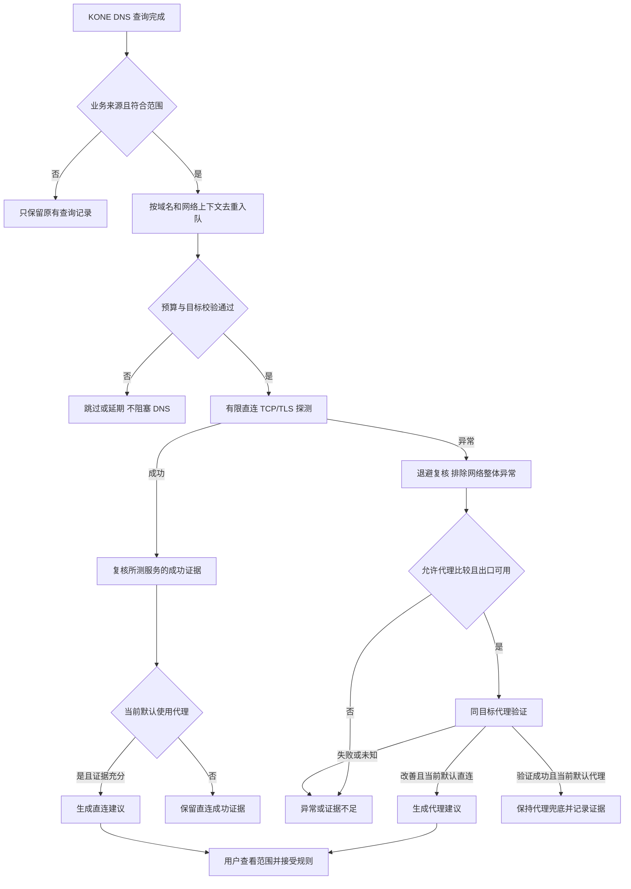

# Proposal：两种基础模式与 Smart 双向分流建议

> 2026-11-08 实施更新：本提案的一期建议已进入当前开发分支。产品契约以 [PRD](../requirements/prd.md)、[Web 规格](../requirements/web-ui.md) 与 [DNS 实现说明](../technical/dns.md) 为准；以下正文为历史设计推理与未来范围，不把后续自动应用、代理 DNS 或新协议视为已实现能力。

原提案日期：2026-11-07。原始研究基线：[master 8d018cd](https://github.com/xjdrew/kone/tree/8d018cd729f7417b7202a652c65a486ae0e2f33f)。承接[产品方向研究](../research/product-direction-2026-11-07.md#5-smart可以实现什么-应该承诺什么)与[四个策略边界 proposal](policy-layers-and-fake-ip.md)。

**采用“Standalone / Global 基础模式＋始终可用的自定义规则＋独立 Smart 开关”。** 两种模式决定默认 FINAL；Smart 评估未命中明确规则的目标，既可建议代理，也可建议直连。原先将 Smart、Custom 并列为全局模式的设想由本次用户澄清替代。

建议先做“观察 DNS → 有限主动探测 → 提供可解释的双向建议”，验证后再开放自动选择。后台建议不要求接管全部业务流量，但无法覆盖所有应用端口、所有协议，也不能修复第一次已经旁路的业务连接。本阶段不自动修改规则、路由或重放业务请求；未来自动分流的捕获和失败边界仍需单独验证。

## 1 先回答观察范围与端口疑问

用户的判断在“选择性捕获、业务目标未落入捕获路由”的前提下成立。需要把 DNS 可见、业务流可见和主动探测可见分开：

| 场景 | KONE 知道什么 | KONE 不知道什么 |
| --- | --- | --- |
| 字面 IP 访问，目的地址未被捕获 | 没有该业务流的证据 | 目标端口、协议、连接结果，也不一定知道该 IP 被访问过 |
| 域名经 KONE DNS 返回真实地址，业务旁路 | 查询名、类型、解析路径、地址与 DNS 错误 | 应用是否真正连接、选择哪个地址/端口、TCP 建连与 UDP 收包结果 |
| 返回 Fake-IP，后续流进入 KONE | 可恢复域名，并取得该流的目标端口、TCP/UDP 与执行结果 | 不能仅凭连接建立推断登录、视频、支付等业务是否成功 |
| 后台主动连接某个 `IP:port` | 自己这次连接的超时、拒绝、路由错误、TLS 或协议响应 | 不能把该探针冒充为应用的原始连接 |

因此，“不知道应用端口，所以无法判断任何 TCP/UDP 连通性”需要限定：**无法被动判断旁路业务流的实际连通性，但可以主动检查选定端点的 TCP/TLS，或有明确定义的 UDP 协议。** 探测 `example.com:443/TCP` 成功，不能说明该域名的 `8443/TCP` 或 `443/UDP` 成功；失败也不能反推应用访问的正是这个端口。

普通 A/AAAA 查询的问题部分是域名、类型和类，不携带业务目标端口。DNS 自己的 UDP/TCP、客户端源端口和 DNS 服务端 53 端口均不是业务连接信息。[RFC 1035 §4.1.2](https://www.rfc-editor.org/rfc/rfc1035.html#section-4.1.2)

这里应使用“**经过 KONE DNS**”而非保证所有解析都以同一种方式经过 TUN：当前既有 DNS listener，也有 sing-tun 回调。应用自行使用未被接管的 DoH/DoT、使用启动前缓存，或者直接访问 IP，都可能没有可用 DNS 事件。预解析还意味着“查过域名”不等于“用户访问过该服务”。[DNS 入口](../../pkg/kone/dns.go)、[查询记录](../../pkg/kone/dns_observation.go)

“没有 IP 规则就一定不进 TUN”也不是所有配置下都成立：开启 `auto-route`/`auto-route6` 后，字面 IP 可以被更广的捕获路由接管；某些更具体的系统路由仍可能旁路。反过来，存在一条直连 IP 规则也不等于该网段已经安装捕获路由。应以实际路由计划、地址族和系统选择为准。[路由实现](../../pkg/kone/live_routes.go)

本 proposal 的自动发现范围只承诺：**KONE 观察到的域名解析，以及按限定目标发起的主动探测。** 在未来更完整的流量接管下，Smart 也可以处理字面 IP；“只支持域名”是本阶段的范围，不是所有 Smart 技术路线的永久限制。

## 2 代理规则模型与配置优化

### 2.1 两种基础模式 规则始终生效

新模型把默认动作、用户意图和辅助决策分开，较四种互斥模式更一致，也更贴近现有 [PRD 5.5](../requirements/prd.md#55-基础策略与全局代理) 的两种基础策略。这里确认的是用户最新的产品方向，不代表管理模式对象已经实现。

| 基础模式 | 基础 FINAL | 用户如何定制 |
| --- | --- | --- |
| Standalone，建议显示为“默认直连” | `direct` | 初始不代理；Smart 关闭或仅建议时，只有明确的代理规则才代理流量 |
| Global，建议显示为“默认代理” | 一个已配置、已启用的代理 | 默认代理受支持的非局域网业务；允许添加直连/拒绝例外或指定其他代理 |

两种模式都使用同一份用户规则，不需要 Custom 模式才能编辑规则。Smart 是独立能力开关；应用身份是规则条件，不再成为模式划分依据。Standalone 也不等于暂停：代理规则仍可能生效，暂停才是停止引擎接管。

“默认”是关键措辞：Standalone 不承诺永远不代理，Global 也不承诺存在用户例外或 Smart 直连决定时仍全量代理。界面应显示“默认出口＋例外＋Smart 状态”，避免只用模式名称推断实际路径。开启 Smart 后，用户允许系统评估默认动作；明确写出的业务规则仍是约束。

### 2.2 保持四池优先级 Smart 只作用于兜底

继续采用 **系统保护 → 域名规则 → IP 规则 → FINAL**。这里的“明确用户规则”指 FINAL 之前的业务条件规则；FINAL 表达缺省动作，不视为禁止一切 Smart 调整的强制目标规则。

建议统一求值契约：

1. 恢复可靠目标身份，检查系统保护。
2. 域名池、IP 池按[四池 proposal](policy-layers-and-fake-ip.md)求值；明确直连、代理或拒绝命中即执行，Smart 不覆盖。
3. 前面需要的证据已齐备且均未匹配，才进入 FINAL。缺少 IP、应用身份或端口条件时继续取证/延迟决定，不能把未知当成允许 Smart 自由选择。
4. Smart 关闭或处于“仅建议”阶段时，执行基础 FINAL；后台只能提出建议。
5. 未来启用自动选择时，FINAL 内部可使用当前网络、目标服务范围内的有效 Smart 偏好；没有充分证据就使用基础 FINAL。

**自动学习结果是 FINAL 的临时决策输入，不是偷偷插入域名池的规则。** 否则一条学习出的域名直连很容易越过用户明确的 IP 代理规则，与“尊重用户意图”矛盾。这一设计不增加第五池，不改变用户域名规则高于用户 IP 规则的关系。用户主动接受建议形成的规则才进入相应池，并预览跨池优先级影响。

路由解释至少区分 `system`、`user-rule`、`smart-final`、`base-final` 的决定来源。即使结果都为 direct，也要能看出是用户要求、Smart 选择还是默认行为。第一期不产生 `smart-final` 的自动执行结果。

例如，Global 中用户写了 `IP-CIDR … → office`，Smart 即使发现相关域名可直连，也不能越过该规则；用户主动接受并新增 `DOMAIN … → direct` 则属于有预览的规则变更，由域名池优先决定。没有用户规则、只有直连探测成功时，仅建议阶段继续代理，自动阶段才可能在 FINAL 内选择 direct。

### 2.3 双向 Smart 与发布阶段

| 组合 | 第一期：开启后提供建议 | 后续自动选择候选能力 |
| --- | --- | --- |
| Standalone，Smart 关闭 | 无后台 Smart；明确规则之后 direct | 同左 |
| Standalone，Smart 开启 | 发现重复直连异常且代理验证成功，建议代理例外 | 在获准、已接管且有足够证据的服务范围内临时选择代理 |
| Global，Smart 关闭 | 无后台 Smart；明确规则之后指定代理 | 同左 |
| Global，Smart 开启 | 发现稳定可直连的服务，建议直连例外；不要求代理先失败 | 在获准服务范围内临时选择 direct；证据未知/失效时回到代理 FINAL |

Smart 的目标是适当使用代理，不是始终寻找代理，也不是每个连接都选延迟最低的出口。Global 下“可以直连”本身就可成为节省代理使用的建议，不需要证明直连一定更快；若宣称性能改善，必须另有可比较测量。一次 TCP 成功仍不等于业务可用，后文给出复核门槛。

**“提供建议”与“自动选择”是 Smart 的执行级别，不是新增全局模式。** 首版开关明确显示“Smart：提供建议”；自动选择验收完成后另行开放，不在升级时把原有建议开关静默变成自动改流量。首次是否默认开启仍是待评审项，建议先保持显式启用。

必须区分用户规则与学习：明确 `DOMAIN … → proxy` 不因直连可达而改为 direct；明确 direct 不因探针失败而改为代理；reject 也不触发绕行探测。若用户希望自动选择，应让该目标进入 FINAL，而非用一条宽泛强制规则匹配所有流量。尚无可靠应用身份时，不能假设相关强制应用规则未命中；后台候选应跳过或标记待证据。

Global＋Smart 的直连探测会产生本地 DNS/目标连接；用户启用双向 Smart 时应能理解这一行为。需要特定目标始终代理时使用明确代理规则，或关闭 Smart 的直连评估。代理失败、协议不支持都不能单独成为自动直连的理由：只有被允许且独立验证过的目标范围才可使用 Smart direct。这保持了现有 POL-05“不可无条件失败直连”的约束；后续 PRD 需补充获准 Smart 决定的范围。

### 2.4 出口选择与捕获范围必须分别设计

**Global 不能仅把 FINAL 改为代理。** 它还需要实际覆盖受支持 IPv4/IPv6、TCP/UDP 的捕获与保护计划；字面 IP 公网访问也要纳入，LAN/VPN 和出口自身保持原有保护。系统路由旁路、不支持的协议或地址族要显示限制，不把配置名称当作已接管证据。

Standalone 可保留选择性接管；单纯打开后台 Smart 建议不要求把所有流量送入 TUN。接受域名代理建议后仍受 3.2 的旧真实 IP 缓存限制。以后若要求首次连接自动回退，则相关候选必须先进入可控制的流路径，再谈自动切换。

**Global 中选择 direct 是由 KONE 转发直连，不等于把该 IP 从 TUN 路由中移除。** 自动为共享 CDN 地址删捕获路由会影响其他域名，也会丢失后续观察。特别是域名直连例外：如果 DNS 直接返回真实 IP，捕获后的流又没有域名身份，就可能再次落回代理 FINAL。需要保留 Fake-IP 或等价的可靠域名身份，让已捕获的新流能执行域名直连决定；不能依赖“最近 DNS 查询对应此 IP”的猜测表。这是实现前的设计要求，当前未完成原生验证。

同理，未来参与自动选择的域名即使暂时选择 direct，也宜在受管理的流路径中保留稳定身份。清除学习只重置目标偏好，不清除 Fake-IP 地址归属。既有 TCP/UDP 会话保持已选出口，下一条连接才读取新策略；不能为了节省代理流量把已发送业务数据的会话迁移或重放。

### 2.5 配置和交互的优化建议

| 配置项 | 建议 |
| --- | --- |
| 基础模式 | 只有“默认直连 / 默认代理”；切换保留全部用户规则与 Smart 开关，不清空配置 |
| 首选代理 | 选择稳定的出站 ID；Global 编译为 FINAL，Standalone 的 Smart 代理比较使用它；首期复用同一选择，不另建自动择优代理组 |
| FINAL 的维护 | 基础模式和首选代理生成唯一的 FINAL；管理界面不同时维护另一份可独立漂移的 FINAL 表单 |
| Smart | 独立开关，明确当前为仅建议还是已开放的自动选择；关闭后停止自动任务、失效临时偏好，新流恢复基础 FINAL |
| 用户规则 | 两种模式始终可编辑；系统保护只读解释，域名/IP 分池展示，池内排序；应用条件支持程度单独标记 |
| 建议与学习 | 与手写规则分开保存；可接受、忽略、复核、清除学习；接受后的规则保留来源，可单独撤销 |
| 状态与解释 | 同时显示当前配置版本、实际捕获范围、默认出口、用户例外、Smart 建议/自动决定；未应用不能显示已生效 |

建议的内部概念为 `base_mode`、`proxy_outbound_id`、`smart.enabled`、`smart.behavior`，由编译器产生 FINAL；这些不是当前可用 TOML 字段。若文件模式继续提供原始 FINAL，导入时转换为同一内部模型，不能产生两份互相覆盖的权威配置。规则可引用其他代理，不因首选代理变化而被改写。

Standalone 不需要代理即可运行；未配置首选代理时 Smart 仍可观察异常，但不能验证“代理可改善”。Global 缺少/禁用首选代理必须阻止启用，不能改成 direct。保存与切换采用统一版本检查、预览及配置/捕获事务，包含接口、IPv6、保护范围与学习失效；底层尚不支持热改的部分应按现有契约暂停应用，不假装已经无缝切换。保存设置也不自动启动已暂停的引擎。

切换基础模式后重新校验候选和策略，过时任务不能提交；建议及临时偏好按新版本失效，Smart 开关本身保留。关闭 Smart 不删除用户曾接受或手写的规则，否则会隐式改变明确意图；界面提供按来源筛选后单独撤销。Global 下临时 direct 失效返回代理，Standalone 下临时 proxy 失效返回 direct，均仅影响新流；复核和回切设滞后，避免路径震荡与站点会话频繁换出口。

### 2.6 迁移与规格同步

现有 PRD 的无条件 `direct-first / proxy-first` 可以对应新的 Standalone / Global 名称，继续保留规则；无需迁移成独立 Custom 模式。先前四模式只存在于研究设想，不据此虚构已经交付的数据迁移。

旧配置若有条件 FINAL、FINAL reject 或其他不能无损表达的兜底，继续保留原语义并标记“高级兜底，待转换”，不能擅自归为其中一种或丢弃条件。后续可预览把条件 FINAL 拆成等价规则加基础 FINAL；若规则池无法表达或会改变顺序，则保留高级编辑/阻止有损转换。它是兼容状态，不再创造一个 Custom 基础模式。

本轮将新模型统一到关联研究及 proposal；现行用户指南保持真实实现描述。后续开发前同步 PRD POL-01–06、基础策略的 Web 规格、配置格式与迁移验收，明确两种模式下 Smart 的授权范围；本提案不代表这些功能已经实现。

## 3 探测手段与能力边界

以下为标准与现有实现支持的可行性判断，不是实网误判率或性能测量结果。

| 手段 | 能得到的证据 | 主要盲点与误判来源 | 建议 |
| --- | --- | --- | --- |
| 已有 DNS 结果 | 超时、SERVFAIL、NXDOMAIN、地址、解析路径 | NXDOMAIN 可能合理；不同 DNS/CDN 地址并不等于污染；NOERROR 无地址也不是 TCP 失败 | 第一期必做，异常单独归类 |
| ICMP Echo / 路由诊断 | 某条路径上的 ICMP 回应或错误 | ICMP 被过滤不能说明 TCP/UDP 不通；HTTP CONNECT、SOCKS、SS 出口不能直接当作通用 ICMP 隧道 | 不作为自动代理建议门槛；留给高级诊断 |
| 指定端口 TCP connect | 本次端点建立、超时、拒绝或本地路由错误 | 只有所测端口；拒绝可能是正常未监听；超时无法定位运营商、防火墙、服务器或拥塞 | 第一期核心证据 |
| TLS 握手与证书校验 | 在所测 TCP 端点上，带指定服务名的 TLS 能否完成 | 系统时间、证书、mTLS、ALPN、TLS 实现与 ECH 差异会影响结果；不代表 HTTP/登录正常 | 第一期面向 Web 的主要验证；不得跳过证书校验 |
| HTTPS HEAD | HTTPS 层有响应，可取得有限状态与响应头 | 403/404/405/5xx 不是“网络不通”；HEAD 可能不受支持，认证与业务状态不可推定 | 可选增强，首期不作为必需 |
| 通用 UDP send/connect | 本地 socket 操作结果，有时有 ICMP 错误 | 发出数据不等于远端收到；无响应可能是不识别请求；不存在通用 UDP 建连成功证据 | 不生成可达性成功结论 |
| 协议专用 UDP 请求/响应 | 如 DNS 请求与有效响应匹配，证明该服务的一次往返 | DNS/UDP 成功不能外推到游戏、语音或 QUIC；出口需支持对应 UDP 能力 | 以后按协议插件化扩展 |
| QUIC / HTTP/3 握手 | 指定服务的 QUIC/TLS/HTTP3 能力与响应 | 服务不支持 H3、路径 UDP 限制、版本协商、出口能力可能混在一起 | 后续独立验证，不用 UDP/443 发包代替 |

TCP 的超时、复位需要相应的连接或报文证据；KONE 没有旁路业务流的这些证据，但能取得自己主动连接的结果。[RFC 9293 连接事件处理](https://www.rfc-editor.org/rfc/rfc9293.html#section-3.10) UDP 本身不建立连接，也不保证交付，需要上层响应语义支持判断。[RFC 8085](https://www.rfc-editor.org/rfc/rfc8085.html)

HEAD 的用途是取得响应元信息而不传输响应内容；即便收到合法的 405，也已经有 HTTP 响应，不能把它标成 TCP 不可达。[RFC 9110 §9.3.2](https://www.rfc-editor.org/rfc/rfc9110.html#section-9.3.2)、[§15.5.6](https://www.rfc-editor.org/rfc/rfc9110.html#section-15.5.6)

若以后增加 HTTP 探针，应使用独立无凭据请求，限制头部/读取量和总时长，默认不跟随重定向，不携带用户 cookie、Authorization 或业务请求。TLS 校验失败单独说明，不通过关闭校验把失败变为成功，也不截获或解密应用的 HTTPS。

### 3.1 端口从哪里来

首期建议提供一个清楚命名的“Web 可达性探测”能力：对符合条件的公网域名使用 TCP/443 加 TLS，明确记录 `port_source=web_default`。**443 是产品选择的启发式探测目标，不是从 A/AAAA 推导出的应用端口。** 域名仅运行邮件、SSH、游戏或自定义 API 时，443 失败只能保留为未确认的探测异常；不能据此要求整个域名代理。Global 下 443/TLS 成功也只能建议相应服务范围直连，不能顺带把所有 UDP 或应用流量改为 direct。

更强的线索可以来自用户指定的服务端口、之后实际捕获到的流，或 DNS 的 HTTPS/SVCB、SRV 服务信息。HTTPS/SVCB 可以给出端口、ALPN 与替代服务端点，SRV 含服务端口；应用是否支持、是否选择它们仍未知，且不能把任意服务记录当作授权扫描所有端口。[RFC 9460 服务参数示例](https://www.rfc-editor.org/rfc/rfc9460.html#section-10.4.3)、[RFC 2782](https://www.rfc-editor.org/rfc/rfc2782.html)

第一期不枚举常见端口；80 只在有明确服务线索或用户配置时探测。SVCB 的替代目标、端口和 ALPN 应作为一组绑定信息验证；不能把一个记录的端口与另一个地址随意组合。未知服务可维持 DNS 层观察，不必为了让所有域名都得到红绿状态而猜测。

### 3.2 直连与代理怎么公平比较

| 比较方法 | 结论范围 | 第一阶段选择 |
| --- | --- | --- |
| 同一个真实 IP、端口、协议、TLS 服务名，分别直连与代理 | 尽量固定服务目标，比较两条探测路径 | 默认采用；所有候选先做保护与公网资格校验 |
| 本地 DNS 的地址 vs 指定代理解析路径返回的地址，再分别探测 | 比较“解析加传输”的整体效果，地址不同会混入 CDN 差异 | 后续显式支持，分别展示解析路径和地址 |
| 直接让代理按域名自行解析，不返回解析地址 | 能观察端到端效果，无法验证远端选了哪个 IP | 首期不自动执行；不能声称完成了目标地址保护检查 |

如果本地 DNS 返回错误公网地址，第一种方法可能两边都失败；这是首期不能完整识别 DNS 问题的边界。以后可以通过明确配置的代理 DNS 通道取得可检查的结果，再固定获准 IP 拨号。不能把私有后缀或企业 DNS 查询自动发给公共解析器，也不能只因两边地址不同就标注“DNS 污染”。

代理服务器的 TCP 连接建立不等于目标服务可达。HTTP CONNECT/SOCKS5 的目标确认比传输建立多一层证据；Shadowsocks 没有同等目标连接确认时，必须等到目标 TLS/协议响应才判相应成功。现有诊断已区分这些层次，建议沿用。[探测实现](../../pkg/kone/diagnostic_probe.go)

多 A/AAAA 分别记录结果，在总预算内抽样多个候选。IPv6 失败而 IPv4 成功，应提示地址族问题，不能把域名整体归为不可达；抽样失败只能写“已测试的候选失败”。不同地址/地址族的可达性确实可能不同，这也是 Happy Eyeballs 处理的场景。[RFC 8305](https://www.rfc-editor.org/rfc/rfc8305.html)

还有一个重要差异：KONE 的探针使用运行引擎的解析和出口接口约束，旁路应用可能由系统选择另一张接口、企业 VPN 或应用专属路由；网关上的探针也不代表客户端自己的路径。因此必须记录探测来源、出口接口与网络代次，不能称作“已经复现应用的连接失败”。同 IP 的对比也不代表同一 CDN 后端或相同地域服务行为。

## 4 从查询到建议的后台流程

1. DNS 正常响应路径只生成小型不可变事件并尝试非阻塞入队，不等待探测、不为探测额外访问上游。队列满时丢弃任务并计数；查询历史关闭也不应使调度器偷偷恢复长期历史存储。
2. 只处理业务来源的相关查询，合并同域名 A/AAAA 与短时间重复请求。排除系统保护、明确拒绝/强制业务规则、私有解析范围和内部诊断事件；FINAL 来自基础模式，不按强制业务规则排除。需要记录决定来源及不完整条件，不能只看当前 outbound 名称判断资格。
3. **同时纳入两类域名：Standalone 等路径返回真实地址的查询，以及 Global 默认 FINAL 导致返回 Fake-IP 的查询。** 后者保留域名作为候选，Fake-IP 本身绝不能作为公网探测地址。若没有真实地址，后台按运行引擎的解析范围有预算地获取 A/AAAA，再校验公网资格；不改变客户端已收到的 DNS 答案，不占用正常响应时延。现有 `ResolveTypeContext` 可提供取得真实 DNS 的基础，但需完善后台来源和版本约束。[解析入口](../../pkg/kone/dns.go)
4. 使用固定配置/网络代次、仍有效的 DNS 证据构造探测计划；等待过久或 TTL 到期时重新验证或放弃。无有效地址的 DNS 失败保留为解析异常；原先只返回 Fake-IP 的 Global 任务也不能跳过此检查。
5. 先做有限直连探测：稳定成功时，在 Global 中产生窄范围直连建议；Standalone 中只保留成功证据。异常后退避复核，使用获准代理做同目标比较；验证改善后，在 Standalone 中建议代理，在 Global 中保持默认代理，不重复生成相同效果的规则。两边失败时报告证据，不盲目切换。没有代理时可以提示异常，但不声称代理能修复。
6. 将结果放进有界的建议存储，界面关闭时任务仍由引擎/助手生命周期管理；前端只是读取，不以页面轮询承担调度。

探针自身触发的解析必须标明来源，并排除二次入队，避免“探测 → DNS → 更多探测”的自激循环。当前查询事件的 `Scope=control` 可作为区分线索，但后续应明确业务、手动诊断、后台探测来源，不以来源字符串偶然相同作为完整契约。

### 4.1 建议的判定门槛

建议存储至少区分：未测试、待执行、直连探测成功待复核、可建议直连、直连异常待复核、可建议代理、两边失败、跳过/预算不足、已忽略、已过期。未知不能显示成不可达，也不能显示成成功。每条建议有明确的 `suggested_action=direct/proxy`，不把直连优化塞进“代理失败”列表。

每份证据绑定实际 IP、端口、协议、TLS 服务名、出口与解析路径、网络/配置版本、探测时间和有效期。不同地址的失败不能拼成“同一端点重复失败”；DNS 轮换后若无法取得可比较样本，应降低结论强度或重新复核。

较强的代理建议应同时满足：相同服务范围内重复直连失败；代理取得可验证的目标 TLS/协议成功证据；样本仍属当前网络/配置；不存在已知可用的同服务直连候选；没有用户明确规则或系统保护禁止比较。建议文案例如：

> 最近两次对 `example.com` 的 TCP/443 与 TLS 探测直连失败，通过 office 验证成功。建议尝试为该域名的 TCP/443 使用代理。此结果来自 KONE 探测，尚未验证你的应用连接。

Global 的直连建议采用不同门槛：同一服务范围在当前网络重复完成直连及目标 TLS/协议验证，没有强制代理/拒绝规则、身份待定或保护冲突，结果仍有效。原型可先取至少两次、间隔不短于 30 秒的可比较成功样本，后续按误判率调优。**不要求默认代理失败，也不要求直连更快。** 未比较代理时明确标注；探针可直连仍不等于直连符合账号地域、出口身份或完整业务的要求，首期由用户接受。

> `example.com` 的 TCP/443 与 TLS 在当前网络重复直连成功，目前由 Global 默认代理处理。可为该服务添加直连例外，减少代理使用。尚未验证应用业务，也未证明直连更快。

未来自动执行需比建议更严格：目标必须受管理、有可靠身份和当前有效证据，未知仍使用基础 FINAL；从代理回直连要有稳定窗口，失败后的重新尝试需退避。一条已建立会话不因后台样本更新而更换出口。建议阶段不能把“用户未反对”当作自动应用许可。

仅 ICMP 不响应、一次超时、DNS 答案不同、HTTP 403/405、某个 IPv6 地址失败，均不足以生成上述结论。证书/时钟、代理不可用、断网、可能的认证门户等情况优先显示对应诊断；无法排除时保留“原因未确定”。跨多个无关目标集中失败时先抑制逐域名建议，不自动建成一大批代理规则。

成功证据只覆盖所测服务。即使探测成功，应用仍可能因其他端口、协议、服务端账号/地域限制或不同路由失败；界面不得据此关闭用户报告的问题。判断“代理对探针有帮助”也不足以确定故障由谁造成，不使用“已确认被封锁”的文案。

### 4.2 接受建议后的生效边界

用户接受直连或代理建议时，预览域名、协议/端口、动作、出口、有效期与现有规则冲突；默认按已验证的较窄范围生成规则，扩大到整个域名由用户选择。沿用配置版本检查与事务发布，已过期或网络变更的建议先失效/复核，不静默覆盖后来编辑的规则。

用户接受的规则进入[四池模型](policy-layers-and-fake-ip.md)的相应域名池；建议本身不是第五池。未来自动学习只作为 FINAL 的输入，不直接插入域名池。拒绝建议/暂不提醒应有按网络和期限区分的状态，不改变永久规则；关闭 Smart 后已接受的规则仍有效。

**接受域名代理建议仍受问题 3.2 限制：** 应用继续使用旧真实 IP 或既有连接时，规则可能不会影响这次请求。提示重新解析并新建连接，不能宣称“保存成功，当前连接立即恢复”。不自动给 DNS 答案加 `/32` 或 `/128` 代理路由；共享 CDN 会让这种捷径影响其他域名。规则启用之后是否已观察到新的 Fake-IP 流，应与“规则已保存”分开展示。

Global 接受域名直连建议后，须验证第 2.4 节的域名身份保留：旧 Fake-IP 发起的新流可按新规则决定；新 DNS 不能因动作变成 direct 就丢掉全局捕获下执行规则所需的身份。已有代理连接继续原路径，不把这种正常会话保留标成切换失败。

## 5 资源、目标范围与生命周期

自动探测会产生额外 DNS/连接和 TLS 流量，是用户启用该能力后的主动行为。产品说明应让用户理解它与只记录查询的区别，同时提供关闭与暂停入口。

| 项目 | 建议的原型起点，需实测调优 |
| --- | --- |
| 后台并发与队列 | 2 个工作者、最多 128 个待处理域名；手动诊断有独立保留额度 |
| 全局速率 | 每分钟最多 30 次连接尝试、突发最多 6 次；每个地址族、重试、代理比较均计入，不能按“任务”漏算 |
| 单次时限 | 每次连接加 TLS 合计 3–5 秒；一次任务总预算不超过 15 秒，预算不够即延期/未知 |
| 复核与冷却 | 可疑结果至少间隔 30 秒再复核；完成后的同域名常规探测冷却起点为 10 分钟 |
| 存储与有效期 | 最多 512 条建议；证据上限 5 分钟，并受 DNS TTL、网络/解析/出口版本变更进一步缩短 |
| 生命周期 | 停止引擎、暂停捕获、关闭 Smart、切换基础模式、助手重建和网络代次变化时取消相关任务；过时结果不得提交 |

这些数值只定义一个可压测的起点，不是已证明的性能指标。还应设置 DNS 请求和结果字节上限、失败退避与调度公平性；不能让一个页面大量预解析耗尽全部预算。去重键至少包含域名、解析范围、网络代次、地址族、协议/端口和出口配置版本；退避复核属于同一待完成任务，不能被常规冷却挡住。重启不扫描历史域名，只处理新观察到的候选。

自动任务只允许经过检查的公网目标：排除 loopback、本机接口、局域网/链路本地、ULA、组播、未指定、特殊用途及 KONE 虚拟地址，遵守私有 DNS 后缀和系统保护；每次解析变化、CNAME/服务替代目标以及拨号前都复核，避免 DNS 重绑定把后台探测导向本机或内部服务。`IsGlobalUnicast` 单一判断不足以覆盖这些范围。对纯域名的代理远端解析看不到实际地址时，不能声称已完成同样检查，首期不自动使用该路径。

现有手动诊断允许用户显式测试部分私网地址，自动探测应另设更严格的目标校验，不改变这一手动能力。建议只保留必要的域名、端点、时间、阶段、错误类别和版本，不保存用户 HTTP 内容或代理凭据；清除历史/建议与停止任务的语义应一致。系统性断网或认证门户只能在已有证据充分时分类，不为推断状态擅自添加一组外部固定探测站点。

## 6 现有代码可复用到什么程度

| 现有基础 | 可复用部分 | 必须补充的设计 |
| --- | --- | --- |
| [dns_observation.go](../../pkg/kone/dns_observation.go) | 查询名、真实/虚拟地址、状态、解析路径、配置版本；代码已声明不代表业务连接 | 决定来源、事件源、内部有界订阅、TTL/CNAME/私有范围证据；Global 的 Fake-IP 域名也要入候选，不探测虚拟地址 |
| [diagnostic_probe.go](../../pkg/kone/diagnostic_probe.go) | 当前引擎快照、出口接口、版本校验、5 秒上下文、TCP/TLS 分阶段结果、引擎停止取消 | 结构化探测计划，分离拨号 IP 与 TLS 服务名；记录固定端点及证据范围 |
| [diagnostic_udp.go](../../pkg/kone/diagnostic_udp.go) | UDP 能力检查、特定 DNS 请求及响应验证，明确不是 QUIC/业务证据 | 不能直接变成任意域名 UDP 测试；新增协议需独立报文与成功判据 |
| [tasks.go](../../pkg/control/tasks.go)、[outbound_health.go](../../pkg/control/outbound_health.go) | 独立诊断与出口健康任务、共享并发控制的已有经验 | 后台全局速率、候选去重、优先级、双向建议存储；出口健康不等于所有目标可达 |
| 规则与配置编译、DNS/流处理 | 当前 FINAL、规则 ID、配置快照、路由事务与 Fake-IP | 两种基础模式生成 FINAL，保留全局域名直连身份；将来自动偏好只在 FINAL 内取用，避免覆盖明确规则 |
| `pkg/desktop` 助手与网络状态 | 真正运行引擎的所有者、远程诊断、停止/网络变化生命周期 | 调度由运行所有者唯一持有；管理进程不能再启动第二套探测器；CLI 也有明确范围 |

当前 TCP 探测接收 `host:port`，TLS 的 `ServerName` 直接取其中的 host。若为了固定目标而把 host 改成 IP，会变成按 IP 校验证书，并可能失去正确的 SNI；不能原样调用后把这类失败归为网络异常。需要新增内部计划，明确 `domain/server_name`、`dial_ip`、`port`、`protocol`、`outbound` 和 DNS/网络证据，让两条路径真正测试同一服务。它仍使用现有模块，不要求引入新的执行核心。

若开发 HTTP/3 等额外协议需要新依赖，按开发规范另行评审。第一期 TCP/TLS 与后台建议没有必要为此引入大型协议栈。

## 7 实施顺序与验收

本轮仅提交方案，不编写调度器、规则变更或前端实现。后续建议按以下顺序拆分：

1. **策略与证据契约。** 同步两种基础模式、统一规则与独立 Smart；明确真实/Fake-IP 查询来源、默认 FINAL 与强制规则区别、私有解析范围、网络代次和未知状态；实现有界事件输入与去重，证明 DNS 不因探测阻塞。
2. **结构化 TCP/TLS 探测。** 固定 IP 与服务名、直连/代理对照、保护校验、预算和取消；先用回环服务和可控代理验证结果分类。
3. **双向建议闭环。** Standalone 建议代理、Global 建议直连；复核/过期/忽略、规则预览与事务、关闭 Smart 后保留手动规则；验证旧真实 IP 限制及 Global 域名直连的身份保留。
4. **隔离平台验证与试点。** 覆盖选择性路由、IPv4/IPv6、VPN/网络切换、助手重启；测量有用建议比例、纠错耗时、误判、DNS 延迟与额外连接开销，再确定默认预算。
5. **按证据扩展。** 代理 DNS 对比、HTTP 或特定 UDP/QUIC 协议，以及需要更完整捕获的自动回退，分别评审，不视为第一期自然拥有的能力。

| 验收场景 | 必须成立的结果 |
| --- | --- |
| 两种基础模式 × Smart 开关 | 同一份用户规则始终生效；基础 FINAL 分别为 direct/指定代理；建议阶段绝不自动改变出口 |
| Global DNS 返回 Fake-IP | 域名仍可入队；后台取合规真实地址，禁止探测 Fake-IP；DNS 正常响应不等待探针 |
| Global 直连重复成功、代理正常 | 可产生窄范围直连建议，不以代理失败或更低延迟为必要条件 |
| 用户明确代理/直连/拒绝、未来学习的域名偏好 | 明确规则优先，包括 IP 强制规则；身份/条件未知不假装未匹配；学习不插进域名池抢优先级 |
| Global 接受域名直连例外 | 全局捕获范围保持；新流有可靠域名身份并执行 direct，不因 DNS 返回真实 IP 再落回代理 FINAL |
| 模式切换、关闭 Smart、清除学习 | 用户规则保留；过时任务取消；临时自动偏好失效；只有新流使用新的基础策略 |
| 导入条件 FINAL、FINAL reject、缺失或禁用首选代理 | 不丢弃旧条件、不误认成普通模式；Global 无可用默认代理不启用；不静默直连 |
| 真实 IP 业务旁路、字面 IP 无 DNS、应用自带未接管 DoH | 不能虚构业务失败、端口或覆盖率；只有已观察 DNS 可触发本阶段任务 |
| 应用用 8443/UDP，探针测 443/TCP | 结果只标记探针范围，不能声称应用正常/异常 |
| 同地址直连失败、代理 TLS 成功 | 经过复核和上下文检查后可建议；不自动改规则 |
| 443 未监听、HTTP 403/405、证书不匹配、mTLS/ECH 差异 | 按阶段说明，不能一概标记网络不可达或确定封锁 |
| 多 CDN 地址、IPv6 失败 IPv4 成功、DNS 结果变化 | 逐候选/地址族记录；有可用直连候选时避免整体代理结论 |
| SS 只连上代理服务器、代理不支持所测协议 | 目标状态保持未知/能力不足，不生成假成功 |
| 私有后缀、DNS 重绑定、替代服务指向内网 | 自动任务不得拨号受保护目标；手动诊断范围保持独立 |
| 网络整体故障、VPN 切换、出口配置变更、模式切换 | 暂停或取消、失效旧证据，不把旧结果发布为当前建议 |
| 高频 DNS、队列满、预算耗尽、重复 A/AAAA | DNS 快速返回；任务有界；重试与地址族均计费；无探测触发自身的循环 |
| 接受规则后继续使用旧真实 IP | 明确 3.2 限制；不加共享 IP 捕获捷径；重新解析后的新流才验证规则效果 |

当前研究已核对实现与协议规范；没有在真实用户网络上执行自动探测，也没有据此声称误判率、默认端口覆盖率或三平台性能已经达标。建议先验证“有限证据能否帮助用户选择代理或直连”，再决定什么时候把 Smart 从建议提升为自动行为。
