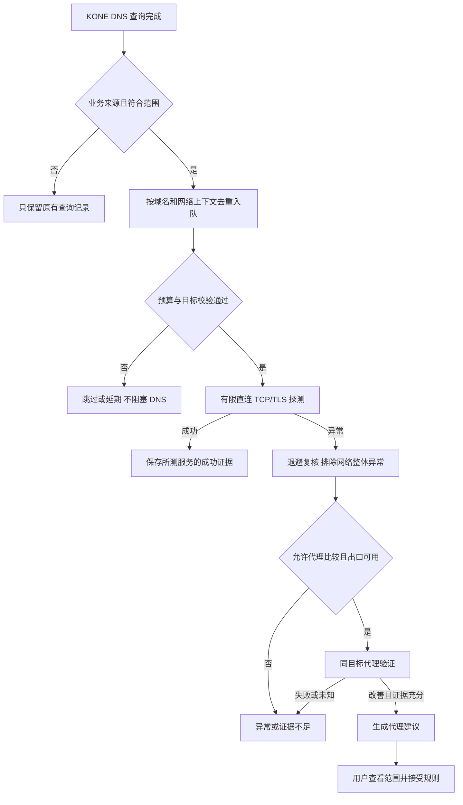

# Proposal：DNS 驱动的 Smart 后台探测与代理建议

日期：2026-11-07。状态：**待评审，供后续开发；未实施。** 代码基线：[master 8d018cd](https://github.com/xjdrew/kone/tree/8d018cd729f7417b7202a652c65a486ae0e2f33f)。承接[产品方向研究](../research/product-direction-2026-11-07.md#5-smart可以实现什么-应该承诺什么)与[四个策略边界 proposal](policy-layers-and-fake-ip.md)。

**建议先做“观察 DNS → 有限主动探测 → 提供可解释的代理建议”。** 这条路线不要求接管全部业务流量，适合 KONE 当前的选择性捕获方式。它可以发现某些直连与代理路径差异，但无法覆盖所有应用端口、所有协议，也不能修复第一次已经旁路的业务连接。本阶段不自动修改规则、路由或重放业务请求；未来自动分流仍需单独验证。

## 1 先回答观察范围与端口疑问

用户的判断在“选择性捕获、业务目标未落入捕获路由”的前提下成立。需要把 DNS 可见、业务流可见和主动探测可见分开：

| 场景 | KONE 知道什么 | KONE 不知道什么 |
| --- | --- | --- |
| 字面 IP 访问，目的地址未被捕获 | 没有该业务流的证据 | 目标端口、协议、连接结果，也不一定知道该 IP 被访问过 |
| 域名经 KONE DNS 返回真实地址，业务旁路 | 查询名、类型、解析路径、地址与 DNS 错误 | 应用是否真正连接、选择哪个地址/端口、TCP 建连与 UDP 收包结果 |
| 返回 Fake-IP，后续流进入 KONE | 可恢复域名，并取得该流的目标端口、TCP/UDP 与执行结果 | 不能仅凭连接建立推断登录、视频、支付等业务是否成功 |
| 后台主动连接某个 `IP:port` | 自己这次连接的超时、拒绝、路由错误、TLS 或协议响应 | 不能把该探针冒充为应用的原始连接 |

因此，“不知道应用端口，所以无法判断任何 TCP/UDP 连通性”需要限定：**无法被动判断旁路业务流的实际连通性，但可以主动检查选定端点的 TCP/TLS，或有明确定义的 UDP 协议。** 探测 `example.com:443/TCP` 成功，不能说明该域名的 `8443/TCP` 或 `443/UDP` 成功；失败也不能反推应用访问的正是这个端口。

普通 A/AAAA 查询的问题部分是域名、类型和类，不携带业务目标端口。DNS 自己的 UDP/TCP、客户端源端口和 DNS 服务端 53 端口均不是业务连接信息。[RFC 1035 §4.1.2](https://www.rfc-editor.org/rfc/rfc1035.html#section-4.1.2)

这里应使用“**经过 KONE DNS**”而非保证所有解析都以同一种方式经过 TUN：当前既有 DNS listener，也有 sing-tun 回调。应用自行使用未被接管的 DoH/DoT、使用启动前缓存，或者直接访问 IP，都可能没有可用 DNS 事件。预解析还意味着“查过域名”不等于“用户访问过该服务”。[DNS 入口](../../pkg/kone/dns.go)、[查询记录](../../pkg/kone/dns_observation.go)

“没有 IP 规则就一定不进 TUN”也不是所有配置下都成立：开启 `auto-route`/`auto-route6` 后，字面 IP 可以被更广的捕获路由接管；某些更具体的系统路由仍可能旁路。反过来，存在一条直连 IP 规则也不等于该网段已经安装捕获路由。应以实际路由计划、地址族和系统选择为准。[路由实现](../../pkg/kone/live_routes.go)

本 proposal 的自动发现范围只承诺：**KONE 观察到的域名解析，以及按限定目标发起的主动探测。** 在未来更完整的流量接管下，Smart 也可以处理字面 IP；“只支持域名”是本阶段的范围，不是所有 Smart 技术路线的永久限制。

## 2 产品目标与阶段边界

目标是帮助用户发现“这个域名的某项服务，在当前网络通过代理可能更可用”，减少手动输入目标、运行诊断和编写规则的步骤。主要候选是经 KONE DNS 正常返回真实地址、没有被明确规则强制代理/拒绝/直连的公网域名；没有地址的 DNS 失败另列为解析异常，不能强行进入 TCP 探测。

本阶段称为 **Smart 辅助建议阶段**。Smart 的长期模式含义仍是自动判断是否代理；当前阶段交付自动发现和建议，不能宣传为所有流量已经自动分流。Standalone、Global、Custom 不因后台功能改变出口语义；切出 Smart 或暂停捕获后停止对应自动任务。用户主动运行的独立诊断仍是另一入口。

第一版不依赖应用归属，不新增一种 app 模式。应用与域名/IP 一样是未来规则条件；没有应用证据时不得把一次 DNS 查询标记为某应用的失败。系统保护和用户明确动作优先，尤其不能为了比较效果而对强制直连的私有业务尝试代理。

## 3 探测手段与能力边界

以下为标准与现有实现支持的可行性判断，不是实网误判率或性能测量结果。

| 手段 | 能得到的证据 | 主要盲点与误判来源 | 建议 |
| --- | --- | --- | --- |
| 已有 DNS 结果 | 超时、SERVFAIL、NXDOMAIN、地址、解析路径 | NXDOMAIN 可能合理；不同 DNS/CDN 地址并不等于污染；NOERROR 无地址也不是 TCP 失败 | 第一期必做，异常单独归类 |
| ICMP Echo / 路由诊断 | 某条路径上的 ICMP 回应或错误 | ICMP 被过滤不能说明 TCP/UDP 不通；HTTP CONNECT、SOCKS、SS 出口不能直接当作通用 ICMP 隧道 | 不作为自动代理建议门槛；留给高级诊断 |
| 指定端口 TCP connect | 本次端点建立、超时、拒绝或本地路由错误 | 只有所测端口；拒绝可能是正常未监听；超时无法定位运营商、防火墙、服务器或拥塞 | 第一期核心证据 |
| TLS 握手与证书校验 | 在所测 TCP 端点上，带指定服务名的 TLS 能否完成 | 系统时间、证书、mTLS、ALPN、TLS 实现与 ECH 差异会影响结果；不代表 HTTP/登录正常 | 第一期面向 Web 的主要验证；不得跳过证书校验 |
| HTTPS HEAD | HTTPS 层有响应，可取得有限状态与响应头 | 403/404/405/5xx 不是“网络不通”；HEAD 可能不受支持，认证与业务状态不可推定 | 可选增强，首期不作为必需 |
| 通用 UDP send/connect | 本地 socket 操作结果，有时有 ICMP 错误 | 发出数据不等于远端收到；无响应可能是不识别请求；不存在通用 UDP 建连成功证据 | 不生成可达性成功结论 |
| 协议专用 UDP 请求/响应 | 如 DNS 请求与有效响应匹配，证明该服务的一次往返 | DNS/UDP 成功不能外推到游戏、语音或 QUIC；出口需支持对应 UDP 能力 | 以后按协议插件化扩展 |
| QUIC / HTTP/3 握手 | 指定服务的 QUIC/TLS/HTTP3 能力与响应 | 服务不支持 H3、路径 UDP 限制、版本协商、出口能力可能混在一起 | 后续独立验证，不用 UDP/443 发包代替 |

TCP 的超时、复位需要相应的连接或报文证据；KONE 没有旁路业务流的这些证据，但能取得自己主动连接的结果。[RFC 9293 连接事件处理](https://www.rfc-editor.org/rfc/rfc9293.html#section-3.10) UDP 本身不建立连接，也不保证交付，需要上层响应语义支持判断。[RFC 8085](https://www.rfc-editor.org/rfc/rfc8085.html)

HEAD 的用途是取得响应元信息而不传输响应内容；即便收到合法的 405，也已经有 HTTP 响应，不能把它标成 TCP 不可达。[RFC 9110 §9.3.2](https://www.rfc-editor.org/rfc/rfc9110.html#section-9.3.2)、[§15.5.6](https://www.rfc-editor.org/rfc/rfc9110.html#section-15.5.6)

若以后增加 HTTP 探针，应使用独立无凭据请求，限制头部/读取量和总时长，默认不跟随重定向，不携带用户 cookie、Authorization 或业务请求。TLS 校验失败单独说明，不通过关闭校验把失败变为成功，也不截获或解密应用的 HTTPS。

### 3.1 端口从哪里来

首期建议提供一个清楚命名的“Web 可达性探测”能力：对符合条件的公网域名使用 TCP/443 加 TLS，明确记录 `port_source=web_default`。**443 是产品选择的启发式探测目标，不是从 A/AAAA 推导出的应用端口。** 域名仅运行邮件、SSH、游戏或自定义 API 时，443 失败只能保留为未确认的探测异常；不能据此要求整个域名代理。

更强的线索可以来自用户指定的服务端口、之后实际捕获到的流，或 DNS 的 HTTPS/SVCB、SRV 服务信息。HTTPS/SVCB 可以给出端口、ALPN 与替代服务端点，SRV 含服务端口；应用是否支持、是否选择它们仍未知，且不能把任意服务记录当作授权扫描所有端口。[RFC 9460 服务参数示例](https://www.rfc-editor.org/rfc/rfc9460.html#section-10.4.3)、[RFC 2782](https://www.rfc-editor.org/rfc/rfc2782.html)

第一期不枚举常见端口；80 只在有明确服务线索或用户配置时探测。SVCB 的替代目标、端口和 ALPN 应作为一组绑定信息验证；不能把一个记录的端口与另一个地址随意组合。未知服务可维持 DNS 层观察，不必为了让所有域名都得到红绿状态而猜测。

### 3.2 直连与代理怎么公平比较

| 比较方法 | 结论范围 | 第一阶段选择 |
| --- | --- | --- |
| 同一个真实 IP、端口、协议、TLS 服务名，分别直连与代理 | 尽量固定服务目标，比较两条探测路径 | 默认采用；所有候选先做保护与公网资格校验 |
| 本地 DNS 的地址 vs 指定代理解析路径返回的地址，再分别探测 | 比较“解析加传输”的整体效果，地址不同会混入 CDN 差异 | 后续显式支持，分别展示解析路径和地址 |
| 直接让代理按域名自行解析，不返回解析地址 | 能观察端到端效果，无法验证远端选了哪个 IP | 首期不自动执行；不能声称完成了目标地址保护检查 |

如果本地 DNS 返回错误公网地址，第一种方法可能两边都失败；这是首期不能完整识别 DNS 问题的边界。以后可以通过明确配置的代理 DNS 通道取得可检查的结果，再固定获准 IP 拨号。不能把私有后缀或企业 DNS 查询自动发给公共解析器，也不能只因两边地址不同就标注“DNS 污染”。

代理服务器的 TCP 连接建立不等于目标服务可达。HTTP CONNECT/SOCKS5 的目标确认比传输建立多一层证据；Shadowsocks 没有同等目标连接确认时，必须等到目标 TLS/协议响应才判相应成功。现有诊断已区分这些层次，建议沿用。[探测实现](../../pkg/kone/diagnostic_probe.go)

多 A/AAAA 分别记录结果，在总预算内抽样多个候选。IPv6 失败而 IPv4 成功，应提示地址族问题，不能把域名整体归为不可达；抽样失败只能写“已测试的候选失败”。不同地址/地址族的可达性确实可能不同，这也是 Happy Eyeballs 处理的场景。[RFC 8305](https://www.rfc-editor.org/rfc/rfc8305.html)

还有一个重要差异：KONE 的探针使用运行引擎的解析和出口接口约束，旁路应用可能由系统选择另一张接口、企业 VPN 或应用专属路由；网关上的探针也不代表客户端自己的路径。因此必须记录探测来源、出口接口与网络代次，不能称作“已经复现应用的连接失败”。同 IP 的对比也不代表同一 CDN 后端或相同地域服务行为。

## 4 从查询到建议的后台流程

1. DNS 正常响应路径只生成小型不可变事件并尝试非阻塞入队，不等待探测、不为探测额外访问上游。队列满时丢弃任务并计数；查询历史关闭也不应使调度器偷偷恢复长期历史存储。
2. 只处理业务来源的相关查询。合并同域名 A/AAAA 与短时间重复请求，过滤 Fake-IP 答案、系统保护、明确拒绝/强制出口、私有解析范围和内部诊断事件。DNS 错误进入独立解析异常状态，不伪造真实地址。
3. 使用固定配置/网络代次、仍有效的 DNS 证据构造探测计划；等待过久或 TTL 到期时，按原解析范围重新验证或放弃，不能拿陈旧 IP 建立强结论。
4. 先做有限直连探测。异常后退避复核；存在可用且被允许使用的代理时，才做目标一致的比较。没有代理配置时仍可提示解析/探测异常，但不声称代理能修复。
5. 将结果放进有界的建议存储，界面关闭时任务仍由引擎/助手生命周期管理；前端只是读取，不以页面轮询承担调度。

探针自身触发的解析必须标明来源，并排除二次入队，避免“探测 → DNS → 更多探测”的自激循环。当前查询事件的 `Scope=control` 可作为区分线索，但后续应明确业务、手动诊断、后台探测来源，不以来源字符串偶然相同作为完整契约。

### 4.1 建议的判定门槛

建议存储至少区分：未测试、待执行、直连探测成功、直连异常待复核、代理对比改善、两边失败、跳过/预算不足、已忽略、已过期。未知不能显示成不可达，也不能显示成成功。

每份证据绑定实际 IP、端口、协议、TLS 服务名、出口与解析路径、网络/配置版本、探测时间和有效期。不同地址的失败不能拼成“同一端点重复失败”；DNS 轮换后若无法取得可比较样本，应降低结论强度或重新复核。

较强的代理建议应同时满足：相同服务范围内重复直连失败；代理取得可验证的目标 TLS/协议成功证据；样本仍属当前网络/配置；不存在已知可用的同服务直连候选；没有用户明确规则或系统保护禁止比较。建议文案例如：

> 最近两次对 `example.com` 的 TCP/443 与 TLS 探测直连失败，通过 office 验证成功。建议尝试为该域名的 TCP/443 使用代理。此结果来自 KONE 探测，尚未验证你的应用连接。

仅 ICMP 不响应、一次超时、DNS 答案不同、HTTP 403/405、某个 IPv6 地址失败，均不足以生成上述结论。证书/时钟、代理不可用、断网、可能的认证门户等情况优先显示对应诊断；无法排除时保留“原因未确定”。跨多个无关目标集中失败时先抑制逐域名建议，不自动建成一大批代理规则。

成功证据只覆盖所测服务。即使探测成功，应用仍可能因其他端口、协议、服务端账号/地域限制或不同路由失败；界面不得据此关闭用户报告的问题。判断“代理对探针有帮助”也不足以确定故障由谁造成，不使用“已确认被封锁”的文案。

### 4.2 接受建议后的生效边界

用户接受时，预览域名、协议/端口、出口、有效期与现有规则冲突；默认按已验证的较窄范围生成规则，扩大到整个域名由用户选择。沿用配置版本检查与事务发布，已过期或网络变更的建议先失效/复核，不静默覆盖后来编辑的规则。

规则进入[四池模型](policy-layers-and-fake-ip.md)的相应域名池；建议本身不是第五池。将来增加自动学习时，也必须明确定义与用户规则的关系，不能在此阶段暗中启用。拒绝建议/暂不提醒应有按网络和期限区分的状态，不改变永久规则。

**接受域名代理建议仍受问题 3.2 限制：** 应用继续使用旧真实 IP 或既有连接时，规则可能不会影响这次请求。提示重新解析并新建连接，不能宣称“保存成功，当前连接立即恢复”。不自动给 DNS 答案加 `/32` 或 `/128` 代理路由；共享 CDN 会让这种捷径影响其他域名。规则启用之后是否已观察到新的 Fake-IP 流，应与“规则已保存”分开展示。

## 5 资源、目标范围与生命周期

自动探测会产生额外 DNS/连接和 TLS 流量，是用户启用该能力后的主动行为。产品说明应让用户理解它与只记录查询的区别，同时提供关闭与暂停入口。

| 项目 | 建议的原型起点，需实测调优 |
| --- | --- |
| 后台并发与队列 | 2 个工作者、最多 128 个待处理域名；手动诊断有独立保留额度 |
| 全局速率 | 每分钟最多 30 次连接尝试、突发最多 6 次；每个地址族、重试、代理比较均计入，不能按“任务”漏算 |
| 单次时限 | 每次连接加 TLS 合计 3–5 秒；一次任务总预算不超过 15 秒，预算不够即延期/未知 |
| 复核与冷却 | 可疑结果至少间隔 30 秒再复核；完成后的同域名常规探测冷却起点为 10 分钟 |
| 存储与有效期 | 最多 512 条建议；证据上限 5 分钟，并受 DNS TTL、网络/解析/出口版本变更进一步缩短 |
| 生命周期 | 停止引擎、暂停捕获、切出 Smart、助手重建和网络代次变化时取消相关任务；过时结果不得提交 |

这些数值只定义一个可压测的起点，不是已证明的性能指标。还应设置 DNS 请求和结果字节上限、失败退避与调度公平性；不能让一个页面大量预解析耗尽全部预算。去重键至少包含域名、解析范围、网络代次、地址族、协议/端口和出口配置版本；退避复核属于同一待完成任务，不能被常规冷却挡住。重启不扫描历史域名，只处理新观察到的候选。

自动任务只允许经过检查的公网目标：排除 loopback、本机接口、局域网/链路本地、ULA、组播、未指定、特殊用途及 KONE 虚拟地址，遵守私有 DNS 后缀和系统保护；每次解析变化、CNAME/服务替代目标以及拨号前都复核，避免 DNS 重绑定把后台探测导向本机或内部服务。`IsGlobalUnicast` 单一判断不足以覆盖这些范围。对纯域名的代理远端解析看不到实际地址时，不能声称已完成同样检查，首期不自动使用该路径。

现有手动诊断允许用户显式测试部分私网地址，自动探测应另设更严格的目标校验，不改变这一手动能力。建议只保留必要的域名、端点、时间、阶段、错误类别和版本，不保存用户 HTTP 内容或代理凭据；清除历史/建议与停止任务的语义应一致。系统性断网或认证门户只能在已有证据充分时分类，不为推断状态擅自添加一组外部固定探测站点。

## 6 现有代码可复用到什么程度

| 现有基础 | 可复用部分 | 必须补充的设计 |
| --- | --- | --- |
| [dns_observation.go](../../pkg/kone/dns_observation.go) | 查询名、真实/虚拟地址、状态、解析路径、配置版本；代码已声明不代表业务连接 | 事件源标记、内部有界订阅、TTL/CNAME/私有范围证据；不能靠轮询历史列表获得完整调度输入 |
| [diagnostic_probe.go](../../pkg/kone/diagnostic_probe.go) | 当前引擎快照、出口接口、版本校验、5 秒上下文、TCP/TLS 分阶段结果、引擎停止取消 | 结构化探测计划，分离拨号 IP 与 TLS 服务名；记录固定端点及证据范围 |
| [diagnostic_udp.go](../../pkg/kone/diagnostic_udp.go) | UDP 能力检查、特定 DNS 请求及响应验证，明确不是 QUIC/业务证据 | 不能直接变成任意域名 UDP 测试；新增协议需独立报文与成功判据 |
| [tasks.go](../../pkg/control/tasks.go)、[outbound_health.go](../../pkg/control/outbound_health.go) | 独立诊断与出口健康任务、共享并发控制的已有经验 | 后台全局速率、候选去重、优先级、建议存储；出口健康不等于所有目标可达 |
| `pkg/desktop` 助手与网络状态 | 真正运行引擎的所有者、远程诊断、停止/网络变化生命周期 | 调度由运行所有者唯一持有；管理进程不能再启动第二套探测器；CLI 也有明确范围 |

当前 TCP 探测接收 `host:port`，TLS 的 `ServerName` 直接取其中的 host。若为了固定目标而把 host 改成 IP，会变成按 IP 校验证书，并可能失去正确的 SNI；不能原样调用后把这类失败归为网络异常。需要新增内部计划，明确 `domain/server_name`、`dial_ip`、`port`、`protocol`、`outbound` 和 DNS/网络证据，让两条路径真正测试同一服务。它仍使用现有模块，不要求引入新的执行核心。

若开发 HTTP/3 等额外协议需要新依赖，按开发规范另行评审。第一期 TCP/TLS 与后台建议没有必要为此引入大型协议栈。

## 7 实施顺序与验收

本轮仅提交方案，不编写调度器、规则变更或前端实现。后续建议按以下顺序拆分：

1. **观察与证据契约。** 明确业务查询来源、私有解析范围、网络代次、不可见状态；实现有界事件输入与去重，证明 DNS 不因探测阻塞。
2. **结构化 TCP/TLS 探测。** 固定 IP 与服务名、直连/代理对照、保护校验、预算和取消；先用回环服务和可控代理验证结果分类。
3. **建议闭环。** 复核/过期/忽略、可解释结果、用户接受的规则预览与事务；真实 IP 缓存限制必须在此闭环验证。
4. **隔离平台验证与试点。** 覆盖选择性路由、IPv4/IPv6、VPN/网络切换、助手重启；测量有用建议比例、纠错耗时、误判、DNS 延迟与额外连接开销，再确定默认预算。
5. **按证据扩展。** 代理 DNS 对比、HTTP 或特定 UDP/QUIC 协议，以及需要更完整捕获的自动回退，分别评审，不视为第一期自然拥有的能力。

| 验收场景 | 必须成立的结果 |
| --- | --- |
| 真实 IP 业务旁路、字面 IP 无 DNS、应用自带未接管 DoH | 不能虚构业务失败、端口或覆盖率；只有已观察 DNS 可触发本阶段任务 |
| 应用用 8443/UDP，探针测 443/TCP | 结果只标记探针范围，不能声称应用正常/异常 |
| 同地址直连失败、代理 TLS 成功 | 经过复核和上下文检查后可建议；不自动改规则 |
| 443 未监听、HTTP 403/405、证书不匹配、mTLS/ECH 差异 | 按阶段说明，不能一概标记网络不可达或确定封锁 |
| 多 CDN 地址、IPv6 失败 IPv4 成功、DNS 结果变化 | 逐候选/地址族记录；有可用直连候选时避免整体代理结论 |
| SS 只连上代理服务器、代理不支持所测协议 | 目标状态保持未知/能力不足，不生成假成功 |
| 私有后缀、DNS 重绑定、替代服务指向内网 | 自动任务不得拨号受保护目标；手动诊断范围保持独立 |
| 网络整体故障、VPN 切换、出口配置变更、模式切换 | 暂停或取消、失效旧证据，不把旧结果发布为当前建议 |
| 高频 DNS、队列满、预算耗尽、重复 A/AAAA | DNS 快速返回；任务有界；重试与地址族均计费；无探测触发自身的循环 |
| 接受规则后继续使用旧真实 IP | 明确 3.2 限制；不加共享 IP 捕获捷径；重新解析后的新流才验证规则效果 |

当前研究已核对实现与协议规范；没有在真实用户网络上执行自动探测，也没有据此声称误判率、默认端口覆盖率或三平台性能已经达标。建议先验证“有限证据能否帮助用户完成纠错”，再决定什么时候把 Smart 从建议提升为自动行为。
