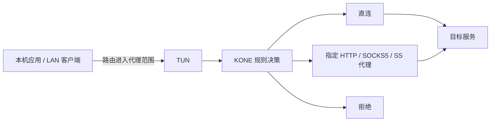
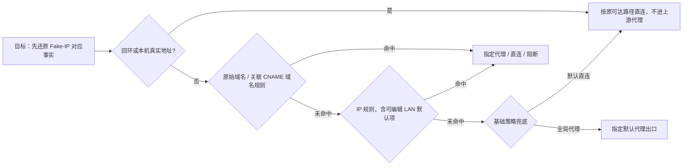

# KONE 产品需求文档（PRD）

| 项目 | 内容 |
| --- | --- |
| 状态 | 重构实现与验收持续更新；基础策略、i18n、访问与诊断的证据及平台边界见决策记录 |
| 核对基线 | `1ba6c0d`（[PR #51](https://github.com/xjdrew/kone/pull/51)），2026-11-07；代码实现不等于全部部署场景已验收 |
| Web 设计目标 | 按任务组织为流量、代理规则、出站三个主工作区，设置与诊断/日志作为工具；页面与布局可整体重构 |
| 读者 | 产品、设计、前后端开发、测试与发布维护者 |
| 配套 | [Web 交互规格](web-ui.md)、[UI/UX 设计规则](../design-system/kone/MASTER.md)、[待办与决策](backlog.md)、[开发验证](../development/development.md) |

## 1. 问题与产品定位

用户已经拥有 HTTP、SOCKS5 或 Shadowsocks 代理链路，但操作系统的代理设置依赖应用配合，难以覆盖直接建立 TCP 连接或不遵循系统 HTTP 代理的应用，也难以精确、灵活地控制不同流量使用哪个出口。问题在于如何让已有代理能力覆盖所需流量，并持续调整分流策略。

**KONE 是面向已有代理链路的高性能透明代理与规则分流工具：通过 TUN 接入本机或网关流量，按目标、协议和端口选择直连、指定代理或拒绝，并以最小必要观察支持策略调整与效果验证。**

| 用户遇到的问题 | KONE 提供的能力 |
| --- | --- |
| 应用不支持代理，或忽略系统代理设置而直接建立 TCP 连接 | 在网络层接入路由进入 TUN 的流量，无需应用实现代理协议或逐个修改应用配置 |
| 不同目标需要不同出口，系统代理选项难以表达 | 按域名、IP/CIDR、国家、TCP/UDP 与端口定义有序规则，选择不同命名代理、直连或拒绝 |
| 从空白规则开始配置成本高 | 提供默认直连、全局代理两种基础策略，分别通过添加代理规则或直连例外完成定制 |
| 网络需求变化后，希望立即调整策略 | 规则（含 CIDR）和兼容出站修改在线应用到新连接；TUN、DNS 等设置变更提示停用与恢复 |
| 多出口分流后难以确认策略是否生效 | 显示命中规则、实际出站、计数与失败阶段，按需独立诊断，再用新业务连接验证 |
| 担心代理工具拖慢网络或窥探业务内容 | 优先降低转发延迟、CPU、分配与复制开销；观察使用必要元数据，不默认检查业务载荷 |

产品原则：

- **应用透明、策略明确。** 应用按原方式建立连接，KONE 在支持的代理范围内决定出口；用户可预先配置规则，也可根据观察结果调整，无需先让业务失败。
- **性能优先。** 转发路径只承担必要的协议处理、规则决策与有界计量；减少重复解析、内存分配和数据复制，管理查询、日志与探测不能阻塞业务转发。
- **最小必要观察。** 使用连接地址、端口、传输协议、必要 DNS 信息、计数和错误解释路径；不默认对业务载荷做内容识别、记录或深度检测，不解密用户 TLS。
- **变更可验证、可撤销。** 保持配置版本、旧连接和新连接的语义清楚；启动失败回滚，暂停恢复自有网络变更。

代理能力受主机路由、DNS 路径、地址族和出站协议约束。透明代理不会让 HTTP 代理获得 UDP 能力，也不保证绕开 KONE 的流量可被控制或观察；支持范围见第 4 节。

## 2. 用户与核心场景

| 用户 | 任务 | 完成条件 |
| --- | --- | --- |
| Windows/macOS 个人用户 | 将不遵循系统代理的应用流量接入已有代理 | 无文件启动；应用无需改代理配置，代理范围内的新连接走指定出口 |
| 多出口策略用户 | 按目标、协议和端口分配直连与不同代理，随时调整 | 规则决定可解释，兼容修改实时作用于新连接，原连接行为稳定 |
| 内网/VPN 用户 | 公网代理与内部解析共存 | 私有名称留在所属解析器，内部访问可验证 |
| Linux/树莓派网关管理员 | 为指定 LAN 客户端提供透明转发 | 客户端 DNS、路由、回程可验证，停用后恢复自有变更 |
| 手机/平板所有者 | 查看或管理同一台 KONE 主机 | 明确主机身份、权限与数据时间，可撤销授权 |
| 开发与维护者 | 定位问题、演进实现、发布可追溯产物 | 有复现证据、回归验证、版本与源码对应关系 |

假设：用户能取得所需代理和主机权限；网关管理员掌握 LAN 配置；产品不提供代理服务本身。界面不能把无代理视为不能运行，纯直连是有效配置。

新增日常路径：启动 KONE 进入管理，选择策略并手工启用代理 → 使用默认直连逐步添加代理规则；或选择全局代理与默认出口，逐步添加直连/阻断例外。首次界面按使用者的系统语言选择中文或英文，之后可手动切换。

## 3. 目标、成功标准与非目标

| 目标 | 验收指标 | 测量方式 |
| --- | --- | --- |
| 应用透明 | 不遵循系统代理的应用，其路由进入 TUN 的受支持流量仍可走指定代理 | 无应用代理配置的真实 TCP/UDP 转发用例 |
| 精确分流与在线调整 | 不同目标/协议/端口命中预期出口；兼容更新影响新连接并保留旧连接决定 | 多出站规则矩阵、热更新与旧会话回归 |
| 可进入、可退出 | 启动后保持暂停，由用户手工启用；无配置文件/无代理仍能进入管理；暂停/退出恢复自有资源 | 首次使用、手工启用、失败注入、原生生命周期测试 |
| 配置可解释 | 每次保存能区分持久化、运行应用和验证结果；并改不静默覆盖 | 双客户端冲突、应用失败、重启后持久化测试 |
| 流量可追溯 | 任一展示路径回到同一观察快照的连接证据；缺失明确提示 | 桑基守恒、高基数与游标回归 |
| 失败可行动 | 从失败连接走完诊断、精确规则、新连接验证和撤销 | 固定端点端到端场景 |
| 管理可访问 | 全部功能在 320 CSS px 起可用；鼠标、键盘和触控可完成核心任务，不绑定页面数量 | 三浏览器自动化与真机验收 |
| 高性能转发 | 吞吐、延迟、CPU、内存与分配有可复现基线；分别量化转发与观察/管理附加成本 | 三栈、多协议、多并发及长连接/高周转场景 |
| 最小内容接触 | 规则、统计和 UI 不依赖业务正文；日志不记录载荷，诊断不重放业务 | 转发/日志代码审查、敏感内容回归与诊断用例 |
| 资源可控 | 日志、明细、缓存、队列和探测有边界；容量满时总计数仍正确 | 容量、并发与性能基线 |
| 策略易配置 | 两种基础策略都有可解释的保护、用户规则和兜底；切换不清空自定义规则 | 模板、国家例外、全局接管与版本冲突矩阵 |
| 语言可扩展 | 首发 en/zh，全界面可切换；新增翻译文件即可注册新语言 | 自动检测、缺失回退、离线切换、伪本地化与新语言文件用例 |

产品不要求全机旁路观察、业务重放、TLS 解密、自动判断“某域名必须代理”、公网多租户控制台、云端流量上传或网关 DHCP/防火墙自动部署。节点订阅、自动切换、自动更新和跨重启全量历史不因本 PRD 自动纳入范围。

高性能是核心产品要求。按目标硬件、网络、协议栈和代理协议建立基线，比较观察明细关闭/开启及管理查询负载下的吞吐、延迟分位数、CPU、内存、分配与丢弃；再确定可验收的性能预算。当前尚无覆盖所有目标设备的统一数值承诺，已有有限采样范围见 [性能观察指南](../development/performance.md)。

## 4. 当前产品能力与边界

| 领域 | 当前实现 | 必须保留的限制 |
| --- | --- | --- |
| 入口与栈 | 单 TUN；system/gvisor/mixed；选择性/全局 IPv4，可选 IPv6 | 多入口、任意协议、ICMP/分片兼容不能由 UI 推断 |
| 出站 | direct/reject、HTTP/HTTPS CONNECT、SOCKS5、SS AEAD2017 | HTTP 无原生 UDP；SS 不含 AEAD-2022/插件；认证失败不直连回退 |
| DNS | UDP/TCP、截断回退、Fake-IP/AAAA、缓存、查询记录、私有解析、系统引导 | DoH/DoT 旁路不可观察；无法复制的私有策略不退回公网 |
| 管理 | 持久 profile、本机自动授权、远程密码、版本校验、热更新、撤销、远程监听与会话撤销 | 文件模式无 HTTP 管理；保存不等于业务验证 |
| 观察 | 业务载荷、活动/结束/失败流、桑基图、尽力本机 IPv4 进程归属 | 仅统计进入 KONE 的流量；IPv6/远端/不确定进程显示未知或远端 |
| 诊断 | TCP/可选目标 TLS、UDP DNS 响应验证、出站连接测试 | 按需、有界，不重放业务；UDP DNS 不能证明 QUIC 成功 |
| 恢复 | 启动回滚、正常清理、所有权记录、显式恢复、换网暂停 | 无法确认所有权时保留资源；真实 VPN/断电组合需单验 |
| 数据与交付 | 内置 GeoIP、JSON/MMDB 导入回退、三平台包、可追溯发布 | 不自动下载数据；包未签名，macOS 未公证，ARMv7 为显式开发构建 |

具体配置与默认值集中在 [配置指南](../user/configuration.md)。Web 新建出站显式默认 UDP 直连回退，文件模式省略回退时拒绝；新建管理配置按主机 IPv6 检测填写网段，既有选择保留，文件模式默认关闭；数字回环管理自动授权，远端入口仍认证。

### Web 重构目标

界面按用户任务组织，技术模块不直接映射为一级页面。高频闭环“观察 → 精确调整 → 验证”应在同一工作区内完成，系统性维护策略与低频主机配置分别承载。

| 入口 | 内容 | 任务边界 |
| --- | --- | --- |
| 流量 | 总览、连接、DNS 观察 | 共享兼容的目标/时间上下文，原地建规则和诊断；DNS 与业务流分别计量 |
| 策略 | 规则、出站 | 共同维护路由配置，直接查看与编辑引用对象 |
| 设置工具页 | TUN 接管、解析配置、配置数据、访问会话、恢复、界面与关于 | 完整承载低频配置，返回时恢复来源上下文 |
| 全局工具面板 | 诊断任务、运行日志 | 从目标直接打开，也可独立访问；关闭呈现不停止主机任务 |

目标布局使用顶部任务导航、按需右侧详情及底部工具面板，不要求保留全局左导航。具体布局与操作预算见 [UI/UX 设计规则](../design-system/kone/MASTER.md)。上述为重构目标；现有页面、路由和组件组织不构成约束，已有业务能力、权限和数据语义必须保留。

### 当前实现与新增目标的区别

管理进程启动后保持暂停，用户手工启用。默认用户规则为空，内置 `direct` 为兜底（配置以 `FINAL → direct` 表达），未配置代理出口也可启用，无需纯直连确认。默认不接管普通业务连接，保留系统 DNS 辅助，便于后续域名规则生效。权限不足、配置无效或网段冲突等真实运行失败应说明原因和处理方法；无代理、空规则和未测试出口不能阻止启用。两种基础策略及 i18n 见第 5.5–5.6 节。

## 5. 功能需求

以下 ID 延续原产品需求，作为重构追踪标识。优先级表示缺陷影响：P0 阻断安全/数据正确性，P1 核心闭环，P2 扩展能力；P2 已实现能力也须保留。表内是验收契约，不是“全部已通过”的状态表。

### 5.1 生命周期与配置

| ID / 优先级 | 用户需求 | 验收条件 |
| --- | --- | --- |
| SAFE-01 / P0 | 启用前获知阻断条件 | 校验权限、网段、端口、出口和解析冲突；失败不留下半配置 |
| SAFE-02 / P0 | 上游与内网不被自身捕获破坏 | 代理/DNS 外层不回流，私有解析排他；CIDR/全局捕获仍成立 |
| SAFE-03 / P0 | 代理失败时仍可停用 | 控制层独立可用；暂停停止数据面、保留管理；任务结果可查询 |
| SAFE-04 / P1 | 异常后知道如何恢复 | 遗留可检查，只恢复确认归属的资源；网络变化暂停并要求重新检查 |
| CFG-01 / P1 | 表单引导首次配置 | 无需编写 TOML；格式、连通性和权限错误分别反馈 |
| CFG-02 / P1 | 配置不会丢失或误应用 | 原子保存、版本冲突、备份/撤销、导入校验；默认脱敏导出 |
| CFG-03 / P1 | 重开应用保留设置 | 任意工作目录使用同一 profile；损坏配置可修复，不静默重置或启用 |
| CFG-04 / P1 | 维护入口、出站及其引用 | 稳定 ID、名称、启停与能力一致；改名/删除处理规则引用；凭据保留正确 |

### 5.2 路由、DNS 与协议

| ID / 优先级 | 用户需求 | 验收条件 |
| --- | --- | --- |
| RULE-01 / P0 | 解释为什么走该路径 | 规则顺序、来源、保护例外、期望与实际出站可查，旧连接保留原版本 |
| RULE-02 / P1 | 从证据创建小范围规则 | 默认精确域名或单 IP；扩大范围需说明；模拟与新连接决定一致 |
| RULE-03 / P1 | 应用、验证和撤销变更 | 规则含 CIDR 在线应用到新连接，路由更新失败回滚，旧连接保留所需路由；TUN/DNS 等设置仍需停用；临时域名规则到期不重写旧流或映射 |
| DNS-01 / P1 | Host 接管本机 DNS 且可恢复 | 默认 Host；启用前保存系统 DNS 快照并作上游，暂停或启动失败恢复；Linux 非 resolved 环境支持原文件/符号链接恢复，逐平台解释覆盖 |
| DNS-04 / P1 | Gate 为局域网提供 DNS | 选择本机 LAN 地址，默认 UDP/TCP 53；不修改系统 DNS；管理员配置 DHCP/DNS 与 Fake-IP 路由 |
| DNS-05 / P1 | 默认上游开箱可用且来源明确 | Host/Gate 均自动读取系统 DNS；无法获取时告警并使用 Google/Cloudflare 公共默认值；显式服务器及私有后缀失败不触发公共回退 |
| DNS-02 / P1 | 企业名称不泄漏公网 | 最长后缀/指定接口语义保留；专用上游失败不改用公共解析器 |
| DNS-03 / P1 | 查询与地址映射可解释 | 查询、缓存、真实/Fake 地址分开；活动映射不提前复用，历史有界 |
| PROTO-01 / P2 | TCP/UDP、IPv4/IPv6 能力真实 | 配置、API、UI 同步；绕过、统计、恢复逐平台验收，不静默降级 |
| PROTO-02 / P2 | SS 出站可互操作 | 明确方法/版本，TCP/UDP、错误密码、取消和远端解析通过独立对端测试 |

### 5.3 观察、诊断与界面

| ID / 优先级 | 用户需求 | 验收条件 |
| --- | --- | --- |
| OBS-01 / P0 | 明白统计范围 | 未观察与零不同；业务、DNS、诊断分开，不补造全机流量 |
| OBS-02 / P1 | 查询活动与失败连接 | 长连接增量可见，零字节失败按目标聚合且保留阶段；目标折叠、过滤、分页和单流详情稳定 |
| OBS-03 / P1 | 流量数字一致 | 载荷口径、窗口、速率/累计明确；独立总计数不随明细淘汰丢失 |
| OBS-04 / P2 | 尽力查看进程 | 展示来源与采集时间；权限不足、复用和远端来源不伪归属 |
| DIAG-01 / P1 | 对明确目标比较路径 | 目标可输入或从最近 20 条去重历史选择，初始含 Google TCP+TLS 与 Telegram TCP；连接与 DNS 查询分模式，域名未带端口按 TCP 80；DNS 默认查询 example.com，对比系统 DNS 与 KONE DNS，无需服务器或出站；每出口摘要显示完整测试耗时，展开查看阶段证据 |
| DIAG-02 / P1 | 将诊断转成操作 | 有证据才给限定建议；新连接验证后可保留或撤销规则 |
| DIAG-03 / P0 | 探测副作用受控 | 不扫描、不重放业务；并发/速率/超时/保留有界，可取消且重试幂等 |
| UI-01 / P1 | 从观察到调整保持上下文 | 流量、策略、设置及工具离线可用；总览钻取、原地规则与诊断不强制跨工作区，筛选、选择、草稿和返回位置不因刷新丢失 |
| UI-02 / P1 | 真实状态与操作反馈 | 使用“代理”术语；开关与实时上下行速率并列，处理中、成功、失败、过期分别显示；断连后不继续显示正常 |
| UI-03 / P0 | 未授权不能读写管理 | 数字回环访问按实际来源自动授权；非回环访问仍认证，不能依赖转发头冒充本机；会话、Host/Origin/CSRF、服务端权限有效，长期秘密不出现在 URL、日志或快照 |
| UI-04 / P1 | 桑基图可验证 | 同一批流的完整路径、统一计量、守恒、固定快照钻取；无演示流量冒充真实数据 |
| UI-05 / P1 | 手机与键盘可使用 | 全部工作区与工具响应式、图形触控等价、表单可操作；不靠颜色或悬停传递唯一信息 |
| UI-06 / P0 | 明确授权手机访问 | 选择本机私网 IP 或全部 IPv4 接口，HTTP/HTTPS 可选；首次启用先设置管理密码，HTTPS 提供 CA 信任指引；密码登录获得管理权限，会话可撤销 |

### 5.4 桌面、性能、数据与发布

| ID / 优先级 | 需求 | 验收条件 |
| --- | --- | --- |
| DESK-01 / P1 | 桌面入口与停机一致 | 无参数管理、托盘启停/诊断/退出、单实例；关页面不停止代理 |
| DESK-03 / P1 | 启用时完成系统授权 | Windows/macOS/Linux 桌面点击启用后请求主机系统授权，确认后启动独立网络助手；管理保持普通权限，取消保持暂停且不改配置；Linux 缺少 pkexec/桌面认证代理时说明替代步骤，无桌面环境支持预授权启动 |
| DESK-02 / P1 | 安装和升级可用 | 对应平台运行与恢复可验；升级保留 profile；未验证架构不冒称验收 |
| PERF-01 / P1 | 高吞吐、低延迟与低资源开销 | 固定 SHA/硬件/协议/负载多次采样；微基准与真实三栈转发分别计量，覆盖长连接、高周转与并发；按已校准预算判断回退 |
| PERF-02 / P1 | 最小处理与有界观察 | 减少重复解析、分配和复制；明细开关与查询负载分别测量；慢客户端、日志、探测不阻塞转发，容量耗尽受控可见 |
| DATA-01 / P2 | GeoIP 可更新回退 | 来源/版本/许可/摘要可查；坏文件不替换有效版，IPv6 能力真实 |
| REL-01 / P1 | 开发版对应精确源码 | 每个合格 first-parent master SHA 独立全门禁，失败不发布 |
| REL-02 / P1 | 包与源码可核对 | 平台、架构、版本、摘要、源码及许可完整，原生验证范围可查 |
| REL-03 / P1 | 稳定发布及问题回退 | 稳定标签明确选择；重新构建全门禁；不可变公开资产、撤回与兼容配置回退 |

### 5.5 基础策略与全局代理

启动 KONE 仅进入管理并保持暂停，代理必须手工启用；保存或切换策略不启动已暂停的引擎。运行中兼容的策略修改仍按应用契约影响新连接。

两种基础策略共享同一份用户规则，仅改变默认出口与接管范围；分层版本固定池间优先级、池内保持顺序。两种策略是配置的起点；用户编辑当前策略，不修改内置模板。基础模式、默认出口、用户规则、系统保护和实际接管范围分别建模，不能只改一个 `FINAL` 就宣称全局代理。

| 基础策略 | 未命中用户规则时 | 定制方式 | 启动条件 |
| --- | --- | --- | --- |
| 默认直连（`direct-first`） | `direct`；初始没有业务代理规则 | 为域名、IP、国家、协议或端口逐步添加指定代理/阻断规则 | 不需要代理出口；启用后仅按当前接管计划处理流量 |
| 全局代理（`proxy-first`） | 指定的已启用代理出口 | 为域名、IP/网段、国家等添加直连或阻断例外，也可指定不同代理 | 默认出口、地址族、真实出口接口、全局接管与保护计划通过预检 |

名称中的“全局”始终受支持协议和地址族约束。目标为覆盖可用 IPv4/IPv6 的 TCP/UDP；不承诺 ICMP 等未支持协议。仅 IPv4 可覆盖时须标明范围；主机有可用 IPv6 而接管未覆盖时，不能显示完整全局已就绪，须修复或由用户显式接受 IPv4 限定范围。

| 类型 | 地址或流量 | 规则归属与修改方式 |
| --- | --- | --- |
| 本机防回环 | `127.0.0.0/8`、`::1/128`、本机真实接口的单地址 | 强制保护，按来源去重展示；不是全部本机发出的业务流量 |
| 代理与 DNS 自身传输 | KONE 到代理端点、DNS 上游的 socket | 绑定真实出口或启动前原生路由，不递归进入 TUN；不按端点 IP 全面豁免其他业务连接 |
| 私网与直连子网 | RFC1918、IPv6 ULA、真实直连子网 | 首次采用全局策略时生成普通 `direct` 规则，位于已有用户规则之后、FINAL 之前；可编辑、前移、覆盖或删除 |
| 本地发现范围 | 链路本地、组播和有限广播 | 全局模板提供普通 `direct` 默认项；不将其可达性等同于普通远端单播服务 |

界面只把前两类列为只读“防回环保护”。私网不等于本机，代理后的远端内网必须可达：用户可在默认直连规则之前添加私网代理规则，或删除对应直连规则。分层版本先匹配域名池，再匹配 IP 池，各池按用户顺序首次命中，不按最长前缀排序；旧版本继续按原全局顺序执行。

局域网默认项只初始化一次；升级旧全局 profile 时保留备份与已有用户规则，补入默认项并记录初始化标记。保存、重启或再次切换策略都不能补回用户删除的项。默认直连初始不添加这组规则。IPv6 未配置时不生成无法校验的 IPv6 规则。

Fake-IP 必须先还原目标事实再匹配；TUN 合成地址不按普通私网或本机地址绕过。换网、VPN 与私有 DNS 需要重新核对原生路由和解析作用域。

| ID / 优先级 | 需求 | 验收条件 |
| --- | --- | --- |
| POL-01 / P1 | 两种策略可作为起点 | 新配置默认直连；全局模式显式选择默认代理；添加代理配置本身不改变当前策略 |
| POL-02 / P0 | 全局接管与保护完整 | 公网与私网业务可按规则进入代理；本机与 KONE 自身传输防回环；全局初始 LAN direct 规则可删除且不被补回；Fake-IP、私有 DNS、IPv6、换网独立验证 |
| POL-03 / P1 | 保留自定义规则与顺序 | 切基础模式保留用户规则及顺序；首次全局补入可编辑 LAN direct 默认项，之后不重复添加；预览差异后提交，清空重建是独立动作 |
| POL-04 / P1 | 国家与目标例外可解释 | 全局模式下 `GEOIP CN → direct`、精确目标直连等可先于代理兜底命中；未知国家按后续规则/兜底处理，不当作本国 |
| POL-05 / P0 | 出口不支持或失败不泄漏直连 | 缺失/禁用默认出口不能启用全局；代理失败不自动直连。HTTP 无原生 UDP，默认拒绝不支持的 UDP 并显示受限；选支持 UDP 的出口才能承诺 TCP/UDP 全代理 |
| POL-06 / P1 | 策略切换一致且可恢复 | 版本校验、预览、保存/应用结果、逆向恢复覆盖策略与路由；热切换需有网络事务能力，否则明确暂停→应用→按用户意图恢复，旧流语义不被伪造 |

国家判断使用已有 GeoIP 与必要 DNS/真实目标地址证据，不读取业务正文。缺少真实地址时说明判定限制，不能把代理服务器国家当目标国家。默认直连加 `DOMAIN example.com → office` 与全局代理加 `GEOIP CN → direct` 都必须形成“系统保护 → 域名池 → IP 池（含可编辑 LAN 默认项）→ 兜底”的可解释决定。

复用已有 UDP 直连回退的出口时，全局预览必须指出差异：选择支持 UDP 的出口，或明确将该出口回退改为拒绝并列出影响引用。用户显式保留直连回退时将其计为策略例外，标注“UDP 存在直连例外”，不能显示严格全局；不得在切策略时静默改写共享出口。切换模板不能丢弃已有条件 FINAL：只有无条件 `direct` / 指定代理兜底可识别为对应基础模式，其余配置显示“高级兜底”；有条件或拒绝 FINAL 必须先由用户显式编辑，基础策略转换不得丢弃其约束。

**可行性与底层改动。** 现有 `FINAL`、有序规则、GeoIP、全局路由、CIDR 在线路由事务与代理端点防回环可复用；当前提供显式策略元数据、保留旧意图的迁移、版本化保护预览、地址族/UDP 校验；基础模式切换要求暂停，同模式兼容规则仍在线更新。显式基础策略的直连拨号已按启动前原生路由选择目标接口；代理外层仍绑定真实出口。复杂 Linux 策略路由和特殊 VPN 组合仍需部署验证。见 [规则决定](../../pkg/kone/rule.go)、[路由安装](../../pkg/kone/one.go)、[出口拨号](../../pkg/kone/outbound.go)。这些属于允许为本需求修改的底层契约，不以现有 Web 接口为限制。

#### 分层规则与地址归属

| ID / 优先级 | 需求 | 验收条件 |
| --- | --- | --- |
| POL-07 / P0 | 固定四池与证据状态 | `rule-version = 2`：系统保护 → 原始域名、关联 CNAME → IP → FINAL；缺 DNS/端口证据时保持待解析/待业务流状态，不提前使用 FINAL |
| POL-08 / P0 | 决定绑定拨号地址 | 按规则顺序选获准候选，直连和代理都只拨该候选；不将地址 B 的规则用于地址 A，不交给代理重新按域名选地址 |
| POL-09 / P0 | 兼容迁移 | 未标记版本保持旧顺序；升级预览列出跨池优先级变化、地址池与退役池；保留规则 ID、范围和用户顺序，需暂停后应用 |
| DNS-04 / P0 | 持久 Fake-IP 身份 | 新管理配置启用持久归属；首次发布前持久提交，TTL/清缓存只影响证据，不释放身份；重启、profile 切换不跨域复用；文件缺失、损坏、独占冲突和容量耗尽明确失败 |
| DNS-05 / P0 | 安全池迁移 | 旧内存映射不可恢复时选不重叠的新池，旧池仍捕获并拒绝；新 IPv6 池使用 /112；容量与退役范围可查，不能静默清空存储 |

明确域名规则仍需取得实际地址做系统保护检查。分层版本使用主机解析范围固定地址，不承诺保留旧版的代理远端解析行为。纯真实 IP 流量不根据 DNS 历史猜域名；接受域名规则后，应用可能需要重新解析和新建连接。

### 5.6 国际化

初始支持 `en`（English）和 `zh`（中文，首发简体），默认跟随使用者系统语言。范围覆盖 Web 登录/首次配置、工作台、错误、提示、命令、图表、辅助技术标签，以及 KONE 自有桌面菜单/提示；系统授权框由 OS 决定语言。配置键、协议、对象 ID、用户命名与原始技术日志保留原文，CLI 技术输出不纳入首发翻译范围。

| ID / 优先级 | 需求 | 验收条件 |
| --- | --- | --- |
| I18N-01 / P1 | 首次自动选择语言 | 显式选择优先；自动模式下本机桌面读取可信 OS 语言，纯 Web 使用浏览器语言优先列表；按可支持项匹配，无匹配回退 en |
| I18N-02 / P1 | 切换即时且按客户端隔离 | 可选跟随系统/English/中文；登录前也可切换；保留草稿、筛选、任务、焦点与配置版本，远端手机不跟随服务器语言 |
| I18N-03 / P1 | 添加翻译文件即可扩展 | 资源文件携语言标识、自称、方向和消息；构建自动发现，业务组件无语言分支；支持参数、复数、地区格式与逐键 en 回退 |
| I18N-04 / P1 | 全面且可验收 | en/zh 键与参数完整检查；界面无裸消息键、无未转义插值；离线切换、长文本/伪本地化、读屏、320 px 与 200% 缩放通过 |

自动检测按语言优先列表依次尝试精确语言标签及父语言：例如 `en-US → en`、`zh-CN/zh-TW → zh`；后者首发仍展示简体，不能声称已提供繁体。`[fr-FR, zh-CN]` 选择 zh，所有候选都不支持才回退 en。显式选择保持至用户改回自动；自动模式在下次启动或收到语言变化时重新匹配。语言不改变时区、规则顺序或 API 值。

纯浏览器只能获得浏览器语言偏好，不能保证等于 OS 设置；严格跟随桌面 OS 需要本机启动器提供语言提示，不能用远端 KONE 主机的语言替代手机语言。此边界依据 [HTML 语言偏好接口](https://html.spec.whatwg.org/multipage/system-state.html#language-preferences)。错误 API 需提供稳定 `code + params`，可附脱敏原始详情；不能让前端匹配英文句子决定翻译或业务行为。

### 5.7 连接健康与 Smart 智能分流

**状态：2026-11-08 已确认，待实现。** 本节替代一期“仅建议、TCP/443、策略页入口”的目标契约。当前实现仍只汇总失败连接，并在 Smart 开启后提供 DNS 驱动建议；不能据本文认定自动调整或异常持久化已经交付。

Overview 的 **Connection health / 连接健康** 统一 DNS 观察、实际连接结果与后台探测，默认展示 **Needs attention / 需要关注**。监控随代理引擎运行，不依赖浏览器或 Smart 开关；代理暂停时保留记录并标明停止检查。**Smart routing / 智能分流** 默认关闭，仅控制是否自动采用已验证的临时出口；关闭时仍可查看建议并手动采用。

| ID / 优先级 | 需求 | 验收条件 |
| --- | --- | --- |
| HEALTH-01 / P0 | DNS 失败立即可见 | 业务查询超时、SERVFAIL、NXDOMAIN 等形成目标异常，不要求先出现连接记录；保留错误类型，合并 A/AAAA 判断，不把单一类型无记录等同域名不可达 |
| HEALTH-02 / P0 | 按当前规则验证连接 | DNS 成功后按各端口的有效规则检查 TCP 80/443，两者均失败才判“Web 端口不可达”；预算不足、未执行及协议缺少目标确认均为未知；实际业务端口失败独立保留，不被 80/443 成功掩盖 |
| HEALTH-03 / P0 | 异常保留至恢复或处理 | 未处理异常跨刷新、重启保留，不因 DNS TTL、证据过期、观察窗口或原始日志淘汰消失；当前上下文的重测成功清除对应异常条件，或调整已应用、用户明确处理后，移出需要关注并记录原因 |
| HEALTH-04 / P0 | 目标聚合与部分恢复 | 同目标按协议/端口、故障原因和解析范围保留子项；全部未处理条件清除后才移除整行。重测成功与标记已处理分别表示“已恢复”和“用户已处理”；新的失败可重新打开，迟到旧样本不能改变新一轮状态 |
| SMART-01 / P1 | 临时选择与明确候选 | 当前路径重复失败、候选路径已验证成功才自动采用；候选以稳定出站 ID 保存。全局代理模式仅在用户明确将 direct 加入候选后允许回退直连；不因一次成功推断更快或业务正常 |
| SMART-02 / P0 | 证据与异常寿命分离 | 绑定目标、协议/端口、地址、解析范围、配置和网络代次；有效证据不超过 DNS TTL 和 5 分钟。换网、改规则、地址或出口变化后重验；旧证据失效不等于异常已处理 |
| SMART-03 / P0 | 手工规则优先 | 系统保护 → 用户域名规则 → 用户 IP 规则 → FINAL；Smart 只在 FINAL 内选择出口，不增加规则池或改写手工规则。命中明确规则的失败仍监控，提供手工修复；未知必要条件不能自动兜底 |
| SMART-04 / P0 | 有界与可取消 | 异步去重、限并发、限速和失败退避，不阻塞 DNS 或转发；沿用 2 工作者、128 队列、每分钟 30 次连接尝试、突发 6 次及单次 5 秒预算。原始样本和热缓存有界，未处理异常摘要独立持久分页，不用缓存上限静默丢弃 |
| SMART-05 / P0 | 一键固定手工规则 | 行内明示精确域名、协议、端口和出口后，一键保存为手工规则并撤销对应临时选择；已有相同规则不重复添加，冲突原位处理。保存与运行应用分别反馈，失败不误报已处理；提供撤销，不扩大为共享 IP 路由 |
| SMART-06 / P0 | 临时选择生命周期 | 只影响之后的新连接，不重放请求；有复核、冷却和到期机制。关闭 Smart 撤销临时选择并保留监控；已固定的手工规则保持。旧真实 IP 缓存导致尚未走新路径时明确提示，不宣称原请求已恢复 |
| SMART-07 / P0 | DNS 故障恢复路径 | 候选验证支持经指定代理的解析；需 IP 证据时先取得合规地址并重新执行保护与用户规则，不把解析失败当 IP 规则未匹配。私有解析范围不自动交给公共解析器或无关出口 |
| SMART-08 / P0 | 升级保留授权意图 | 一期 Smart 开启仅授权探测/建议，升级不能自动转换为自动调整授权；旧配置默认保持自动选择关闭，用户明确开启后才应用临时选择 |

异常状态与当前检测结果分别保存：后台或手动重测成功均可清除对应故障；DNS 恢复不能清除仍失败的业务端口，80 成功也不能清除实际 8443 故障。自动或手动调整必须已应用才算处理；后续验证失败重新进入需要关注。用户可以明确“标记已处理”，该动作不代表网络已恢复，也不是永久静默该目标。

只对 KONE 已观察到的业务目标执行有限验证，默认检查 TCP 80/443；实际业务端口或用户指定目标可补充。UDP 按有定义的协议验证，不将发包成功当可达。TCP、目标确认及 TLS 结果分别表达，代理自身握手成功不冒充目标成功；不读取用户载荷。明确阻断单列为“按规则阻断”，不当连接故障触发自动绕过。多地址抽样不足不能声称所有地址均失败，集中断网或出口故障优先归因，避免批量反复调整。

未处理异常仅保存必要摘要、计数和有限样本；磁盘或持久化失败必须报告，不能显示为空或伪称全部健康。处理历史可按保留策略清理；异常摘要保留期限与短期探测证据的有效期独立。

## 6. 数据、隐私与依赖约束

业务流记录以稳定 ID、运行代次、时间、源、目标、规则、出站、协议、载荷字节计数和失败阶段关联。域名、真实 IP、Fake-IP、代理端点分别表达；未知字段不根据时间邻近猜测。保存/运行/确认版本含义见 Web 规格。

业务载荷只作转发，不默认进行内容嗅探、DPI、正文解析或存储。协议栈处理必要报头，代理适配处理握手和传输封装，DNS 模块处理解析查询；这些必要处理与业务内容分析分开。域名依据已观察 DNS/Fake-IP 或用户配置取得，不为补齐图表而嗅探业务内容。

独立诊断由用户输入任意域名/IP 与端口；Google HTTPS、Telegram MTProto 仅是可选预设，后者保持纯 TCP。每个目标/出口一行摘要，显示延迟和状态，运行中逐项反馈，展开查看阶段与技术证据。

管理服务默认每分钟检查已启用出站，使用真实代理协议连接明确目标（默认 `example.com:443`，验证目标 TLS）；可按出站关闭、改目标或禁用目标 TLS。只有一个自动检查同时执行，保留手工诊断容量；页面关闭或业务代理暂停不停止管理层检查。失败不自动切出口、改规则或直连。检查仅反映所测目标和协议，不代表全部网络或 UDP 可用。文件模式没有该后台管理任务。

上述探测均有界，不扫描或重放原流量；目标 TLS 握手不用于解密用户业务连接。

默认数据留在主机；授权手机按会话范围读取。日志与诊断不包含密码、令牌、认证头或业务载荷。观测历史默认有界内存，跨进程永久历史需单独需求。

依赖后端能力、系统权限、解析环境、证书信任与平台驱动。框架选择属于实现设计；任何前端重构都不能靠按钮状态替代后端授权、校验、锁和网络所有权检查。

## 7. 重构交付与验收

| 阶段 | 交付物 | 退出条件 |
| --- | --- | --- |
| 契约冻结 | API/状态适配、现状与差距、测试夹具 | 明确哪些是兼容替换，哪些需改后端或评审产品行为 |
| 基础闭环 | 认证、应用框架、配置、手工启用和 i18n | 启动保持暂停、手工启用默认直连、授权失败恢复、en/zh 检测切换、并改通过 |
| 策略闭环 | 两种基础策略、保护/路由计划、例外与迁移 | 公网 IP、LAN/VPN、Fake-IP、IPv6、UDP 限制、国家例外、切换失败与旧配置迁移通过 |
| 观察闭环 | 桑基、连接、DNS、诊断与日志 | 固定快照、零字节失败、长连接、规则验证与撤销通过 |
| 平台与发布 | 移动、原生桌面、包、性能比较 | 三浏览器、真机边界、全门禁及版本追溯完成 |

验收必须覆盖正常、空数据、慢请求、断网、会话失效、只读、并发修改、任务重复、能力缺失与资源截断。真实管理服务需验证 Cookie/CSRF、凭据保存、刷新和进程重启；浏览器 mock 不能代替它。真实系统网络验证使用隔离 runner。

纯界面重构保持已有 profile、API 语义与规则决定；本次新增基础策略/i18n 允许同步修改底层接口，涉及格式或行为迁移时须有兼容与回退方案。新旧界面不得并发无版本控制地写配置。每个未完成项必须有明确差距记录，不以页面可渲染视为完成。

## 8. 风险与待决策

本机免密码、规则在线应用、IPv6 默认、状态术语和目标聚合已按用户确认实现，决策、回归证据和验收边界见 [需求记录](backlog.md)。文件模式仍需重启进程加载修改；IPv6 地址检测不等于真实目标可达。

基础策略和 i18n 已进入本 PRD，见 POL、I18N 条目；待办记录其实施依赖。HTTP 无原生 UDP、浏览器不能直接读取远端用户的 OS 语言是能力边界；跨平台 LAN/VPN、物理 IPv6 与特殊系统路由仍需按具体部署验证；基础模式切换采用暂停边界，不能把单元测试或编译成功当作真机验收。

部署风险集中在 VPN/系统解析差异、缓存 Fake-IP、平台授权/信任、跨架构原生验证和长期负载。UI 必须展示实际能力与错误；验收结果绑定 SHA 和环境。

结构采用问题、目标、用户、范围、需求和成功标准的 PRD 主线，参考 [Atlassian PRD 指南](https://www.atlassian.com/agile/product-management/requirements)。
