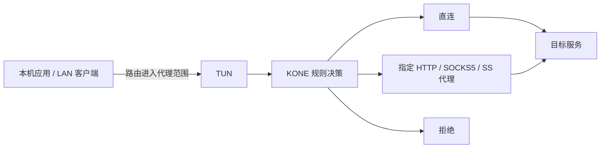

# KONE 产品需求文档（PRD）

| 项目 | 内容 |
| --- | --- |
| 状态 | 产品与重构基线；B01–B08 已实现，具体平台验收与交付状态见决策记录 |
| 核对基线 | `428303b` 文档基线及 [PR #51](https://github.com/xjdrew/kone/pull/51)，2026-11-07；代码实现不等于全部部署场景已验收 |
| 读者 | 产品、设计、前后端开发、测试与发布维护者 |
| 配套 | [Web 交互规格](web-ui.md)、[待办与决策](backlog.md)、[开发验证](../development/development.md) |

## 1. 问题与产品定位

用户已经拥有 HTTP、SOCKS5 或 Shadowsocks 代理链路，但操作系统的代理设置依赖应用配合，难以覆盖直接建立 TCP 连接或不遵循系统 HTTP 代理的应用，也难以精确、灵活地控制不同流量使用哪个出口。问题在于如何让已有代理能力覆盖所需流量，并持续调整分流策略。

**KONE 是面向已有代理链路的高性能透明代理与规则分流工具：通过 TUN 接入本机或网关流量，按目标、协议和端口选择直连、指定代理或拒绝，并以最小必要观察支持策略调整与效果验证。**

| 用户遇到的问题 | KONE 提供的能力 |
| --- | --- |
| 应用不支持代理，或忽略系统代理设置而直接建立 TCP 连接 | 在网络层接入路由进入 TUN 的流量，无需应用实现代理协议或逐个修改应用配置 |
| 不同目标需要不同出口，系统代理选项难以表达 | 按域名、IP/CIDR、国家、TCP/UDP 与端口定义有序规则，选择不同命名代理、直连或拒绝 |
| 网络需求变化后，希望立即调整策略 | 规则（含 CIDR）和兼容出站修改在线应用到新连接；TUN、DNS 等设置变更提示停用与恢复 |
| 多出口分流后难以确认策略是否生效 | 显示命中规则、实际出站、计数与失败阶段，按需独立诊断，再用新业务连接验证 |
| 担心代理工具拖慢网络或窥探业务内容 | 优先降低转发延迟、CPU、分配与复制开销；观察使用必要元数据，不默认检查业务载荷 |

产品原则：

- **应用透明、策略明确。** 应用按原方式建立连接，KONE 在支持的代理范围内决定出口；用户可预先配置规则，也可根据观察结果调整，无需先让业务失败。
- **性能优先。** 转发路径只承担必要的协议处理、规则决策与有界计量；减少重复解析、内存分配和数据复制，管理查询、日志与探测不能阻塞业务转发。
- **最小必要观察。** 使用连接地址、端口、传输协议、必要 DNS 信息、计数和错误解释路径；不默认对业务载荷做内容识别、记录或深度检测，不解密用户 TLS。
- **变更可验证、可撤销。** 保持配置版本、旧连接和新连接的语义清楚；启动失败回滚，暂停恢复自有网络变更。

代理能力受主机路由、DNS 路径、地址族和出站协议约束。透明代理不会让 HTTP 代理获得 UDP 能力，也不保证绕开 KONE 的流量可被控制或观察；支持范围见第 4 节。

## 2. 用户与核心场景

| 用户 | 任务 | 完成条件 |
| --- | --- | --- |
| Windows/macOS 个人用户 | 将不遵循系统代理的应用流量接入已有代理 | 无文件启动；应用无需改代理配置，代理范围内的新连接走指定出口 |
| 多出口策略用户 | 按目标、协议和端口分配直连与不同代理，随时调整 | 规则决定可解释，兼容修改实时作用于新连接，原连接行为稳定 |
| 内网/VPN 用户 | 公网代理与内部解析共存 | 私有名称留在所属解析器，内部访问可验证 |
| Linux/树莓派网关管理员 | 为指定 LAN 客户端提供透明转发 | 客户端 DNS、路由、回程可验证，停用后恢复自有变更 |
| 手机/平板所有者 | 查看或管理同一台 KONE 主机 | 明确主机身份、权限与数据时间，可撤销授权 |
| 开发与维护者 | 定位问题、演进实现、发布可追溯产物 | 有复现证据、回归验证、版本与源码对应关系 |

假设：用户能取得所需代理和主机权限；网关管理员掌握 LAN 配置；产品不提供代理服务本身。界面不能把无代理视为不能运行，纯直连是有效配置。

## 3. 目标、成功标准与非目标

| 目标 | 验收指标 | 测量方式 |
| --- | --- | --- |
| 应用透明 | 不遵循系统代理的应用，其路由进入 TUN 的受支持流量仍可走指定代理 | 无应用代理配置的真实 TCP/UDP 转发用例 |
| 精确分流与在线调整 | 不同目标/协议/端口命中预期出口；兼容更新影响新连接并保留旧连接决定 | 多出站规则矩阵、热更新与旧会话回归 |
| 可进入、可退出 | 无配置文件/无可用代理时仍能进入管理；正常暂停/退出恢复自有资源 | 首次使用、失败注入、原生生命周期测试 |
| 配置可解释 | 每次保存能区分持久化、运行应用和验证结果；并改不静默覆盖 | 双客户端冲突、应用失败、重启后持久化测试 |
| 流量可追溯 | 任一展示路径回到同一观察快照的连接证据；缺失明确提示 | 桑基守恒、高基数与游标回归 |
| 失败可行动 | 从失败连接走完诊断、精确规则、新连接验证和撤销 | 固定端点端到端场景 |
| 管理可访问 | 八页面在 320 CSS px 起可用；鼠标、键盘和触控可完成核心任务 | 三浏览器自动化与真机验收 |
| 高性能转发 | 吞吐、延迟、CPU、内存与分配有可复现基线；分别量化转发与观察/管理附加成本 | 三栈、多协议、多并发及长连接/高周转场景 |
| 最小内容接触 | 规则、统计和 UI 不依赖业务正文；日志不记录载荷，诊断不重放业务 | 转发/日志代码审查、敏感内容回归与诊断用例 |
| 资源可控 | 日志、明细、缓存、队列和探测有边界；容量满时总计数仍正确 | 容量、并发与性能基线 |

产品不要求全机旁路观察、业务重放、TLS 解密、自动判断“某域名必须代理”、公网多租户控制台、云端流量上传或网关 DHCP/防火墙自动部署。节点订阅、自动切换、自动更新和跨重启全量历史不因本 PRD 自动纳入范围。

高性能是核心产品要求。按目标硬件、网络、协议栈和代理协议建立基线，比较观察明细关闭/开启及管理查询负载下的吞吐、延迟分位数、CPU、内存、分配与丢弃；再确定可验收的性能预算。当前尚无覆盖所有目标设备的统一数值承诺，已有有限采样范围见 [性能观察指南](../development/performance.md)。

## 4. 当前产品能力与边界

| 领域 | 当前实现 | 必须保留的限制 |
| --- | --- | --- |
| 入口与栈 | 单 TUN；system/gvisor/mixed；选择性/全局 IPv4，可选 IPv6 | 多入口、任意协议、ICMP/分片兼容不能由 UI 推断 |
| 出站 | direct/reject、HTTP/HTTPS CONNECT、SOCKS5、SS AEAD2017 | HTTP 无原生 UDP；SS 不含 AEAD-2022/插件；认证失败不直连回退 |
| DNS | UDP/TCP、截断回退、Fake-IP/AAAA、缓存、查询记录、私有解析、系统引导 | DoH/DoT 旁路不可观察；无法复制的私有策略不退回公网 |
| 管理 | 持久 profile、本机自动授权、远程密码、版本校验、热更新、撤销、只读/管理配对 | 文件模式无 HTTP 管理；保存不等于业务验证 |
| 观察 | 业务载荷、活动/结束/失败流、桑基图、尽力本机 IPv4 进程归属 | 仅统计进入 KONE 的流量；IPv6/远端/不确定进程显示未知或远端 |
| 诊断 | TCP/可选目标 TLS、UDP DNS 响应验证、出站连接测试 | 按需、有界，不重放业务；UDP DNS 不能证明 QUIC 成功 |
| 恢复 | 启动回滚、正常清理、所有权记录、显式恢复、换网暂停 | 无法确认所有权时保留资源；真实 VPN/断电组合需单验 |
| 数据与交付 | 内置 GeoIP、JSON/MMDB 导入回退、三平台包、可追溯发布 | 不自动下载数据；包未签名，macOS 未公证，ARMv7 为显式开发构建 |

具体配置与默认值集中在 [配置指南](../user/configuration.md)。Web 新建出站显式默认 UDP 直连回退，文件模式省略回退时拒绝；新建管理配置按主机 IPv6 检测填写网段，既有选择保留，文件模式默认关闭；数字回环管理自动授权，远端入口仍认证。

## 5. 功能需求

以下 ID 延续原产品需求，作为重构追踪标识。优先级表示缺陷影响：P0 阻断安全/数据正确性，P1 核心闭环，P2 扩展能力；P2 已实现能力也须保留。表内是验收契约，不是“全部已通过”的状态表。

### 5.1 生命周期与配置

| ID / 优先级 | 用户需求 | 验收条件 |
| --- | --- | --- |
| SAFE-01 / P0 | 启用前获知阻断条件 | 校验权限、网段、端口、出口和解析冲突；失败不留下半配置 |
| SAFE-02 / P0 | 上游与内网不被自身捕获破坏 | 代理/DNS 外层不回流，私有解析排他；CIDR/全局捕获仍成立 |
| SAFE-03 / P0 | 代理失败时仍可停用 | 控制层独立可用；暂停停止数据面、保留管理；任务结果可查询 |
| SAFE-04 / P1 | 异常后知道如何恢复 | 遗留可检查，只恢复确认归属的资源；网络变化暂停并要求重新检查 |
| CFG-01 / P1 | 表单引导首次配置 | 无需编写 TOML；格式、连通性和权限错误分别反馈 |
| CFG-02 / P1 | 配置不会丢失或误应用 | 原子保存、版本冲突、备份/撤销、导入校验；默认脱敏导出 |
| CFG-03 / P1 | 重开应用保留设置 | 任意工作目录使用同一 profile；损坏配置可修复，不静默重置或启用 |
| CFG-04 / P1 | 维护入口、出站及其引用 | 稳定 ID、名称、启停与能力一致；改名/删除处理规则引用；凭据保留正确 |

### 5.2 路由、DNS 与协议

| ID / 优先级 | 用户需求 | 验收条件 |
| --- | --- | --- |
| RULE-01 / P0 | 解释为什么走该路径 | 规则顺序、来源、保护例外、期望与实际出站可查，旧连接保留原版本 |
| RULE-02 / P1 | 从证据创建小范围规则 | 默认精确域名或单 IP；扩大范围需说明；模拟与新连接决定一致 |
| RULE-03 / P1 | 应用、验证和撤销变更 | 规则含 CIDR 在线应用到新连接，路由更新失败回滚，旧连接保留所需路由；TUN/DNS 等设置仍需停用；临时域名规则到期不重写旧流或映射 |
| DNS-01 / P1 | 系统解析可控且可恢复 | 逐平台解释覆盖；UDP/TCP、截断回退、启动失败及停止恢复通过 |
| DNS-02 / P1 | 企业名称不泄漏公网 | 最长后缀/指定接口语义保留；专用上游失败不改用公共解析器 |
| DNS-03 / P1 | 查询与地址映射可解释 | 查询、缓存、真实/Fake 地址分开；活动映射不提前复用，历史有界 |
| PROTO-01 / P2 | TCP/UDP、IPv4/IPv6 能力真实 | 配置、API、UI 同步；绕过、统计、恢复逐平台验收，不静默降级 |
| PROTO-02 / P2 | SS 出站可互操作 | 明确方法/版本，TCP/UDP、错误密码、取消和远端解析通过独立对端测试 |

### 5.3 观察、诊断与界面

| ID / 优先级 | 用户需求 | 验收条件 |
| --- | --- | --- |
| OBS-01 / P0 | 明白统计范围 | 未观察与零不同；业务、DNS、诊断分开，不补造全机流量 |
| OBS-02 / P1 | 查询活动与失败连接 | 长连接增量可见，零字节失败按目标聚合且保留阶段；目标折叠、过滤、分页和单流详情稳定 |
| OBS-03 / P1 | 流量数字一致 | 载荷口径、窗口、速率/累计明确；独立总计数不随明细淘汰丢失 |
| OBS-04 / P2 | 尽力查看进程 | 展示来源与采集时间；权限不足、复用和远端来源不伪归属 |
| DIAG-01 / P1 | 对明确目标比较路径 | 目标、协议、解析、出站、时间、版本、失败阶段完整 |
| DIAG-02 / P1 | 将诊断转成操作 | 有证据才给限定建议；新连接验证后可保留或撤销规则 |
| DIAG-03 / P0 | 探测副作用受控 | 不扫描、不重放业务；并发/速率/超时/保留有界，可取消且重试幂等 |
| UI-01 / P1 | 从总览进入详情 | 八页面离线可用；筛选、选择、草稿和返回上下文不因刷新丢失 |
| UI-02 / P1 | 真实状态与操作反馈 | 使用“代理”术语；开关与实时上下行速率并列，处理中、成功、失败、过期分别显示；断连后不继续显示正常 |
| UI-03 / P0 | 未授权不能读写管理 | 数字回环访问按实际来源自动授权；非回环访问仍认证，不能依赖转发头冒充本机；会话、Host/Origin/CSRF、服务端权限有效，长期秘密不出现在 URL、日志或快照 |
| UI-04 / P1 | 桑基图可验证 | 同一批流的完整路径、统一计量、守恒、固定快照钻取；无演示流量冒充真实数据 |
| UI-05 / P1 | 手机与键盘可使用 | 八页面响应式、图形触控等价、表单可操作；不靠颜色或悬停传递唯一信息 |
| UI-06 / P0 | 明确授权手机访问 | 私网 HTTPS、短期配对、默认只读、显式管理权限、撤销生效 |

### 5.4 桌面、性能、数据与发布

| ID / 优先级 | 需求 | 验收条件 |
| --- | --- | --- |
| DESK-01 / P1 | 桌面入口与停机一致 | 无参数管理、托盘启停/诊断/退出、单实例；关页面不停止代理 |
| DESK-02 / P1 | 安装和升级可用 | 对应平台运行与恢复可验；升级保留 profile；未验证架构不冒称验收 |
| PERF-01 / P1 | 高吞吐、低延迟与低资源开销 | 固定 SHA/硬件/协议/负载多次采样；微基准与真实三栈转发分别计量，覆盖长连接、高周转与并发；按已校准预算判断回退 |
| PERF-02 / P1 | 最小处理与有界观察 | 减少重复解析、分配和复制；明细开关与查询负载分别测量；慢客户端、日志、探测不阻塞转发，容量耗尽受控可见 |
| DATA-01 / P2 | GeoIP 可更新回退 | 来源/版本/许可/摘要可查；坏文件不替换有效版，IPv6 能力真实 |
| REL-01 / P1 | 开发版对应精确源码 | 每个合格 first-parent master SHA 独立全门禁，失败不发布 |
| REL-02 / P1 | 包与源码可核对 | 平台、架构、版本、摘要、源码及许可完整，原生验证范围可查 |
| REL-03 / P1 | 稳定发布及问题回退 | 稳定标签明确选择；重新构建全门禁；不可变公开资产、撤回与兼容配置回退 |

## 6. 数据、隐私与依赖约束

业务流记录以稳定 ID、运行代次、时间、源、目标、规则、出站、协议、载荷字节计数和失败阶段关联。域名、真实 IP、Fake-IP、代理端点分别表达；未知字段不根据时间邻近猜测。保存/运行/确认版本含义见 Web 规格。

业务载荷只作转发，不默认进行内容嗅探、DPI、正文解析或存储。协议栈处理必要报头，代理适配处理握手和传输封装，DNS 模块处理解析查询；这些必要处理与业务内容分析分开。域名依据已观察 DNS/Fake-IP 或用户配置取得，不为补齐图表而嗅探业务内容。

独立诊断仅在用户请求时生成有界探测，不扫描或重放原流量；诊断中的目标 TLS 握手不用于解密用户业务连接。

默认数据留在主机；授权手机按会话范围读取。日志与诊断不包含密码、令牌、认证头或业务载荷。观测历史默认有界内存，跨进程永久历史需单独需求。

依赖后端能力、系统权限、解析环境、证书信任与平台驱动。框架选择属于实现设计；任何前端重构都不能靠按钮状态替代后端授权、校验、锁和网络所有权检查。

## 7. 重构交付与验收

| 阶段 | 交付物 | 退出条件 |
| --- | --- | --- |
| 契约冻结 | API/状态适配、现状与差距、测试夹具 | 明确哪些是兼容替换，哪些需改后端或评审产品行为 |
| 基础闭环 | 认证、应用框架、配置和生命周期 | 无文件启动、密码、并改、应用失败、暂停恢复通过 |
| 观察闭环 | 桑基、连接、DNS、诊断与日志 | 固定快照、零字节失败、长连接、规则验证与撤销通过 |
| 平台与发布 | 移动、原生桌面、包、性能比较 | 三浏览器、真机边界、全门禁及版本追溯完成 |

验收必须覆盖正常、空数据、慢请求、断网、会话失效、只读、并发修改、任务重复、能力缺失与资源截断。真实管理服务需验证 Cookie/CSRF、凭据保存、刷新和进程重启；浏览器 mock 不能代替它。真实系统网络验证使用隔离 runner。

前端单独重构保持已有 profile、API 语义与规则决定；涉及数据格式迁移时另写兼容与回退方案。新旧界面不得并发无版本控制地写配置。每个未完成项必须有明确差距记录，不以页面可渲染视为完成。

## 8. 风险与待决策

本机免密码、规则在线应用、IPv6 默认、状态术语和目标聚合已按用户确认实现，决策、回归证据和验收边界见 [需求记录](backlog.md)。文件模式仍需重启进程加载修改；IPv6 地址检测不等于真实目标可达。

部署风险集中在 VPN/系统解析差异、缓存 Fake-IP、平台授权/信任、跨架构原生验证和长期负载。UI 必须展示实际能力与错误；验收结果绑定 SHA 和环境。

结构采用问题、目标、用户、范围、需求和成功标准的 PRD 主线，参考 [Atlassian PRD 指南](https://www.atlassian.com/agile/product-management/requirements)。
