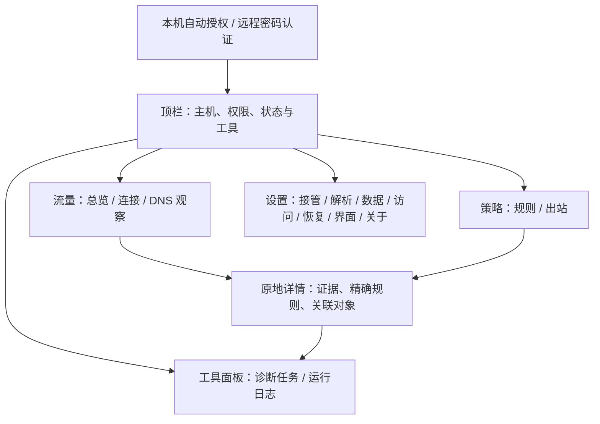
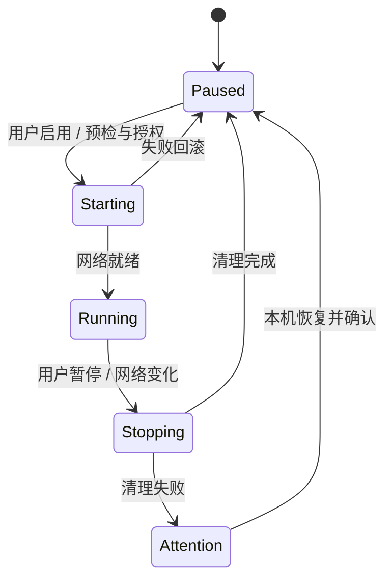
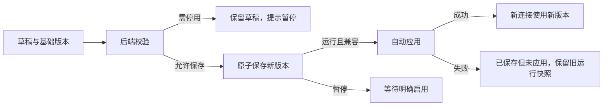

# Web 管理交互与验收规格

本文件是 [产品 PRD](prd.md) 的 UI 规格，供 `web/` 重写或重构使用。能力核对基线为 `1ba6c0d`（[PR #51](https://github.com/xjdrew/kone/pull/51)，2026-11-07）；信息架构为重构目标。以下描述用户可见契约；现有页面划分、布局、组件库、框架和内部路由均不构成限制。既有能力须保留，未实现的验收项作为差距处理，不冒称已交付。

新增目标包括默认直连/全局代理基础策略、en/zh 国际化；允许同步调整底层接口。启动后仍保持暂停、由用户手工启用代理，差距见 PRD 第 5.5–5.6 节。

布局、视觉变量、组件、键盘、上下文操作和点击预算见 [UI/UX 设计规则](../design-system/kone/MASTER.md)。该规则细化本文件的呈现与操作方式；权限、数据范围、配置生命周期和验收语义继续以本文件及 PRD 为依据。

## 1. 使用者、范围与成功标准

使用者包括本机管理员、通过密码登录的远端管理员。界面需完成“选择策略并手工启用 → 观察 → 诊断 → 调整 → 验证 → 停用”闭环，覆盖桌面、手机和平板；首次无代理时默认直连可运行。公网多租户、业务分析、节点订阅与自动代理决策不在范围内。

界面服务于透明代理与精确多出口分流。图表和诊断仅消费必要元数据，不要求后端读取业务正文或扩大捕获范围；刷新、聚合和查询开销须有界，并纳入转发性能对比。

成功标准：PRD 中 UI-01 至 UI-06、CFG-01 至 CFG-04 和观察/诊断契约通过；真实管理服务保存/刷新/重启闭环可复现；旧 profile 和业务规则行为不因前端替换改变。

## 2. 信息架构

使用顶部“流量 / 策略”任务导航，设置作为工具入口，诊断与日志作为全局工具面板。原来的八个页面合并为任务工作区；第 5 节按功能域保留验收 ID，不规定八个独立页面。

登录前和会话失效后，导航、业务数据与操作控件不展示。登录后全局固定主机身份、运行状态、用户权限、数据时间和当前操作；管理连通性与数据面可用性分别表达。

流量总览到连接是同区视图钻取，保留快照；DNS 与连接共享兼容目标/时间，专属筛选不混用。规则与出站共用配置草稿及版本，可原地编辑引用对象。设置承载完整配置，不缩成狭窄弹窗；离开后恢复来源。诊断/日志可从目标或全局工具入口打开，后台任务不得强制展开面板。详情和工具面板按屏幕空间展开，不要求固定左导航。

## 3. 身份、权限与运行状态

| 操作 | 本机管理员 | 远端管理员 | 只读用户 |
| --- | --- | --- | --- |
| 看状态、流量、DNS、日志 | 允许 | 允许 | 允许 |
| 改配置、启停、诊断 | 按运行锁与能力 | 按运行锁与能力 | 禁止 |
| 恢复系统遗留、恢复全部默认 | 本机显式确认 | 禁止 | 禁止 |
| 开启 LAN / 初始认证 | 按本机授权流程 | 不代替本机授权 | 禁止 |
| 修改本浏览器界面语言 | 允许 | 允许 | 允许，不修改主机配置 |

服务端是权限判断的最终依据。HTTP 数字回环入口自动创建完整管理会话，即使已设置密码也不要求本机输入。服务端同时核对实际回环来源、Host/端口、Origin 和跨站请求标记，不信任转发头；`localhost` 等名称不触发免密，HTTP/HTTPS 远程监听均要求密码，即使通过回环 IP 访问也不自动授权。本机会话不能远程复用，写操作仍需 CSRF。会话过期后本机自动重新建会话，期间隐藏受保护页面且不重放失败写请求；远程会话失效回到登录。

这是用户体验状态图；不要逐字当作 API 枚举。页面适配 `control_state`、`data_state`、恢复报告与任务结果；网络失败时进入“状态未知/数据过期”，不自行推断已经停止。控制层修复配置和数据面运行状态分别展示。

启动 KONE、打开 Web、登录、刷新或重连均不触发启用。只有用户明确启用才执行启动及其必要授权，预检可独立查看；顶栏同时说明引擎状态和当前策略，不能把默认直连误显示为暂停。人工暂停后，保存、切换基础策略或语言都不得恢复运行。

## 4. 配置编辑契约

| ID | 契约 | 验收 |
| --- | --- | --- |
| MG-CONFIG-01 | 区分草稿、已保存、运行、已确认版本；常用编辑保留“保存/取消” | 不用保存成功冒充应用成功；暂停时不自动启动，运行兼容修改自动应用 |
| MG-CONFIG-02 | 基础版本随提交，后端复验及磁盘并改检测 | 409 保留草稿并提示重新加载/比较后重做；不自动覆盖或盲重试 |
| MG-CONFIG-03 | 凭据保留/替换/清除独立表达 | 掩码不回写密码，不回显 URL 凭据；错误、日志和脱敏导出无秘密 |

`restart_required` 由后端判定；入站、core、DNS、general、GeoIP 变化在运行时禁止保存。所有合法规则（含 CIDR 内容、顺序和出站类型变化）及兼容出站保存可在线应用；旧连接保留原快照与所需路由。路由更新成功后才发布新策略，失败回滚，无法完整回滚时停止代理并报告。未展开的合法高级项须保留，不将表单未覆盖字段清空。

离开脏表单先确认保留编辑或放弃；无修改不打断。字段错误贴近输入，总体错误持久可见；失败后输入不丢失，按钮仅在该动作确实不可用时禁用并说明原因。

暂停状态保存配置不会隐式启动。基础策略切换必须把模式、默认出口、用户规则、保护/路由计划视为一次版本化变更，不能依次调用几个互不关联的保存形成半配置。

## 5. 功能域需求与工作区归属

总览、连接与 DNS 观察归流量；规则与出站归策略；入站和 DNS 配置归设置；诊断与日志归全局工具。以下小节对应能力与验收 ID，布局采用上述合并结构。

### 5.1 流量总览与桑基图

| ID | 内容与验收 |
| --- | --- |
| MG-HOME-01 | 状态、上传/下载速率、累计、活动和失败/拒绝数量；“需要关注”按目标合并，显示次数、最近原因和时间，保留原始失败记录钻取；注明范围、采样窗口和会话 |
| MG-HOME-02 | 路径为实际入站 → 规则/策略 → 实际出站 → 最终业务目的；使用同一条流的完整事实 |
| MG-HOME-03 | 上传/下载/合计/累计切换统一量纲；各层守恒，Top N 与“其他”保留总量 |
| MG-HOME-04 | 点击结点或边绑定所选快照、窗口、过滤条件与流 ID 集合；返回保留上下文 |
| MG-HOME-05 | 实时增量、稳定顺序/颜色、可读标签、等价路径列表；空态或失联不播放伪造流量 |

图形主导总览，详细数值和操作进入详情。零字节失败用事件数与状态表示，不伪造正宽度；拒绝、未知、截断与控制流量不混成正常业务。真实目标 IP 不可得时显示未知，代理端点不当最终目的。

钻取若分批获取 flow IDs，必须保持同一 anchor；已淘汰流明确提示缺失，不能用新流补足旧快照。暂停图形刷新只冻结呈现，不暂停主机代理。

### 5.2 连接

| ID | 内容与验收 |
| --- | --- |
| MG-CONN-01 | 活动/结束/失败列表，按目标、协议、出站、规则、时间过滤；稳定分页、零字节失败可查 |
| MG-CONN-02 | 详情呈现源、域名/地址来源、原规则版本、期望/实际出站、计数和阶段；可进入 DNS、规则或独立诊断 |

筛选、分页与返回位置不因刷新重置。缺失详情提示原因和返回入口；导出能力仅在后端支持时提供且脱敏。按规范化域名（小写、去末尾点和端口）分组，无域名时使用规范化 IP；同一目标的不同端口/协议保留在原始行，同 IP 的不同域名分开。先过滤，再按目标组分页；组内展示连接数、活动/失败数、载荷和速率，展开状态跨刷新保留。首页多条失败钻取固定原流 ID 集合；只汇总已载入记录，不伪装全量历史。

### 5.3 入站

| ID | 内容与验收 |
| --- | --- |
| MG-IN-01 | 单 TUN 摘要与编辑：名称/启用、地址、栈、范围、出口；按能力展示高级项，不虚构多入口 |
| MG-IN-02 | 预检设备、网段、端口、真实出口与 DNS/VPN 冲突；全捕获必填出口，禁选自身 TUN；重启影响可见 |

配置启用不等于已经运行。IPv6 能力与启用状态分别展示；首次或恢复默认管理配置按启用中的非回环接口全局单播地址选择无冲突 ULA 网段；链路本地地址不算可用。已有配置与手动关闭保留，文件模式默认关闭。不把地址检测当作互联网可达证明，仍需预检出口、DNS 和网段冲突。

### 5.4 出站

| ID | 内容与验收 |
| --- | --- |
| MG-OUT-01 | 代理名称、协议、脱敏地址、实测延迟、状态；独立紧凑编辑，按协议填地址/认证；direct/reject 保持内置 |
| MG-OUT-02 | 用户主动测试，展开阶段、时间与适用目标；未测、过期、失败、不支持分开；UDP 回退不冒充原生能力 |
| MG-OUT-03 | 改名/禁用/删除展示受影响引用；禁止悬空引用；旧流保持原决定，禁用后新流拒绝 |

当前 Web 新建出站显式默认 `udp-fallback=direct`，既有策略保留；界面必须让用户知道这个选择。文件模式缺省拒绝不得被表单默认值静默改写。FINAL 在策略的规则视图维护，主摘要为“其余流量 → 出站”，出站视图引用可就地定位，简写为“其余流量”；有协议/端口限制时保留作用范围与范围外直连说明。

### 5.5 规则

| ID | 内容与验收 |
| --- | --- |
| MG-RULE-01 | 按类型编辑条件；顺序、稳定 ID/来源、引用校验及模拟解释；排序提供键盘替代，FINAL 固定底部分组 |
| MG-RULE-02 | 从流或诊断建立精确域名/单地址草稿，预览范围、提交、用新连接验证并可撤销 |
| MG-RULE-03 | 展示生效版本、需暂停的原因、旧连接与临时规则到期语义；撤销不覆盖他人的更新 |

基础策略的默认出口在兜底摘要中编辑，用户例外仍使用相同规则编辑器；不能把“默认直连”当作关闭 TUN，也不能把“全局代理”当作忽略用户规则。具体新增契约见第 5.9 节。

支持类型从后端/配置契约取得；合法 IP 规则在运行中可在线应用到新连接；IPv6 规则仍要求已配置 IPv6 网段，不能绕过运行中的 core 设置锁。临时到期只适用域名类，CIDR、GEOIP 和 FINAL 明确拒绝。

### 5.6 DNS

| ID | 内容与验收 |
| --- | --- |
| MG-DNS-01 | 系统引导、监听与上游、自动发现/手工私有解析分别呈现；修改遵守暂停边界，异常不隐式用公共 DNS |
| MG-DNS-02 | 查询类型/传输、解析器/接口、延迟、缓存、错误与真实/Fake 地址；显示容量/过期/截断 |

查询记录、真实响应缓存、Fake-IP 映射与系统/应用缓存是不同对象，清除操作不能混称。搜索域来源可见，不能声称复制了全部 VPN 解析策略。

### 5.7 诊断与日志

| ID | 内容与验收 |
| --- | --- |
| MG-DIAG-01 | 明确目标和协议，任务可发起/取消/查询；排队、运行、完成、失败、未执行、过期、不支持分别表示 |
| MG-DIAG-02 | 解析、连接、代理认证、目标 TLS、UDP DNS 响应各阶段独立；TCP 或 Fake-IP ping 不当应用成功 |
| MG-DIAG-03 | 候选来自已观察失败或用户输入；按证据给限定建议，创建规则后回到原上下文；不自动改规则 |

日志使用紧凑表格：时间、级别、来源、消息、可展开字段；时间范围使用浏览器本地时区输入，提交规范时间。保留级别/来源过滤、50/100/200 分页、较旧/较新/回到最新。阅读历史或编辑过滤时新记录只提示，不跳页、不抢焦点。

日志游标/ID 保留字符串。`after` 与 `before` 互斥，`from/to` 含端点；不把日志轮询自身写成运行事件。默认内存保留 1000 条/4 MiB，已淘汰记录提示边界。

### 5.8 设置

| ID | 内容与验收 |
| --- | --- |
| MG-SET-01 | profile、TOML 导入/校验、备份/恢复、显式恢复默认；坏配置保留修复入口，升级不重置 |
| MG-SET-02 | 恢复检查、所有权与失败可见；启用时自动处理安全残留，需本机授权的恢复明确引导 |
| MG-SET-03 | 版本、日志、GeoIP 来源/摘要/回退和隐私真实；无实现的自动更新/诊断包不显示虚假进度 |
| MG-ACCESS-01 | 下拉选择本机私网 IP 或 `0.0.0.0`，端口可配置，HTTP/HTTPS 可选；展示实际访问 URL，只有 HTTPS 显示 CA 下载、指纹和信任步骤；不自动安装信任或改防火墙 |
| MG-ACCESS-02 | 首次启用必须设置管理密码，页面就地完成“设置密码并启用”；已有密码直接启用。远程密码登录拥有管理权限，支持会话到期与撤销；移除配对码，URL 不携秘密 |

本机“管理密码”用于设置远程认证；未设置时提供首次设置表单，已设置后改密码仍校验当前密码。本机自动授权会话不显示“退出登录”，远端保留该操作。

GeoIP 上传由浏览器传文件内容，不传主机路径；暂停后安装，失败保留旧数据。恢复默认、遗留恢复等本机限定动作不能通过远端 UI 绕过。

### 5.9 基础策略

| ID | 内容与验收 |
| --- | --- |
| MG-POLICY-01 | 策略工作区顶部展示基础模式、默认出口、用户规则数、运行/保存版本；可从流量顶栏策略摘要原地打开同一编辑器 |
| MG-POLICY-02 | 选择默认直连或全局代理；后者必须明确选默认出口。预览列出保留用户规则、默认出口/UDP 行为变化、IPv4/IPv6 接管、保护范围及暂停影响 |
| MG-POLICY-03 | 用户规则列表可直接“添加代理规则”或“添加直连例外”；全局模式提供国家例外入口，选择国家后形成可编辑 GEOIP 规则并显示数据源/未知国家处理 |
| MG-POLICY-04 | 保护、用户规则、兜底三层清楚；保护列表只读可展开，带真实地址/接口来源和原因。显示“已自定义”，不因修改例外丢失基础模式 |
| MG-POLICY-05 | 全局缺出口、IPv6 未覆盖、UDP 不支持/直连回退冲突分别提示；有限覆盖使用带范围标签的模式，不显示无条件“全部已代理” |
| MG-POLICY-06 | 切换基准保留规则并预览；409/校验失败保留草稿；保存与路由应用失败分开，失败可恢复旧策略及网络状态；有后端支持才提供无中断热切换 |

全局代理正常路径是“基础模式 → 全局代理 → 指定出口 → 检查差异并应用”，不要求用户手写 `0.0.0.0/0`、复制局域网 CIDR 或手改 FINAL。使用已配置的兼容出口时四次点击可提交；新增出口与处理能力限制计为单独路径。若用户主动选择“清空并从模板重建”，单独列出被删除的自定义内容并确认，不放在普通切换动作里。

### 5.10 国际化

| ID | 内容与验收 |
| --- | --- |
| MG-I18N-01 | 首屏渲染前解析客户端偏好；手动语言优先，自动模式按本机桌面 OS 提示或浏览器语言列表匹配 en/zh，无匹配回退 en；语言资源随包离线可用 |
| MG-I18N-02 | 登录/首次配置可直接选择 English/中文；登录后设置 → 界面及命令面板可切换或恢复“跟随系统”，不重新登录、不清草稿、不请求网络配置保存 |
| MG-I18N-03 | 标签、空态、校验、任务阶段、toast、快捷键说明、图表及 ARIA 名称均来自翻译资源；用户命名、配置键、协议和原始日志不翻译；未知错误本地化摘要加脱敏详情 |
| MG-I18N-04 | 更新文档 lang/dir，日期数字按 locale 格式化且时区不变；en/zh 下长按钮可增长/换行，320 px 不裁掉主要操作；新增资源文件可被自动发现 |

使用语言自称，不以国旗代替语言；`zh` 首发显示“中文（简体）”。切换后提示使用新语言，任务状态由稳定代码重新渲染，不通过翻译状态名判断业务。默认策略名称为本地化标签，`direct-first/proxy-first/direct/reject` 等稳定值不随语言改变。

## 6. 数据与 API 适配边界

| 对象 | 必需语义 |
| --- | --- |
| 状态 | 主机、角色、控制/数据状态、能力、运行锁、数据时间、错误 |
| 配置 | 基础/已保存/运行/确认版本、完整合法配置、管理元数据、应用结果 |
| 业务流 | 字符串 ID、运行代次、时间、源/目标及来源、规则、实际出站、载荷与失败 |
| 流量快照 | anchor、窗口、指标、路径、总体计数、实际 flow IDs、截断/丢失标记 |
| DNS 事件 | 名称/类型/传输、解析器/接口、真实/Fake 地址、缓存、结果、时间和版本 |
| 操作/诊断 | ID、幂等标识、状态、进度/结果、目标/范围、时间与取消能力 |
| 日志 | 字符串 ID、时间、级别、来源、消息、脱敏字段与游标 |
| 策略计划（新增） | 基础模式、默认出口引用、用户规则、保护来源、地址族/路由范围、UDP 限制、影响与校验结果；带基础版本 |
| 界面语言（新增） | 客户端自动/显式选择、可用语言元数据、本机可信 OS 提示；不得把远端服务语言当客户端语言 |

当前 API 路径和响应以 [server.go](../../pkg/control/server.go)、[api.js](../../web/src/api/endpoints.ts) 及相关 handler 为准。适配层负责保持 ID 类型、错误码、版本、时间和缺失值，页面不复制协议解析逻辑。API 兼容不要求保留现有 DOM 或大文件组织。

新增策略接口应先生成完整计划/差异，再以基础版本提交并报告保存与网络应用结果；可扩展现有配置接口，不预设路径。策略元数据与实际规则必须有单一事实来源，手工导入无法无损识别的配置显示自定义，不强行反推模板。全局策略的局域网/出口保护属于数据面与系统路由。i18n 错误返回稳定 code/params，不要求翻译原始日志。新字段使用版本化迁移，旧读者不支持时应明确拒绝，不能静默忽略保护设置。

| API 组 | 重构时必须保留 |
| --- | --- |
| `/auth`、`/session`、`/auth/password`、远程监听/会话接口 | 本机自动会话与远程登录区分，保留首次密码设置、Cookie/CSRF、退出与撤销；会话变化后旧请求不得恢复私密页面 |
| `/state`、`/readiness`、`/lifecycle/*`、`/operations/*` | 请求受理与最终结果区分；未知状态先查询，避免重复启停 |
| `/config`、校验/导入/应用/撤销 | 版本冲突与运行锁；保存可能成功但应用失败 |
| `/traffic`、`/flows`、`/dns` | 同快照范围、稳定游标、缺失语义与观察边界 |
| 出站测试、规则模拟、`/diagnostics`、`/logs` | 有副作用操作需管理权限；限流、任务重试和历史分页正确 |

## 7. 通用质量与移动体验

| ID | 验收条件 |
| --- | --- |
| MG-GLOBAL-01 | 无文件/坏代理/未授权系统权限时仍可进入管理；损坏配置不静默覆盖 |
| MG-GLOBAL-02 | 状态来自后端；右上角开关用 `role=switch` 与 `aria-checked` 表达代理状态，忙碌/切换/无权限时禁用；运行时左侧分别显示业务载荷上传/下载速率，B/s、KB/s、MB/s 自动换算，过期显示不可用，停止隐藏；任务有最终结果，断连不显示继续运行的假保证 |
| MG-GLOBAL-03 | 业务/DNS/诊断分开；未观察、零、过期、截断可区分 |
| MG-GLOBAL-04 | 刷新不丢筛选、页码、选择、草稿或焦点；离开编辑有保护 |
| MG-QUALITY-01 | 后端权限与 Host/Origin/CSRF 有回归；秘密不泄漏，输入与资源边界保留 |
| MG-QUALITY-02 | 键盘可操作、焦点可见、错误关联字段；图表有等价路径列表，可减弱动效 |
| MG-QUALITY-03 | 静态资源无公网 CDN 依赖；查询有界，关闭页面释放客户端资源但不误停主机任务 |
| MG-MOBILE-01 | 320 px 起全部工作区、设置和工具无主体横向溢出；横竖屏保留状态，安全区/键盘不遮主操作 |
| MG-MOBILE-02 | 桑基图保留，点选摘要后显式钻取；局部交互不劫持整页滚动 |
| MG-MOBILE-03 | 筛选、列表、详情与表单触控可达；主要目标设计为至少 44×44 CSS px，不依赖拖拽/悬停 |
| MG-MOBILE-04 | 锁屏、后台、换网后重新读取一致快照；显示过期/重连，不重复提交或取消主机已执行任务 |

顶部主导航和工具入口在各视图保持一致顺序；保存、加载和错误状态应能由辅助技术获知，且不抢夺焦点。参考 [W3C 一致导航](https://www.w3.org/WAI/WCAG22/Understanding/consistent-navigation.html) 与 [状态消息](https://www.w3.org/WAI/WCAG22/Understanding/status-messages.html)。

目标浏览器基线：Safari/iOS 16.4、Chrome/Android 110、Firefox 115。保持现有 Chromium 全套及 WebKit/Firefox 兼容项目；自动化触控不替代真实手机、证书信任和软键盘验收。

## 8. 重构验收场景

| 场景 | 必须观察到的结果 |
| --- | --- |
| 首次打开与重开 | 数字回环自动管理 → 可选设置远程密码 → 配置持久化；远端仍认证，升级不重新初始化 |
| 两页面同时编辑 | 第二次旧版本保存冲突，草稿保留，第一份修改不丢失 |
| 保存成功、运行应用失败 | 保存版本前进，运行版本和旧流保持，错误与恢复入口明确 |
| 启用中失联或重复点击 | 只有一个有效主机任务；重连查询结果，不猜测或重复启动 |
| 长连接与零字节失败 | 长流增量可见，失败事件可查，图表总量守恒 |
| 高基数快照钻取 | 对应原 flow IDs；新流不补旧样本，淘汰明确提示 |
| 失败到规则闭环 | 按协议诊断 → 最小规则 → 应用 → 新业务验证 → 撤销不覆盖新改动 |
| 只读、撤销、登出及迟到响应 | 写操作服务端拒绝；私密状态清空，迟到响应不重新展示 |
| 暂停后日志/配置仍可用 | 数据面已停、管理可用；日志历史分页不被新记录打断 |
| 手机后台与换网 | 数据过期可见，恢复后一致；筛选/草稿保留，不重复任务 |
| 启动暂停与手工启用 | 启动保持暂停；空用户规则、默认 direct、无代理时一次点击即可手工启用，不额外确认；保留 DNS 辅助；OS 授权失败可修复；新开标签、保存、切策略或语言均不启动已暂停引擎 |
| 默认直连逐步添加代理 | 选定目标走指定代理，其他未匹配流量直连；基础模式和实际运行版本可查 |
| 全局代理添加国家直连例外 | 本地/LAN/出口保护优先，已知目标国家例外命中，其他受支持流量走默认代理；Fake-IP 不误绕过 |
| 全局出口能力与切换失败 | HTTP 的 UDP 限制、IPv6 覆盖缺口明确；切换失败不留半套路由、不隐式退回默认直连 |
| 自动语言与客户端隔离 | en-US→en、zh-CN→zh、[fr-FR,zh-CN]→zh、全部不支持→en；远端用户不继承服务器语言 |
| 编辑/任务中切换语言 | 输入、选择、焦点、版本、任务 ID 保持；读屏名称和错误更新，无裸键或布局截断；离线仍可切换 |
| 增加第三种语言 | 仅增加带元数据的翻译文件并构建即可出现语言选项，键/参数检查通过，无业务组件分支 |

现有证据入口：[前端单测](../../web/test)、[交互 E2E](../../web/e2e/console.spec.ts)、[真实管理 E2E](../../web/e2e/real-console.spec.ts)、[控制测试](../../pkg/control/server_test.go)。重写前建立基线，验收后记录实际覆盖与待验证差距。

## 9. 变更与未决事项

B01–B08 的术语/开关、目标聚合、规则路由在线应用、IPv6 默认与本机免密已按用户确认实现，见 [决策与验收记录](backlog.md)；后续重构须保留上述行为。凡改变后端契约、认证或持久化格式，须同步 PRD、API、迁移/回退和回归用例。纯布局重构不绑定 React、现有 CSS 或前端内部路径。

基础策略、i18n 是已确认范围；全局策略所需的地址族和网络能力须按上述预检处理，与“所有既有 profile 自动启用 IPv6”区分。实现后同步更新策略和语言使用指南；启动暂停的现行契约继续保留，不能在仅更新设计文档时冒称功能已发布。
