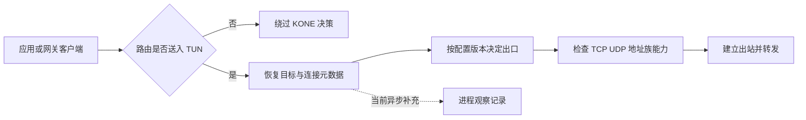
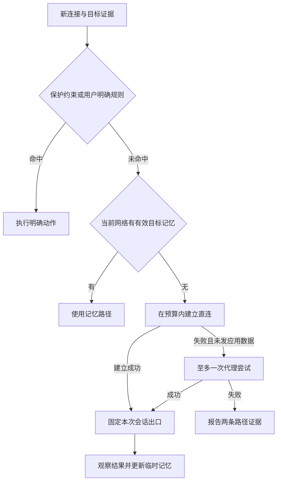

# KONE 技术边界与产品方向研究

日期：2026-11-07。代码基线：[master 8d018cd](https://github.com/xjdrew/kone/tree/8d018cd729f7417b7202a652c65a486ae0e2f33f)。本文为方向建议，不替代现行 PRD，也不表示下述能力已经排期或实现。竞品结论依据官方资料和公开代码；本文没有在中国不同运营商网络上进行实机横评，不以功能表推断实际成功率或性能排名。

产品方向补充：按用户最新澄清，全局模式为 **Standalone、Global、Smart、Custom**；应用与域名、IP 同属规则条件，由 Smart 和 Custom 按需使用。第 7 节据此修订；模式定义已确认，具体默认值、平台实现与验收方案仍属于待验证建议。现行 PRD 的两种基础策略需在后续需求同步时迁移，不能直接将旧语义套用到这四种模式。

**建议把 KONE 定位为“少配置、能解释、可恢复的桌面分流工具”，优先解决策略正确性与应用分流，再以受限范围验证自适应直连。** 面向普通代理用户，现阶段协议、导入和稳定性仍是门槛；“有 TUN、有规则、有图表”不足以让用户迁移。若决定进入大众客户端市场，应先验证成熟执行核心的复用价值，再决定继续投入多少自研数据面。

最影响规划的五个结论：

1. **IP/CIDR 规则已经能在线修改。** 新连接采用新配置，已接管的旧连接保留原出口；修改网页规则不等于迁移正在下载的 TCP 连接。
2. **有些“规则没生效”并非缓存过期慢，而是缺少域名或真实 IP 证据。** 本次隔离实验还确认了多地址决定与拨号目标不一致、Fake-IP 映射重建后地址重用的条件，应先处理。
3. **smart 可行，但不能承诺自动识别所有“无法访问”。** 首发宜限定为“规则辅助、按目标记忆、连接建立阶段的直连失败回退”。TCP 连通、TLS 成功、网站业务可用是不同层次。
4. **应用规则可行，且比泛化 smart 更适合先交付。** 当前进程信息是异步观察数据，IPv6 进程归属明确未支持，不能直接用现有展示字段决定出口。Windows 可先补强现有系统查询；macOS 应比较原生 socket 查询与透明代理扩展。详见[平台研究](application-routing-platforms-2026-11-07.md)。
5. **四种全局模式与统一规则体系可以并存。** Standalone 不代理任何流量，Global 代理所有非局域网流量，Smart 自动判断，Custom 使用自定义规则；应用作为规则条件由 Smart 和 Custom 使用，不另设应用模式。

## 1 当前路线的价值与代价

当前链路是内核路由把流量送进 TUN，sing-tun 交付 TCP/UDP 会话，KONE 恢复 Fake-IP 对应的域名、匹配规则，再通过 direct、HTTP(S)、SOCKS5 或 Shadowsocks 出站。管理服务与特权助手分离，配置快照、资源所有权和故障恢复已经形成基础。三种运行栈使用同一套规则和出站，换栈不会增加代理协议。[架构](../technical/architecture.md)、[出站实现](../../pkg/kone/outbounds.go)、[依赖维护](../technical/sing-tun.md)

这条路线适合“把已有代理链路覆盖到不支持系统代理的应用”，也便于实现一致的规则解释与热更新。代价是 KONE 同时承担捕获、DNS、规则、进程归属、代理协议和跨平台恢复的维护工作。平台越多、协议越多，功能之间的组合验证增长越快。

必须区分三个问题：**流量是否进入 KONE、KONE 知道它是什么、KONE 能否执行选中的出口。** 只解决其中一个不能保证分流成功。

| 场景 | 当前判断 | 主要限制或下一步 |
| --- | --- | --- |
| 本机或网关 TCP/UDP 透明分流 | 已有基础 | 以实际路由和地址族覆盖为前提，不能把 UI 开关当作全流量证明 |
| IP/CIDR 在线改规则 | 已支持 | 路由事务与新流快照；原始文件模式修改文件仍需重新加载/重启 |
| 现有长连接无感更换出口 | 不能通用保证 | TCP 对端与状态已固定；应提供可选断开重连语义 |
| 应用自带 DoH、直接使用真实 IP | 可按已知 IP 分流 | 未观察到域名时，域名规则无法可靠匹配 |
| 代理后的实际目标 IP 与国家展示 | 有条件 | 远端解析未返回真实目标地址时必须保持未知 |
| 某个本机应用全部走代理 | 尚未形成决策能力 | 需首包前应用识别、IPv6、未知身份处理及子进程覆盖 |
| 网关后某台手机的某个应用走代理 | 仅凭网关不可靠 | 需要端上协作；可先做设备/源地址规则 |
| 任意流量的三层 VPN 替代品 | 当前不具备 | TCP/UDP 代理不等于任意 IP 协议、组播、入站可达或完整 VPN 语义 |
| VLESS、Trojan、Hysteria 等用户已有节点直接导入 | 当前出站范围不覆盖 | 需要成熟核心/协议适配及订阅导入，不能靠换 TUN 栈实现 |

还应认真看待四类非功能性代价：物理出口绑定与企业 VPN 共存、休眠换网后的重新发现、Fake-IP 状态寿命、签名安装与升级恢复。这些往往比规则编辑器决定普通用户是否留下。当前 CI 能证明指定环境的用例通过，不能替代真实 VPN、弱网、游戏及多天运行验收。[开发验收边界](../development/development.md#5-验收按风险定位)

## 2 实时规则修改究竟能到哪一步

### 2.1 现有实现已经做对的部分

`ReloadVersion` 校验配置，构建新规则与出站，先完成捕获路由变更，再发布新快照，并清除 KONE 的直连判断缓存。每个 TCP 流和 UDP 会话持有自己的快照；活动流引用的捕获路由延迟释放。因此，“IP 规则天然无法热改”不成立。[配置发布](../../pkg/kone/one.go)、[路由事务与引用](../../pkg/kone/live_routes.go)、[回归用例](../../pkg/kone/live_routes_test.go)

Fake-IP 映射也没有直接绑定一个永不改变的代理：新流量可以使用同一个虚拟地址重新匹配最新规则。已有真实 DNS 证据过期时，新 DNS 查询或新流会刷新并重判；不会因为持续访问 Fake-IP 就无限延长真实 DNS 答案的有效期。[流决策](../../pkg/kone/flow.go)、[TTL 回归](../../pkg/kone/dns_final_proxy_ttl_test.go)

但是，`core`、DNS、普通日志配置等变化仍受重启边界约束。基础策略切换如果需要改变全局接管范围、IPv6 或出口接口，不能仅替换 `FINAL` 就声称全部完成。[配置生效范围](../user/configuration.md#1-配置对象与生效范围)、[PRD 的基础策略要求](../requirements/prd.md)

### 2.2 需要拆开的缓存与连接状态

| 状态层 | 改规则后的行为 | 能否立即控制 |
| --- | --- | --- |
| KONE 规则快照 | 后续接纳的新流读取新版本 | 能；已有流不会自动迁移 |
| KONE 的直连判断缓存 | 热更新清除，并有代次检查 | 能，不能代表已清除操作系统缓存 |
| KONE 真实 DNS 响应缓存 | 保留 TTL 内解析证据，再按新规则判断；规则变更不必重新问 DNS | 能管理自己的缓存，不能保证上游返回更新答案 |
| Fake-IP 映射 | 热更新保留地址，活动流固定引用 | 当前运行代次内可管理；跨重启另有边界 |
| 操作系统、浏览器、应用 DNS 缓存 | 可能继续拿真实 IP 或旧 Fake-IP 建连 | 无法通用地远程清空每个应用内部状态 |
| HTTP/2、HTTP/3、WebSocket、数据库连接池 | 新业务请求可能继续复用旧网络连接 | 刷新页面不等于新建连接；需等待关闭或明确断开 |
| 上游代理的 DNS、连接池与目标 CDN | 位于 KONE 控制之外 | 不能用清本机缓存强制刷新 |

HTTP/2 允许持久连接承载多个请求，并在满足条件时跨不同 authority 复用。纯流转发层看不到加密流里的每个业务请求，无法按后续 URL 重新选出口。QUIC 虽有端点连接迁移机制，也不意味着中间代理能替任意应用安全迁移现有会话。[HTTP/2 连接复用](https://www.rfc-editor.org/rfc/rfc9113.html#section-9.1.1)、[QUIC 连接迁移](https://www.rfc-editor.org/rfc/rfc9000.html#section-9)

更合适的产品反馈是：“配置 v42 已应用；新连接采用 v42；仍有 3 条 v41 长连接”，并提供有影响预览的“断开相关连接”。后者是未来能力，不应把当前的清空观察记录按钮解释为断开实际 socket。

此外，已有路由引用只能保护**已经进入 KONE**的连接。添加更宽捕获路由时，之前旁路的直连长连接后续报文可能改变路径；代码中的引用保护不能证明它们也不会中断。这需要加入原生网络验证，不能把“保留已接管连接”扩展成“全机连接永远不受影响”。

## 3 本次实验确认的四个边界

实验只使用内存状态和回环 DNS，没有启动 TUN、修改系统 DNS/路由，也没有拨号真实代理。实验断言用于确认基线行为，测试 PASS 表示复现成立，不表示这些行为是期望规格。完整探针和运行方式见[复现附件](policy-boundaries-2026-11-07.md)。

### 3.1 冷启动的 IP 例外可能被 FINAL 代理掩盖

配置为 `IP-CIDR 203.0.113.0/24 → direct`，随后 `FINAL → office`；回环 DNS 准备返回 `203.0.113.9`。首次查询 `cold.example` 时，KONE 按域名的 FINAL 立即返回 Fake-IP，实际上游查询数为 **0**；新流仍选择 `office`。

原因是当前 DNS/流路径在已能决定代理、又没有真实地址证据时，不会为了前面的 IP 规则主动解析。规则本身可以匹配 IP，但匹配所需的信息尚未取得。[DNS 代理捷径](../../pkg/kone/dns.go)、[流目标解析](../../pkg/kone/flow.go)

**优先级 P0，属于全局策略正确性缺口。** `GEOIP CN → direct + FINAL → proxy` 不能仅凭规则存在就承诺工作完整。应把规则求值改成“已决定／需要解析／证据不足”，到达需要 IP 的规则时按明确 DNS 策略补证据，同时提供类似 `no-resolve` 的显式选择。Surge 的规则系统正是把触发解析、跳过解析与解析失败处理分开定义。[Surge 规则与 DNS](https://manual.nssurge.com/rules/overview.html)

### 3.2 缓存真实 IP 后 新增域名规则不会凭空恢复域名

先按 direct 查询 `cached.example`，客户端得到 `203.0.113.9`；再在线增加 `DOMAIN cached.example → office`。向旧真实 IP 发起的新流仍选择 direct；重新查询得到 Fake-IP 后，新流才选择 office。两个结果都在同一次配置更新之后得到。

这既可能发生在浏览器 DNS 缓存，也可能发生在应用使用独立解析器时。即使真实 IP 已进入 TUN，IP 报文也不携带原始域名；多个域名共享 CDN IP，不能把一个 IP 的最近 DNS 查询当作所有连接的身份。

**这是能力边界，需要 P0 产品契约与接管设计。** 可对希望持续控制的域名从一开始稳定使用 Fake-IP，或在可选模式中补充有限域名元数据识别；仍不能承诺覆盖全部加密解析。ECH 会保护真实 SNI，增加 SNI 嗅探也不是通解。[ECH 标准](https://www.rfc-editor.org/rfc/rfc9849.html)

### 3.3 多地址答案的匹配对象与拨号对象可能不同

一个域名已有两个 A 记录，顺序是 `203.0.113.9`、`198.51.100.9`。更新为 `IP-CIDR 198.51.100.0/24 → direct`、`FINAL → office` 后，实验得到：**命中 198.51.100.0/24 的直连规则，拨号目标却是 203.0.113.9:443。**

`DecideDNS` 从整个答案集合选优先规则，`SetRealIP` 则保存第一个符合地址族的地址。两步没有共同选择同一个目标，导致规则解释与实际动作可能不一致。[规则证据遍历](../../pkg/kone/rule.go)、[真实地址选择](../../pkg/kone/dns_table.go)

**优先级 P0，属于应修复的正确性问题。** 决策结果应包含选中的地址候选与解析来源，拨号和解释都消费同一结果；多地址重试也逐候选遵守规则。不能在某个允许直连的地址上判定，然后拨号另一个没有获准直连的地址。

### 3.4 Fake-IP 重建后的旧缓存可能错关联

采用默认 `10.192.0.1/16` 地址池的两个全新映射表时，`site-120.example` 和 `site-201.example` 都可首先分配到 `10.192.97.89`。第二张表只知道后者；客户端若仍缓存前者的地址，反查会得到后者。该实验验证的是表级地址复用条件，不是已经观测到用户业务数据被发错的实机事故，也不能据此推算真实发生频率。

当前映射是内存对象，地址由哈希提示与空位分配决定，运行中的 pin 只能保护当代活动引用，不能保护重建前留在应用里的缓存。[地址池](../../pkg/kone/dns_ip_pool.go)、[映射表](../../pkg/kone/dns_table.go)

**优先级 P0，列入重启、升级及异常恢复设计。** 需比较持久映射、带有效期的地址保留、代次隔离及池更换策略，并处理恢复损坏和隐私存储。仅缩短 DNS TTL 或清系统缓存不覆盖所有应用。Mihomo 提供 `store-fake-ip` 持久映射配置，可借鉴其目标，但仍要验证 KONE 自己的生命周期和地址回收契约。[Mihomo 缓存](https://wiki.metacubex.one/config/general/#缓存)

## 4 三款产品究竟值得学什么

### 4.1 先区分客户端、执行核心与策略组

| 对象 | 官方资料体现的定位与能力 | 对 KONE 的直接启发 |
| --- | --- | --- |
| Surge | 面向 macOS/iOS 的网络工具，连接代理之外还覆盖 DNS、规则、请求检查和诊断 | 用户需要知道为什么失败，并能在同一处修正规则；不必复制其全部调试功能 |
| Clash Verge Rev | Windows/macOS/Linux 桌面客户端，基于 Tauri，集成 Mihomo，提供订阅、系统代理、TUN 和配置扩展 | 客户端体验可以建立在成熟核心上；导入现有节点与规则是迁移门槛 |
| Mihomo | Clash Verge Rev 使用的执行核心，提供协议、DNS、路由和进程匹配等能力 | 研究核心的数据面能力，同时评估控制接口能否满足 KONE 的解释与事务语义 |
| v2rayN | 跨 Windows/Linux/macOS 的多核心客户端，支持 Xray、sing-box 等核心 | 兼容用户已有生态很重要，但多核心也会增加配置翻译与能力差异 |

来源：[Surge 官方网站](https://nssurge.com/)、[Clash Verge Rev 仓库](https://github.com/clash-verge-rev/clash-verge-rev)、[v2rayN 仓库](https://github.com/2dust/v2rayN)、[v2rayN 核心列表](https://github.com/2dust/v2rayN/wiki/List-of-supported-cores)。以上是能力核对，不是实测优劣排名。不能把 Clash Verge Rev 的界面能力都当作 Mihomo API，也不能把某个核心支持的功能推定为所有客户端版本都已经暴露。

### 4.2 Surge：学习决策反馈与应用边界

**Surge Smart Group 不等于“直连失败再代理”。** 官方文档明确排除 DIRECT 等内置策略；它根据真实连接表现选择代理，并记忆不同站点的偏好。值得学的是按目标积累证据、让历史判断随时间衰减，而不是把名称为 Smart 的功能直接搬来充当自动直连策略。[Smart Group](https://manual.nssurge.com/policy-groups/smart.html)

Surge 的 fallback 则在一组策略中按健康检查选择可用成员。某个测试 URL 成功只能证明那条测试路径可用，无法证明当前游戏、公司服务或目标网站可用。[Fallback](https://manual.nssurge.com/policy-groups/fallback.html)

应用匹配也有明确边界：Surge 的 `PROCESS-NAME` 是 Mac 功能，可以按名称或路径匹配；新版支持用应用包路径前缀覆盖多个可执行文件。官方同时指出 DNS 预匹配阶段尚无进程信息。KONE 应学习“选一个应用，覆盖其合理的进程集合”，而不是要求用户手填一个随版本变化的 PID。[Process Rule](https://manual.nssurge.com/rules/process.html)

另一个启发是按协议处理失败。Surge 对 QUIC 的阻断策略包含观察是否出现 TCP 回退的机制，说明“禁掉 UDP/443，所有应用自然会恢复”不是可靠假设。KONE 不应把全局禁 QUIC 当作 smart 的默认捷径。[QUIC 策略参数](https://manual.nssurge.com/policies/parameters.html)

KONE 最值得吸收的是完整操作链：看到失败 → 理解决策和证据 → 形成局部例外 → 验证 → 撤销。MITM、脚本重写和全面 HTTP 调试会改变产品边界与维护成本，当前不建议追随。

### 4.3 Clash Verge Rev / Mihomo：学习生态入口与规则分层

Clash Verge Rev 的常见起点是导入订阅，再选择策略与开启系统代理/TUN；用户不必先理解整份底层配置。可视规则支持把个人规则前置或后置，减少订阅更新覆盖个人意图的问题。[快速入门](https://www.clashverge.dev/guide/quickstart.html)、[规则管理](https://www.clashverge.dev/guide/rules.html)

Mihomo 的进程匹配、DNS 策略、Fake-IP 持久化和多地址连接策略，说明这些问题已有成熟工程参照。但它的 `url-test`、`fallback` 文档描述的是基于测试 URL 的候选选择；这仍不同于对任意目标进行直连可达性判定。[规则](https://wiki.metacubex.one/config/rules/)、[URL Test](https://wiki.metacubex.one/config/proxy-groups/url-test/)、[Fallback](https://wiki.metacubex.one/config/proxy-groups/fallback/)、[通用配置](https://wiki.metacubex.one/config/general/)

有两项值得直接进入 KONE 的产品设计：

- **保留配置来源。** 用户例外、基础策略、外部规则集、临时学习结果分开保存，导入更新不能悄悄覆盖用户选择。Clash Verge Rev 的合并和脚本机制提供了实际参照；KONE 可以先实现更少、更明确的层次，并展示最终结果的来源。[配置扩展](https://www.clashverge.dev/guide/extend.html)
- **拆开 DNS 的任务。** 代理服务器自身解析、普通直连解析、代理目标解析、公司私有域名解析不是同一个问题。KONE 已有私有 DNS 范围基础，应明确它们与 IP 规则补解析、smart 探测的交互，防止解析循环或错误地把企业私有域名送到公网解析器。[Mihomo DNS](https://wiki.metacubex.one/config/dns/)

不要以“提供更多 YAML 字段”为竞争方向。规则与订阅越强大，用户越需要知道当前生效的究竟是哪一层，以及新订阅为什么改变了结果。

### 4.4 v2rayN：学习兼容性，也看到多核心的成本

v2rayN 将系统代理入口与路由配置分开，支持多种核心和节点来源。对普通用户而言，“我的现有节点能导入并工作”通常早于“路由解释是否漂亮”。KONE 如果只支持目前这组出站协议，会把相当一部分现有代理用户挡在首次使用之前；这个判断来自兼容范围差异，不是用户规模调查。[路由说明](https://github.com/2dust/v2rayN/wiki/Description-of-system-proxy-routing)

不能沿用“v2rayN 只有 Windows”或“某核心一定不支持进程”的旧印象。本次查看的代码中，sing-box 路由生成器会把 Process 配置转换为 `process_name` / `process_path`，V2ray 路由生成器也存在进程条件处理。实际效果仍需按核心版本、平台和捕获入口验证。[sing-box 配置生成，固定提交](https://github.com/2dust/v2rayN/blob/91d1cbe55aeb5fc416353e10b7fa29c2299b9c98/v2rayN/ServiceLib/Services/CoreConfig/Singbox/SingboxRoutingService.cs)、[V2ray 配置生成，同一提交](https://github.com/2dust/v2rayN/blob/91d1cbe55aeb5fc416353e10b7fa29c2299b9c98/v2rayN/ServiceLib/Services/CoreConfig/V2ray/V2rayRoutingService.cs)

KONE 应展示能力约束，例如“这个出口不支持 UDP”“这个平台当前无法识别该应用”，在保存时处理冲突。暂不建议同时做多核心选择器：用户不该为了决定一个应用是否代理而先学习数个核心的规则方言。

## 5 smart：可以实现什么 应该承诺什么

### 5.1 “不可达”不是单一信号

用户的 smart 目标是合理的，但透明代理只能看到有限证据。下面几种情况需要不同处理。

| 观察到的情况 | 能得出的结论 | 建议行为 |
| --- | --- | --- |
| DNS 超时、错误或异常答案 | 当前解析路径有问题；不能直接证明目标被阻断 | 按域名范围换合适解析路径，私有域名保持私有解析约束 |
| TCP 建连超时/拒绝/路由失败 | 这一地址、端口、时间点的直连失败 | 在尚未转发应用数据时，允许一次代理尝试 |
| TCP 建立但 TLS 握手失败或连接重置 | 路径、服务、证书、协议都可能有问题 | 记录证据，必要时独立诊断；不能任意重放已经转发的数据 |
| TLS 成功但返回登录失败、403、地区限制 | 业务失败；加密流通常不可见 | 由用户明确覆盖或由获授权的应用层集成判断 |
| UDP 发送成功，没有返回包 | 不知道对端是否收到，也不知道是否本应响应 | 按协议判断；通用 UDP 不自动复制到两条路径 |
| 全机断网、认证门户、DNS 服务整体故障 | 不能把所有目标都判成“需要代理” | 暂停学习，报告网络环境问题 |
| 两条路径都失败 | 可能是目标故障、节点故障或本地网络故障 | 明确报告失败，避免重试风暴和错误永久规则 |

“自动判断是否被特定网络封锁”比“观察到当前连接失败”强得多，不应成为产品承诺。中国不同运营商、移动/固定网络、IPv4/IPv6和时段的结果也不相同，静态 GeoIP 分类不能替代可达性证据。

### 5.2 建议的第一版范围

**第一版 smart 是按目标记忆的连接级回退：默认直连，明确例外优先；直连在应用数据发送前失败，才尝试指定代理。** 成功后暂时记住该目标在当前网络中的选择。它不保证每次首访无等待，也不保证修复所有 TLS 或业务层失败。

必要前提是相关流量确实进入 KONE。只捕获已知代理网段、把其他流量完全交给系统旁路，KONE 就没有机会观察那些目标的直连失败。因此 smart 需要较完整的 TCP/UDP 接管与稳定域名映射，同时保护局域网、企业 VPN、代理服务器自身和管理通道；不是只加一个规则名字。

这里的“建立成功”必须标注证据等级。直连 TCP 的建立、代理服务器 TCP 的建立、代理协议确认已连上目标、收到目标响应，是四件事。当前 HTTP CONNECT / SOCKS5 可以取得目标连接的协议确认，而 Shadowsocks 建立代理传输并不等于目标已经响应。现有独立诊断已经区分部分证据，适合复用，但不能把一个绿色 TCP 指标解释成“网站正常”。[出站实现](../../pkg/kone/outbounds.go)、[诊断探针](../../pkg/kone/diagnostic_probe.go)

采用延迟并行建连可以缩短等待，但前提是**只竞争连接建立，不向两个出口复制应用请求**。对某些缺少目标确认的协议，并行连接依然不能提供可信的胜者判断，首发可限制支持范围。HTTP 标准也明确约束非幂等请求的自动重试；KONE 不应在无法识别业务语义的字节流层重放支付、上传等操作。[HTTP 重试语义](https://www.rfc-editor.org/rfc/rfc9110.html#section-9.2.2)

遇到“TCP 成功、发送 TLS 数据后失败”，可以把本次证据用于后续新连接或提示用户重试；不要承诺当前连接能透明自愈。应用可能自己建立新连接，也可能只显示失败，这正是 assisted smart 先于全自动模式的理由。

### 5.3 学习缓存必须有边界

临时记忆至少区分网络代次、目标域名或 IP、端口、TCP/UDP、地址族、解析上下文和代理配置版本。不能因为酒店 Wi-Fi 下失败，就让这个目标在回家后永久代理；不能因为 IPv6 失败就把可用 IPv4 也判坏；不能因为一个域名的单个 CDN 地址失败就永久拉黑整个域名。

实现上需要有限 TTL、容量上限、失败退避、回切滞后和预算上限。成功证据逐渐过期，网络/VPN/代理配置变化时重新评估；一个会话保持出口稳定。手动规则始终高于学习结果，自动判断保存在独立临时层，支持查看原因、清除和固定为用户规则。

同一业务也可能跨登录、API、媒体等多个域名建立连接；逐连接“选最快”可能让它们呈现不同出口 IP，触发风控或会话异常。需要允许应用/站点集合固定出口，且不能擅自把公共后缀下的所有服务合并。对于明确需要代理的常见目标，可辅以可更新、可覆盖的规则，减少首访试错；规则分类与自动学习的来源必须分开显示。

默认直连尝试本身会向本地网络暴露目标连接，可能还包括 DNS 查询。对“这个目标必须走代理”的用户意图，绝不能先直连试试；proxy-first 与 smart 应保留不同的隐私语义。自动策略只能在用户允许选择的出口集合里工作，不能为了成功率越过明确的拒绝或强制代理规则。

建议先上线 **assisted smart**：发现值得关注的失败 → 用独立探针比较路径 → 告知证据等级 → 用户一键创建临时例外。这个阶段可以复用现有诊断和规则能力，也能积累哪些失败确实可被代理修复的数据。只有证明误判率、延迟和重试边界可控，再开放受限 TCP 自动回退。UDP/QUIC 放到后续按协议验证。

## 6 app：可行 但必须把观察提升为决策能力

### 6.1 现有进程展示不是现成的进程路由

当前 `attributeProcess` 在连接处理中异步补充进程记录，不参与先前的出口选择。解析器使用有界队列和工作线程，默认超时 500ms，并明确把非 IPv4 查询标为 unknown；远端客户端的源地址也不会被误当作本机进程。[连接观察](../../pkg/kone/flow.go)、[进程解析器](../../pkg/process/resolver.go)

app 规则需要在决定出口、发送应用数据之前取得足够可信的身份。把现有异步查询改成所有连接同步等待 500ms，会明显伤害启动和页面加载。应先用短时缓存与有效身份校验命中常见情况，再对未命中连接做有预算的查询，并显示 unknown。进程退出、PID 重用、端口重用、子进程和共享 socket 都要纳入失效条件。

### 6.2 各平台的实现路线

| 平台/场景 | 当前基础 | 建议演进与边界 |
| --- | --- | --- |
| Windows 本机 | 系统 TCP/UDP 表、进程路径与启动时间校验 | 先补 IPv6 与查询缓存，验证 UDP 归属歧义；若要求强制隔离，再评估 WFP ALE 等更直接的应用身份机制 |
| macOS 本机 | 有界 `lsof` / `ps` 查询及身份复验 | 不宜让每个新流都启动子进程；评估原生查询或事件缓存，应用包及 helper 集合需要单独验证 |
| Linux 本机 | 有界 `/proc` socket 与进程归属扫描 | 优化重复查询，明确权限、共享文件描述符与 namespace 边界；不能把宿主看到的 PID 等同于容器内应用 |
| IPv6 | 当前解析器返回 unknown | 正式宣传“某应用全部代理”之前必须补齐，或明确限制地址族 |
| 网关客户端 | 只有远端源地址/设备信息 | 提供设备规则；应用规则要求端上代理或协作组件 |

Windows WFP ALE 官方支持连接级应用身份，是严格场景的候选路线，但不等于第一版必须写驱动。sing-box 的路由文档也列出了桌面平台进程名/路径条件，佐证功能方向可行；具体可靠性仍需按 KONE 所选实现验证。[WFP ALE](https://learn.microsoft.com/en-us/windows/win32/fwp/application-layer-enforcement--ale-)、[sing-box 路由条件](https://sing-box.sagernet.org/configuration/route/rule/)

### 6.3 用户选的是应用 不只是进程名

建议交互是“选择已安装或最近联网的应用 → 指定代理 → 显示当前识别覆盖”，持久规则基于应用路径、应用包及可验证身份，PID 只作为短期证据。安装路径变动、升级替换、浏览器 helper、启动器与游戏本体都可能改变实际联网进程，应允许用户确认扩展范围。

不能承诺一个普通进程规则区分浏览器里的两个网站账号、两个标签页，或多个应用共用的系统网络服务。浏览器按站点分流仍适合域名规则；需要按浏览器配置文件区分时，可能需要扩展或不同显式代理入口。

DNS 还存在独立难点：系统解析请求可能来自共用的解析服务，而实际 TCP 连接来自目标应用。不能因 DNS 包的进程不是被选应用，就提前判定后续连接不用代理。应先保留域名映射，再在连接阶段结合应用身份决策。

unknown 必须有产品语义。普通模式可以回到明确的基础策略并记录“应用身份未识别”，但不能同时宣称强制无泄漏；严格模式若要禁止被选应用误走直连，需要可靠的系统级归属与限制。简单地阻断所有 unknown 会伤及其他应用，而仅阻断已识别流又无法保证未知流属于谁。

**建议先选一个桌面平台交付可验证的应用规则 MVP。** 从现有原生接口基础看，Windows 可作为首选候选，但应由首批用户平台决定；验收包含 IPv4/IPv6、TCP/UDP、helper、升级与身份未知情形。不要用三个平台同时“基本支持”代替一个平台明确可靠。

补充的[Windows/macOS 应用规则研究](application-routing-platforms-2026-11-07.md)进一步区分系统能力与当前实现缺口：Windows 的 IPv6 owner table 已有官方支持；macOS 的流代理接口可提供来源应用元数据，但需要签名、授权与扩展生命周期管理。两者都不能仅凭“支持进程规则”就承诺禁止任何旁路。

## 7 策略模型：四种全局模式与统一规则

### 7.1 已确认的模式定义

KONE 的目标是让大多数用户选择模式后即可使用，同时保留充分的自定义能力。全局模式与规则条件分别建模：

| 全局模式 | 用户确认的含义 | 建议的规则处理与兜底 |
| --- | --- | --- |
| Standalone | 不代理任何流量 | 不执行会改变该承诺的业务分流规则；流量直连，仍可保留观察能力 |
| Global | 代理所有非局域网流量 | 局域网直连，其余业务流量使用指定代理；不由业务例外悄悄改成部分代理 |
| Smart | 自动判断是否需要代理 | 先执行用户明确规则，未命中时进入自动判断与临时学习 |
| Custom | 自定义规则 | 按有序规则与用户指定的兜底处理；不隐式加入 Smart 学习结果 |

第一、二列记录确认方向；第三列是使这些模式行为一致、可解释的实施建议。Custom 初始兜底和首次默认模式尚未由本次澄清指定；可以在 Smart 达到验收标准后将其作为普通用户的推荐入口。开箱即用仍以存在可用出口及完成必要系统授权为前提。

Standalone 与暂停/退出应保持独立：前者规定流量出口，后者规定引擎是否运行。切换模式保留已保存的规则、顺序和代理配置，只改变本次生效的策略；用户返回 Smart/Custom 时继续使用自己的规则。Global 遇到不支持的协议、地址族或不可用出口时，应明确失败或范围限制，不能静默直连后仍显示严格 Global。

### 7.2 应用作为规则条件

统一规则表达“匹配条件 → 执行动作”：条件可以是应用、域名、IP、协议、端口及其组合，动作可以是直连、指定代理或拒绝。应用身份由平台提供，规则顺序和出口选择由同一决策系统处理。

例如，在 Smart 中为办公应用指定直连，其他未命中流量继续自动判断；在 Custom 中指定某应用代理、某域名直连，其余使用配置的兜底。应用与域名/IP 规则之间使用可查看、可调整的总顺序；自动学习不能越过用户明确的规则。具体平台无法识别应用时，显示 unknown 并遵循约定的未匹配处理，不能伪造命中。

建议模式切换以一次版本化变更发布模式、规则作用范围、默认出口和接管计划；旧连接继续受原快照约束。旧 PRD 的 `direct-first/proxy-first` 允许持续叠加用户例外，不能直接重命名成 Standalone/Global：有生效例外的旧配置应预览迁移为 Custom，避免新名称与旧实际行为不符。

“全局代理”也要写清楚究竟保护哪些路径。局域网不是全部 RFC1918 地址，企业 VPN 也可能使用公网网段；反过来，有些用户确实需要通过代理访问远端私网。保护本机管理入口、代理服务器、防止回环是系统约束；“所有私网地址都必须直连”则只是可能的默认策略，不能混为不可改变的事实。

当前 direct 出站会绑定选定的物理出口，这有防止流量重新进入 TUN 的价值，却不自动满足“按目标保留企业 VPN 路由”。当前管理层发现网络上下文变化会暂停捕获，属于已有的保护措施；未来若要无感恢复，还需要重新发现出口、DNS 范围、路由和 smart 记忆的完整事务。[出口绑定](../../pkg/kone/outbound.go)、[网络变化处理](../../pkg/control/network_watch.go)

## 8 KONE 有没有竞争力 该不该继续自研核心

### 8.1 坦率判断：现在还缺少足够强的迁移动机

对已经熟练使用上述工具的人，KONE 当前的协议、订阅、规则生态、应用路由和长期使用验证都不是明显优势。有本地 Web 管理、图表、开源、TUN 和隐私导向，也不足以单独形成差异：竞品在其中多项已经投入多年。本文没有用户研究数据，不能把功能差距换算成市场份额或断言一定没有需求。

KONE 的潜在优势在于已有的配置版本、规则解释、连接证据、独立诊断和恢复机制可以组成更短的纠错路径。**如果用户能在一分钟内理解“为什么这个应用不通”，修正一个局部选择，并确认没有破坏公司内网，那才是值得迁移的结果。** 这需要实测成立，不能仅靠产品描述。

建议先服务一个具体群体：已有一个或少数代理出口、同时使用普通网络和企业 VPN、希望按应用或目标解决访问问题、又不想维护复杂配置的桌面用户。这个定位不要求首发赢过 Surge 的完整调试能力，也不要求立刻兼任路由器固件和移动端客户端。

对这批用户，优先级更可能是：

1. 现有节点能导入，凭据和协议能力校验明确，第一次就能连上。
2. 默认策略不破坏内网、办公 VPN、IPv6 和常用应用。
3. 选应用或目标即可调整，能够解释实际结果与未知部分。
4. 断网、休眠、换网、升级后能恢复，退出后不留下网络异常。
5. 在上述基础上，自动减少重复调整。

“无需过多配置”还包括安装权限、签名、节点导入、DNS、错误反馈与升级。只增加 smart/app 两个按钮，不会自动解决这些环节。

### 8.2 三条技术路线的真实取舍

| 路线 | 可以保留或获得什么 | 仍需付出的代价 | 适合条件 |
| --- | --- | --- | --- |
| 保持当前自研数据面 | 决策、证据、热更新完全可控 | 自己维护 DNS、Fake-IP、进程、协议及平台组合 | 透明决策本身是核心目标，团队愿意承担长期网络工程投入 |
| 保留 KONE 捕获/决策，只委托成熟核心做代理出站 | 较快扩大协议范围，保留入口元数据 | 多一层生命周期与故障边界，捕获、DNS、进程问题仍由 KONE 负责 | 协议兼容是眼前主要障碍，且本地桥接开销与语义可接受 |
| 成熟核心负责捕获、DNS、规则与出站，KONE 负责产品层 | 最大程度复用平台和协议生态 | 控制 API 未必暴露充分证据或支持所需事务，可能需要适配/上游贡献 | 重点是少配置体验与排障效率，愿意重新定义少部分现有语义 |

第二条不是免费的折中：通过本地 SOCKS 等桥接可以扩展出站，但不会自动继承另一个核心的应用识别、Fake-IP 生命周期或 TUN 修复。第三条也不是换个二进制即可：如果核心仅在连接建立后推送观察事件，KONE 就不能靠一个控制面回调阻止本次连接走错出口。

**我的建议是先给成熟核心适配做一个有上限的验证，再决定继续扩建哪部分自研数据面。** 可把两周作为探索时间上限而非交付承诺；优先检验 Mihomo 的能力契合度，必要时用 sing-box 对照。选择一个作为候选执行后端，不同时产品化多个核心，也不在选型前重写整个应用。

验证必须回答以下问题，而不只展示“网页能打开”：

- 能否准确表达 KONE 的基础策略、用户例外、应用条件和 TCP/UDP 能力约束？无法表达的配置是否会被明确拒绝？
- 能否在每条连接上取得决策版本、命中条件、实际出口、域名/IP 来源及可信度？现有指标有哪些必须放弃或补接口？
- 热改失败能否回滚，旧连接如何处理，异常退出与重启后网络和 Fake-IP 状态能否恢复？
- 是否能在数据转发前执行 smart 决策？若只能事后观察，就先做 assisted smart，不宣称支持当前流自动回退。
- 同一套测试下，IPv6、企业 VPN、应用识别、资源开销和安装权限是否达到目标？依赖许可、分发方式、固定版本与补丁维护是否可接受？

若成熟核心通过这些约束，建议把新增协议和底层适配工作转向复用，集中维护 KONE 的决策体验与恢复流程；若关键语义无法实现，则保留自研路径，并明确这是为可证明的能力付出代价。不能因为已经写了大量代码就默认全部必须保留，也不能因为核心功能更多就忽略迁移损失。

## 9 建议执行顺序与验收门槛

这些是建议的新阶段，不是已确认的开发任务，也不是时间估算。应先确认产品目标和第一个试点平台，再拆成 PRD 与开发计划。

| 阶段 | 交付重点 | 进入下一阶段的条件 |
| --- | --- | --- |
| P0：正确性与契约 | 处理冷 IP 例外、多地址决策一致性、Fake-IP 重建；说明真实 IP 缓存与长连接边界 | 本文四类探针转为期望行为回归；原生网络测试覆盖热改、重启及旧连接；无法控制的边界有明确反馈 |
| P1：路线与首次使用 | 完成有上限的核心适配验证；确定一个执行后端，打通最小节点导入与能力校验 | 常见用户配置能导入或明确指出不支持；退出/恢复、DNS、IPv6、VPN 基线通过 |
| P2：应用规则 | 一个平台上的应用匹配 MVP，由 Smart/Custom 使用，应用集合、未知身份与规则优先级清楚 | 目标平台的 TCP/UDP、IPv4/IPv6、helper 与升级用例通过，常见应用不需要手填规则 |
| P3：辅助智能 | 失败发现、独立诊断、临时规则、一键撤销，记录有限且可解释的路径证据 | 试点中用户纠错步骤和耗时下降；不把无证据的推测显示成事实 |
| P4：受限自动智能 | 在适配出口上做 TCP 建连回退、网络相关记忆、预算和手动覆盖 | 相比纯直连确有恢复收益；健康网络延迟可控；无应用数据重复转发或越过强制规则 |
| P5：按证据扩展 | 更多平台、目标级代理择优、经过协议验证的 UDP 处理 | 由实际未满足场景驱动，避免把“自动”变成无边界的重试系统 |

P0 的缓存边界并非都能“修成立即生效”：需要区分能修正的错误和必须向用户解释的协议约束。验收时，旧真实 IP 不携带域名这一事实不能靠测试期望强行消失；可以验证稳定 Fake-IP 模式、明确提示和受控重连流程是否满足新的产品契约。

### 9.1 建议保留的验收场景

| 类别 | 关键场景 | 要观察的结果 |
| --- | --- | --- |
| 规则证据 | 冷域名命中早于 FINAL 的 IP/GeoIP 例外；CNAME 与多 A/AAAA；地址 TTL 到期 | 命中规则与实际拨号对象一致，解析来源可解释 |
| 规则热改 | 旧真实 IP、新 Fake-IP、已接管旧连接、此前旁路旧连接 | 新连接行为可预测，旧连接与路由切换影响明确 |
| 重启恢复 | 应用保留 Fake-IP 后正常重启、崩溃、升级、恢复损坏状态 | 不把旧地址误认为其他域名，失败能够被定位与恢复 |
| 加密与复用 | 应用 DoH/ECH、共享 CDN、HTTP/2 复用、长连接下载 | 不伪造域名证据，不声称一个业务请求等于一个新流 |
| 应用身份 | IPv4/IPv6、TCP/UDP、helper、PID/端口重用、共享服务、权限不足 | 规则在首包前决定；识别不确定时遵循明确策略 |
| 网络环境 | 企业 VPN、私有 DNS、双栈、Wi-Fi 切换、休眠、认证门户 | 不错误学习全网封锁，不绕过受保护路由，不泄漏私有解析 |
| 回退边界 | TCP 不通、TCP 通但 TLS 失败、代理可连但目标不可达、两路都失败 | 证据等级正确，尝试次数有界，已转发的数据不重放 |
| UDP/QUIC | 有响应和无响应的 UDP、仅 QUIC 应用、HTTP/3 回落 | 不把 send 成功当成可达，不全局复制包或无条件禁 QUIC |
| 资源与生命周期 | 短连接突发、DNS 高频、学习缓存高基数、节点失效、订阅更新 | 队列/缓存/探测有上限，手动规则不被自动层覆盖 |

### 9.2 先测用户结果 再谈“智能”

建议北极星指标是“在保留内网和办公需求的前提下，无需编辑规则就完成目标任务的比例”，辅以首次配置完成率、每周手动纠错次数、一次故障定位与修复时间。下载速度和节点测速延迟只是其中一部分。

自动回退还要单独记录：能被代理修复的直连失败比例、误判为需要代理的比例、首次访问和记忆命中时的 P50/P95/P99 额外等待、规则覆盖准确性、额外连接数与能耗。统计应区分网络、地址族、协议和目标类型，不能靠平均值掩盖某类应用始终失败。

可以先组织约 20–30 位目标用户、持续两周的自愿试点，覆盖多个运营商和至少一种办公 VPN；这是研究建议，不是已经获得的样本。试点前共同确定数值预算，例如热路径 P95 额外开销目标不超过 50ms、自动代理误判率目标低于 1%；这些只是待验证门槛，不能写成现有性能。重复发送应用数据、违反强制代理/拒绝规则应是零容忍验收项。

## 10 研究方法、证据等级与未验证部分

本次核对 KONE 的规则、DNS、流快照、路由事务、出站、进程查询、诊断和网络变化处理；阅读三款产品的官方手册、仓库与关键配置生成代码。正文分别标注了已实现行为、可复现边界和建议方案。外部文档以 2026-11-07 查阅结果为准，可能继续变化；关键 v2rayN 代码和 KONE 基线使用固定提交链接。

本地在 Linux 上完成四个隔离探针的竞态测试，并运行相关 reload、DNS、路由与进程归属回归及 `just quality vet`。探针通过 Go overlay 注入临时文件，未加入常规测试套件，也未修改运行时代码。复现过程见[附件](policy-boundaries-2026-11-07.md)。

本次没有进行 Surge/Clash Verge Rev/v2rayN 的同机性能横评，没有在 Windows/macOS 实机验证新的 app/smart 方案，没有进行跨运营商长期访问测试，也没有实现或压测成熟核心适配器。因此，架构选型、性能预算与产品定位应通过后续有边界的验证做最终决策，不能以本报告替代验收。

现阶段最值得确认的方向是：**先让决策可相信，再让常见配置足够少，最后让自动选择减少真实故障。** 三者的顺序会决定 KONE 是多一个需要调试的代理工具，还是能替用户减少调试的工具。
