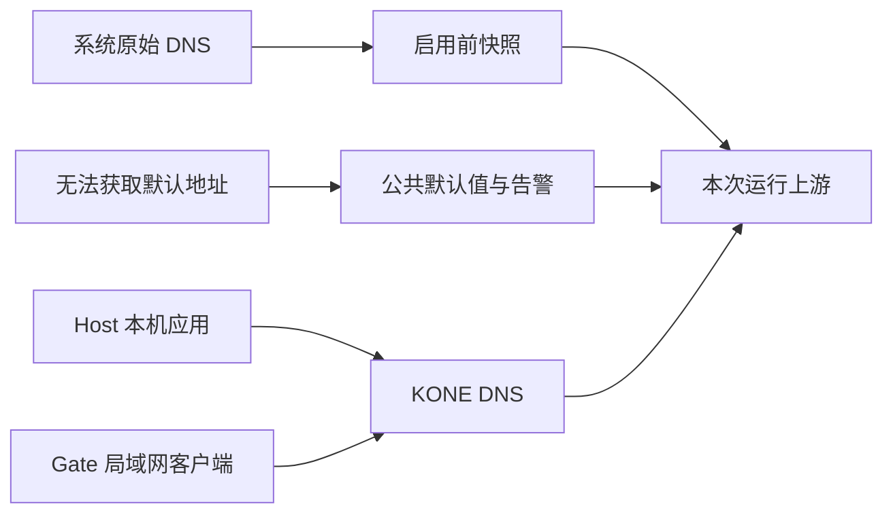

# DNS 解析与系统集成

本文说明上游发现、私有解析和逐平台系统引导的实现边界。用户配置见 [TOML 配置](../user/configuration.md)。

## 系统上下文与私有解析

不配置 `[dns].servers` 时，KONE 在创建引擎、配置系统网络之前读取当前解析器及可见作用域。这个快照服务于正常解析和代理服务器主机名解析，不使用 Fake-IP 再解析代理服务器，也不会因专用解析器失败去查询公共 DNS。配置固定到本次引擎实例，换网或修改 DNS 后需要重新创建实例。

| 平台 | 只读来源 | 可以表达的部分 |
| --- | --- | --- |
| Windows | `Get-DnsClientNrptPolicy -Effective`、DNS 客户端/服务器/搜索域、接口路由 | NRPT 的精确名称和后缀；网卡专用后缀、服务器与可确定的出口 |
| Linux | `resolvectl domain/dns/dnsovertls/default-route` | systemd-resolved 的 per-link 路由域、搜索域、默认上游与传输边界 |
| macOS | `scutil --dns` | 默认与 scoped resolver 的域名、搜索域、接口、地址和端口 |

Windows NRPT 有超出普通 UDP/TCP DNS 的安全、IPsec、DirectAccess 和查询策略；这些不能仅靠复制服务器 IP 保证语义。Linux 的加密 DNS 及 macOS 的多播/特殊 resolver 也不直接改成普通 UDP。已知不能安全表达的 scope 保持不可用并显示原因，匹配请求失败；它不会改走默认公共 DNS。来源文档：[Microsoft NRPT](https://learn.microsoft.com/en-us/powershell/module/dnsclient/get-dnsclientnrptpolicy)、[systemd resolvectl](https://www.freedesktop.org/software/systemd/man/261/resolvectl.html)、[Apple scutil](https://github.com/apple-oss-distributions/configd/blob/main/scutil.tproj/scutil.8)。

普通模式保留既有 systemd-resolved 本机 stub 时，可以继续由系统服务处理它原有的 VPN 路由与安全策略。启用 KONE 的系统 DNS 引导后，stub 可能指回 KONE，因此必须使用发现的真实上游；Host/Gate 无法取得默认上游时显式告警并选择公共默认值；已知私有作用域仍保持专用路由，不随默认回退泄漏公网。

macOS 已有 KONE 引导会话运行时，新启动的管理进程或数据面助手会只读核对 dynamic store 中的会话所有者、utun 和完整 DNS 配置，从上游快照排除该会话自己的监听地址，保留原有默认解析器及更具体的 VPN 域。无法核实所有权、配置在读取期间发生变化或原解析器不可见时，要求显式配置 DNS；不会仅凭回环地址猜测所有权。

macOS 的普通默认和全域 supplemental resolver 按 `SearchOrder` 选择，数值小的优先，展示顺序不代表优先级；接口专用和具体域的 resolver 保持各自作用域。默认解析器的优先级或传输方式无法确定、同一最低优先级指向不同服务器时，要求显式配置，不随意选择一个服务器。

所有发现命令只读取本机状态，总预算四秒、标准输出最多 1 MiB，错误输出不写入日志。最多接收 64 条自动/手工规则及每条 16 个服务器；超出可表达范围时拒绝不确定的自动解析并要求显式配置。原始操作系统快照不写入 TOML，也不会被伪装成用户配置。

### 手工覆盖

```toml
[[dns.rules]]
suffix = "corp.example"
servers = ["10.0.0.53"]
interface = "VPN"
```

使用实际网卡名称，留空沿用核心出口。手工规则优先于自动 scope；手工规则之间最长后缀优先。域名后缀使用 ASCII，国际化域名应填写 IDNA 的 punycode。匹配规则后只使用该组服务器，连不上、返回否定回答或接口失效都不会向公共默认上游回退。反向解析名称也可配置独立后缀。

搜索域作为观察到的系统上下文展示，不由 KONE任意添加到查询名称；客户端发送展开后的完整名称。自动发现不涵盖全部按应用、VPN 厂商插件、DNS 代理或加密 DNS 配置。需要这些语义的环境应核对实际系统策略、状态警示和查询记录，再明确配置；不要把发现成功当作所有企业网络行为都已经复制。

DNS 查询和失败是解析事件，不证明业务连接已经进入 TUN。解析接口、查询传输、实际使用的上游和缓存分别记录；本地 stub 的实际网络接口标为 loopback，不把其内部可能使用的公网解析器伪装成 KONE 直接访问的上游。

真实 DNS 响应和 Fake-IP 映射分别过期。IP/CNAME 规则依赖的真实响应到期后，新查询或新连接重新解析和判定；访问虚拟地址不会续期真实 DNS 数据。刷新保留同一域名的 Fake-IP 和活动会话引用，已建立连接继续使用原先选定的目标；刷新失败不会改用已过期地址或其他解析器。

## 系统 DNS 引导

`dns.mode` 分为 Host 与 Gate。管理模式默认 Host；旧 `dns.system=true` 管理配置迁移为 Host，旧 false 保持原行为，不自动开放局域网监听。

- **Host**：先发现原始系统 DNS，再启动本地 DNS 服务，最后接管系统 DNS；停止时先恢复系统 DNS，再关闭监听。
- **Gate**：在 `dns.listen-address` / `dns.listen-port`（默认 53）启动 UDP/TCP，不调用系统 DNS 配置接口。管理员负责 DHCP/客户端设置及 Fake-IP 回程路由。
- **默认上游**：两个模式均自动发现系统 DNS；没有可用默认地址时采用 `8.8.8.8:53`、`8.8.4.4:53`、`1.1.1.1:53`、`1.0.0.1:53`，API 通过 `public_fallback` 标明来源。显式上游和私有后缀不做该回退。



### Linux：按主机解析方式接管

使用 systemd-resolved stub 的主机保持原有按 link 集成，验证服务与 KONE 位于同一网络命名空间。非 stub 环境（包括 WSL）使用临时本机 resolver 入口：

1. 保存原内容、权限与符号链接关系；私有备份及所有权记录位于 `/var/lib/kone/dns`，可跨进程退出与重启恢复。
2. DNS 监听就绪后，原子替换本机 `/etc/resolv.conf` 入口；WSL 的共享目标文件保持原样。保留 search/options 等非 nameserver 内容。
3. 运行期间监测外部替换；停止时仅恢复匹配本次记录的状态。外部修改保持原样，备份保留供检查。
4. 异常退出后通过本机恢复操作授权处理；验证进程、启动标识、网络命名空间、启动周期与内容摘要。仅有 CAP_NET_ADMIN 不足以替换 resolver 文件时，管理模式使用授权 helper。

Host 文件模式需要端口 53；Gate 可选择 LAN 地址与端口，不能把自己的监听地址配置成上游。
```toml
[dns]
mode = "host"
# servers = []  # 从启动前的系统解析范围读取真实上游
```

KONE 在创建独占 TUN、配置路由并确认所有 IPv4/IPv6 UDP/TCP DNS 监听就绪后，才为该 link 设置 DNS、根路由域 `~.` 和 DNS 默认路由。现有更具体的 VPN/内网解析域仍按系统的最长匹配规则优先，不把根路由域当作强制截获所有 DNS。系统调用方式及域路由语义以 [resolvectl](https://www.freedesktop.org/software/systemd/man/latest/resolvectl.html) 和 [systemd-resolved D-Bus API](https://www.freedesktop.org/software/systemd/man/255/org.freedesktop.resolve1.html) 为依据。

启用系统引导时，KONE 使用在修改前发现的真实上游/系统范围，不再把会转回 KONE 的 resolved stub 当作自身上游。不能安全发现真实上游、存在无法复制的加密/严格解析策略时会阻断或按所属范围拒绝，不自动改用公共 DNS。显式手工解析规则仍优先。系统/企业 VPN 的全部应用级策略并非一个后缀列表所能完整替代，运行状态会保留来源、搜索域、接口与不可安全复制的警示。

本地 Fake-IP DNS 不是签名的公网权威答案，也不是本地 DoT 服务。全局严格 DNSSEC/DoT 设置无法透明保持时，系统引导明确拒绝；不会为了启用而降低系统全局安全策略。仅在自己新建 link 上配置必要的本地解析模式，物理/VPN link 不被重写。

退出或启动后段失败时，先恢复 DNS 引导，再关闭 DNS 监听。清理前检查 open TUN 的身份、接口 index、resolver 的唯一 owner/PID，以及自己管理的 link 配置快照。只逐项恢复修改过的 DNS、域、默认路由和本地安全模式，保留既有 LLMNR/mDNS/NTA；不使用会重置所有 link 属性的无条件 `revert`。其他程序已经改写或替换对象时保留其新状态并报告。TUN link 被移除后，resolved 的相应临时 link 配置也随之消失；这不需要清空全机 DNS 缓存。[官方说明](https://www.freedesktop.org/software/systemd/man/latest/resolvectl.html)

### macOS：自有临时解析服务

macOS 实现使用独立 `scutil` 会话，以随机 UUID 创建 `State:/Network/Service/<UUID>/DNS` 临时值。它使用 `add key temporary`，键已存在就失败；不覆盖物理/VPN 服务、不调用 `networksetup`，也不持久改写全机 DNS。空的 `SupplementalMatchDomains` 配合优先级表示默认解析范围，更具体的原生 VPN/内网域仍优先。`ServerPort` 支持独立监听端口，相关字段见 [Apple DNS schema](https://developer.apple.com/documentation/systemconfiguration/dns-entity-keys)。

优先级使用 `SupplementalMatchOrders` 的 CFNumber 数组：`scutil` 的 `* #` 组合明确创建数字数组，避免标量 `SearchOrder` 被 configd 按服务顺序重写。验收检查实际系统配置中的顺序值，再验证真实解析，不只确认动态存储中存在一个字典。[scutil 字典类型处理](https://github.com/apple-oss-distributions/configd/blob/main/scutil.tproj/dictionary.c)

Darwin utun 是点对点设备，自有 DNS 的系统入口使用已独占监听的 `127.0.0.1:<端口>`；不会把系统查询重新发进虚拟地址路由。上游必须在引导前读取，不能把同端口的自身 loopback 服务当作上游。创建后还要确认系统解析配置已选中该服务，才能报告代理就绪；无法保留的特殊应用/VPN 解析语义不被宣称透明兼容。

临时值的所有权属于 configd 会话。正常停止先关闭该会话并确认键已移除，再关闭 DNS；scutil 崩溃或持有 stdin 的父进程退出，也会使会话结束并自动撤销其临时值。其他会话取得该键的所有权后，configd 不再由旧会话删除它，KONE 保留外部值并报告。原生实现依据 [scutil add temporary](https://github.com/apple-oss-distributions/configd/blob/main/scutil.tproj/cache.c)、[configd 会话关闭](https://github.com/apple-oss-distributions/configd/blob/main/configd.tproj/_configclose.c) 与 [跨会话替换](https://github.com/apple-oss-distributions/configd/blob/main/configd.tproj/_configset.c) 的所有权检查。

生命周期同时监测会话死亡、自有键变化与 utun 身份变化；异常会触发统一停止，避免系统引导已消失而界面继续表示正常。一次性 macOS runner 对同一程序的 system/gvisor/mixed 逐栈验收临时原始解析器、实际系统顺序与查询、DNS 就绪后的故障恢复，以及运行中第二实例的原始上游发现；另有独立的精确子进程句柄终止和会话恢复验收，前后核对物理 DNS 与默认路由。结果以对应 SHA 的实际执行为准。特殊 VPN、应用自带解析器及部署环境仍需单独验收，不能从这些用例推断全部兼容。

### Windows：独占的本地 NRPT 引导

Windows 支持 `system = true`，要求 `listen-port = 53`。DNS 监听就绪后，KONE 为本次 Wintun 地址创建一条本地 NRPT 根规则 `.`，并确认它在有效策略中被选中。Windows DNS API 优先查询 NRPT；单纯降低适配器 metric 不能保证所有系统查询都选择该适配器。[Windows 名称解析顺序](https://learn.microsoft.com/windows/security/operating-system-security/network-security/vpn/vpn-name-resolution)

物理/VPN 适配器的 DNS、metric 和默认路由不会被该引导改写，更具体的内网/VPN NRPT 规则保持优先。已有根规则、域策略使本地规则无效、要求加密 DNS 的全局策略，或无法验证的旧租约会阻止启动；KONE 不替换这些策略。启动前发现真实上游，并排除已有 KONE 根规则和 Wintun DNS 地址，避免第二实例把查询递归送回 KONE。企业 VPN、DoH/DoT 和应用自带解析器仍需按实际部署验收。

根规则是持久的 Windows 配置。KONE 先在 `HKLM\SOFTWARE\Kone\DNSLeases` 写入最小所有权记录，再创建含随机标识的 NRPT 规则；记录只允许管理员/SYSTEM 修改，不含代理配置或凭据。全局互斥量防止不同管理配置或 CLI 同时管理根规则。正常退出、启动失败或父进程退出时，持有租约的进程先核对并撤销自己的规则，再关闭 DNS。系统 DNS 缓存不会被全机清空。[NRPT 规则接口](https://learn.microsoft.com/powershell/module/dnsclient/add-dnsclientnrptrule)

如果租约进程也被强制终止，规则可能在 Wintun 消失后仍然存在。重新打开本机 Web 管理，在恢复区域检查并显式执行恢复，Windows 会请求管理员授权。恢复重新验证机器记录及完整规则，只删除仍与本次租约相符的规则；即使崩溃发生在 Windows 生成规则 GUID 与回写 GUID 之间，也可依据随机标识找回。仍在运行的其他实例、被外部更改或无法证实的规则均保留并提示人工检查，不能通过清除管理记录掩盖尚未恢复的 DNS。

一次性 Windows CI runner 对 system/gvisor/mixed 分别验证系统 API → KONE Fake-IP、内网规则保留、正常恢复、根规则冲突、外部改动保留，以及强杀租约进程/代理进程后的完整与未回写 GUID 两种恢复。测试使用 `Resolve-DnsName`，不使用会绕过 NRPT 的 `nslookup` 或显式 DNS 服务器参数；前后比较物理适配器 DNS、metric 和默认路由。实际结果以对应 SHA 的 CI 为准。[Microsoft 对 NRPT 验证工具的说明](https://learn.microsoft.com/windows/client-management/mdm/vpnv2-csp)

应用内部缓存、已缓存 Fake-IP、DoH/DoT 或其他旁路解析有各自的生存期。停用代理与恢复系统 DNS 不会神奇地清除所有应用缓存，也不声称观察到绕开 KONE 的查询。

### 验收隔离

确定性测试覆盖每个设置阶段失败、命令超时前已生效、外部 DNS/LLMNR 改动、设备复用、resolver 换代与命名空间不匹配。Linux 原生 CI 另起 network/mount namespace，私有 `/run`、resolver 配置、D-Bus 和 systemd-resolved，执行真实 OS stub → KONE Fake-IP → 停止恢复，以及 DNS 就绪后的服务故障；system/gvisor/mixed 分别运行。测试程序在任何写入前再次验证 namespace/resolver，不能借宿主 D-Bus 做假验收。

原生任务缺少工具或隔离失败会明确失败；mock 测试不会被称为系统 DNS 已验收。实际结果以对应 SHA 的 CI 为准。本轮没有在用户主机执行系统 DNS 设置命令。

## DNS 查询诊断

`POST /api/v1/diagnostics/dns` 接收 `name`（默认 example.com）与 `type`（A/AAAA），复用有界、可取消的任务队列，固定比较 system / kone：

| 入口 | 执行路径与证据 |
| --- | --- |
| system | 当前操作系统解析入口，含系统缓存与 hosts；不虚构解析 API 未返回的 DNS RCODE/TTL |
| kone | 运行中引擎的客户端 DNS handler，经过缓存、分流和 Fake-IP；暂停时仅构造已保存配置，不启动监听或 TUN |

系统入口已指向 KONE 时，两者可能返回相同答案。摘要耗时覆盖查询至结果完成；答案、响应码、Fake-IP 标记和运行/保存配置范围在详情中展示。`GET /api/v1/dns/configuration` 为设置页提供默认上游来源、回退警示、网卡候选和实际运行状态。原有指定服务器的 UDP DNS 探测仍由 `/diagnostics` 的 `protocol=udp` 提供。
