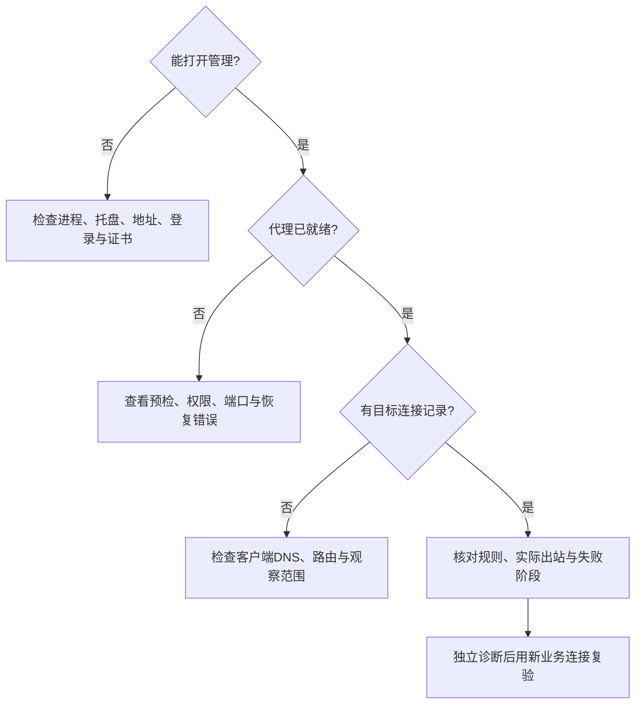

# 观察与排障指南

从失败阶段定位问题：管理访问、配置、系统代理、DNS、出站连接、业务响应。先保留版本和错误，再修改最小范围设置。

## 1. 选择排查入口

| 现象 | 检查与处理 |
| --- | --- |
| 保存后行为未变化 | 对照已保存/运行版本；检查应用错误及旧连接快照，用新连接验证 |
| 暂停时仍有旧虚拟地址 | 应用可能缓存 Fake-IP；暂停不会清空全部系统/应用缓存 |
| 代理启动失败 | 诊断日志检查网段、已有设备、端口 53、真实出口、权限和 DNS 策略冲突 |
| TCP 建连后仍失败 | 查代理拨号、认证、目标 TLS 和传输阶段；客户端连入 TUN 不等于目标已连接 |
| HTTP 代理下 UDP 不通 | 确认协议能力与显式回退；SOCKS5/SS 失败不会自动改直连 |
| 内网名称失败 | 检查私有 DNS 后缀、VPN 接口及作用域警示，不改用公共 DNS掩盖问题 |
| 只有部分流量可见 | 检查客户端实际路由和 DNS；更具体路由、旁路 DoH/DoT 可能绕过 KONE |
| 管理可用但流量数据过期 | 查看数据面/助手状态；不要把过期样本当实时成功或零流量 |
| Windows 程序尚未运行就被拦截 | 查系统应用控制事件；UAC 不替代应用信任，重新构建也不继承旧文件签名 |

## 2. 读懂流量和日志

桑基图显示同一批业务流的入站、决策、实际出站与最终目的。每层是同一载荷的投影，不能相加成总流量；代理服务器地址不是业务目的。DNS 查询不证明后续业务进入 TUN，零字节失败也不是零次事件。

首页“需要关注”按规范化域名聚合，无域名时按目标 IP；显示次数、最近失败原因和时间。多条事件的“详情”进入对应快照中的连接组。连接页先筛选再按目标分组，以目标组分页；端口或协议不同的记录仍可展开逐条查看，同 IP 的不同域名不会被合并。分组仅统计已载入记录，不能推算全量历史。

连接详情显示原决策版本、规则、协议、出站和失败阶段。无法可靠关联进程时显示未知或远端；远端 LAN 流量不归给主机进程。

诊断页日志可按级别、来源和时间筛选，每页 50/100/200 条。阅读历史时新日志先提示，不抢走当前位置；回到最新后继续刷新。真实出站故障记为 ERROR，主动拒绝和正常取消分别处理。

日志是本次进程的有界内存记录，默认最多 1000 条 / 4 MiB；淘汰记录无法通过翻页恢复。页面筛选不能找回未采集的 DEBUG，近期日志不等于持久审计。

## 3. 独立连接诊断

选择明确的目标、协议、出站，再运行测试。诊断不重放业务请求、不携业务凭据、不自动改规则。

| 结果 | 可以证明的范围 |
| --- | --- |
| TCP 建立 | 该传输阶段可建立；目标应用是否成功仍需验证 |
| 代理握手成功 | 代理接受相应请求；与外层 TLS、目标 TLS 分阶段显示 |
| SS 传输建立 | SS 无目标连接成功应答，未验证目标 TLS 时不能声称目标可达 |
| 目标 TLS 成功 | 本次目标握手通过，不保证应用请求成功 |
| UDP DNS 匹配响应 | 指定 DNS 端点的 UDP 往返；NXDOMAIN/REFUSED/TC 单列，不代表查询或 QUIC 成功 |
| 超时 | 未取得证据；不能区分丢包、静默防火墙或不提供该服务 |

UDP 选择“独立 DNS 响应验证”，重新填写 DNS 服务器及端口，选择查询名和 A/AAAA。HTTP/HTTPS 显示不支持，即便业务有直连回退，诊断也不借直连冒充代理 UDP 能力。IPv6 服务器可回答 A 查询，服务器地址族与查询类型分别选择。

每任务最多比较 8 个出站，单出站最长 5 秒、总计最长 20 秒，每分钟最多接纳 32 次出站探测。任务可取消；后续出站尚未执行时不能标失败。结果按时间、配置和网络环境解释，过期后重新验证。

## 4. 恢复访问与网络

**忘记密码或旧认证文件不兼容：** 退出 KONE，备份完整 profile，将 `auth.json` 移出该目录，重开数字回环管理地址，在“设置 → 管理密码”重新设置远程访问密码。本机数字回环入口本身无需密码。保留 `settings.json` 可保留规则和代理；不要在运行时直接改认证文件。

**DNS 或路由残留：** 重新打开本机管理，检查恢复信息并显式授权恢复。KONE 只处理可确认所有权的资源；外部修改或不确定资源保留并提示人工处理。Windows 强杀后 NRPT 可能残留，恢复时需要管理员授权。恢复完成后再启用代理或卸载。

**GeoIP 损坏：** 暂停后显式恢复上一版或重新导入可信文件；备份整个 profile 的 `geoip` 子目录，不只复制清单。清单及两版均损坏时用可信备份，不手改摘要绕过校验。

## 5. 提交可复现问题

提供 KONE 版本/提交、OS/架构、协议栈、管理或文件模式、复现步骤、目标协议、发生时间、预期与实际结果，以及已脱敏错误。注明问题是否经过 VPN/网关、是否只影响新连接。移除密码、令牌、一次性入口和不必要的域名/IP；无需提供业务载荷。
