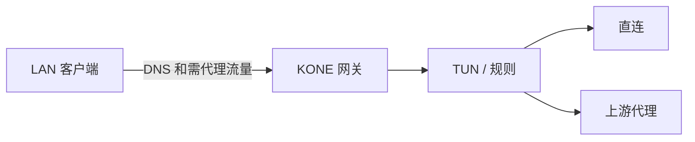

# 使用指南

KONE 将进入虚拟网卡的流量按规则交给直连、代理或拒绝出站。个人电脑使用管理界面；Linux/Raspberry Pi 网关可使用 TOML 文件模式。

## 1. 安装与打开

从 [Releases](https://github.com/xjdrew/kone/releases) 下载对应架构的包，按随附 `SHA256SUMS` 校验。

| 平台 | 包与启动方式 | 终端命令 |
| --- | --- | --- |
| Windows amd64/arm64 | 解压 ZIP，双击 `kone.exe`；可使用随附按用户安装脚本 | `kone-cli.exe` |
| macOS amd64/arm64 | 安装 PKG，打开 `Kone.app` | `kone-cli` |
| Linux amd64/arm64 | 安装 DEB，运行 `kone` | `kone` |

包未签名，macOS 未公证，系统应用信任策略仍适用。Windows 内嵌 Wintun，无需安装 TAP 或预建网卡；启用网络仍需管理员权限。64 位树莓派使用 Linux arm64，32 位网关需 [源码打包](../development/packaging.md)。

安装本身不启用代理。Windows/macOS 打开后显示托盘/菜单图标；`-no-browser` 可静默启动到托盘。关闭浏览器不停止 KONE，可从托盘重新打开管理。

## 2. 首次配置


1. 从本机托盘或程序提供的数字回环地址（例如 `http://127.0.0.1:端口`）打开页面，自动获得管理权限，无需密码。`localhost` 等名称和远端入口仍走认证流程；需要远程访问时先在“设置 → 访问”设置密码。密码至少 8 个字符，UTF-8 不超过 128 字节。
2. 在“策略 → 出站”添加已有代理的协议、服务器、端口与认证。保存后按需点“测试连接”，检查实测阶段与延迟；未测试不代表不可用。
3. 在“策略 → 规则”选择基础策略：默认直连，逐步添加代理规则；或先选择全局代理及默认出口，再添加直连/阻断例外。预览后保存，不会自动启动。
4. 在“设置 → 接管/解析”核对虚拟网段、真实出口和解析设置，避免与 LAN/VPN 冲突。首次管理配置默认准备一个 TUN，系统 DNS 引导开启；检测到可用 IPv6 时自动填写不冲突的 ULA 网段，已有配置保持原选择，代理仍停用。
5. 打开右上角“代理”开关，按平台完成授权。程序执行预检与安全残留处理；只有实际就绪才显示运行。空用户规则和内置 direct 出口可直接启用，无需额外确认。
6. 建立一条新的业务连接，在“流量 → 连接”核对规则、实际出站和结果。诊断成功不能代替应用验证。

管理设置保存在用户 profile，独立于当前目录的 `config.toml` 和终端代理环境。修改 TOML 不会自动修改管理设置；需要时从界面导入。

“检查启用条件”先显示阻断原因和对应操作，建议项不阻止启动。缺少网络管理权限时，在运行 KONE 的主机上授权并使用原 profile 重启；网页不能授予系统权限。没有代理出口或代理规则不属于阻断项。默认用户规则为空、兜底出口为 direct，不接管普通业务连接；保留 DNS 辅助，使后续域名规则可生效。“重新检查”只刷新检查结果，条件满足后仍需手工点击启用。

## 3. 日常操作

| 目的 | 操作与结果 |
| --- | --- |
| 改规则或出站 | 保存时校验；包括 CIDR 增删改在内的规则更新自动应用到新连接，旧连接保留原决定与所需路由 |
| 改 TUN、DNS、协议栈或全局路由开关 | 按提示先暂停，再保存并重新启用；停止会中断现有连接 |
| 看流量路径 | 流量总览 → 路径 → 连接详情；只包含进入 KONE 的流量 |
| 网站失败 | 连接详情 → 独立诊断 → 创建精确规则 → 用新连接验证 |
| 临时停用 | 关闭“代理”开关，恢复自有网络变更，管理仍可用 |
| 完全关闭 | 从托盘或管理退出，等待恢复完成 |

运行时开关左侧分别显示实时上传、下载速率，按 B/s、KB/s、MB/s 自动换算；断连或采样失效时显示不可用。速率按业务载荷统计，不含代理封装。首页“需要关注”按域名合并失败；连接页按目标折叠，展开可查看每条原始记录。

“已保存”和“运行版本”不同表示尚未应用或应用失败。查看提示后重试或撤销；不要重复点击启停来猜测任务结果。更详细的影响见 [配置指南](configuration.md)。

按 `Ctrl/Cmd+K` 打开命令面板，`/` 聚焦当前搜索。连接或 DNS 行的操作菜单可直接创建代理、直连或阻断规则；连接保留真实协议/端口，DNS 域名规则不虚构端口。右侧详情与底部诊断/日志保留当前工作区。

在“设置 → 界面”选择跟随系统、English 或中文；登录页也可切换。语言、主题和密度是本客户端偏好，不修改网络配置或启动代理。无匹配语言时回退 English。

## 4. 手机和平板访问

1. 在 KONE 主机打开“设置 → 访问”，从下拉列表选择本机私网 IP；需要监听所有 IPv4 接口时选择 `0.0.0.0`，包括本机已有的公网 IPv4 接口。
2. 设置端口，选择是否使用 HTTPS。HTTP 无需证书，但明文传输管理密码和数据；HTTPS 使用本地 CA 加密管理连接。
3. 首次启用先填写管理密码及确认，点击“设置密码并启用”；已有密码时直接“启用监听”。密码保存成功但监听失败时，保留配置并按错误提示重试。
4. HTTPS 启用后，在本机下载 CA，传到访问设备，核对 SHA-256 指纹并添加信任；HTTP 不展示 CA 步骤。页面“如何信任 CA”提供平台说明。
5. 在访问设备打开页面列出的实际 IP 地址，用管理密码登录并获得管理权限。`0.0.0.0` 是监听范围，不是访问地址。

修改监听范围、端口或协议后点击“应用变更”；成功切换或停止监听会撤销远程会话，失败时尽可能恢复原监听并显示当前状态。接口地址变化后停止并重新启用监听；监听仅在当前 KONE 进程内生效，重启后需手工启用。访问页可单独撤销会话，修改密码收在折叠区内。配对码已移除。

CA 信任参考：[Windows 证书存储](https://learn.microsoft.com/en-us/windows-hardware/drivers/install/trusted-root-certification-authorities-certificate-store)、[macOS 钥匙串信任设置](https://support.apple.com/en-ie/guide/keychain-access/kyca11871/mac)。KONE 不自动安装证书、修改防火墙或开放路由器端口。手机查看的是主机数据；访问管理页不会自动代理手机的其他流量。界面资源随主机提供，支持 Safari/iOS 16.4、Chrome/Android 110、Firefox 115 及以上。

## 5. CLI 与文件模式

从 [完整示例](../../configs/kone.example.toml) 创建配置。在 Linux 上：

```sh
kone -check -config config.toml
sudo kone -config config.toml
```

macOS 换用 `kone-cli`，Windows 使用 `kone-cli.exe -config config.toml`，需要时请求 UAC。`-check` 仅静态校验，不修改网络；`-version` 查看版本，`-debug` 提高日志级别。文件修改后需重启文件模式进程。

**文件模式不启动 HTTP 管理服务。** 需要持久管理时使用无参数启动或 `-manage`；`-data-dir` 指定 profile，`-listen` 指定回环管理地址。CLI 的 `-no-browser` 输出本机入口；数字回环访问会自动取得管理会话。兼容入口可能含一次性设置证明，页面在请求前移除该片段，不应转发给他人。

Windows 自动提权的原窗口退出仅表示交接，查看新管理员窗口中的运行结果，在该窗口按 `Ctrl+C` 停止。服务/无交互环境可使用 `-no-elevate`，调用方必须已具备权限。被引用出站受临时代理环境覆盖时，自动提权可能拒绝交接；改用明确 TOML 或已提权的正确环境。

## 6. Linux / Raspberry Pi 网关

前提：Linux TUN、`iproute2`、管理权限、可达的真实出口。先在一台客户端验证，再扩展到全网。



| 模式 | 客户端 / 路由器配置 | KONE 配置 |
| --- | --- | --- |
| 选择性旁路 | 例如网关 LAN 为 `192.168.10.101`，为 `10.192.0.0/16` 添加到它的静态路由；客户端 DNS 指向 `10.192.0.1` | 对需代理域名返回 Fake-IP；按需配置 CIDR |
| 全局 IPv4 | 客户端默认下一跳指向 KONE 主机，主机保留真实上游默认路由 | `core.auto-route = true`，指定真实 `outbound-interface` |

管理员负责 forwarding、LAN/TUN 转发放行、回程路由或源 NAT、DHCP 与合适的 reverse-path filtering。严格 `rp_filter` 可能丢弃回注报文，需按实际路由评估。不要删除真实默认路由或清空既有防火墙。

验证顺序：DNS 返回预期地址 → 域名 TCP → 直接 IP TCP → UDP → 拒绝规则 → 暂停后恢复。更具体的 LAN/VPN 路由仍可能优先。IPv6 需另配地址、路由、转发及防火墙；KONE 不自动发布 RA/DHCPv6 或设置 NAT66。

Docker 部署见 [容器说明](../../deploy/docker/README.md)。网关设置与主机系统 DNS 引导是两件事，后者不会自动修改 LAN 客户端。

## 7. 升级与卸载

先备份 profile，再停用代理、退出程序、替换或卸载应用。设置目录与程序分离，升级和卸载保留用户配置。回退旧版本时明确恢复兼容备份，不同时运行两个写同一 profile 的版本。

macOS 包的自有文件包括 `/Applications/Kone.app`、`/usr/local/bin/kone-cli` 和 `/usr/local/share/kone`；Windows 便携版移除应用目录，Linux 通过包管理器卸载。管理员自行配置的网关路由、DHCP 和防火墙须另行撤销。恢复失败先按 [排障指南](troubleshooting.md) 处理，再删除程序。
